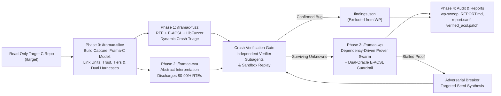

# Frama-C Agentic Verification & Hybrid Fuzzing Pipeline

An industrial-grade, multi-agent formal verification and dynamic bug-hunting framework for large C codebases (up to 100,000+ LoC), built on **Frama-C 35.0~~dev (Bromine)** (`RTE`, `Eva`, `WP`, `E-ACSL`, `MetAcsl`, `Mdr/SARIF`), **SMT Solvers** (`Alt-Ergo`, `Z3`, `CVC5`), and **Clang LibFuzzer**.

All verification tools execute inside reproducible, network-isolated containers (a **build image** for the target's own build and tests, an **analysis image** for everything else), orchestrated by modular **Agent Skills** ([`/framac-verify`](./skills/framac-verify/SKILL.md), [`/framac-slice`](./skills/framac-slice/SKILL.md), [`/framac-fuzz`](./skills/framac-fuzz/SKILL.md), [`/framac-eva`](./skills/framac-eva/SKILL.md), [`/framac-wp`](./skills/framac-wp/SKILL.md)) and deterministic Python helper scripts.

---

## How It Works



### Key Capabilities

1. **Zero-ACSL Dynamic Triage (`RTE + E-ACSL + LibFuzzer`):**
   Automatically injects ACSL runtime-error assertions (`-rte -rte-initialized`) and compiles them with E-ACSL into shadow-memory and arithmetic runtime checks linked with LibFuzzer (`e-acsl-gcc`, `-fsanitize=fuzzer`). Catches intra-struct sub-object buffer overflows, use-after-free, uninitialized reads, signed integer overflow, division by zero, invalid shifts, and functional contract violations before a single minute is spent on formal proofs.
2. **Module-Level Abstract Interpretation (`Eva`):**
   Simulates symbolic inputs (`0 .. MAX_INPUT_SIZE`) from per-module `eva_main()` harnesses to automatically discharge **80–90% of RTE assertions** without writing loop invariants.
3. **Dependency-Driven Subagent WP Swarm (`/framac-wp`):**
   A deterministic scheduler ([`./scripts/wp_scheduler.py`](./scripts/wp_scheduler.py)) dispatches a **Function Prover Subagent** (`frama-c -wp -wp-rte -wp-fct <fn>`) as soon as the function's callees are merged. Longest caller chains go first, and finished proofs merge in parallel micro-batches without global wave barriers.
4. **Dual-Oracle Anti-Hallucination Guardrail:**
   Every ACSL contract (`requires`, `assigns`, `ensures`, `loop invariant`) proposed by a subagent is compiled with **E-ACSL** and tested against the live fuzzer corpus before being passed to **WP**, preventing the LLM from passing proofs via vacuous or over-constrained preconditions (`requires \false`).
5. **Adversarial Prover-vs-Breaker Dual-Play:**
   When a WP proof stalls after `K` retries on an assertion, an **Adversarial Breaker Subagent** crafts targeted fuzzer seeds that trigger the assertion at runtime without blocking the stalled function's callers.
6. **6 Layers of Security Properties (Beyond Memory Safety):**
   - **Layer 1:** Absence of Run-Time Errors (`AoRTE` via `-rte`)
   - **Layer 2:** Termination & Anti-DoS (`loop variant`, `decreases`)
   - **Layer 3:** Memory Isolation (`assigns`, `\separated`) for every function that writes through a pointer
   - **Layer 4:** Authentication gates (MetAcsl: only the gate writes the auth state, protected functions require it)
   - **Layer 5:** Output sanitization at the threat model's sinks (no CR/LF in log text, no uninitialized byte)
   - **Layer 6:** Secrets wiped on release and never handed to an output sink

   Layers 4 to 6 come from the structured threat model in `THREAT_MODEL.md`, not from patterns in the code ([`./docs/security-properties.md`](./docs/security-properties.md)).
7. **Self-Sizing Resource Broker & Content-Addressed Caches:**
   Before every job, [`./scripts/resources.py`](./scripts/resources.py) measures available cgroups, Slurm allocations, and Docker/Podman engine limits to lease CPUs and memory per container while keeping outcome-deciding limits (`-wp-memlimit`, `-rss_limit_mb`, seeds) fixed across machines. Deterministic per-module builds, fuzzing, and Eva runs execute via Make ([`./scripts/pipeline_make.py`](./scripts/pipeline_make.py)) backed by per-run and cross-run caches ([`./docs/resources-and-caching.md`](./docs/resources-and-caching.md)).
8. **Evidence Discipline & Mechanical Validation:**
   Tool hits are fingerprinted candidates, not findings, until independently verified into `confirmed`, `needs_validation`, or `rejected` records. A deterministic coverage ledger (`function x obligation class`) tracks unconditional proofs, proofs under open assumptions, and blocked or deferred units ([`./docs/v2-design.md`](./docs/v2-design.md)).

> [!IMPORTANT]
> **Security & Isolation Boundary:** The target repository is mounted **read-only** at `/target`, and all shared JSON artifacts are schema-validated on every transition. The hardened container (`--network none`, `--cap-drop ALL`, `no-new-privileges`, default seccomp/AppArmor profiles, and CPU/memory/PID limits) is the isolation boundary. Inside the container, target-controlled binaries run through [`./scripts/sandbox_exec.py`](./scripts/sandbox_exec.py) (enforcing CPU/file/process `rlimits`, an explicit environment allowlist, and process-group timeouts). There is no separate filesystem namespace inside the container; see [`./docs/v2-design.md` (Section 3)](./docs/v2-design.md) for the residual-risk model.

---

## Prerequisites

- **Container Engine:** Docker or Podman (`FRAMAC_CONTAINER_ENGINE=auto|docker|podman`).
  - Allocate at least **4 GiB of RAM** to the container engine VM (**8 GiB+ recommended** for parallel WP and fuzzing). Tools refuse to run below their single-worker memory floor (`1768 MiB` for WP, `3072 MiB` for LibFuzzer) rather than producing starved or flaky results.
- **Host Python:** Python **3.10+** (stdlib only; used on the host by the resource broker and test suite).
- **Target C Project:** a C99/C11 source tree that builds. Phase 0 runs the target's own build (make, CMake, Meson, Ninja, autotools) under `bear` in the build image, from a recipe you give or confirm: the build command, its Debian packages, and optionally the test command. A target that does not build stops Phase 0 with `needs_build_recipe` and a diagnostic (first error, missing headers, candidate packages) until the recipe is fixed.
- **Threat model (recommended):** a structured `framac-threat-model` block in the target's `THREAT_MODEL.md` (input sources, trusted callers, secrets, auth gates, output sinks; [`./schemas/threat_model.schema.json`](./schemas/threat_model.schema.json)). Without it, trust follows the default rules and only Layer 3 properties are generated.

---

## Quickstart

### 1. Build the Container Image

From the repository root:

Two images from one multi-stage `Dockerfile`, on the same Debian release, gcc and glibc:

- the **analysis image** (`framac-analysis`) runs every Frama-C, MetAcsl, E-ACSL, fuzzing and proof step;
- the **build image** (`framac-build`) runs the target's own build and its tests.

The wrappers build either one on first use with `-BuildIfMissing` (`--build-if-missing`).

```powershell
# Windows (PowerShell)
$env:PYTHONIOENCODING="utf-8"
docker build --target framac-analysis "-t" "framac-analysis:latest" .
docker build --target framac-build "-t" "framac-build:latest" .
```

```bash
# Linux / macOS (POSIX)
docker build --target framac-analysis -t framac-analysis:latest .
docker build --target framac-build -t framac-build:latest .
```

The analysis image holds none of the target's packages. Name them in the build recipe: the build capture installs them in a derived build image (`framac-build:<repo>`) and copies the headers and libraries the build used to the run's snapshot (`workspace/snapshot/`), where the analysis image reads them.

One more image is optional: **CodeQL** (`docker build -f Dockerfile.codeql -t framac-codeql:latest .`), off by default. It adds untrusted marks from CodeQL's taint queries, and runs only when the user declares the target open source.

`-Image` (`FRAMAC_DOCKER_IMAGE`) only renames the analysis image, or the build image with `-BuildImage`. The monolithic `framac-pipeline` image is gone.

### 2. Initialize a Run and Verify the E-ACSL Canary

Use [`./wrappers/framac-docker.ps1`](./wrappers/framac-docker.ps1) on Windows or [`./wrappers/framac-docker.sh`](./wrappers/framac-docker.sh) on Linux/macOS. Passing `-NewRun` (`--new-run`) creates a fresh run directory outside the target at `~/framac-pipeline/<repo>/run-<N>/` and prints its path:

```powershell
# Windows (PowerShell)
& ".\wrappers\framac-docker.ps1" `
  -TargetDir "C:\path\to\c-project" `
  -NewRun `
  -BuildIfMissing `
  "frama-c -version && python3 /opt/framac-pipeline/scripts/sandbox_exec.py probe && python3 /opt/framac-pipeline/scripts/run_eacsl_fuzz.py selftest"
```

```bash
# Linux / macOS (POSIX)
./wrappers/framac-docker.sh \
  --target /path/to/c-project \
  --new-run \
  --build-if-missing \
  -- "frama-c -version && python3 /opt/framac-pipeline/scripts/sandbox_exec.py probe && python3 /opt/framac-pipeline/scripts/run_eacsl_fuzz.py selftest"
```

Pass the printed run directory as `-RunDir "<run-dir>"` (`--run-dir "<run-dir>"`) on subsequent commands for that run.
- `sandbox_exec.py probe` verifies the inner sandbox (`{"sandbox": "rlimits"}`).
- `run_eacsl_fuzz.py selftest` compiles and runs the built-in E-ACSL canary ([`./templates/eacsl_canary/canary.c`](./templates/eacsl_canary/canary.c)) to verify that benign inputs pass cleanly while buffer overflows and uninitialized reads are caught at runtime.
- Optional resource caps and cache settings are controlled via host environment variables (`FRAMAC_POOL_CPUS`, `FRAMAC_POOL_MEMORY`, `FRAMAC_MAX_AGENTS`, `FRAMAC_CACHE`, `FRAMAC_BROKER=off`; see [`./docs/resources-and-caching.md`](./docs/resources-and-caching.md)).

### 3. Run the Agent Skills

Invoke the skills from your AI coding assistant:

| Skill | Stage | Purpose |
| :--- | :---: | :--- |
| [`/framac-verify`](./skills/framac-verify/SKILL.md) | **All (0–4)** | **End-to-end orchestrator:** slices the codebase, fuzzes with E-ACSL, prunes with Eva, verifies crash candidates, proves surviving obligations with parallel WP subagents, and emits final reports. Supports `--profile quick\|standard\|deep`. |
| [`/framac-slice`](./skills/framac-slice/SKILL.md) | **Phase 0** | Initializes the `workspace/` shadow overlay, captures the target's build, parses each link unit with Frama-C (call graph, API, trust), records seeds from the tests, builds the DAG with link units as modules and risk tiers from trust, generates the MetAcsl security properties and dual harnesses, gates them on API reachability and on a working E-ACSL build, and seeds `coverage-ledger.json`. |
| [`/framac-fuzz`](./skills/framac-fuzz/SKILL.md) | **Phase 1** | Runs zero-ACSL `RTE + E-ACSL + Clang LibFuzzer` campaigns per module slice via Make. |
| [`/framac-eva`](./skills/framac-eva/SKILL.md) | **Phase 2** | Runs `frama-c -rte -then -eva` per module slice, discharging 80–90% of RTE checks and emitting per-slice SARIF. |
| [`/framac-wp`](./skills/framac-wp/SKILL.md) | **Phase 3** | Dispatches the dependency-driven prover swarm (`Alt-Ergo`, `Z3`, `CVC5`) via `wp_scheduler.py`, enforcing the E-ACSL Dynamic Guardrail and spawning Adversarial Breakers on stalled goals. |

---

## Run Outputs & Artifacts

Every run directory (`~/framac-pipeline/<repo>/run-<N>/`) produces a self-contained, schema-validated audit trail:

| Artifact | Description |
| :--- | :--- |
| `REPORT.md` | Executive summary: run status (`complete` or `incomplete`), confirmed vulnerabilities table, needs-validation candidates, assurance summary (unconditional vs. conditional proofs), and coverage metrics. |
| `FINDINGS-DETAIL.md` | Detailed root-cause traces, reproduction commands, and candidate fix diffs for every `confirmed` finding. |
| `NEEDS-VALIDATION.md` | Source-grounded hypotheses and unverified Eva `Invalid` alarms with concrete validation plans. |
| `report.sarif` | SARIF v2.1.0 report containing verified records (`confirmed` as `error`, `needs_validation` as `warning`) for GitHub Code Scanning / IDE integration. |
| `coverage-ledger.json` | Machine-readable ledger of every `function x obligation class` unit (`covered`, `blocked`, `candidate`, `deferred`, `out_of_scope`) and its open assumptions. |
| `findings.json` / `candidates.json` | Canonical verdict records and fingerprinted tool hits (`<file>#<function>::<kind>::<hash10>`). |
| `workspace/reports/verified_acsl.patch` | Unified diff of all pure-ACSL contracts proven during the run (applicable to the target via `workspace_overlay.py apply-in-place`). |

---

## Repository Layout

```text
frama-c/
├── Dockerfile                        # Stages framac-build (Debian trixie, build systems, bear, strace), framac-analysis
│                                     # (Frama-C 35.0~~dev, MetAcsl, E-ACSL, Alt-Ergo/Z3/CVC5, Clang/LibFuzzer), the last stage
├── Dockerfile.codeql                 # Optional CodeQL image, built from framac-build
├── docker-compose.yml                # Manual container service definition & volume mappings
├── wrappers/
│   ├── framac-docker.ps1             # Windows PowerShell wrapper (host broker, image choice, scratch volume, hardening)
│   ├── framac-docker.sh              # POSIX/Bash wrapper (same options)
│   └── codeql-derived.Dockerfile     # framac-codeql:<repo>: the target's build image plus the CodeQL CLI
├── skills/                           # Modular Agent Skills (single source of truth; .agents/skills/ and .claude/skills/ mirror them)
│   ├── framac-verify/SKILL.md        # Umbrella end-to-end orchestrator (/framac-verify)
│   ├── framac-slice/SKILL.md         # Phase 0: Slicing, Call-Graph DAG, stubs & harnesses (/framac-slice)
│   ├── framac-fuzz/SKILL.md          # Phase 1: Zero-ACSL RTE + E-ACSL + LibFuzzer triage (/framac-fuzz)
│   ├── framac-eva/SKILL.md           # Phase 2: Module-level abstract interpretation (/framac-eva)
│   └── framac-wp/                    # Phase 3: Dependency-driven parallel WP swarm (/framac-wp)
│       ├── SKILL.md
│       └── *_brief.md                # Subagent briefs (header_architect, prover, breaker, crash_verifier)
│   ├── python-patterns/SKILL.md      # Conventions for the pipeline's Python scripts
│   └── python-testing/SKILL.md       # Pytest conventions for tests/
├── scripts/                          # Stdlib-only Python 3.10+ pipeline scripts
│   ├── build_capture.py              # Phase 0: Runs the build under bear; link units, flags, API, snapshot
│   ├── phase0_model.py               # Phase 0: Frama-C parse per link unit (phase0_dump.ml), GCC fallback, optional Alias
│   ├── trust.py, codeql_trust.py     # Phase 0: Trust boundary from the build, call graph & threat model (+ optional CodeQL)
│   ├── seed_harvest.py               # Phase 0/1: Seeds recorded from the API calls the target's tests make
│   ├── build_callgraph_dag.py        # Phase 0: DAG view of the model: link-unit modules, waves, tiers, unit split
│   ├── tiers.py, unit_split.py       # Phase 0: Risk tiers from trust; split of units too large for one Eva run
│   ├── module_map.py                 # Harness modules and sub-modules mapped to their link unit
│   ├── security_props.py             # Phase 0/3: MetAcsl Layer 3-6 properties from the threat model
│   ├── generate_harness.py           # Phase 0: Dual-use Eva + LibFuzzer harness & sidecar generator
│   ├── harness_reach.py              # Phase 0/1: Harness reachability gate (static, and dynamic from coverage)
│   ├── pipeline_make.py              # Phases 1-4: Generates & runs Makefile for deterministic module work
│   ├── run_eacsl_fuzz.py             # Phase 1 & 3: E-ACSL + LibFuzzer campaigns, replays, selftest & guardrail
│   ├── run_eva_slice.py              # Phase 2: Frama-C Eva + RTE runner, read/write sets & SARIF exporter
│   ├── eva_tuning.py                 # Phase 2: Eva ladder selection, guards and per-obligation combination
│   ├── eva_options.py                # Phase 2: allowlisted Eva options and the fixed ladder
│   ├── eva_loops.py                  # Phase 2: per-loop unrolling on a scratch mirror of the sources
│   ├── kernel_ast.py                 # Frama-C kernel AST facts & call graph (with kernel_ast_dump.ml)
│   ├── function_facts.py             # Per-function prover facts (kernel AST + Eva flows) & brief assembly
│   ├── function_slice.py             # Per-function reading slice from the real compile flags
│   ├── prover_candidates.py          # A prover's best candidate across iterations
│   ├── wp_scheduler.py               # Phase 3: Dependency-driven WP task scheduler, micro-batch merges & gates
│   ├── run_wp_function.py            # Phase 3: Per-function Frama-C WP + RTE runner & goal bucketer
│   ├── contract_negotiator.py        # Phase 3: Cross-function Caller-Callee contract strengthening ledger
│   ├── workspace_overlay.py          # Shadow overlay, per-agent scratch trees, & pure-ACSL structural splicing
│   ├── acsl_ast.py                   # C/ACSL lexical analyzer & token-stream verifier
│   ├── ledger.py                     # Coverage ledger seeding, phase ingestion, & hypothesis auditing
│   ├── generate_report.py            # Phase 4: Derives REPORT.md, FINDINGS-DETAIL.md, NEEDS-VALIDATION.md, report.sarif
│   ├── resources.py, cache.py        # Host/container resource broker & content-addressed build/proof caches
│   ├── sandbox_exec.py               # Inner rlimits, environment allowlist, & process-group timeout runner
│   ├── benchmark.py, benchmark_*.py  # Repeatable benchmark: recall replay, Eva metrics, baseline comparison, brief A/B
│   └── validate_artifacts.py, ...    # Schema & semantic validators, checkpointing, fingerprinting, & shared helpers
├── schemas/                          # JSON Schemas, one per shared artifact (findings, candidates, coverage-ledger,
│                                     # run-metadata, agent-result, benchmark-run, build_capture, build_check,
│                                     # callgraph_dag, harness_reach_dynamic, harness_sidecar, phase0_model,
│                                     # security_props, seed_harvest, seed_trace, threat_model)
├── templates/
│   ├── pipeline.mk                   # Make rules for build, selftest, fuzz, eva, ingest, replay, wp-sweep, report
│   ├── harness_dual.c.template       # Dual-use Eva + LibFuzzer C harness template
│   ├── eacsl_runtime/fuzz_init.c     # LLVMFuzzerInitialize hook initializing E-ACSL shadow memory
│   ├── eacsl_canary/canary.c         # Self-test canary for `run_eacsl_fuzz.py selftest`
│   ├── fc_stubs/                     # Bodyless ACSL-annotated prototypes for third-party/host headers
│   ├── acsl/                         # ACSL vocabulary and external-function stubs
│   ├── metacsl/                      # MetAcsl meta-property templates for Layers 4-6
│   └── codeql/                       # CodeQL trust query
├── benchmark/                        # Benchmark manifest, harness assets, fixed brief sample & stored baseline
├── tests/                            # Pytest unit and integration test suite
└── docs/                             # Architecture, onboarding, security layers, caching, & reference manuals
    ├── bugs-found/                   # Public vulnerability advisories & verification reports per target
    ├── upstream/                     # Upstream Frama-C 33/34 e-acsl-gcc bug reports & workarounds
    └── references/                   # Frama-C RTE, Eva, WP, ACSL, and E-ACSL reference manuals (33.0 editions; re-extract from the 35.0 PDFs when published)
```

---

## Bugs Found

See [`./docs/bugs-found/README.md`](./docs/bugs-found/README.md) for the master vulnerability index, disclosure statuses, upstream GitHub ticket links, standalone reproducers, and candidate fix diffs across evaluated open-source C targets:

| Target | Upstream Repository | Confirmed Bugs | Details |
| :--- | :--- | :---: | :--- |
| **minmea** | [`kosma/minmea`](https://github.com/kosma/minmea) | **3** (2 Medium, 1 Low) | [`./docs/bugs-found/minmea/README.md`](./docs/bugs-found/minmea/README.md) |
| **QCBOR** | [`laurencelundblade/QCBOR`](https://github.com/laurencelundblade/QCBOR) | **3** (1 Medium, 2 Low) | [`./docs/bugs-found/qcbor/README.md`](./docs/bugs-found/qcbor/README.md) |
| **CryptoLib** | [`nasa/CryptoLib`](https://github.com/nasa/CryptoLib) | **1** (1 Medium; +1 C11 hygiene note) | [`./docs/bugs-found/cryptolib/README.md`](./docs/bugs-found/cryptolib/README.md) |
| **libmnl** | [`netfilter/libmnl`](https://git.netfilter.org/libmnl) | **5** (1 Medium, 4 Low) | [`./docs/bugs-found/libmnl/README.md`](./docs/bugs-found/libmnl/README.md) |
| **picohttpparser** | [`h2o/picohttpparser`](https://github.com/h2o/picohttpparser) | **0** (11 units proven) | [`./docs/bugs-found/picohttpparser/README.md`](./docs/bugs-found/picohttpparser/README.md) |
| **Frama-C 33.0 / 34.0~~dev (`e-acsl-gcc`)** | [`pub/frama-c`](https://git.frama-c.com/pub/frama-c/-/issues) | **10** (6 Bugs, 4 Limitations/UX) | [`./docs/upstream/frama-c-e-acsl-issues.md`](./docs/upstream/frama-c-e-acsl-issues.md) |

---

## Testing & Development

All helper scripts in `scripts/` use the Python 3.10+ standard library only and run on both Windows and POSIX hosts. To run the test suite and static checks locally:

```powershell
# Windows (PowerShell)
$env:PYTHONIOENCODING="utf-8"
python -m pytest tests
python -m ruff check scripts tests
python -m ruff format --check scripts tests
python -m mypy scripts tests
```

```bash
# Linux / macOS (POSIX)
python3 -m pytest tests
python3 -m ruff check scripts tests
python3 -m ruff format --check scripts tests
python3 -m mypy scripts tests
```

> [!NOTE]
> Edit skills only under `skills/`. The repository records the harness mirrors `.agents/skills/*` and `.claude/skills/*` as symlinks to `skills/*`. Where a checkout cannot use them (Windows with `core.symlinks=false`, where a harness needs real files), the mirror may be a real copy instead; `tests/test_extract_references.py` accepts a link, git's plain-file form of a link, or a copy, and fails when a copy differs from `skills/` by a single byte.

---

## Documentation Index

- [Bugs Found & Target Verification Reports (`./docs/bugs-found/README.md`)](./docs/bugs-found/README.md)
- [Architecture & Dataflow (`./docs/architecture.md`)](./docs/architecture.md)
- [Slicing & Onboarding 90k+ LoC Codebases (`./docs/slicing-and-onboarding.md`)](./docs/slicing-and-onboarding.md)
- [Phase 0 Redesign & Implementation Plan (`./docs/phase0-redesign.md`, `./docs/phase0-implementation-plan.md`)](./docs/phase0-implementation-plan.md)
- [Phase 0 Redesign: Effects on the Other Phases (`./docs/phase0-downstream-effects.md`)](./docs/phase0-downstream-effects.md)
- [Plans & Reviews: Remediation Plan, Phase 0 Remediation, Phase 1 Review & Remediation (`./docs/remediation-plan.md`, `./docs/phase0-remediation-plan.md`, `./docs/phase1-review.md`, `./docs/phase1-remediation-plan.md`)](./docs/remediation-plan.md)
- [Proving Security Properties Beyond Memory Safety (`./docs/security-properties.md`)](./docs/security-properties.md)
- [Multi-Agent Swarm & Dual-Oracle Guardrail (`./docs/agentic-swarm.md`)](./docs/agentic-swarm.md)
- [Resources, Scheduling & Caching (`./docs/resources-and-caching.md`)](./docs/resources-and-caching.md)
- [Pipeline v2 Design & Evidence Discipline (`./docs/v2-design.md`)](./docs/v2-design.md)
- [Implementation Backlog & Verification Checklist (`./docs/backlog.md`)](./docs/backlog.md)
- [Benchmark: Measuring Changes to Filters, Eva Configuration & Briefs (`./docs/benchmark.md`)](./docs/benchmark.md)
- [Troubleshooting Guide (`./docs/troubleshooting.md`)](./docs/troubleshooting.md)
- [Upstream Frama-C 33.0 / 34.0~~dev E-ACSL & Variadic Issues (`./docs/upstream/frama-c-e-acsl-issues.md`)](./docs/upstream/frama-c-e-acsl-issues.md)
- [Frama-C Reference Manuals (`./docs/references/README.md`)](./docs/references/README.md) & [E-ACSL Quick Reference (`./docs/references/e-acsl-quickref.md`)](./docs/references/e-acsl-quickref.md)
- [Third-Party Header Stubs Guide (`./templates/fc_stubs/README.md`)](./templates/fc_stubs/README.md)
