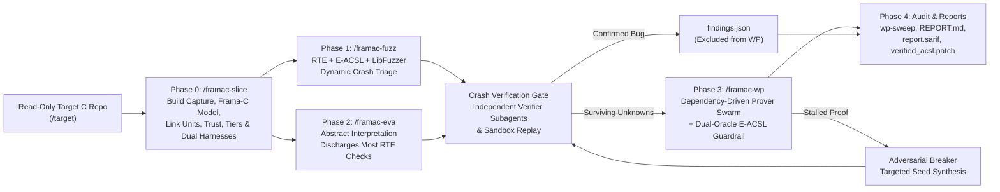

# Frama-C Agentic Verification & Hybrid Fuzzing Pipeline

A multi-agent pipeline that hunts bugs in C code and proves what it can about the rest. It is built on **Frama-C 34.0~beta (Selenium)** (`RTE`, `Eva`, `WP`, `E-ACSL`, `MetAcsl`, `Mdr/SARIF`), **SMT Solvers** (`Alt-Ergo`, `Z3`, `CVC5`), and **Clang LibFuzzer**.

Give it a C project that builds, and it:

- fuzzes the project's API with runtime checks generated from the C semantics, without any annotations from you;
- proves the absence of runtime errors with abstract interpretation and LLM-written ACSL contracts;
- has an independent agent check every crash before it is reported as a bug;
- states exactly what was proven, under which assumptions, and what was not.

All verification tools execute inside reproducible, network-isolated containers (a **build image** for the target's own build and tests, an **analysis image** for everything else), orchestrated by modular **Agent Skills** ([`/framac-verify`](./skills/framac-verify/SKILL.md), [`/framac-slice`](./skills/framac-slice/SKILL.md), [`/framac-fuzz`](./skills/framac-fuzz/SKILL.md), [`/framac-eva`](./skills/framac-eva/SKILL.md), [`/framac-wp`](./skills/framac-wp/SKILL.md)) and deterministic Python helper scripts.

---

## Project Status

The pipeline is under active development and is tested on real open-source libraries. It has found bugs that were reported upstream ([Bugs Found](#bugs-found)), and it has produced 39 bug reports against Frama-C itself. **Complete proof coverage is not yet the usual outcome:** the latest supervised run of each target below stopped before reaching `complete`.

| Target and run | Profile | How it ended | Result |
| :--- | :---: | :--- | :--- |
| [libmodbus run-1](./docs/runs/2026-11-18-libmodbus-run1-supervision.md) (2026-11-18) | `standard` | `incomplete` after 16 h 05 min | 87 of 215 units covered, none unconditionally. All 35 candidates verified, with no defect worth reporting upstream. |
| [mpack run-4](./docs/runs/2026-11-17-mpack-run4-supervision.md) (2026-11-17) | `standard` | Paused in Phase 3 when the driving model ran out of context | Phases 0 to 2 finished on 476 functions. The confirmed findings at the pause are in an example program, not the library. |
| [c-ares run-1](./docs/runs/2026-11-16-c-ares-run1-supervision.md) (2026-11-16) | `standard` | `incomplete` after 21 h 09 min, stopped by the user in Phase 3 | 13 of 1,942 units covered. Eva timed out on 4 modules. The 20 pipeline fixes it led to were merged too late to help this run. |
| [QCBOR run-6](./docs/runs/2026-11-14-qcbor-run6-supervision.md) (2026-11-14) | `deep` | `incomplete` after 11 h 36 min | Eva discharged 91.67% of its checks. [15 of 16 confirmed records were real](./docs/runs/2026-11-15-qcbor-run6-findings-assessment.md), and they come down to 7 distinct defects. |
| [minmea run-1](./docs/runs/2026-11-14-minmea-run1-supervision.md) (2026-11-14) | `standard` | `incomplete` | 3 confirmed findings, 1 needs validation, 19 of 37 units blocked. |

These results describe the pipeline as it was on each date. Fixes from each run have landed since. Earlier campaigns are recorded in [`./docs/bugs-found/README.md`](./docs/bugs-found/README.md), including picohttpparser, where 11 units were proven and no bug was found.

### What to Expect

- **Review the findings.** A `confirmed` verdict means a replayed failure that an independent agent attributed to the target. It can still be wrong: libmodbus's one confirmed finding turned out to be documented behaviour.
- **Read proofs with their assumptions.** A `covered` unit can rest on open assumptions, such as unverified callers or stub contracts. `REPORT.md` separates unconditional proofs from conditional ones.
- **Plan for long runs.** The libmodbus, c-ares and QCBOR runs above took 11 to 21 hours each, and a run uses many LLM subagents.
- **Treat size as a design goal.** The architecture targets codebases of about 100,000 lines, but no run in the table reached `complete`, including c-ares (1,942 ledger units) and QCBOR (755 functions).
- **Eva results vary by target.** On the modules it finished in recent runs, Eva discharged 73% to 93% of the runtime-error checks. Some modules time out instead.
- **Known defects are recorded.** Open pipeline bugs are marked `**Open pipeline bug:**` in [`./docs/troubleshooting/`](./docs/troubleshooting/README.md).

---

## How It Works



### Capabilities

**Understanding the target (Phase 0)**

1. **Build capture.** Runs the target's own build (make, CMake, Meson, Ninja, autotools) under `bear`, and takes its link units, per-file flags, API and headers from what the build really did.
2. **Frama-C model and trust boundary.** Parses every link unit into a call graph with direct and indirect edges. It marks attacker-reachable functions from the build, the call graph and your threat model, and optionally from CodeQL taint queries. A unit Frama-C cannot parse falls back to GCC's call graph and is fuzzed with the sanitizers only.
3. **Generated harnesses.** Writes one dual-use harness per module for Eva and LibFuzzer, with cases for exported functions, public header functions, object lifecycles and the target's own variadic call sites. Gates check that each harness reaches the API and builds under E-ACSL.
4. **Seeds from what the target already has.** Records the API calls the target's tests make, imports the fuzz corpora it ships, and turns its C fuzz targets into extra fuzzed modules.
5. **Contracts for external libraries.** Generates contract skeletons for functions declared in host headers. A subagent fills them in, and ABI, Eva and runtime checks test them against the real library.

**Finding bugs (Phases 1 and 2)**

6. **Zero-ACSL dynamic triage.** Injects runtime-error assertions (`-rte -rte-initialized`), compiles them with E-ACSL into shadow-memory and arithmetic checks, and fuzzes with LibFuzzer alongside an ASan and UBSan build. It catches intra-struct overflows, use-after-free, uninitialized reads, signed overflow, division by zero and invalid shifts.
7. **Module-level abstract interpretation.** Runs Eva from each harness's `eva_main()` without hand-written loop invariants. A fixed tuning ladder and [case-level sharding](./docs/guides/eva-sharding.md) handle modules that are imprecise or slow.
8. **Independent crash verification.** Every tool hit is a fingerprinted candidate until a fresh Crash Verifier subagent replays it in the sandbox and audits it against the API's documented preconditions. Verdicts are `confirmed`, `needs_validation` or `rejected`, and each rejection records its class, such as `harness_induced` or `toolchain_artifact`.

**Proving properties (Phase 3)**

9. **Dependency-driven prover swarm.** A deterministic scheduler ([`./scripts/wp_scheduler.py`](./scripts/wp_scheduler.py)) dispatches a **Function Prover Subagent** as soon as the function's callees have contracts it can see. Longest caller chains go first, and finished proofs merge in parallel micro-batches.
10. **Dual-oracle guardrail.** Every contract a subagent proposes is compiled with **E-ACSL** and replayed on the fuzzer corpus before **WP** sees it, so a precondition that real inputs violate is rejected. Smoke tests then catch contradictory contracts, and mechanical checks refuse `admit`, axioms and any change to the C code.
11. **Adversarial breakers and contract negotiation.** When a proof stalls after its retry limit, a **Breaker Subagent** crafts fuzzer seeds aimed at the unproven goal, without blocking the function's callers. Callers can ask callees for stronger contracts through a negotiation ledger.
12. **Prover context.** Prover briefs carry deterministic facts: a per-function reading slice, frame skeletons, loop templates, a retrieved ACSL knowledge base and known dead ends. Proofs from earlier runs carry forward once they are re-proven on the current code.
13. **Six layers of security properties:**
    - **Layer 1:** Absence of Run-Time Errors (`AoRTE` via `-rte`)
    - **Layer 2:** Termination & Anti-DoS (`loop variant`, `decreases`)
    - **Layer 3:** Memory Isolation (`assigns`, `\separated`) for every function that writes through a pointer
    - **Layer 4:** Authentication gates (MetAcsl: only the gate writes the auth state, protected functions require it)
    - **Layer 5:** Output sanitization at the threat model's sinks (no CR/LF in log text, no uninitialized byte)
    - **Layer 6:** Secrets wiped on release and never handed to an output sink

    Layers 4 to 6 come from the structured threat model in `THREAT_MODEL.md`, not from patterns in the code ([`./docs/guides/security-properties.md`](./docs/guides/security-properties.md)).

**Running and measuring it**

14. **Self-sizing resources and caches.** Before every job, [`./scripts/resources.py`](./scripts/resources.py) measures cgroups, Slurm allocations and Docker/Podman limits to lease CPUs and memory, while limits that decide outcomes (`-wp-memlimit`, `-rss_limit_mb`, seeds) stay fixed across machines. Deterministic per-module work runs through Make ([`./scripts/pipeline_make.py`](./scripts/pipeline_make.py)) with per-run and cross-run caches ([`./docs/guides/resources-and-caching.md`](./docs/guides/resources-and-caching.md)).
15. **Evidence discipline.** A deterministic coverage ledger (`function x obligation class`) tracks unconditional proofs, proofs under open assumptions, and blocked or deferred units ([`./docs/guides/v2-design.md`](./docs/guides/v2-design.md)).
16. **Repeatable benchmark.** Measures a pipeline change against recorded bugs, comparison targets and seeded-bug projects ([`./docs/guides/benchmark.md`](./docs/guides/benchmark.md)). Separate tools score specification quality by mutation (`mutation_check.py`) and count the goals a finished run left unproved (`wp_residual_census.py`).

> [!IMPORTANT]
> **Security & Isolation Boundary:** The target repository is mounted **read-only** at `/target`, and all shared JSON artifacts are schema-validated on every transition. The hardened container (`--network none`, `--cap-drop ALL`, `no-new-privileges`, default seccomp/AppArmor profiles, and CPU/memory/PID limits) is the isolation boundary. Inside the container, target-controlled binaries run through [`./scripts/sandbox_exec.py`](./scripts/sandbox_exec.py) (enforcing CPU/file/process `rlimits`, an explicit environment allowlist, and process-group timeouts). There is no separate filesystem namespace inside the container, so deliberately hostile targets are out of scope; see [`./docs/guides/v2-design.md` (Section 3)](./docs/guides/v2-design.md) for the residual-risk model.

---

## Prerequisites

- **Container Engine:** Docker or Podman (`FRAMAC_CONTAINER_ENGINE=auto|docker|podman`).
  - Allocate at least **4 GiB of RAM** to the container engine VM (**8 GiB+ recommended** for parallel WP and fuzzing). Tools refuse to run below their single-worker memory floor (`1768 MiB` for WP, `3072 MiB` for LibFuzzer) rather than producing starved or flaky results.
- **AI coding agent:** a harness that loads skills and can spawn subagents. Skills are mirrored for Claude Code (`.claude/skills/`) and for harnesses that read `.agents/skills/`, and recent runs were driven from opencode. Phases 0 and 3 need the agent. Phases 1 and 2 run through Make.
- **Platform:** **x86_64 Linux containers only.** The host must be x86_64, and the target's build must produce x86_64 code. A host of another architecture, or a build with `-m32`, `-mx32` or a cross compiler, stops Phase 0 with `unsupported_architecture` and instructions (see [Troubleshooting](./docs/troubleshooting/phase0-build-and-model.md)). Other architectures are not supported yet.
- **Host Python:** Python **3.10+** (stdlib only; used on the host by the resource broker and test suite).
- **Target C Project:** a C99/C11 source tree that builds. Phase 0 runs the target's own build (make, CMake, Meson, Ninja, autotools) under `bear` in the build image, from a recipe you give or confirm: the build command, its Debian packages, and optionally the test command. A target that does not build stops Phase 0 with `needs_build_recipe` and a diagnostic (first error, missing headers, candidate packages) until the recipe is fixed.
- **Threat model (recommended):** a structured `framac-threat-model` block in the target's `THREAT_MODEL.md` (input sources, trusted callers, secrets, auth gates, output sinks; [`./schemas/threat_model.schema.json`](./schemas/threat_model.schema.json)). Without it, trust follows the default rules and only Layer 3 properties are generated.

---

## Quickstart

### 1. Build the Container Image

From the repository root:

Two images from one multi-stage `Dockerfile`, on the same Debian release, gcc and glibc:

- the **analysis image** (`framac-analysis`) runs every Frama-C, MetAcsl, E-ACSL, fuzzing and proof step;
- the **build image** (`framac-build`) runs the target's own build and its tests.

The wrappers build either one on first use with `-BuildIfMissing` (`--build-if-missing`).

```powershell
# Windows (PowerShell)
$env:PYTHONIOENCODING="utf-8"
docker build --target framac-analysis "-t" "framac-analysis:latest" .
docker build --target framac-build "-t" "framac-build:latest" .
```

```bash
# Linux / macOS (POSIX)
docker build --target framac-analysis -t framac-analysis:latest .
docker build --target framac-build -t framac-build:latest .
```

The analysis image holds none of the target's packages. Name them in the build recipe: the build capture installs them in a derived build image (`framac-build:<repo key>`) and copies the headers and libraries the build used to the run's snapshot (`workspace/snapshot/`), where the analysis image reads them.

One more image is optional: **CodeQL** (`docker build -f Dockerfile.codeql -t framac-codeql:latest .`), off by default. It adds untrusted marks from CodeQL's taint queries, and runs only when the user declares the target open source.

`-Image` (`FRAMAC_DOCKER_IMAGE`) only renames the analysis image, or the build image with `-BuildImage`. The monolithic `framac-pipeline` image is gone.

### 2. Initialize a Run and Verify the E-ACSL Canary

Use [`./wrappers/framac-docker.ps1`](./wrappers/framac-docker.ps1) on Windows or [`./wrappers/framac-docker.sh`](./wrappers/framac-docker.sh) on Linux/macOS. Passing `-NewRun` (`--new-run`) creates a fresh run directory outside the target at `~/framac-pipeline/<repo>/run-<N>/` and prints its path:

```powershell
# Windows (PowerShell)
& ".\wrappers\framac-docker.ps1" `
  -TargetDir "C:\path\to\c-project" `
  -NewRun `
  -BuildIfMissing `
  "frama-c -version && python3 /opt/framac-pipeline/scripts/sandbox_exec.py probe && python3 /opt/framac-pipeline/scripts/run_eacsl_fuzz.py selftest"
```

```bash
# Linux / macOS (POSIX)
./wrappers/framac-docker.sh \
  --target /path/to/c-project \
  --new-run \
  --build-if-missing \
  -- "frama-c -version && python3 /opt/framac-pipeline/scripts/sandbox_exec.py probe && python3 /opt/framac-pipeline/scripts/run_eacsl_fuzz.py selftest"
```

Pass the printed run directory as `-RunDir "<run-dir>"` (`--run-dir "<run-dir>"`) on subsequent commands for that run.
- `sandbox_exec.py probe` verifies the inner sandbox (`{"sandbox": "rlimits"}`).
- `run_eacsl_fuzz.py selftest` compiles and runs the built-in E-ACSL canary ([`./templates/eacsl_canary/canary.c`](./templates/eacsl_canary/canary.c)) to verify that benign inputs pass cleanly while buffer overflows and uninitialized reads are caught at runtime.
- Optional resource caps and cache settings are controlled via host environment variables (`FRAMAC_POOL_CPUS`, `FRAMAC_POOL_MEMORY`, `FRAMAC_MAX_AGENTS`, `FRAMAC_CACHE`, `FRAMAC_BROKER=off`; see [`./docs/guides/resources-and-caching.md`](./docs/guides/resources-and-caching.md)).

### 3. Run the Agent Skills

Invoke the skills from your AI coding assistant:

| Skill | Stage | Purpose |
| :--- | :---: | :--- |
| [`/framac-verify`](./skills/framac-verify/SKILL.md) | **All (0–4)** | **End-to-end orchestrator:** slices the codebase, fuzzes with E-ACSL, prunes with Eva, verifies crash candidates, proves surviving obligations with parallel WP subagents, and emits final reports. Supports `--profile quick\|standard\|deep`. |
| [`/threat-model`](./skills/threat-model/SKILL.md) | **Before Phase 0** | **Source-backed threat model of the target:** understands it from its documentation and build files, inventories every file with coverage receipts, classes every exported function, traces data flows, states what can go wrong and which property rules it out, has an independent reviewer challenge the result, and ends `ThreatModel.md` with the validated `framac-threat-model` block that Phase 0 takes through `--threat-model`. Reports no vulnerability and never changes the target. |
| [`/framac-slice`](./skills/framac-slice/SKILL.md) | **Phase 0** | Initializes the `workspace/` shadow overlay, captures the target's build, parses each link unit with Frama-C (call graph, API, trust), records seeds from the tests, imports the fuzz targets and corpora the target ships, builds the DAG with link units as modules and risk tiers from trust, generates the MetAcsl security properties and dual harnesses, gates them on API reachability and on a working E-ACSL build, and seeds `coverage-ledger.json`. |
| [`/framac-fuzz`](./skills/framac-fuzz/SKILL.md) | **Phase 1** | Runs zero-ACSL `RTE + E-ACSL + Clang LibFuzzer` campaigns per module slice via Make. |
| [`/framac-eva`](./skills/framac-eva/SKILL.md) | **Phase 2** | Runs `frama-c -rte -then -eva` per module slice, separates Invalid, Unknown and dead code, and emits per-slice SARIF. |
| [`/framac-wp`](./skills/framac-wp/SKILL.md) | **Phase 3** | Dispatches the dependency-driven prover swarm (`Alt-Ergo`, `Z3`, `CVC5`) via `wp_scheduler.py`, enforcing the E-ACSL Dynamic Guardrail and spawning Adversarial Breakers on stalled goals. |
| [`/run-supervisor`](./skills/run-supervisor/SKILL.md) | **Any (host-side)** | **Read-only supervisor of a live run:** polls progress, containers and the opencode transcript, triages stalls and failures, has fixer subagents reproduce and fix pipeline bugs in isolated worktrees with a failing regression test first, records troubleshooting entries and upstream drafts, and writes a supervision report. Never steers or stops the run, never pushes. |
| [`/paper-assessment`](./skills/paper-assessment/SKILL.md) | **None (planning)** | **Research papers to a ranked plan:** reads each paper with a stated coverage, weighs its evidence, generalizes its mechanisms, maps them onto the scripts and briefs, drops what the pipeline's rules exclude or earlier trials closed, has one independent challenger attack the rest, and writes a ranked plan under `docs/plans/` plus a row per paper in [`papers-assessed.md`](./docs/plans/papers-assessed.md). Changes no pipeline code. |

Profiles change how much work a run does, never the evidence a finding or proof needs:

| Profile | Scope | Fuzz budget per harness case (cap per link unit) | Prover budget per function | Retries before a breaker |
| :--- | :--- | :---: | :---: | :---: |
| `quick` | Phases 0 to 2, crash verification, and WP on Tier 1A entry chains only. Tier 3 is deferred. | 60 CPU-s (480) | 600 s | 2 |
| `standard` (default) | All phases. Tier 3 modules get Eva and `rte` WP, without fuzzing. | 120 CPU-s (1200) | 900 s | 4 |
| `deep` | The same scope as `standard`, with larger budgets. | 900 CPU-s (7200) | 1800 s | 6 |

---

## Run Outputs & Artifacts

Every run directory (`~/framac-pipeline/<repo>/run-<N>/`) produces a self-contained, schema-validated audit trail:

| Artifact | Description |
| :--- | :--- |
| `REPORT.md` | Executive summary: run status (`complete` or `incomplete`), confirmed vulnerabilities table, needs-validation candidates, assurance summary (unconditional vs. conditional proofs), and coverage metrics. |
| `FINDINGS-DETAIL.md` | Detailed root-cause traces, reproduction commands, and candidate fix diffs for every `confirmed` finding. |
| `NEEDS-VALIDATION.md` | Source-grounded hypotheses and unverified Eva `Invalid` alarms with concrete validation plans. |
| `report.sarif` | SARIF v2.1.0 report containing verified records for GitHub Code Scanning / IDE integration. `confirmed` records map by severity (critical and high to `error`, medium to `warning`, low to `note`), and `needs_validation` records are `warning`. |
| `coverage-ledger.json` | Machine-readable ledger of every `function x obligation class` unit (`covered`, `blocked`, `candidate`, `deferred`, `out_of_scope`) and its open assumptions. |
| `findings.json` / `candidates.json` | Canonical verdict records and fingerprinted tool hits (`<file>#<function>::<kind>::<hash10>`). |
| `workspace/reports/verified_acsl.patch` | Unified diff of all pure-ACSL contracts proven during the run (applicable to the target via `workspace_overlay.py apply-in-place`). |

---

## Repository Layout

```text
frama-c/
├── Dockerfile                  # Stages framac-build, framac-opam (Frama-C, MetAcsl, Why3, Alt-Ergo) and framac-analysis
├── Dockerfile.codeql           # Optional CodeQL image, built from framac-build
├── opam/                       # Local opam repository: Frama-C and MetAcsl releases not yet in opam-repository
├── wrappers/                   # framac-docker.ps1 / .sh (broker, image choice, hardening), CodeQL derived image
├── skills/                     # Agent Skills (single source of truth; .agents/skills/ and .claude/skills/ mirror them)
│   ├── framac-verify/          # End-to-end orchestrator
│   ├── framac-slice/           # Phase 0, with the stub author brief
│   ├── framac-fuzz/            # Phase 1
│   ├── framac-eva/             # Phase 2
│   ├── framac-wp/              # Phase 3, with the architect, prover, breaker and crash verifier briefs
│   ├── run-supervisor/         # Read-only supervisor of a live run
│   ├── threat-model/           # Source-backed threat model for Phase 0's --threat-model
│   ├── paper-assessment/       # Research papers to a ranked improvement plan
│   └── python-patterns/, python-testing/   # Conventions for scripts/ and tests/
├── scripts/                    # Stdlib-only Python 3.10+ pipeline scripts, the main ones by phase:
│   │                           # Phase 0: build_capture, phase0_model, trust, codeql_trust, seed_harvest, fuzz_assets,
│   │                           #   variadic_calls, build_callgraph_dag, tiers, unit_split, security_props, stub_gen,
│   │                           #   stub_check, generate_harness, api_harness, harness_reach, phase0_gates
│   │                           # Phase 1: run_eacsl_fuzz, fuzz_build, fuzz_coverage, fuzz_dictionary, crash_replay
│   │                           # Phase 2: run_eva_slice, eva_tuning, eva_options, eva_loops, eva_shards
│   │                           # Phase 3: wp_scheduler, run_wp_function, workspace_overlay, acsl_ast, contract_negotiator,
│   │                           #   function_facts, function_slice, frame_skeleton, spec_kb, proof_carry,
│   │                           #   decision_point_check
│   │                           # Phase 4: ledger, validate_artifacts, generate_report
│   │                           # Measurement: benchmark*, mutation_check, wp_residual_census
│   └──                         # Infrastructure: pipeline_make, resources, cache, sandbox_exec
├── schemas/                    # JSON Schemas, one per shared artifact
├── templates/                  # pipeline.mk, the dual harness template, E-ACSL runtime and canary, fc_stubs/, acsl/,
│                               # metacsl/ (Layers 4-6) and codeql/
├── benchmark/                  # Benchmark manifest, harness assets, fixed brief sample & stored baseline
├── tests/                      # Pytest unit and integration test suite
├── tools/                      # Repository guardrails, skill mirror sync, and upstream filing tools
└── docs/                       # Documentation hub
    ├── guides/                 # How the pipeline works today
    ├── troubleshooting/        # Symptom, cause and fix catalogs
    ├── plans/                  # Active engineering plans, backlog & archive
    ├── runs/                   # Chronological target run logs and postmortems
    ├── bugs-found/             # Confirmed target vulnerabilities, per target
    ├── upstream/               # Upstream bug drafts, filing packages & source references
    └── references/             # Frama-C RTE, Eva, WP, ACSL and E-ACSL reference manuals (33.0 editions)
```

---

## Bugs Found

See [`./docs/bugs-found/README.md`](./docs/bugs-found/README.md) for the master vulnerability index, disclosure statuses, upstream ticket links, standalone reproducers, and candidate fix diffs across evaluated open-source C targets:

| Target | Upstream Repository | Confirmed Bugs | Details |
| :--- | :--- | :---: | :--- |
| **minmea** | [`kosma/minmea`](https://github.com/kosma/minmea) | **4** (2 Medium, 2 Low) | [`./docs/bugs-found/minmea/README.md`](./docs/bugs-found/minmea/README.md) |
| **QCBOR** | [`laurencelundblade/QCBOR`](https://github.com/laurencelundblade/QCBOR) | **3** (1 Medium, 2 Low) | [`./docs/bugs-found/qcbor/README.md`](./docs/bugs-found/qcbor/README.md) |
| **CryptoLib** | [`nasa/CryptoLib`](https://github.com/nasa/CryptoLib) | **1** (1 Medium; +1 C11 hygiene note) | [`./docs/bugs-found/cryptolib/README.md`](./docs/bugs-found/cryptolib/README.md) |
| **libmnl** | [`netfilter/libmnl`](https://git.netfilter.org/libmnl) | **5** (1 Medium, 4 Low) | [`./docs/bugs-found/libmnl/README.md`](./docs/bugs-found/libmnl/README.md) |
| **picohttpparser** | [`h2o/picohttpparser`](https://github.com/h2o/picohttpparser) | **0** (11 units proven) | [`./docs/bugs-found/picohttpparser/README.md`](./docs/bugs-found/picohttpparser/README.md) |

The QCBOR reviews of run-5 and run-6 also produced 10 upstream report packages, listed in [`./docs/upstream/qcbor/README.md`](./docs/upstream/qcbor/README.md).

Building and running the pipeline also exposed defects in the tools it depends on. As of 2026-11-18, **39 reports** are filed against [`pub/frama-c`](https://git.frama-c.com/pub/frama-c/-/issues) (#2793 to #2831). Two more are drafted for Frama-C, and one for MetAcsl (`pub/meta`). See [`./docs/upstream/frama-c/README.md`](./docs/upstream/frama-c/README.md).

---

## Testing & Development

All helper scripts in `scripts/` use the Python 3.10+ standard library only and run on both Windows and POSIX hosts. To run the test suite and static checks locally:

```powershell
# Windows (PowerShell)
$env:PYTHONIOENCODING="utf-8"
python -m pytest tests -n auto
python -m ruff check scripts tests
python -m ruff format --check scripts tests
python -m mypy scripts tests
```

```bash
# Linux / macOS (POSIX)
python3 -m pytest tests -n auto
python3 -m ruff check scripts tests
python3 -m ruff format --check scripts tests
python3 -m mypy scripts tests
```

`-n auto` runs the tests in parallel (pytest-xdist); see [`tests/README.md`](./tests/README.md).

> [!NOTE]
> Edit skills only under `skills/`. The harness mirrors `.agents/skills/` and `.claude/skills/` are plain tracked copies of it (no symlinks). After an edit, run `python tools/sync_skill_mirrors.py` to refresh both. The pre-commit hook, CI and `tests/test_sync_skill_mirrors.py` run `python tools/sync_skill_mirrors.py --check`, which fails when a mirror differs from `skills/` by a single byte.

---

## Documentation Index

Start at [`./docs/README.md`](./docs/README.md) for the full documentation map and [`./docs/AGENTS.md`](./docs/AGENTS.md) for maintenance rules:

- **Core Living Guides ([`./docs/guides/README.md`](./docs/guides/README.md)):**
  - [Architecture & Dataflow (`./docs/guides/architecture.md`)](./docs/guides/architecture.md)
  - [Pipeline v2 Design & Evidence Discipline (`./docs/guides/v2-design.md`)](./docs/guides/v2-design.md)
  - [Slicing & Onboarding Large Codebases (`./docs/guides/slicing-and-onboarding.md`)](./docs/guides/slicing-and-onboarding.md)
  - [Proving Security Properties Beyond Memory Safety (`./docs/guides/security-properties.md`)](./docs/guides/security-properties.md)
  - [Multi-Agent Swarm & Dual-Oracle Guardrail (`./docs/guides/agentic-swarm.md`)](./docs/guides/agentic-swarm.md)
  - [Resources, Scheduling & Caching (`./docs/guides/resources-and-caching.md`)](./docs/guides/resources-and-caching.md)
  - [Eva Sharding (`./docs/guides/eva-sharding.md`)](./docs/guides/eva-sharding.md)
  - [Benchmark: Measuring Changes to Filters, Eva Configuration & Briefs (`./docs/guides/benchmark.md`)](./docs/guides/benchmark.md)
- **Troubleshooting ([`./docs/troubleshooting/README.md`](./docs/troubleshooting/README.md)):** thematic operational runbooks and [`./docs/troubleshooting/AGENTS.md`](./docs/troubleshooting/AGENTS.md)
- **Bugs Found & Target Verification Reports ([`./docs/bugs-found/README.md`](./docs/bugs-found/README.md))**
- **Upstream Reports & Reference Sources ([`./docs/upstream/README.md`](./docs/upstream/README.md)):** [Frama-C E-ACSL & Variadic Issues (`./docs/upstream/frama-c/frama-c-e-acsl-issues.md`)](./docs/upstream/frama-c/frama-c-e-acsl-issues.md), [QCBOR Reports (`./docs/upstream/qcbor/README.md`)](./docs/upstream/qcbor/README.md), and [Vendored Upstream Sources (`./docs/upstream/sources/README.md`)](./docs/upstream/sources/README.md)
- **Engineering Plans & Backlog ([`./docs/plans/README.md`](./docs/plans/README.md)):** [Implementation Backlog (`./docs/plans/backlog.md`)](./docs/plans/backlog.md), active roadmaps, formal-discovery tiers, and archived Phase 0 plans
- **Run Logs & Postmortems ([`./docs/runs/README.md`](./docs/runs/README.md))**
- **Frama-C Reference Manuals ([`./docs/references/README.md`](./docs/references/README.md)):** [E-ACSL Quick Reference (`./docs/references/e-acsl-quickref.md`)](./docs/references/e-acsl-quickref.md) & [`INDEX.md`](./docs/references/INDEX.md)
- **Third-Party Header Stubs Guide ([`./templates/fc_stubs/README.md`](./templates/fc_stubs/README.md))**
