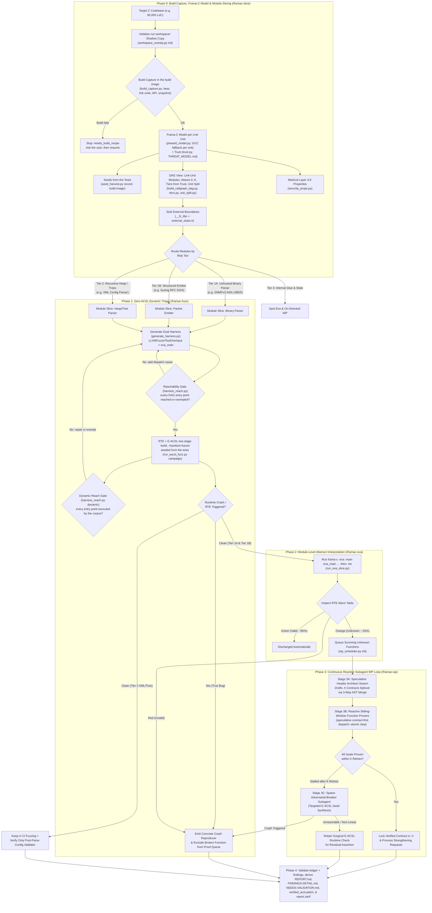
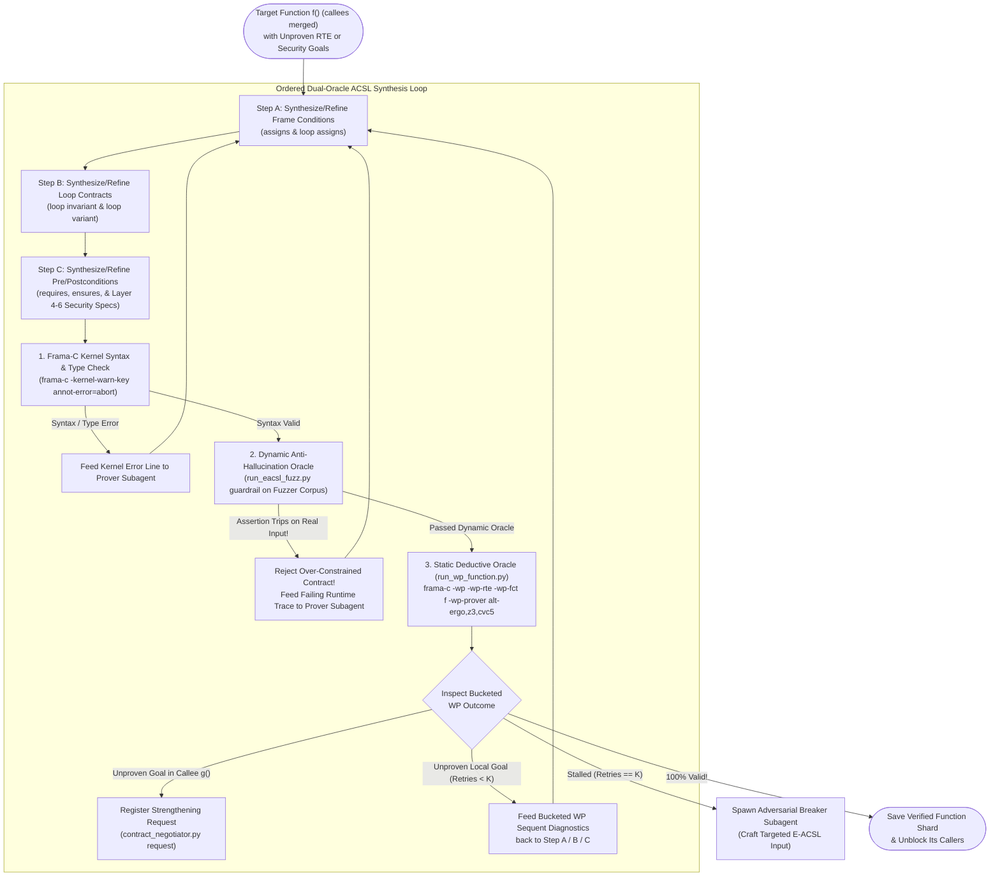

# Pipeline Architecture & Dataflow

This document details the macro-level and micro-level architecture of the Frama-C Agentic Verification Pipeline, how the four plugins (**RTE**, **E-ACSL**, **Eva**, and **WP**) collaborate on a shared AST, and how artifacts flow across phases.

---

## 1. Collaborative Role of Each Frama-C Plugin

| Plugin | Role in Pipeline | Input | Output |
| :--- | :--- | :--- | :--- |
| **RTE (`-rte`)** | **Syntactic Proof-Obligation Generator.** Scans the C AST and inserts explicit ACSL `/*@ assert rte: ...; */` annotations at every potential runtime error (signed/unsigned overflow, `\valid` / `\valid_read` pointer dereference, division by zero, bitshift bounds, float-to-int cast, function pointer call). | Raw C AST | Annotated C AST with numbered RTE assertions |
| **E-ACSL (`-e-acsl`)** | **Executable Contract Compiler & Dynamic Oracle.** Translates ACSL assertions, preconditions, postconditions, loop invariants, and ghost state into runtime C instrumentation backed by shadow memory. Paired with Clang `-fsanitize=fuzzer`. | C AST + RTE / ACSL annotations | Instrumented C binary (`fuzz_runner`) that aborts on any UB or contract violation |
| **Eva (`-eva`)** | **Whole-Slice Abstract Interpreter.** Propagates value intervals, octagons, and symbolic pointer locations from a module's `eva_main()` harness without requiring user-written loop invariants. Automatically proves 80–90% of RTE assertions (`Valid`). | Module C slice + `eva_main()` | Per-assertion status (`Valid`, `Unknown`, `Invalid`) + SARIF |
| **WP (`-wp -wp-rte`)** | **Modular Deductive Verifier.** Translates one C function at a time (`-wp-fct`) and its ACSL contract (`requires`, `assigns`, `ensures`, `loop invariant`, `loop variant`) into first-order logic goals discharged in parallel by `Alt-Ergo`, `Z3`, and `CVC5`. | Single C function + Callee `.h` contracts | Mathematical proof (`100% Valid`) or failed goal sequent |

---

## 2. Macro-Level Pipeline: Slicing & Verifying a Large C Codebase



### Phase 0 in short

Design and measurements: [`./phase0-redesign.md`](./phase0-redesign.md) and [`./phase0-implementation-plan.md`](./phase0-implementation-plan.md).

- **Images.** The build image (`framac-build`) runs the target's own build and tests. The analysis image (`framac-analysis`) runs everything else and holds no target packages. The CodeQL image is optional and off by default. There are no other images: the monolithic `framac-pipeline` image was removed in step I10.
- **Build capture** (`build_capture.py`, build image, scratch volume). The target's build runs under `bear` from a recipe the user gave or confirmed. It gives the link units, per-file flags, test units, API entry points, and a snapshot of the target's headers and libraries in `workspace/snapshot/`. A build that fails stops Phase 0 with `needs_build_recipe` until the user fixes the recipe.
- **Frama-C model** (`phase0_model.py`, analysis image). One Frama-C parse per distinct set of sources and flags gives the functions (`file#name`), direct and indirect edges, macro aliases, thread entries and each function's trust. A unit Frama-C cannot parse falls back to GCC's `-fcallgraph-info`, and is flagged. Alias narrowing of indirect edges exists but is off by default.
- **Trust** (`trust.py`). Library API and functions reached from input readers are untrusted, unless the structured threat model says otherwise. Optional CodeQL facts can only add untrusted marks.
- **DAG view** (`build_callgraph_dag.py`). Modules are the build's link units. Harnesses may be sub-modules of a unit, and `module_map.py` maps every report back to its unit. Tiers come from trust (`tiers.py`), and units too large for one Eva run are split into clusters (`unit_split.py`).
- **Seeds** (`seed_harvest.py`). The API calls the target's tests make are recorded in the build image and written as seeds in each harness's case format.
- **Security properties** (`security_props.py`). The threat model's auth gates, output sinks and secrets become MetAcsl properties (Layers 4 to 6), and pointer writers get Layer 3 frame units.
- **Gates.** The reach gate and the E-ACSL build check write `workspace/reports/phase0_gates.json`, and Make refuses to fuzz, run Eva or queue WP on a module that failed one. Coverage after fuzzing reopens the reach gate for entry points no input executed.

---

## 3. Micro-Level Zoom: Inside Each Function Pod (`/framac-wp`)



---

## 4. On-Disk Run Directory & Artifact Layout

Each run lives outside the target in `~/framac-pipeline/<repo>/run-<N>/` (mounted at `/framac-run`; the target is mounted read-only at `/target`). See [`./v2-design.md`](./v2-design.md) for ownership rules.

```text
run-<N>/
├── run-metadata.json                         # Run id, source ref, profile, scope, sandbox, toolchain, run_status
├── coverage-ledger.json                      # Coverage claim: one unit per function x obligation class
├── candidates.json                           # Fingerprinted tool hits awaiting an independent verdict
├── findings.json                             # Verdict records: confirmed / needs_validation / rejected
├── REPORT.md, FINDINGS-DETAIL.md, NEEDS-VALIDATION.md, report.sarif   # Derived reports
├── state/
│   ├── progress.json                         # Phase resume pointer
│   ├── phase0.json, phase2.json, phase3.json # Phase completion snapshots (Phase 0 seed, `run wp-queue`, end of Phase 3)
│   ├── phase3_shards/<fn>.json               # Per-function WP completion shards
│   ├── wp_schedule.json                      # Phase-3 task graph (wp_scheduler.py)
│   ├── merge-journal.json                    # Present only while a merge is in flight
│   ├── cache/                                # Per-run caches: E-ACSL builds, WP proofs, Eva results
│   ├── resource-history/<class>/             # Peak memory / OOM records that size future leases
│   └── ingested.json                         # Digests of reports already ingested
├── workspace/
│   ├── baseline/                             # Clean read-only snapshot of original C/H files
│   ├── work/                                 # Active shadow tree (ACSL annotations only)
│   ├── snapshot/                             # The target's headers and libraries from the build (root/, manifest.json)
│   ├── harnesses/                            # Generated harness_<mod>.c, harness_<mod>.json, and E-ACSL binaries
│   ├── build/                                # Generated Makefile, modules.mk, params.json (pipeline_make.py)
│   ├── seed_records/                         # API calls recorded from the target's tests (calls.jsonl)
│   ├── seeds/<mod>/                          # Seeds in the harness's case format (read-only extra corpus)
│   ├── corpus/<mod>/                         # LibFuzzer seed and coverage corpus per module (parent-owned)
│   ├── crashes/<mod>/                        # crash-* inputs triggering E-ACSL assertions
│   ├── contracts/                            # Exported verified .h and .acsl contract headers
│   └── reports/
│       ├── build_capture.json                # Link units, flags, API, snapshot digest, or needs_build_recipe diagnostics
│       ├── phase0_model.json                 # Frama-C model: functions, edges, units, trust, parse status per unit
│       ├── codeql_trust.json                 # Optional CodeQL trust facts
│       ├── seed_harvest.json                 # What the seed recording kept
│       ├── security_props.json               # MetAcsl Layer 3-6 properties and their instances
│       ├── callgraph_dag.json                # DAG view: link-unit modules, waves, tiers, unit split
│       ├── phase0_gates.json                 # Reach gate and E-ACSL build check, per module
│       ├── harness_reach.json                # Static reach gate report (harness_reach_dynamic.json after coverage)
│       ├── strengthen_requests.json          # Caller-Callee contract negotiation ledger
│       ├── wp_queue.json                     # Ordered Phase-3 queue (written by wp_scheduler.py init)
│       ├── verified_acsl.patch               # Unified diff of all verified ACSL annotations
│       ├── fuzz/<mod>.json                   # Phase 1 campaign outputs (fingerprinted failures)
│       ├── coverage/<mod>.json               # Functions and regions each corpus executes
│       ├── eva/<mod>.json                    # Phase 2 Eva + RTE status buckets & per-slice .sarif
│       ├── replay/<fp>.json                  # Deterministic replays of candidate reproducers
│       ├── wp/<fn>.json                      # Phase 3 per-function WP results by obligation class
│       └── wp-sweep/                         # End-of-run re-proof of merged functions
└── agents/<agent-id>/scratch/                # The only place a subagent may write (parent_wp/ holds the parent re-check)
```
