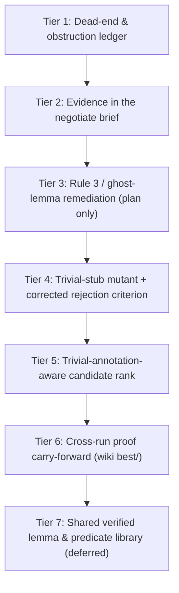

# Formal Discovery Generalization Analysis & Ranked Implementation Plan

This document reads *Discovering formally verified quantum programs with AI* (Shirobokov et al., Google DeepMind & Google Quantum AI, `arXiv:2611.09822v1`, November 2026), maps its verification and collaboration mechanisms onto the Frama-C agentic verification pipeline ([`./v2-design.md`](./v2-design.md), [`./agentic-swarm.md`](./agentic-swarm.md)), and sets out an implementation plan **ordered by expected value**, not by how little code each change touches. Every claim about the pipeline below was checked against the scripts on 2026-11-09; every claim about the paper carries the section it comes from.

The paper is a *discovery* setting: the specification is frozen, the program is the unknown, and a cost objective (qubits times T gates) ranks solutions. The pipeline is a *verification* setting: the C code is frozen and the specification is the unknown. The mapping therefore has to be done mechanism by mechanism, and several of the paper's rules (cost thresholds, code-shortening) have no literal counterpart. Section 3 says which ones transfer and which do not.

---

## 1. What the paper actually does (`arXiv:2611.09822v1`)

### 1.1 Verification library (Section 1.1, Appendix A)
- A Lean 4 formalization of a classical-quantum `while` language after Feng and Ying (`QProg`: `skip`, `abort`, `x := e`, `qset`, `apply U`, `x := measure M`, sequencing, `qif`, unbounded `qwhile`), with classical state `Store Var → ℤ` and a single quantum variable of dimension `d`.
- Assertions are `Store Var → Observable d`; satisfaction is an expectation in `[0, 1]`. Correctness is a total-correctness triple `Triple Θ c Ψ := ∀ Δ, E[Δ, Θ] ≤ E[⟦c⟧ Δ, Ψ]`, proved backwards through a weakest-precondition transformer `wp` with an exact duality theorem (`expect_wp`).
- Resource counting: syntactic gate counts on `Circuit` / `DynamicCircuit` (worst-case branch for measurement-dependent branching) and a semantic expected-cost transformer with compositional upper bounds (`CostBound`).

### 1.2 Frozen specification and independent verification (Section 1.2, Appendix B)
- Each problem is a Lean file pinned to a frozen repository commit, with `sorry` placeholders for the program, its cost, and both proofs (Fig. 2).
- Every submission is replayed in a clean sandbox by the Lean Comparator (Lean FRO's `comparator`). It passes only if (i) the target theorems and every transitive definition match the specification, (ii) the proof terms depend solely on `propext`, `Quot.sound` and `Classical.choice`, with no `sorry` or custom axiom, and (iii) the proved resource theorem reduces to the claimed closed-form cost. The same check runs before anything is merged into the wiki.
- Named gaming vectors (Appendix B): weakening theorem statements, modifying helper definitions, adding axioms, disabling local kernel checks, misreporting costs. The one specification loophole the paper names is Toffoli-count gaming (Section 2.6); it was closed by *revising the specification*, which is the researchers' only review duty. Appendix I.1 explains why the P450 specification covers every eigenstate within Δ of the ground state: a specification covering the ground state only would be satisfied by a circuit with no gates and a constant estimate.

### 1.3 Empirical search before formal proof (Section 2.2, Appendix F.3)
- For the arcsin problem only, agents first searched over the *kickmix* gate set (X, CNOT, Toffoli, CSWAP, measurement-based uncompute, diagonal phase corrections), whose circuits can be fuzz-tested classically in seconds, then moved to the Lean library to lift the gate-set restriction and optimise further (a further 11% cost reduction). The other four problems were verified in Lean throughout. The lesson the paper draws is "numerical testing where it is cheap, formal proof on top", not a general two-stage protocol.

### 1.4 Shared wiki (Section 1.2, Appendix C, Fig. S4)
One directory per problem: `README.md` (leaderboard), `best/Solution/` plus `history.md` (verified records, each crediting its teams), `lean/` (reusable partial Lean modules verified to compile against the shared library), `ideas/` (reviewed notes labelled *verified*, *promising* or *dead-end*, with the concrete obstruction: a numerical counter-example or a Lean lemma). A candidate replaces `best/` only if it passes the external verifier and improves cost by at least 5%; for problems with an established solution, an update that shortens the Lean code by at least 20% **while still strictly reducing cost** is also accepted. New teams start from the wiki's best solution.

### 1.5 Conferences (Appendix C, Fig. S5)
Every four hours, teams meet on a shared forum to pose questions, critique claims and propose constructions for other teams to test; direct replies are encouraged. Statements made there carry no weight until verified and published to the wiki.

### 1.6 Where the gains came from (Section 2.6, Fig. 5b)
Across the three scientific applications, once both channels were active: 61% of the logarithmic cost reduction came from within-team ideas, 15% from cross-team wiki entries or Lean files, 24% from conference exchanges (cross-team share from 13% on stopping power to 63% on P450). Dead-end notes and partial proofs also transferred: one note proving why a shortcut fails stopped two other teams' proposals.

---

## 2. Mapping onto the pipeline

| Paper mechanism | Pipeline counterpart | Where |
| :--- | :--- | :--- |
| Backward `wp` in Lean, kernel-checked | Frama-C WP (`-wp -wp-rte -wp-fct`) with Qed and the Alt-Ergo / Z3 / CVC5 portfolio | [`../scripts/run_wp_function.py`](../scripts/run_wp_function.py) |
| Lean Comparator (frozen spec, standard axioms only, no `sorry`) | C-token-stream check `verify_acsl_only`, `_UNSOUND_ACSL_RE` (`admit`, `axiom`, `axiomatic`, `inductive`), `_VACUOUS_FALSE_CLAUSE_RE`, unproven-lemma and `Typed+cast` soundness verdicts, `check_frame_preserved`, per-agent scratch overlays, parent re-verification at merge, end-of-run `wp-sweep` with `--cache-dir off` | [`../scripts/acsl_ast.py`](../scripts/acsl_ast.py), [`../scripts/workspace_overlay.py`](../scripts/workspace_overlay.py), [`../scripts/run_wp_function.py`](../scripts/run_wp_function.py), [`../scripts/pipeline_make.py`](../scripts/pipeline_make.py) |
| kickmix fuzz-testing before Lean | Phase 1 E-ACSL + LibFuzzer and Phase 2 Eva before Phase 3; per-iteration Dual-Oracle Guardrail (`run_eacsl_fuzz.py guardrail`) and candidate tracker | [`../scripts/run_eacsl_fuzz.py`](../scripts/run_eacsl_fuzz.py), [`../scripts/run_eva_slice.py`](../scripts/run_eva_slice.py), [`../scripts/prover_candidates.py`](../scripts/prover_candidates.py) |
| "Claims carry no weight until verified" | `candidate` / `needs_validation` / `confirmed` verdicts, Crash Verifier gate | [`../scripts/ledger.py`](../scripts/ledger.py) |
| Wiki `ideas/` (repair patterns) | Specification KB: seed items from the manuals, evolved (error → fix) items mined from finished provers, rendered at `<!-- spec-kb -->` | [`../scripts/spec_kb.py`](../scripts/spec_kb.py) |
| Wiki `ideas/` (dead ends with obstruction) | **none** (Section 3, Tier 1) | |
| Wiki `best/` (new teams start from the best verified solution) | **none across runs**: WP proofs are not published or carried forward (`v2-design.md` Section 9) | (Tier 6) |
| Wiki `lean/` (reusable verified modules) | Header Architect declarations, deduplicated by `splice_architect_header`; provers cannot contribute (Tier 7) | [`../scripts/acsl_ast.py`](../scripts/acsl_ast.py) |
| Conference seam critique | Caller → callee strengthening requests and `negotiate` tasks | [`../scripts/contract_negotiator.py`](../scripts/contract_negotiator.py), [`../scripts/wp_scheduler.py`](../scripts/wp_scheduler.py) |
| Specification loopholes closed by spec review | `--wp-smoke-tests` doomed-path checks, `trivial_layer_clauses` (syntactic), mutation-based completeness / precision | [`../scripts/run_wp_function.py`](../scripts/run_wp_function.py), [`../scripts/mutation_check.py`](../scripts/mutation_check.py) |

### 2.1 Verified gaps

1. **Dead ends are discarded.** `spec_kb.mine_run` pairs failed-goal signatures with the ACSL lines a *merged* patch added; nothing records what the E-ACSL guardrail refuted (`rejected_overconstrained`, whose report carries a parsed `failure` object) or which strengthening requests callees could not satisfy (`rejected_by_callee` in `workspace/reports/strengthen_requests.json`). `prover_candidates._oracle_summary` keeps only the guardrail's `status`. Re-queued provers and sibling callers can repeat refuted clauses.
2. **The negotiating prover sees requests, not evidence.** `wp_scheduler._prepare_kwargs` passes a `negotiate` task only its request records; `prepare_agent` renders them as a JSON block under "Contract Negotiation Requests". The caller's failing WP goals (the way a breaker receives the stalled prover's `wp_report`) and the callee's own candidate history are not attached. Batching already exists: later requests on a running `negotiate` become `followup_requests` and a new round, capped by `MAX_NEGOTIATION_ROUNDS_PER_CALLEE = 3` and `MAX_NEGOTIATIONS_PER_PAIR = 2`.
3. **The prover brief contradicts the splicer (existing bug).** `prover_brief.md` Rule 3 tells provers to replace a global `lemma` by a recursive `/*@ ghost ... */` C function. `acsl_ast._compute_span_start` leaves top-level ACSL declarations (`ghost` is in `_TOP_DECL_KWS`) outside the function span, so `splice_prover_changes` raises `ScopeViolationError` for that block (reproduced on 2026-11-09; `verify_acsl_only` passes, so the prover learns of it only at `merge-agent`). Under `-wp-fct` the ghost function's contract is a hypothesis, and neither the prover loop nor `_run_parent_reverify` proves the ghost function itself. Recorded in [`./troubleshooting.md`](./troubleshooting.md) (Section 5).
4. **Implementation mutants are judged on `Invalid` only.** `mutation_check._is_rejection` counts a mutant as rejected only when an `ensures` / behavior goal comes back *Invalid*. A false postcondition usually comes back *Unknown* unless a counter-example is found, and a mutant that fails to parse (`status: "error"`) also counts as "not rejected". Precision is therefore under-reported, and `impl_mutants` yields no mutant at all (`precision: None`) for bodies without relational operators or constant returns.
5. **Candidate ranking cannot see trivial annotations.** `_rank_key` is `(failed, invalid, -proved)` (a deliberate SESpec port, see [`./backlog.md`](./backlog.md)); `progress` also counts a rise in `proved`. Every added `assert` or `loop invariant` creates goals, so tautological annotations raise `proved` and count as progress. Syntactic tautology detection exists (`acsl_ast.is_trivial_predicate`, `trivial_layer_clauses` in the WP report) but is not used in the rank.
6. **No cross-run carry-forward of proofs.** `wp-sweep` re-proves every merged function with no proof cache and publishes nothing; the shared store (`cache.py`, `/framac-cache`) has no namespace for proven contracts. Every run starts the provers from scratch.

---

## 3. Ranked plan (by expected value)



| Rank | Upgrade | Paper origin | Value | Risk |
| :---: | :--- | :--- | :--- | :--- |
| 1 | Dead-end & obstruction ledger | Appendix C (`ideas/` dead ends with obstruction), Section 2.6 | High: stops repeated refuted clauses; data already on disk | Low: brief-only, behind `FRAMAC_SPEC_KB` |
| 2 | Evidence in the negotiate brief | Fig. S5 (critique with the failing seam named) | Medium-high | Low: no scheduler state change |
| 3 | Rule 3 remediation plan | Appendix B (only verified claims count) | High: provers lose whole attempts today | Low: brief + early check |
| 4 | Trivial-stub mutant, corrected criterion | Appendix I.1 (no-gate circuit), Section 2.6 | Medium: evaluative, fixes an existing metric | Low |
| 5 | Trivial-annotation-aware rank | Appendix C (shortening rule, reinterpreted) | Low-medium | Low, behind a flag |
| 6 | Cross-run proof carry-forward | Appendix C (`best/`, new teams start from it) | High, but a milestone of its own (M5) | Medium |
| 7 | Shared lemma & predicate library | Appendix C (`lean/`) | Medium | High: relaxes M2 isolation |

Tiers 1 to 6 each have a self-contained implementation plan under [`formal-discovery/`](./formal-discovery/), written to be handed to an implementer without this document. Tiers 1, 2, 4, 5 and 6 are independent of each other; Tier 3 must land before Tier 7.

### Common requirements for every tier

- **A/B switch.** Each tier ships behind an environment flag defaulting to on (`FRAMAC_SPEC_KB` already covers Tier 1; new flags for Tiers 2, 4, 5). A new flag must be added to both wrappers, `docker-compose.yml` and `tests/test_remediation_p2_container.py` (the container environment is an allowlist; [`./resources-and-caching.md`](./resources-and-caching.md) Section 4).
- **Measurement.** A tier is accepted on a `benchmark.py` run compared with `benchmark_compare.py` against the previous baseline (recall first; fewer Unknowns only if nothing else explains it). Unit tests show the mechanism works, not that it helps.
- **Docs follow the code.** The prover brief ([`../skills/framac-wp/prover_brief.md`](../skills/framac-wp/prover_brief.md)), [`./agentic-swarm.md`](./agentic-swarm.md), [`./v2-design.md`](./v2-design.md) and [`./backlog.md`](./backlog.md) are updated in the same change. The `.agents/skills` and `.claude/skills` trees are gitignored mirrors synced from `skills/`, never edited directly.
- **Tests** run with `-n auto` ([`../AGENTS.md`](../AGENTS.md)).

---

### Tier 1: Dead-end & obstruction ledger

Detailed implementation plan: [`formal-discovery/tier-1-dead-end-ledger.md`](./formal-discovery/tier-1-dead-end-ledger.md).

**Problem.** Gap 1. The paper's single most transferable collaboration result is that a dead-end note with its obstruction stopped other teams from repeating it (Section 2.6).

**Changes.**
- [`../scripts/prover_candidates.py`](../scripts/prover_candidates.py): `_oracle_summary` for `oracle == "guardrail"` also keeps `failure` (predicate, kind, location) when `status in GUARDRAIL_REFUTATIONS`. Add `refuted_clauses(scratch) -> list[dict]`, deduplicated by predicate text.
- [`../scripts/spec_kb.py`](../scripts/spec_kb.py): a separate store `reports/kb/obstructions.json` (not `evolved.json`: obstruction items have no helpfulness triplet and would be pruned by the top-L ranking). `mine_run` fills it from (a) `agents/*/scratch/candidates/c*/guard_*.json` with `rejected_overconstrained` (function, predicate, failing input id) and (b) `strengthen_requests.json` entries whose `status == "rejected_by_callee"` **and** whose `resolution_note` says the clause was tried and failed. Structural rejections written by the scheduler ("not dispatched: callee not found", caps, "callee is candidate") are excluded by matching the `not dispatched:` prefix. Add `obstructions_section_for(run_dir, overlay, function, callees)` rendering at most 10 items as `### Known Dead Ends (Do Not Repeat)`, each with the predicate and the obstruction (input id or callee note).
- [`../scripts/workspace_overlay.py`](../scripts/workspace_overlay.py): in `prepare_agent`, append the section to `kb_section` for `prover` **and** `breaker` roles (today only provers get a KB section), gated by `spec_kb.enabled()`.
- Tests: `tests/test_spec_kb.py` (mining both sources, exclusion of structural rejections, cap), `tests/test_prover_candidates.py` (failure kept), `tests/test_workspace_overlay.py` (section rendered for both roles, absent with `FRAMAC_SPEC_KB=off`).

### Tier 2: Evidence in the negotiate brief

Detailed implementation plan: [`formal-discovery/tier-2-negotiate-evidence.md`](./formal-discovery/tier-2-negotiate-evidence.md).

**Problem.** Gap 2. Fig. S5 shows critiques that name the exact seam ("are you proving the equivalence ... or symbolic normalization?"); the negotiate brief today names only the clause the caller wants.

**Changes.**
- [`../scripts/wp_scheduler.py`](../scripts/wp_scheduler.py): in `_prepare_kwargs` for `kind == "negotiate"`, also pass `caller_reports`: for each caller task, the promoted WP report path (the same source breakers use for `wp_report`) and the caller's `unproven_goals` restricted to call-site goals of the callee (goal `annotation` naming the callee's `requires` / `ensures` instance) and to the stalled postconditions.
- [`../scripts/workspace_overlay.py`](../scripts/workspace_overlay.py): extend "Contract Negotiation Requests" with, per request, the caller's relevant goals (name, line, prover verdicts) and, for the callee, `prover_candidates.status` of its last run (what was proven, what failed), so the negotiator does not re-try a known-failing clause.
- **Not included:** holding `negotiate` until every running sibling caller finishes. The paper's conferences are periodic, not gated on other teams' progress; the scheduler already batches late requests through follow-up rounds; and a hold would delay the stalled caller by up to a full prover budget. If batching ever proves necessary, use a short grace window (requests arriving within N minutes join the same round), measured on the benchmark.
- Tests: `tests/test_wp_scheduler.py` (kwargs carry caller reports), `tests/test_workspace_overlay.py` (brief renders them).

### Tier 3: Rule 3 / ghost-lemma remediation (plan only)

Detailed implementation plan: [`formal-discovery/tier-3-rule3-ghost-lemma.md`](./formal-discovery/tier-3-rule3-ghost-lemma.md).

Gap 3 is an open pipeline bug (troubleshooting Section 5). The remediation, to be implemented as its own change:

1. **Make the brief truthful now.** Rewrite Rule 3 in [`../skills/framac-wp/prover_brief.md`](../skills/framac-wp/prover_brief.md): a global `lemma` is flagged `unsound_proof` when unproven **and** a file-scope `/*@ ghost ... */` function is outside the function span and is refused at merge. When an inductive lemma is needed, the prover stops with `status: "stalled_after_k_retries"` and `proof_gap: {"predicate": ..., "reason": "inductive lemma required"}`; no scratch work-around (ghost function in the span, `axiomatic`, `admit`) is acceptable.
2. **Fail early, not at merge.** Add `--base <scratch/base/<rel>>` handling to `workspace_overlay.py check-acsl-only` (or a check in `run_wp_function.py` when the file is under `agents/<id>/scratch/work/`) that diffs `extract_top_level_acsl_declarations(base)` against the agent file and reports `scope_violation_pending: [<decl names>]` on the first iteration. `acsl_ast` already has the parser; the prover brief tells the agent to treat that field as a stop.
3. **Count the gap.** `ledger.py` already records `proof_gap`; make `generate_report.py` list `inductive lemma required` gaps under prover-limited open units so the loss is visible per target.
4. **Tests.** `tests/test_acsl_ast.py`: a ghost function block before the function raises `ScopeViolationError` (documenting the behaviour), and the early check names it. `tests/test_workspace_overlay.py`: rendered Rule 3 text. The troubleshooting entry moves from **Open** to **fixed** in the same change.
5. **Long term.** Tier 7 is the only way to let provers contribute lemmas; it must also run WP on the ghost function in the prover's own loop and at merge.

### Tier 4: Trivial-stub mutant with a corrected rejection criterion

Detailed implementation plan: [`formal-discovery/tier-4-trivial-stub-mutant.md`](./formal-discovery/tier-4-trivial-stub-mutant.md).

**Problem.** Gap 4. The paper's no-gate argument (Appendix I.1) is a specification-design check: does the spec reject the program that does nothing? The pipeline has no such mutant, and its existing impl mutants use a criterion that misses most rejections.

**Changes.**
- [`../scripts/mutation_check.py`](../scripts/mutation_check.py):
  - `_is_rejection` becomes: the mutant run has at least one non-RTE `ensures` / behavior / `assert` goal that is **not Valid** (Invalid *or* Unknown), given that the original function is `all_proven` with the same budget. Record the verdict kind (`invalid`, `unknown`) in `details`. A mutant whose WP run ends in `status: "error"` is recorded as `not_applicable` and excluded from the denominator (today it silently counts as accepted).
  - `trivial_stub_mutant(span_text, brace_offset)`: `{}` for `void` returns, `{ return 0; }` for scalar and pointer returns, `not_applicable` for struct / union returns. Prepend it to the impl mutants; record `trivial_body_rejected` per function and `trivial_body_accepted` in the totals.
  - Optionally run mutants with `--counter-examples` so a concrete model is attached when the solvers find one (already supported by `run_wp_function.py`).
- [`../scripts/generate_report.py`](../scripts/generate_report.py): list `all_proven` functions whose contract accepts the trivial stub in the "Specification quality" section; this is evaluative and gates nothing until measured.
- Tests: `tests/test_mutation_check.py` for the three stub shapes, the `not_applicable` path, and Unknown-counts-as-rejected.

### Tier 5: Trivial-annotation-aware candidate rank

Detailed implementation plan: [`formal-discovery/tier-5-trivial-aware-rank.md`](./formal-discovery/tier-5-trivial-aware-rank.md).

**Problem.** Gap 5. The paper's 20% code-shortening rule only applies alongside a strict cost reduction, so it is not a parsimony criterion and byte counts are the wrong proxy (they penalise a necessary quantified invariant and reward a tautology). What the pipeline can measure is how many of a candidate's goals come from clauses that hold whatever the code does.

**Changes.**
- [`../scripts/prover_candidates.py`](../scripts/prover_candidates.py): `_oracle_summary` records `trivial_added`: the number of agent-added clauses (`loop invariant`, `assert`, `ensures`) whose predicate `acsl_ast.is_trivial_predicate` accepts, computed from the diff against `scratch/base/<rel>`. `_rank_key` becomes `(failed, invalid, trivial_added, -proved)` and `progress` ignores goals produced by trivial clauses. Flag `FRAMAC_CANDIDATE_RANK=legacy` restores the current rank for A/B.
- Expect a small effect: a prover stops at its first `all_proven` candidate, so the rank mostly decides among partial candidates. The detection is syntactic, as it is for `trivial_layer_clauses`.
- Tests: `tests/test_prover_candidates.py`.

### Tier 6: Cross-run proof carry-forward (the paper's `best/`)

Detailed implementation plan: [`formal-discovery/tier-6-proof-carry-forward.md`](./formal-discovery/tier-6-proof-carry-forward.md).

**Problem.** Gap 6. "Newly launched teams can start from the wiki's best solution" (Section 1.2) is the paper's main lever for cumulative progress; the pipeline re-derives every contract on every run. [`./v2-design.md`](./v2-design.md) Section 9 lists this as the open part of M5.

**Sketch** (a milestone, not a patch):
- A `proofs` namespace in [`../scripts/cache.py`](../scripts/cache.py) keyed by the function's C definition digest (`c_definitions.py`), the digests of the callee contracts it depends on, the effective preprocessor flags and the toolchain identity. Stored value: the function's merged contract text, its swept WP report and the guardrail verdict. Written **only** by `wp-sweep` after a successful re-proof (the trusted step, like `build` and `eva`), with `FRAMAC_CACHE_MODE=rw`.
- Consumption: at Phase 3 start, for each `prove` task whose key hits, the parent seeds `agents/<id>/scratch/work/` with the prior contract as the prover's first candidate (or, when the hit is exact and the swept report is `all_proven`, merges it directly and re-verifies, skipping the prover). Hypotheses are re-audited by `ledger.py audit-hypotheses` as today.
- Invariant to keep: a cached proof never changes a verdict without a re-proof on the current tree (the `wp-sweep` discipline), so carry-forward only saves prover time.
- Tests: key derivation stability, no hit across differing callee contracts, no write outside `wp-sweep`.

### Tier 7: Shared verified lemma & predicate library (deferred)

> **Isolation guardrails.** This tier relaxes `splice_prover_changes` so a prover may add top-level `predicate` / `logic` declarations to its module header and a `/*@ ghost ... */` lemma function directly above its function. It must keep: C-token edits forbidden, `_UNSOUND_ACSL_RE` intact, `check_conflicting_acsl_profiles` on every new declaration, deduplication as in `splice_architect_header`, and WP + guardrail on every new ghost function **both in the prover's own oracle loop and in `_run_parent_reverify`**, since `-wp-fct <fn>` never proves the ghost function itself.

**Why deferred.** The paper's `lean/` files only need to compile against the library; the pipeline's equivalent must be fully proved, E-ACSL-executable (unbounded quantifiers in `predicate`s fail the guardrail), and reconciled with the ledger's hypothesis audit (a ghost function has no ledger unit, so `callee_contract_hypothesis` on it would never be discharged today). It also undoes a deliberate M2 decision that only the Header Architect writes header-level ACSL. Do Tiers 1 to 6 first and measure how often `proof_gap: inductive lemma required` (Tier 3) actually occurs before paying for this.

**Changes if pursued.** [`../scripts/acsl_ast.py`](../scripts/acsl_ast.py): `extract_new_top_level_helper_blocks`, `extract_ghost_function_names`, relaxed `splice_prover_changes`. [`../scripts/workspace_overlay.py`](../scripts/workspace_overlay.py): parent WP on each new ghost function, rollback on any unproven goal. [`../scripts/ledger.py`](../scripts/ledger.py): hypothesis audit treats proven ghost functions as discharged. [`../skills/framac-wp/prover_brief.md`](../skills/framac-wp/prover_brief.md): Rule 3 rewritten again. Tests in `tests/test_acsl_ast.py`, `tests/test_workspace_overlay.py`.

---

## 4. Verification commands

```powershell
$env:PYTHONIOENCODING="utf-8"
python -m pytest tests/test_prover_candidates.py tests/test_mutation_check.py tests/test_spec_kb.py tests/test_wp_scheduler.py tests/test_acsl_ast.py tests/test_workspace_overlay.py -n auto
```

Then the full suite and static checks ([`../skills/python-patterns/SKILL.md`](../skills/python-patterns/SKILL.md)):

```powershell
$env:PYTHONIOENCODING="utf-8"
python -m pytest tests -n auto
python -m ruff check scripts tests
python -m mypy scripts tests
```

And, per tier, a benchmark run compared against the previous baseline:

```powershell
python scripts/benchmark_compare.py <baseline.json> <candidate.json>
```