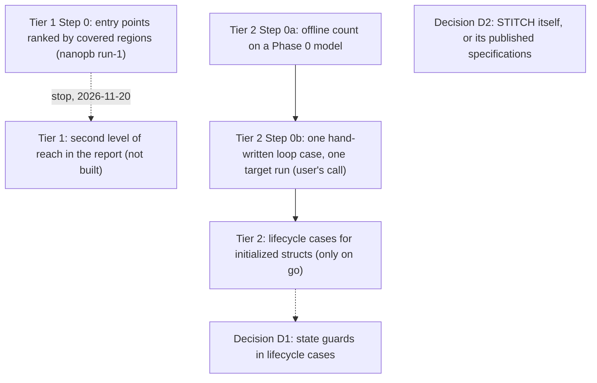

# API-Sequence Fuzzing Paper (STITCH): Generalization Analysis & Ranked Implementation Plan

This document reads one paper on fuzzing library APIs through call sequences assembled at run time (STITCH: Green, Brown, Le Goues, CCS 2026; `3830454.3846663.pdf`), maps what it offers onto the Frama-C agentic verification pipeline ([`../guides/v2-design.md`](../../guides/v2-design.md), [`../guides/agentic-swarm.md`](../../guides/agentic-swarm.md)), and sets out a plan **ordered by expected value**. It follows the format of [`./papers-generalization-plan.md`](./papers-generalization-plan.md) and [`./harness-and-spec-papers-generalization-plan.md`](./harness-and-spec-papers-generalization-plan.md), and does not repeat work those plans cover. Claims about the pipeline were checked against the files on 2026-11-20, in the working tree of `main` at `6877117` (which has uncommitted changes, among them [`../../templates/harness_dual.c.template`](../../../templates/harness_dual.c.template)); every claim about the paper carries the section it comes from.

Limits on the reading and on the checks:

- **Read:** all 15 pages, the reference list skimmed. Table 1 is an image in the PDF. The cells used here (the c-ares and libpng rows) were read from the page image and confirmed by the challenger from a higher-resolution render; no other cell is used.
- **Not read:** the paper's Supplemental Information (the Flecs case study, the full prompt of Section 5.5, the project list, the table of submitted bugs), which is not in the PDF. The four artifact repositories named under "Open Science" were not fetched: that is a download, and it waits for the user's go-ahead.
- **Not checked in the pipeline:**
  - whether a hand edit of a generated case survives a later regeneration of the harness;
  - what happens to the corpus after a harness repair;
  - the rows of Section 2 on the Configure Agent, the Triage Agent, seeds and dictionaries, and the compile probe, beyond the existence of the functions and the text of the briefs and docstrings.
- **Measured:** one measurement, Step 0 of Tier 1, on 2026-11-20, over the coverage report and the harness sidecar of nanopb run-1 under `C:\Users\Florian\framac-pipeline\`. The challenger ran it as its cheapest refutation, with read-only scripts kept outside the repository; the figures on the entry functions' own regions were then read again from the same report. Result: a **stop** (see "Step 0 result" under Tier 1). No Docker image or target was run.
- **Independent challenge:** one fresh agent checked the quoted numbers against the PDF and the pipeline claims against the files, and argued against each candidate. Its objections corrected Sections 1 and 2, closed Tier 1 and turned Tier 2 into a trial; they are answered in Section 3 ("Objections and what they changed").

Two tiers and two decisions come out of it. **Nothing here can be built today.** Tier 1 is closed by its measurement. Tier 2 is a trial whose first step is an offline count and whose second step is one target run, which is the user's call. Both decisions carry the recommendation to do nothing now.

---

## 1. What the paper does

### 1.1 STITCH (Green, Brown, Le Goues; CCS 2026; `3830454.3846663.pdf`)

- **Setting:** finding memory-safety and stability bugs in C and C++ libraries by fuzzing their public API with sanitizers, with no hand-written harness (Sections 1 and 4). The input is a repository URL.
- **Method, the specification (Section 3.1):**
  - A **code block** is a 4-tuple `(Code, In, Out, F)`: native code that calls one API function, typed input objects, typed output objects, and the fuzzable parameters it asks for. A **testcase** is a sequence of block instances whose inputs refer to outputs of earlier instances. It is well-formed when references point backward, each output is used at most once, and types match.
  - **Extrinsic typestate:** a per-object and a global key-value store, kept by the fuzzer outside the target's type system. A block writes keys on the objects it produces and reads them on the objects it receives (Fig. 3: `ns` set by the constructor that made an attribute, `doc` holding the parent document; Fig. 4: the kind of a parsed JSON value).
  - **Bail:** a block that sees a failed call or a typestate it does not accept ends the testcase cleanly (`FUZZ_BAIL`, Section 3.2.1). The semantics model a bail and nothing else: a crash is "an external property of testcase execution" (Section 3.1, "Crashes").
- **Method, the engine (Section 3.2.2):** the corpus holds testcases, not byte strings. Four structural mutations (regenerate, crossover, extend at the bail frontier, trim at the bail frontier) keep well-formedness only; whether a testcase runs without bailing is found by trying, "akin to rejection sampling". Fuzzable parameters are values of their own, "preserved during mutation" instead of being cut from one shared byte buffer (Section 3.2.1, footnote 1). A crashing testcase is minimized and can be exported as a standalone C++ program with the blocks inlined into `main`.
- **Method, the automation (Section 4, Fig. 5):**
  - A **Configure Agent** writes a Dockerfile and a list of public headers, validated by compiling one test program (Section 4.1).
  - **Specification synthesis** by chained prompts over the headers as plain text: canonical objects with their aliases and per-function requirements (Section 4.2.1); one code block per function, validated by compiling it, with up to three retries; dedicated constructor blocks for the types "the library expects callers to allocate" directly (Section 4.2.2); generators of initial values for string and file parameters (Section 4.2.3).
  - A **Triage Agent** reduces each crash by compiling and running modified testcases, and classes it `p1` (security), `p2` (stability) or `p3` (misuse) (Section 4.3).
  - A **Patch Agent** edits the code blocks to close out a family of crashes, and fuzzing restarts (Section 4.4). It runs for true bugs as well as for spurious ones, because "shallow, easy-to-trigger bugs can occlude subsequent ones" (Section 5.4 D).
- **Results, head to head (Section 5.2, Table 1):** 33 C and C++ benchmarks at commits the text gives as one to four years old (the table shows 0.9 to 4.1); each tool builds its harness or specification once, then five runs of 24 hours on 1 vCPU and 2 GB; LibAFL 0.14.1 in forkserver mode for every tool; `gpt-5-2025-08-07` for STITCH (Section 5.1). STITCH runs **without the Patch Agent** here.
  - **Coverage:** the best mean line coverage with `p < 0.05` on 21 of 33 benchmarks. It beats OGHarn and libErator on every benchmark, the OSS-Fuzz harnesses on 18 of 22, PromptFuzz on 10 of 12 and PromeFuzz on 16 of 22.
  - **Bugs:** 30 unique true bugs in 14 projects, against 10 for all other tools together; 15 were unknown and still present in the latest versions.
  - **Precision after triage:** 70% (30 true positives), against 12% for PromeFuzz, 2% for PromptFuzz and 100% for OGHarn. The Triage Agent had filtered 221 of 265 crashes before that count.
  - **Cost:** 19 minutes and 1.77 USD of inference per benchmark.
  - **Two pipeline targets are in the set.**
    - c-ares (API column 136, full scope): no true bug by any of the six tools. STITCH's coverage is 57.8% against 57.9% for PromeFuzz, so it is not one of the 21 wins, and its one crash there was filtered as misuse.
    - libpng (API column 257, full scope): no true bug by the four tools evaluated on it. STITCH's nine crashes there were all filtered as misuse.
- **Results, at scale (Section 5.3):** 1365 repositories. Configuration succeeded on 915 (67%). Each was fuzzed for one to three days on one vCPU. 4556 reports, 3371 unique: 178 `p1`, 766 `p2` and 2427 `p3`. The authors reviewed 170 of the 944 `p1` and `p2` reports by hand and submitted 127 bug reports in 96 projects; 3 were marked invalid and 90 were patched by September 12, 2026.
- **Results, the specifications (Section 5.4, on the 915 projects unless noted):**
  - 117,691 of 157,780 functions (74.6%) got a compilable block; 39,450 (25%) were marked unharnessable by the model, nearly half of them for linkage and configuration reasons; 859 failed three compilations. The three counts add up to 158,000, not to the printed total.
  - 40% of the targets never crashed and 11% crashed once.
  - 40.6% of the 121,764 generated blocks read or write typestate.
  - On the 33 benchmarks, run again for 24 hours with extra instrumentation: 96.8% of the harnessable API functions "were able to be invoked" and 92.5% "succeeded at least once".
  - The Patch Agent ran 3,287 times, changing 5.1 blocks on average (median 2). 52% of the patches added bail guards; 36.9% of the patched blocks got new typestate reads and 17.2% new writes; 19.9% needed a second patch.
- **Comparison with an LLM agent alone (Section 5.5):** one library (libjpeg-turbo, at the version of the at-scale run). Claude Code with Opus 4.7 reported one true and three false positives for 47.90 USD, after a first run that was blocked at about 30 USD; STITCH found three true positives on that version. Two of the agent's false positives came from setting a struct field directly instead of calling the library's initializer. The authors call it "a case study and not a controlled comparison".
- **Stated limits:**
  - Specifications are "both underspecified ... and overspecified"; their accuracy was spot-checked by hand, with no ground truth (Section 5.4 C).
  - Configuration is best-effort and may miss headers (Section 4.1). Variadic functions, callbacks-only functions and C++ templates are often unharnessable (Section 5.4 B). Inference is nondeterministic.
  - What counts as a bug depends on documentation: a heap overflow in libjpeg-turbo was classed by its maintainers as intended behaviour, and they changed the documentation (Section 7).
  - "We observed no clear false negatives" of the triage (Section 5.2); no number is given.

**What the evidence can bear.**

- **Implementation and evaluation:** a tool exists and was measured, on C libraries of the pipeline's kind and with the sanitizers the pipeline also uses. Nothing was measured with E-ACSL, Eva or WP.
- **Baselines:** fixed-sequence harness generators and the OSS-Fuzz harnesses. None of them is what the pipeline does: its `--api` harness is one dispatch case per function plus byte-picked calls on one handle (Section 2).
- **Ablation:** the Patch Agent only, and only by its absence in the head-to-head runs (Section 5.1). No run removes typestate, the structural mutations, the value generators or the first-class parameters. The 40.6% is how often typestate is used, not what it contributes. GraphFuzz, the nearest system without typestate, and Hopper are discussed (Sections 2 and 6) and not run.
- **Configuration:** 24 hours per run and one to three days per target at scale, against a Phase 1 budget of minutes (libmodbus run-1: 1200 CPU-seconds, [`../runs/2026-11-18-libmodbus-run1.md`](../../runs/2026-11-18-libmodbus-run1.md)).
- **Liberties:** an LLM writes the harness code and decides which uses of the API are valid; it also patches the harness after seeing a crash, true bug or not. Reports are reviewed by hand before submission.
- **Evidence labels.**

| Mechanism | Label | Basis |
| :--- | :--- | :--- |
| Call sequences over typed objects, assembled at run time, with LLM-written blocks (the whole system without patching) | `measured on our toolchain` in the sense of C libraries under sanitizers, not of Frama-C; not ablated | Table 1 |
| Extrinsic typestate | `argued` as a separate mechanism | Sections 3.3 and 5.4 C give usage and examples; no run isolates it |
| Bail on a failed call | `argued` as a separate mechanism | Section 3.2.1 |
| Structural mutations; first-class fuzzable parameters; value generators | `argued` as separate mechanisms | Sections 3.2.1, 3.2.2 and 4.2.3 |
| Triage Agent | `measured elsewhere` (LLM triage of sanitizer crashes), with no false-negative count | Section 5.2 |
| Patch Agent | `measured elsewhere`, `ablated` by absence in Table 1 only; its patch statistics are counts, not effects | Sections 5.1 and 5.4 D |
| The two levels of reach, "invoked" and "succeeded at least once" | a measurement the paper reports, not a mechanism it uses | Section 5.4 C |

---

## 2. Mapping onto the pipeline

| Paper mechanism | Pipeline counterpart | Where |
| :--- | :--- | :--- |
| One code block per API function, typed inputs and outputs (Sections 3.1 and 3.2.1) | One dispatch case per entry point, its arguments built from the Phase 0 model's signature. Typed objects exist as constructed opaque handles (`handle_functions`, `outparam_constructors`, parents up to `MAX_HANDLE_DEPTH`) and as structs initialized by the library (`initializers`) | [`../../scripts/api_harness.py`](../../../scripts/api_harness.py) |
| A testcase is a sequence of blocks chosen at run time (Sections 3.1 and 3.2.2) | **Partly.** `lifecycle_case`: construct one opaque handle, then up to `LIFECYCLE_MAX_CALLS` (8) calls, each picked by one input byte among the functions taking exactly one handle of that type, then release it. `sequence_case`: replay of one chain recorded from the target's tests. Both share `MAX_SEQUENCE_CASES` (16), recorded chains first. **Missing:** a synthesized sequence on a struct the caller allocates and the library initializes, and a sequence over objects of two types. `plan` builds lifecycle cases for the types in `(set(api.ctors) \| set(api.out_ctors)) & set(api.dtors)` only, and a handle is whatever the layout probe saw written as one. `_lifecycle_case` also refuses an out-parameter constructor that needs a parent and a type with no method, and `plan` drops that reason without recording it | the same file (`plan`, `lifecycle_case`, `lifecycle_methods`, `sequence_case`) |
| A corpus of testcases and structural mutations (Section 3.2.2) | none. libFuzzer mutates bytes; the case selector and the lifecycle's choice bytes are ordinary input bytes | [`../../templates/harness_dual.c.template`](../../../templates/harness_dual.c.template) |
| Fuzzable parameters as separate values, with initial values (Section 3.2.1, footnote 1; Section 4.2.3) | The slot layout of each case in the sidecar (`api_cases`), from which `seed_harvest.py write` turns recorded calls into seeds; shipped corpora mapped to cases; a dictionary. The method calls of a lifecycle case read their bytes in the loop and have no slots | [`../../scripts/api_harness.py`](../../../scripts/api_harness.py), [`../../scripts/seed_harvest.py`](../../../scripts/seed_harvest.py), [`../../scripts/fuzz_assets.py`](../../../scripts/fuzz_assets.py) |
| Extrinsic typestate (Section 3.1; Figs. 3 and 4) | none. The only state a lifecycle case tests is `fc_h != 0`. The argument-domain rules (A to F) normalize values of one call, not states across calls | [`../../scripts/api_harness.py`](../../../scripts/api_harness.py) (`_lifecycle_case`, `_domain_rules`) |
| Bail (Section 3.2.1) | `FRAMAC_FUZZ_REJECT()` for an input that runs no case: no selector byte, a selector out of range, a skipped case (`_build_dispatch_invocation`). `api_harness.py` never emits it, and a lifecycle case goes on after a failed call **on purpose**: the generator's docstring keeps "use after free, double free and call after error" reachable | [`../../scripts/generate_harness.py`](../../../scripts/generate_harness.py), [`../../templates/harness_dual.c.template`](../../../templates/harness_dual.c.template), [`../../scripts/api_harness.py`](../../../scripts/api_harness.py) |
| Configure Agent (Section 4.1) | The target's build is captured from a recipe the user confirms; the run stops and asks when it does not build | [`../../skills/framac-slice/SKILL.md`](../../../skills/framac-slice/SKILL.md), [`../../scripts/build_capture.py`](../../../scripts/build_capture.py) |
| API scanning from header text: canonical objects, aliases, requirements (Section 4.2.1) | The model comes from Frama-C's AST; the spellings and typedef aliases from clang's AST of the harness (`probe_layouts`, `enum_pointer_spellings`, `anon_record_tags`, `qualified_pointer_spellings`). Documented requirements are not read at harness time: `api_harness.py` has no reference to the threat model | [`../../scripts/api_harness.py`](../../../scripts/api_harness.py); [`./schema-driven-api-harness-plan.md`](./schema-driven-api-harness-plan.md) proposes to read `input_sources` |
| Block validated by compiling it, with retries (Section 4.2.2) | The compile probe drops a case the compiler refuses and records the function in `api_skipped` with the compiler's first error | [`../../scripts/api_harness.py`](../../../scripts/api_harness.py) (`probe_cases`, `failing_cases`) |
| Constructor blocks for types the caller allocates (Section 4.2.2) | A struct with an initializer of the unit: one object, initialized by that call before the call under test, released by the struct's destructor when there is one (`initializers`, `struct_destructors`). A builder that returns the struct by value is not an initializer (nanopb's `pb_istream_from_buffer`: all 36 cases of nanopb run-1 have an empty `inits`) | [`../../scripts/api_harness.py`](../../../scripts/api_harness.py); [`./schema-driven-api-harness-plan.md`](./schema-driven-api-harness-plan.md), S2 |
| Unharnessable functions and their reasons (Section 5.4 A and B) | `api_skipped` with a reason per function; the static reach gate lists the entry points with no case | [`../../scripts/api_harness.py`](../../../scripts/api_harness.py), [`../../scripts/harness_reach.py`](../../../scripts/harness_reach.py) |
| Triage Agent: reduce by compiling and running variants, class, deduplicate (Section 4.3) | Crash Verifier subagents with sandboxed replay; cvise minimization under a fingerprint-preserving test; fingerprints; the patch-and-replay check of the decision point; reconciliation of opposite verdicts at one sink | [`../../skills/framac-wp/crash_verifier_brief.md`](../../../skills/framac-wp/crash_verifier_brief.md), [`../../scripts/run_eacsl_fuzz.py`](../../../scripts/run_eacsl_fuzz.py), [`../../scripts/decision_point_check.py`](../../../scripts/decision_point_check.py), [`../../scripts/ledger.py`](../../../scripts/ledger.py) |
| Patch Agent: change the specification after a crash, restart (Section 4.4) | A repair task after a `harness_induced` rejection only: `generate_harness.py --record-repair`, then a hand edit of the harness or a regeneration (`_describe_repair`), the reach gate, and the module again. At most two attempts per harness, then the linked units are `blocked` (`harness_repair_exhausted`). A crash that is not harness-induced is never patched away; a keep-going round skips its case instead (`FRAMAC_FUZZ_SKIP_CASES`) | [`../../skills/framac-verify/SKILL.md`](../../../skills/framac-verify/SKILL.md), [`../../scripts/generate_harness.py`](../../../scripts/generate_harness.py), [`../../scripts/wp_scheduler.py`](../../../scripts/wp_scheduler.py) |
| Standalone reproducer program (Section 3.2.2) | A reproducer is the input file replayed on the harness build (`run_eacsl_fuzz.py replay`). No standalone program is generated | [`../../scripts/run_eacsl_fuzz.py`](../../../scripts/run_eacsl_fuzz.py), [`../../scripts/crash_replay.py`](../../../scripts/crash_replay.py) |
| "Invoked" against "succeeded at least once" (Section 5.4 C) | **One level only.** The dynamic reach gate asks whether the entry point ran at least once (`check_dynamic`, `_entry_executions`), from any caller. The coverage report already holds, per function, the regions covered and the uncovered line ranges (`summarize_coverage_export`). No script reads them per entry point: the run report prints module totals and the functions never reached (`fuzz_reach_lines`), and the Phase 1 skill sends the orchestrator to `uncovered_lines` by hand | [`../../scripts/harness_reach.py`](../../../scripts/harness_reach.py), [`../../scripts/fuzz_coverage.py`](../../../scripts/fuzz_coverage.py), [`../../scripts/generate_report.py`](../../../scripts/generate_report.py), [`../../skills/framac-fuzz/SKILL.md`](../../../skills/framac-fuzz/SKILL.md) |

### 2.1 Verified gaps

1. **An entry point that runs only its refusal path counts as reached.**
   - **What the code does.** `check_dynamic` in [`../../scripts/harness_reach.py`](../../../scripts/harness_reach.py) puts an entry point in `gaps` when its function has 0 executions, no `reach_exempt` entry matches it and no reproducible crash of the current harness proves it ran. An execution from any caller counts, not only one from the entry point's own case. `summarize_coverage_export` in [`../../scripts/fuzz_coverage.py`](../../../scripts/fuzz_coverage.py) computes `regions.covered`, `regions.total` and `uncovered_lines` per function, and nothing reads them per entry point.
   - **Cost.** Two observed cases, both found by a person or a supervisor reading the harness, not by a gate:
     - QCBOR run-6: the generated cases of the `*InMap*` accessors call the accessor on a fresh context, "so they only exercise `QCBOR_ERR_MAP_NOT_ENTERED`" ([`../troubleshooting/harnesses-and-seeds.md`](../../troubleshooting/harnesses-and-seeds.md), an open pipeline gap). How many accessors are concerned is not recorded.
     - nanopb run-1: every reader case got a zeroed stream, so "the decoder reads no byte at all"; 25 of 36 cases left an attacker parameter without input bytes, and Eva found 1844 obligations Dead ([`./schema-driven-api-harness-plan.md`](./schema-driven-api-harness-plan.md), Section 2). The run's dynamic reach row passed with 36 of 36 entry points, three of them at 0 executions and counted through a crash.
   - **Consequence for Phase 3.** A dynamic gap holds a module's planned units out of WP; an entry point reached only on its refusal path does not.
2. **No input makes two API calls on one initialized context struct, unless the target's tests recorded such a chain.**
   - **What the code does.** `plan` in [`../../scripts/api_harness.py`](../../../scripts/api_harness.py) synthesizes a lifecycle case for an opaque handle type with a constructor and a destructor. A struct the caller allocates and an initializer fills (`api.inits`: by the name and first-parameter rule of `initializers`, QCBOR's `QCBORDecode_Init` and mpack's `mpack_reader_init_data` qualify; nanopb's stream builders do not) gets single cases (the initializer, then one call) and recorded chains, at most 16.
   - **Cost.** The QCBOR case of gap 1 is this gap: the fix the troubleshooting entry suggests is "`Init -> EnterMap/EnterArray -> accessor`". In run-6, `QCBORDecode_Private_ExitBoundedLevel` was never executed until a hand-written case entered and left a real map. No count exists of how many entry points of a target need an earlier call on the same struct, so the size of this gap is not measured.
   - **On disk today.** No sidecar under `C:\Users\Florian\framac-pipeline\` holds a lifecycle case (nanopb run-1; nginx run-3, run-4 and run-5; 21 sidecars under `benchmark\runs`, 20 of them with no `--api` case). nanopb run-1 has 36 single cases and no sequence case. The QCBOR, mpack and libmodbus run directories that the census of 2026-11-18 read are no longer there.
3. **Nothing in a lifecycle case depends on what an earlier call did, or on which constructor built the handle.**
   - **What the code does.** `_lifecycle_case` builds the handle with one constructor (`api.ctors[htype]`) and lets every input byte pick any of the methods. There is no per-object state.
   - **Cost, as far as the records go.** In the census of 76 `harness_induced` rejections ([`./harness-and-spec-papers-generalization-plan.md`](./harness-and-spec-papers-generalization-plan.md), Section 5.2), 8 are type-state or call-order conditions (Section 5.4 there): 1 on libmodbus (`modbus_tcp_pi_listen`) and 7 on mpack (writer, reader and node entries). mpack's contexts are structs the headers define, which get no lifecycle case, so at most the one libmodbus record can come from a lifecycle case. That follows from the generator's code; no mpack sidecar is left to confirm it. The 7 mpack records lack an earlier call (gap 2), which no guard supplies. The 14 lifetime or ownership records name allocators, constructors and free functions as their entries, which reads as faults of single cases; the census does not record the kind of case.
   - **One run.** On libmodbus run-1, 9 of the 14 artifacts after the first repair were in `modbus_tcp_pi_listen`, called on the TCP context of the lifecycle case. The second and last repair gave those arms their own context and also rebuilt the request buffers of two other arms, with a module rebuild of 559 s ([`../runs/2026-11-18-libmodbus-run1.md`](../../runs/2026-11-18-libmodbus-run1.md)). The same fault occurred in two single cases, and the run report leaves open whether the remaining artifact is a state fault or the libc model of `getaddrinfo`.
   - **Weak.** At most one record of 76, and one run.
4. **A function that takes two opaque handles of one type gets no case.** `_bind_call` raises "the call takes N such handles and who owns them afterwards is not known" when the handle type is a pointer to a struct the headers only declare; for a `void *` typedef it passes zeroed buffers and writes a note. No sidecar on disk records such a skip, so this gap has no observed cost.

Recorded, not planned:

- [`./papers-assessed.md`](../papers-assessed.md) and [`./paper-assessments-register.md`](../paper-assessments-register.md) both present themselves as the list of assessed papers, and neither holds all of the other's rows. This assessment is recorded in the first, which the `paper-assessment` skill reads.
- The run directories of QCBOR, mpack and libmodbus are gone from `C:\Users\Florian\framac-pipeline\`, so the censuses of [`./harness-and-spec-papers-generalization-plan.md`](./harness-and-spec-papers-generalization-plan.md) (Sections 5 to 7) cannot be repeated or extended from disk.
- `plan` in [`../../scripts/api_harness.py`](../../../scripts/api_harness.py) drops the reason when a lifecycle case cannot be built, so no `api_skipped` entry or note says why a handle type has none. Added on 2026-11-20 as an open pipeline gap to the lifecycle entry of [`../troubleshooting/harnesses-and-seeds.md`](../../troubleshooting/harnesses-and-seeds.md) ("Still open").
- The row "Matches the threat model" of [`./schema-driven-api-harness-plan.md`](./schema-driven-api-harness-plan.md) (Section 2) counts `pb_write` among six cases. Its generated case passes a zeroed `pb_ostream_s`, so the row says which parameters receive input bytes, not that the call does its work.

---

## 3. Ranked plan (by expected value)



| Rank | Upgrade | Paper origin | Value | Risk |
| :---: | :--- | :--- | :--- | :--- |
| 1 | A second level of dynamic reach: entry points executed only on their refusal path. **Closed by its Step 0 (2026-11-20), not built** | Section 5.4 C | As ranked before the measurement. Medium: closes gap 1, seen on two targets and found by hand both times. Evidence: a measurement the paper reports, `argued` as something to act on. Transfer `same kind of tool` | Low, report only. Cost: `brief or report only` in the form that was measured; the form that could work is `script and flag` (a coverage replay per case) |
| 2 | Call sequences on a struct the library initializes. **A trial with no pipeline change; not a build** | Sections 2, 3.1 and 4.2.2; Table 1 | Medium until measured: closes gap 2, whose size is not known. Evidence `measured on our toolchain` in the sense of C libraries under sanitizers, for the whole system and not ablated. Transfer `same kind of tool`, under conditions the pipeline does not share (24-hour runs, a corpus of testcases, LLM-written blocks) | Medium: every lifecycle case seen on a target so far produced mostly harness-induced candidates and used both repairs; Eva's cost on such a loop is not measured. Cost: `script and flag` |
| D1 | State guards in lifecycle cases (the paper's typestate) | Sections 3.1, 3.3 and 5.4 D | Low today: at most one record of 76 | High for the validity of findings: a guard written by an LLM narrows what is tested |
| D2 | STITCH itself as a second source of candidates, or its published specifications as a reference | Sections 4 and 5; "Open Science" | Low: Table 1 gives no true bug on either shared target | Medium: a new tool, an external model API, numbers that are not comparable |

Tier 2 does not depend on Tier 1. D1 makes sense only after Tier 2: a guard restricts sequences, and for struct contexts there are none to restrict today.

### Common requirements

The requirements of [`./formal-discovery-plan.md`](./formal-discovery-plan.md) ("Common requirements for every tier") apply unchanged: an A/B environment flag for behaviour changes (added to both wrappers, `docker-compose.yml` and `tests/test_remediation_p2_container.py`), acceptance on a `benchmark.py` run compared with `benchmark_compare.py`, guides and briefs updated in the same change (then `python tools/sync_skill_mirrors.py`), tests run with `-n auto`. Any pipeline bug found on the way goes into [`../troubleshooting/`](../../troubleshooting/README.md) in the same session.

### Objections and what they changed

| Objection (challenger) | Answer |
| :--- | :--- |
| Tier 1 cannot work from the existing report. On nanopb run-1 the worst known case, `pb_decode`, has all of its own regions covered, and thin wrappers saturate. Over the callee closure nearly every region is shared with another entry point | **Accepted; Tier 1 is closed.** The own-region figures were read again from the report and hold. See "Step 0 result" |
| `executions` counts entries from any caller, so "executed" does not even mean that the entry point's own case ran it | **Accepted.** Gap 1 and the mapping row say so |
| nanopb's streams are not in `api.inits`: `pb_istream_from_buffer` returns by value, and all 36 cases have an empty `inits` | **Accepted.** Gap 2 names QCBOR and mpack only; nanopb's case belongs to S2 of the schema-driven plan |
| A lifecycle case for a struct would decode zeros: under the reserved rest, an initializer's unsized byte pair is zero data with a fuzzed length, an item the troubleshooting entry lists as still open; a loop method's unsized string or pair does not advance the offset | **Accepted.** Step 0a of Tier 2 classifies the initializer's data argument, and both open items are prerequisites in its "Changes" |
| Up to 255 methods and 8 byte-picked calls on a byte stream where each argument shifts the next, at 1200 CPU-seconds against the paper's 24 hours: the paper's own argument against fixed sequences (1 in 81 to the sixth, Section 2) applies | **Kept as a limit of Tier 2**, and the reason it is a trial. Step 0b measures it on one target |
| At most 1 of the 8 type-state records can come from a lifecycle case; the 7 mpack records need an earlier call, not a guard. The libmodbus case is a choice of constructor, and a guard would make the TCP-PI methods dead in a lifecycle built by `modbus_new_tcp` | **Accepted.** Gap 3 is rewritten and called weak; D1's recommendation rests on it |
| An LLM-written guard is the derivation behind the two wrong `EncodeHead` rejections, moved to before the crash, with no rejection record left to audit. It also narrows what `eva_main` analyses | **Accepted.** It is the main argument of D1 |
| For D2: Table 1 predicts no true bug on c-ares and libpng after five runs of 24 hours. STITCH's reproducers are C++ programs, so a crash could enter the gate only as a witness-less hypothesis. The pipeline's side of a comparison is nearly empty: c-ares run-1 had two candidates, both `toolchain_artifact`, and libpng has Phase 0 postmortems only | **Accepted.** D2's recommendation is to do nothing now |
| Gap 4 was stated from the docstring: only an opaque handle taken twice is skipped | **Accepted.** Gap 4 is corrected from `_bind_call` |
| The lifecycle condition was misquoted, and more conditions apply (the probe decides what a handle is, a parent-bound out-constructor and a type with no method are refused, the reason is dropped) | **Accepted.** The mapping row is corrected; the dropped reason is under "Recorded, not planned" |
| "9 of 14 ... the second repair was spent on it" overstates: the repair also fixed two other arms, the same fault occurred in single cases, and the report leaves the cause of the remaining artifact open | **Accepted.** Gap 3 says so |
| A repair is a hand edit or a regeneration | **Accepted.** The mapping row says so |
| Paper anchors: the "external property" sentence is in Section 3.1; footnote 1 belongs to Section 3.2.1 and does not say "one at a time"; the API column has no stated unit; the commit ages in the table run from 0.9 to 4.1; "the same version" in Section 5.5 is the at-scale version and the cost leaves out a blocked first run; the three function counts of Section 5.4 A do not add up to the printed total; libpng was evaluated by four tools; c-ares is not a coverage win | **Accepted.** Section 1 is corrected on each point |
| Missing from Section 1: typestate in patches (36.9% and 17.2%), and constructor blocks for caller-allocated types | **Accepted.** Both are in Section 1, and the second is a row of the mapping |
| "Nothing was run" no longer holds | **Accepted.** The opening limits say what was run and by whom |
| The challenger counts 22 shaded cells in Table 1 against the text's 21, and 264 crashes against 265 | **Not settled.** The text's figures are quoted; the cells were not counted again |

---

### Tier 1: A second level of dynamic reach

**Problem.** Gap 1. The paper reports reach at two levels, the share of API functions that "were able to be invoked" (96.8%) and the share that "succeeded at least once" (92.5%), from runs with extra instrumentation (Section 5.4 C). A block succeeds when it does not bail, and STITCH's blocks bail on a failed call. The pipeline's generated cases never reject, so it has no such signal. The idea was to take the covered regions of the entry function as a stand-in. That stand-in is an inference of this plan, not the paper's.

**Step 0 (as intended): rank the entry points of a finished run by covered regions.** From a run's coverage report and sidecar: for each API case, the covered and total regions of the entry function, and the same over its callee closure inside the module (`_entry_callee_closure`). The cases known to be driven on a state that refuses the call must come out at the bottom, and correctly driven cases must not.

**Stop or go.** No rule was written down before the measurement: the challenger ran it as its cheapest refutation. The rule intended was: **stop** if the known bad cases do not rank below the cases known to be good; **go** if they do on one run, then repeat on a second target.

**Step 0 result (2026-11-20): stop.** nanopb run-1 is the only finished run on disk with a usable coverage report. The report was written at 20:00:28Z. The run's supervision log ([`../runs/2026-11-20-nanopb-run1-supervision.md`](../../runs/2026-11-20-nanopb-run1-supervision.md)) puts fuzz coverage at 21:00 and the first harness repair at 21:08 of its own clock, so the report describes the generated harness that [`./schema-driven-api-harness-plan.md`](./schema-driven-api-harness-plan.md) analysed. It has 36 entry points.

- **Own regions: the worst known cases are saturated.** 14 of the 36 entry functions have every region covered. Among them are `pb_decode` (2 of 2), `pb_decode_tag` (7 of 7) and `pb_decode_varint32` (2 of 2), all driven on a zeroed stream. A thin wrapper has nothing to leave uncovered, and the regions of a function are covered by any caller, not only by its own case. QCBOR's `*InMapN` accessors are wrappers of the same kind; that part is an expectation, since no QCBOR report is on disk.
- **Own regions: some refused cases do rank low.** `pb_field_iter_find` (4 of 26), `pb_decode_varint` (5 of 19) and `pb_write` (7 of 26) are the lowest among the functions that ran. The case of `pb_write` passes a zeroed `pb_ostream_s` (read in the run's harness), so its low rank is correct. The measure is therefore not empty; it misses the cases the gap is about.
- **The other direction was not tested.** No case of this harness is verified to drive its function properly, so nothing shows how a good case ranks. `pb_write` was first read as one, from the schema-driven plan's row of cases that match the threat model; that row is about which parameters receive input bytes.
- **Callee closure: no attribution.** By the challenger's figures, which were not read again: `pb_decode` is at 22% over its closure, but 1351 of its 1353 callee regions are shared with another entry point; 16 of the 36 entries are under 50%. A merged report cannot say which case covered a shared region, and the list would name about half the API.
- **So the measured form is closed.** A list that leaves out `pb_decode` would be read as complete when it is not.

**What a working form would need (not designed here).** Coverage per case: the corpus split by selector byte and one coverage replay per case, so that the regions a case reaches are its own. The sidecars on disk hold between 16 and 850 cases, so the cost is of another order than one report field, and the signal would still need a known-positive check of the kind above. It is not ranked. If it is ever taken up, the QCBOR `*InMap*` accessors are the positive to test against.

**Changes (as designed before Step 0; not built).**

- [`../../scripts/harness_reach.py`](../../../scripts/harness_reach.py), `check_dynamic`: per entry point, the covered and total regions, in the dynamic row. Report only.
- [`../../scripts/generate_report.py`](../../../scripts/generate_report.py), `fuzz_reach_lines`: the entry points executed on few of their regions.
- **Flag:** none (no status depends on it). **Tests:** `tests/test_harness_reach.py`, `tests/test_report.py`.

**What does not transfer.** The paper's two percentages: they come from blocks that check return values and bail, over 24 hours.

### Tier 2: Call sequences on a struct the library initializes (a trial)

**Problem.** Gap 2. The paper's case for sequences is a bug that needs six calls in order on related objects, which no fixed harness of its comparison made (Section 2). Its blocks treat a struct the caller allocates like any other object: the type gets a constructor block, and later blocks receive the object (Section 4.2.2). Table 1 is the evidence, for the whole system. The pipeline makes sequences only on opaque handles, and several of its targets (QCBOR, mpack) put their state in a caller-allocated struct.

**Step 0a: an offline count (one scratch script, no run).** On a Phase 0 model of a target with struct contexts (one of QCBOR is on disk under `benchmark\runs\bench-tier2-step0b\qcbor-dev`; whether the script's inputs are complete there was not checked), using the generator's own functions (`initializers`, `plan_params`):

- per struct type with an initializer: the number of entry points that take exactly one pointer to it, which would be the methods of its loop;
- for that initializer: whether its data argument would carry input bytes inside a loop case, or zero data under the reserved rest (`_RESERVED_REST`), as a lifecycle constructor's unsized byte pair does today;
- how many of those entry points already appear after another call on the same struct in a recorded chain.

**Stop or go for 0a.**

- **Stop** if no struct type has an initializer and at least five methods, or if recorded chains already put at least half of those methods after another call on the same struct. Record the counts here.
- **Prerequisite** if the initializer's data argument would be zero data: the loop would decode zeros. The layout then needs a fixed slot for that buffer, as the lifecycle constructor's string got one. That design comes before Step 0b.
- **Go to 0b** otherwise.

**Step 0b: one hand-written loop case in one target run (the user's call).** On QCBOR's decode module at the standard budget: one `--dispatch-case` that initializes a decode context on input bytes, then makes up to 8 calls picked by input bytes among the enter, exit and accessor functions, beside the generated cases. The measures come from reports the run already writes:

- **The watch list, fixed before the run from the run's own call graph:** the functions of the module whose every caller is an `*InMap*` accessor or an exit function, plus `QCBORDecode_Private_ExitBoundedLevel`.
- **A baseline first.** Tier 1 showed that a merged coverage report cannot attribute an execution to a case, and a recorded chain on the same context could reach these functions without the loop. So the list is first measured on the same harness without the loop case, and a function already executed there is taken off it. The loop case is then measured by replaying only the inputs whose selector picks it.
- the crash candidates whose input selects that case, and the classes the Crash Verifiers give them;
- Eva's wall time for the module with and without the case.

**Stop or go for 0b.**

- **Stop** if fewer than half of the functions left on the watch list are executed at the standard budget, if more than half of the case's candidates are rejected as `harness_induced`, or if the case uses both repairs. Record the result and close the tier.
- **Go** otherwise.

**Changes, only on go (not built).**

- [`../../scripts/api_harness.py`](../../../scripts/api_harness.py):
  - first, the two open items of the lifecycle entry in [`../troubleshooting/harnesses-and-seeds.md`](../../troubleshooting/harnesses-and-seeds.md): a loop method's unsized string or byte pair that does not advance the offset, and a constructor's unsized byte pair that is always zero data;
  - `plan`: a lifecycle case for a struct type in `api.inits`, within `MAX_SEQUENCE_CASES`, with the reason recorded when none can be built;
  - `_lifecycle_case`: the object is a stack struct filled by its initializer and released by `struct_destructors` when there is one; `lifecycle_methods` takes the entry points with exactly one pointer to the struct, without its initializers and destructors.
- [`../../schemas/harness_sidecar.schema.json`](../../../schemas/harness_sidecar.schema.json): the `lifecycle` layout names a struct as well as a handle.
- [`../../scripts/seed_harvest.py`](../../../scripts/seed_harvest.py): seeds of such a case start from the initializer's recorded arguments, as for a handle.
- **Flag:** `FRAMAC_API_STRUCT_LIFECYCLE`, default off until the A/B.
- **Tests:** `tests/test_api_harness_lifecycle.py` (the fixture library with a struct context whose second call needs the first), `tests/test_seed_harvest.py`, `tests/test_remediation_p2_container.py`.

**Acceptance.** Benchmark A/B on the flag, on the targets with struct contexts: fewer entry points that need a hand-written case to be reached; the number of `harness_induced` rejections per module and the repairs used; Eva's wall time per module. What must not get worse: recall on the seeded set (7 of 7), and the number of modules whose repair budget is exhausted.

**What does not transfer, and unsettled objections.**

- Table 1's coverage and bug counts: five runs of 24 hours, blocks written by an LLM that also checks return values, a corpus of testcases with structural mutations.
- The structural mutations and the first-class parameters. In a libFuzzer byte stream, inserting one byte shifts every later choice and argument; the paper avoids that by construction (footnote 1) and does not measure what it is worth.
- **Unsettled:** whether byte-picked sequences reach a six-call state at a budget of minutes. Coverage feedback helps and the paper's 1 in 81 to the sixth is for blind sampling, but nothing here measures it before Step 0b.
- **Unsettled:** Eva's cost. The troubleshooting entry on lifecycle cases says it "is not measured" on a target.
- **Unsettled:** the one lifecycle case seen on a real target (libmodbus) produced mostly harness-induced candidates. A struct loop may do the same, and the remedy the paper uses for that is D1.

---

### Decision D1: state guards in lifecycle cases (the paper's typestate)

**The question.** STITCH keeps invalid sequences out with typestate checks that an LLM writes from the headers and extends after crashes (Sections 3.3, 4.2.2 and 4.4). Should the pipeline's lifecycle cases get such guards, for example "this method only on a handle built by that constructor" or "this method only after that one succeeded"?

**Options.**

- **A. No guards.** A harness-induced crash from a call order is rejected by a Crash Verifier and repaired by hand, within the two attempts.
- **B. Guards written at repair time only.** The repair of a `harness_induced` rejection is expressed as a declarative guard in the sidecar, which the generator applies again at each regeneration and the report lists as a harness assumption. A guarded call is skipped; the input is not rejected.
- **C. Guards inferred before fuzzing,** by an agent reading the headers at Phase 0, as STITCH does.

**Recommendation.** A.

- **Frequency.** At most one of 76 `harness_induced` rejections has this shape in a lifecycle case (gap 3). The libmodbus case is a choice of constructor: a guard would only make the TCP-PI methods dead there.
- **Validity.** A guard written by an LLM is a precondition derived from documentation that may not state it. That derivation is what produced the two wrong rejections of real QCBOR bugs, and the census that closed Tier 1 of [`./harness-and-spec-papers-generalization-plan.md`](./harness-and-spec-papers-generalization-plan.md) found no rule that tells a right derivation from a wrong one. Before the crash, a guard leaves no rejection record to audit, and it narrows `eva_main` as well.
- **The paper's own evidence.** Typestate is not ablated; the specifications are "overspecified" in places with no ground truth (Section 5.4 C); patches are applied to true bugs too (Section 5.4 D); and bailing on a failed call removes the call-after-error sequences that the pipeline's lifecycle case exists to reach.
- **When to reconsider.** If Tier 2's Step 0b ends in a stop because most candidates of the loop case are harness-induced by call order. Option B is then the form to weigh, since it is tied to a verifier's record.

### Decision D2: STITCH itself, or its published specifications

**The question.** The tool and its generated specifications are announced as public ("Open Science"). Can the pipeline use them directly?

**Options.**

- **A. Nothing.**
- **B. Read the published specifications of the shared targets** (c-ares, libpng), after the user's go-ahead for the download. First a directory listing, to see whether either target is there and at which version. Then compare the functions STITCH marked unharnessable with the pipeline's `api_skipped`, and its bail guards with the pipeline's `harness_induced` rejections.
- **C. Run STITCH in a trial container on one shared target,** as a second source of crash candidates or as a recall reference.

**Recommendation.** A; B is cheap if curiosity justifies a download, and little should be expected from it. Not C.

- **Expected yield.** Table 1 reports no true bug on c-ares or libpng after five runs of 24 hours, by any tool.
- **Fit.** STITCH's reproducers are C++ programs and its harness is C++, so E-ACSL cannot instrument it and a crash cannot be replayed on the pipeline's harness. It could enter the gate only as a witness-less hypothesis.
- **Nothing to compare with.** c-ares run-1 had two candidates, both rejected as `toolchain_artifact` ([`../runs/2026-11-16-c-ares-run1-supervision.md`](../../runs/2026-11-16-c-ares-run1-supervision.md)); libpng has Phase 0 postmortems only; the census of rejections holds neither target.
- **Rules.** A new tool is tried in a trial image first, as a milestone of its own, and this one needs an external model API and multi-day runs.

### Not pursued

| Item | Reason |
| :--- | :--- |
| The stitching engine as Phase 1's fuzzer: a corpus of testcases, structural mutations, LibAFL forkserver (Section 3.2.2) | Phase 1 rests on one C harness with a byte input: the same file is analysed by Eva through `eva_main`, compiled by E-ACSL, replayed, minimized, fingerprinted and fed with seeds by slot. A testcase graph has no counterpart in any of these. The mutations are not ablated |
| Blocks written by an LLM from header text (Sections 4.2.1 and 4.2.2) | The pipeline builds cases deterministically from Frama-C's and clang's ASTs, and deterministic work stays in scripts. 25% of the functions were marked unharnessable by the model, with no check of that judgment beyond the listed reasons |
| Bail on a failed call (Section 3.2.1) | It removes the call-after-error sequences the lifecycle case was built to keep. `FRAMAC_FUZZ_REJECT()` already keeps inputs that run no case out of the corpus |
| The Patch Agent's loop: patch the specification for every crash family, true or not, and restart (Sections 4.4 and 5.4 D) | A harness is repaired only after an independent rejection, at most twice; a real crash is skipped by case in a keep-going round, not patched away |
| The Triage Agent (Section 4.3) | Already covered by the Crash Verifier, cvise minimization, the decision-point check and fingerprints. Its false-negative rate is not reported, and it filtered 221 of 265 crashes |
| Value generators and hints (Section 4.2.3) | Seeds recorded from the target's own tests and its shipped corpora are a stronger source than values an LLM writes. Not ablated |
| First-class fuzzable parameters (Section 3.2.1, footnote 1) | Not ablated. In libFuzzer it would be a custom mutator aware of the case layout. Noted as an unsettled limit of Tier 2, not planned |
| Standalone reproducer programs (Section 3.2.2) | No observed cost: a reproducer is replayed on the harness build in the container. Whether the disclosure bundles under `docs/upstream/` would have used one was not checked |
| The Configure Agent (Section 4.1) | It succeeded on 67% of the repositories. The pipeline needs the target's real build and asks the user when it fails |
| Sequences over objects of two types, and calls taking two handles (gap 4) | No observed cost on disk |
| The libjpeg-turbo case as a reason to report undocumented preconditions (Section 7) | Tier 1 of [`./harness-and-spec-papers-generalization-plan.md`](./harness-and-spec-papers-generalization-plan.md) is closed with a stop, and its open backlog item needs a rule that tells a stated precondition from a derived one. The paper gives one more instance of the problem and no such rule |
| The comparison with an LLM agent alone (Section 5.5) | One library, called a case study by the authors. Its one usable observation, that setting struct fields directly produces false positives where the library's initializer does not, is what `initializers` already does |

---

## 4. Verification commands

For the document itself:

```powershell
$env:PYTHONIOENCODING="utf-8"
python tools/check_generated_text.py
python -m pytest tests/test_docs_structure.py tests/test_extract_references.py -n auto
```

For Tier 2, once built:

```powershell
$env:PYTHONIOENCODING="utf-8"
python -m pytest tests/test_api_harness_lifecycle.py tests/test_seed_harvest.py tests/test_remediation_p2_container.py -n auto
```

Then the full suite and static checks ([`../../skills/python-patterns/SKILL.md`](../../../skills/python-patterns/SKILL.md)):

```powershell
$env:PYTHONIOENCODING="utf-8"
python -m pytest tests -n auto
python -m ruff check scripts tests
python -m mypy scripts tests
```

And a benchmark run compared against the previous baseline:

```powershell
python scripts/benchmark_compare.py <baseline.json> <candidate.json>
```
