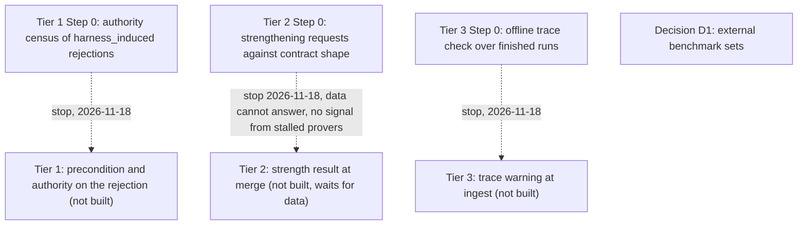

# Harness-Environment and Specification-Strength Papers: Generalization Analysis & Ranked Implementation Plan

This document reads three papers on LLM-driven verification and vulnerability detection (SpecAgent, AutoSOUP, SemScan), maps what each one offers onto the Frama-C agentic verification pipeline ([`../guides/v2-design.md`](../../guides/v2-design.md), [`../guides/agentic-swarm.md`](../../guides/agentic-swarm.md)), and sets out an implementation plan **ordered by expected value**. It follows the format of [`./papers-generalization-plan.md`](./papers-generalization-plan.md) and [`./proof-papers-generalization-plan.md`](../proof-papers-generalization-plan.md), and does not repeat work those plans cover. Claims about the pipeline were checked against the files on 2026-11-18, on branch `phase1-remediation`; every claim about a paper carries the section it comes from.

Limits on the reading and on the checks:

- **Read:** all pages of the three papers (SpecAgent 21, AutoSOUP 24, SemScan 15), reference lists skimmed. Not checked cell by cell: the per-repository cells of SpecAgent's Tables 2 and 3 (only the averages are used here), and SemScan's Tables 1, 3, 6 and 7.
- **Not checked in the pipeline:** whether [`../../scripts/api_harness.py`](../../../scripts/api_harness.py) emits the two argument-domain clauses that their regression tests assert (read from the test text only).
- **Measured:** Step 0 of all three tiers, on 2026-11-18, over finished runs on disk under `C:\Users\Florian\framac-pipeline\`. No Docker image or target was run.
  - Tier 3, over the 432 trace steps, locations and decision points of ten runs: a **stop**, with no line outside the function it names. See "Step 0 result" under Tier 3.
  - Tier 1, over the `findings.json` of five runs: a **stop**. See "Step 0 result" under Tier 1 and the census in Section 5.
  - Tier 2, over the `strengthen_requests.json` of six runs: a **stop, because the data cannot answer**. See "Step 0 result" under Tier 2 and the counts in Section 6.
  - Tier 2, second measurement on 2026-11-18, over the 53 stalled provers of libmodbus run-1 and then the 17 of QCBOR run-6: **no signal** in either, with almost no power to find one. See "Second measurement" under Tier 2 and Section 7.
- **Independent challenge:** one fresh agent checked the quoted numbers against the PDFs and the pipeline claims against the files, and argued against each candidate. Its objections changed Tier 1 and the gap list; they are answered in Section 3 ("Objections and what they changed").

Three tiers and one decision come out of it. None is a build that can start today: each tier begins with a measurement on data from finished runs, with its stop rule written here. SemScan yields one small check and nothing else.

**Status on 2026-11-18:**

- Tier 1 is closed by its Step 0. The rule it proposed does not flag one of the two wrong rejections it was designed for, and both of its narrowing conditions hold as well.
- Tier 2 is stopped and waits for data. Two measurements were made and neither supports building it.
  - No prover-filed request has a callee contract shape from before the request, so that question is undetermined, not answered with a no.
  - No stalled prover of libmodbus run-1 or QCBOR run-6 (70 in all) was held up by a postcondition missing from a proved contract. Neither run could have shown the effect: of 129 dispatched provers, eight had a directly called callee with a proved contract, and in libmodbus the other proved callees are called through function pointers, where WP never applies their contracts. Callers are dispatched before their callees are proved, by design, which also puts the tier's trigger point in doubt.
- Tier 3 is closed by its Step 0: no trace step, location or decision point of ten runs names a line outside its function.
- Decision D1 is open. No tier of this plan can be built today: two are closed and one is stopped.

---

## 1. What each paper does

### 1.1 SpecAgent (Ma, Wang, Liu, Wang, Bu; `arXiv:2610.05132v2`)

- **Setting:** synthesis of ACSL contracts and loop invariants for real-world C, checked with Frama-C/WP (Frama-C 32.0, Section 4.1). The WP memory model and timeouts are not stated.
- **Method (Section 3, Fig. 2):** four agents under a deterministic state machine (Section 3.5).
  - **Planning:** which functions and loops to specify, and in which order (Section 3.1).
  - **Generation:** ACSL edits only, no code change (Section 3.2.1), with up to three examples retrieved from a knowledge base of 184 function-level units taken from the ACSL tutorial. Retrieval is a 32-bit structural fingerprint, a coarse filter on loop structure and return type, then Jaccard similarity (Section 3.2.2, Fig. 3).
  - **Verification gate and repair:** WP results become a JSON report with each failure mapped to its source line and its caller or callee context (Section 3.3.1). The repairing agent may strengthen an upstream specification instead of the failing one, and may run WP and Eva (Section 3.3.2, Table 1).
  - **Critique:** on a proved set, a critique agent answers ACCEPT, IMPROVE (a local weakness, back to generation) or REPLAN (an interprocedural weakness, back to planning) (Section 3.4.1). It can run a "postcondition completeness probe": a harness calls the function twice with identical arguments and asserts that the two results are equal. If WP cannot prove it from the contract, the failed obligation and the counterexample go to the critic (Section 3.4.2).
- **Budgets (Section 4.1):** 10 steps for planning and critique, 30 for generation and repair, 10 agent invocations in total. When the budget runs out, the current candidates are output as they are (Section 3.5).
- **Results:**
  - **Specification quality (Table 2):** on 50 programs from 14 repositories with ground-truth specifications (average 456.44 LoC, Section 4.3), precision 96.82% and recall 88.95% with DeepSeek-V4; 96.10% and 82.77% with GPT-5. Recall is the share of ground-truth specifications covered, decided by a bidirectional implication checked with WP (Section 4.4).
  - **Ablation (Table 3, DeepSeek-V4, precision / recall):** generation only 89.78 / 80.93; plus planning 90.19 / 83.99; plus repair 94.79 / 82.08; full, with critique, 96.82 / 88.95. With GPT-5: 88.66 / 72.14; 87.51 / 71.51; 94.34 / 76.21; 96.10 / 82.77.
  - **Invocations (Fig. 5):** the share of trajectories that pass the verification gate rises from 36% at 2 invocations to 62% at 6, and stays between 60% and 64% up to 10.
  - **Verification targets (Table 4):** 604 of 811 discharged, against 523 for Codex, 468 for SpecSyn and 425 for Preguss. On the three programs with runtime-error targets it is 386 of 542 (X509-parser 140 of 140, Contiki 137 of 163, Atomthreads 109 of 239) against 337 for Preguss, which equals it on Atomthreads (109).
  - **Cost (Table 5, DeepSeek-V4):** 1684 s, 25.58 Frama-C calls, 99.40 LLM calls and 0.6228 USD per program.
- **Stated limits (Section 6.2):** adding a component changes the later trajectory, so the ablation measures "the contribution of each component within the overall workflow rather than as strictly independent causal effects"; the benchmark is small; WP is incomplete.
- **Not isolated by the paper:** the knowledge base, the completeness probe, and the effect of any component on the verification targets of Table 4. The critique step is ablated for recall against ground-truth specifications only.

### 1.2 AutoSOUP (Amusuo et al.; `arXiv:2605.10712v1`)

- **Setting:** component-level memory-safety verification of embedded C by bounded model checking (CBMC) with "unit proofs": a harness that fixes the scope, the loop bounds and the environment model, `V = (S_c, B, E)` (Section 3). Subjects: Zephyr, RIOT, Contiki-NG and FreeRTOS (Section 5.1). Concurrency is excluded (Section 3.2).
- **Method (Section 4, Fig. 2):** deterministic workflows hand bounded tasks to an LLM agent and validate each result before it enters the proof ("LLM-as-function-call", Section 4.1.2).
  - **Stage 1, scope (Section 4.2; Algorithm 3 in Appendix C.1):** start from the entry point's file and model external callees by type (unconstrained primitive returns; pointer returns as valid allocated objects). Widen by files while verification stays within the budget.
  - **Stage 2, loop bounds and models (Section 4.3, Algorithm 1):** for each uncovered property block, an agent classifies the blocker (a loop bound, compile-time configuration, or side effects of an external call that a return-only model lacks) and applies the matching local repair. A repair is accepted only if the proof stays valid, the block becomes covered and coverage does not decrease.
  - **Stage 3, environment (Section 4.4, Algorithm 2):** for each violation, an agent infers an approximate precondition that suppresses it. Then, for the call sites of the entry point and the implementations of modelled functions, an agent derives the path constraints and judges one of three outcomes: the precondition holds there and becomes an explicit assumption; a calling path violates it but the property still holds, so it is weakened; a calling path violates it and triggers the violation, which is reported as a memory-safety error. This validation is an LLM judgment, not a mechanical check.
- **Guarantee (Section 4.5.1):** the component is verified only under the scope, bounds and assumptions recorded in the unit proof.
- **Results:**
  - **Valid unit proofs (Table 1):** 93% of 57 targets at scope level 1 and 89.5% at level 2, against 31.6% for Codex; 129.8 and 363.7 minutes and 3.0 and 5.9 USD per proof.
  - **Known CVEs exposed (Table 2):** 40 and 39 of 60, against 17 for Codex and 25 for Seeker. Six and five more are "unexploitable": the sink was reached and the inferred precondition is valid in the calling context.
  - **New reports (Section 5.3.2, Table 3):** 63 and 99 potential violations with a violated precondition; "after reviewing a subset", 20 confirmed. One has a CVE. Four were fixed without one, because the maintainers considered that exploitation needed a prior compromise of the downstream application.
  - **A reported case (Appendix F):** an out-of-bounds `memcpy` in RIOT is reported because the validator traced the length back to a public API parameter and found no check on the way.
  - **Per stage (Table 4):** stage 3 is the most expensive of the three, at 141.5 minutes and 2.602 USD. After stage 2 the table gives 412.8 verified of 580.0 properties and after stage 3 531.6 of 539.0 (98.63%, Section 5.4.2). The prose of Section 5.4.2 says "up to 71.04% of reachable properties on average are violated" after stage 2, which the table does not support as printed.
  - **Shape of the inferred assumptions over 20 proofs (Table 5):** 62 pointer-not-null, 1 pointer-offset, 70 variable-against-constant, 8 variable-against-variable.
- **Misses attributed to CBMC (Table 2):** an overflow of a struct field that stays inside the struct is not reported (2 and 4 CVEs); unsupported sinks (2 and 2).
- **Stated limits (Section 4.5.2):** LLM steps; call-graph imprecision at indirect calls; file-level scope.
- **Status:** an arXiv preprint with conference-template placeholders and an anonymized artifact (Appendix B). One of the three exposure criteria is checked by hand (Section 5.3.1). The precision of the call-site validation is not reported.

### 1.3 SemScan (Xu et al., CCS 2026; `3830454.3846788.pdf`)

- **Setting:** taint-style vulnerabilities in Python repositories, given source and sink points (Section 3.1). For the 200-project run they are extracted with CodeQL and filtered by hand (Section 4.5). The paper does not say how the pairs of the 30-CVE benchmark were supplied.
- **Method (Section 3):** "evidence induction". Evidence is a set of tuples (summary, file path, start line, end line, raw code) (Section 3.7.2). Each round, a strong model synthesizes source-to-sink paths over the accumulated evidence and names the missing links as gaps; the gaps become tool tasks (repository listing, AST navigation, regex search) whose results small models turn into new evidence (Sections 3.5 to 3.7). Four principles (Section 3.3): bounded model inputs; paths re-synthesized from scratch each round instead of extended; a path is valid only if every step is backed by an evidence item; cheap models for local extraction.
- **Results:**
  - **Benchmark (Table 2):** 28 of 30 Python CVEs, against 21 for Claude Code, 19 for GPT-5.4 with hand-made prompts, 6 for RepoAudit, 1 for CodeQL and 0 for Semgrep.
  - **Ablation by call depth (Fig. 3; low, medium, high):** full 88%, 100%, 90%; without gap-guided expansion 75%, 50%, 50%; without re-synthesis 75%, 42%, 50%.
  - **In the wild (Section 4.5):** on 200 projects, 106 reports, 62 confirmed by proof of concept (58.49%), 22 CVEs.
  - **False positives (Section 4.5):** 31 of 44 from over-approximate CodeQL sources and sinks, 13 of 44 from missed validation or sanitization. On the CVE benchmark CodeQL recovers 17 of 30 source-sink pairs (Section 6).
- **Stated limits (Section 6):** it needs sources and sinks; it misses a path when several branches are feasible; no flow across requests through storage; Python only.
- **Not isolated by the paper:** the evidence-grounding principle. The ablation removes gap-guided expansion and re-synthesis only.

---

## 2. Mapping onto the pipeline

| Paper mechanism | Pipeline counterpart | Where |
| :--- | :--- | :--- |
| Repair revisits an upstream contract (1.1, Section 3.3.2) | Caller-to-callee strengthening requests and `negotiate` tasks, capped by `MAX_NEGOTIATIONS_PER_PAIR = 2` and `MAX_NEGOTIATION_ROUNDS_PER_CALLEE = 3` | [`../../scripts/contract_negotiator.py`](../../../scripts/contract_negotiator.py), [`../../scripts/wp_scheduler.py`](../../../scripts/wp_scheduler.py) |
| Failure report with source line and caller or callee context (1.1, Section 3.3.1) | WP report with goal buckets and diagnostic hints; the callers' call-site goals in the negotiate brief | [`../../scripts/run_wp_function.py`](../../../scripts/run_wp_function.py), [`../../skills/framac-wp/prover_brief.md`](../../../skills/framac-wp/prover_brief.md) |
| Critique of proved contracts feeding regeneration (1.1, Section 3.4.1) | **Partly.** Syntactically trivial clauses reach the prover at every iteration (`trivial_added`, `next_synthesis_focus: "drop_trivial_clauses"`). The mutation check is "purely evaluative" and `limits.contract_shape` is "reported only": neither reaches a prover or the Header Architect | [`../../scripts/prover_candidates.py`](../../../scripts/prover_candidates.py), [`../../scripts/mutation_check.py`](../../../scripts/mutation_check.py), [`../../scripts/run_wp_function.py`](../../../scripts/run_wp_function.py) (`contract_shape_limit`) |
| Completeness probe: two calls, equal results (1.1, Section 3.4.2) | none; the trivial-stub mutant asks the opposite question (does the contract constrain anything) | [`../../scripts/mutation_check.py`](../../../scripts/mutation_check.py) (`trivial_stub_mutant`) |
| Example retrieval by structural fingerprint (1.1, Section 3.2.2) | Keyword overlap between a query built from the function's features and sections of the manuals, plus mined repair items | [`../../scripts/spec_kb.py`](../../../scripts/spec_kb.py) (`function_query`, `query_kb`) |
| Deterministic workflow, bounded LLM tasks, validated results (1.2, Section 4.1.2; 1.1, Section 3.5) | Make and the scheduler decide; subagents judge; the parent re-verifies | [`../../scripts/pipeline_make.py`](../../../scripts/pipeline_make.py), [`../../scripts/wp_scheduler.py`](../../../scripts/wp_scheduler.py) |
| Type-directed input model, permissive first (1.2, Section 4.2) | `--api` cases read each parameter over its C type's domain, then argument-domain rules restrict named shapes (`_domain_rules`: ordered bounds, a lone bound forwarded by an inline wrapper, capacities, counts, enums). Each restriction is a free-text entry in the case's `notes`. Caller-derived facts already shape cases (`param_sizes`, variadic call sites, `bound_forwards`), and the generator states that caller literals are "not a contract" | [`../../scripts/api_harness.py`](../../../scripts/api_harness.py), [`../../schemas/harness_sidecar.schema.json`](../../../schemas/harness_sidecar.schema.json) |
| Precondition inferred from a violation, validated at call sites, recorded as an assumption (1.2, Section 4.4) | **Partly.** A Crash Verifier rejects a candidate as `harness_induced` when the decision point is "a `harness_choice` that no legitimate caller could make", states a `refutation_basis` (`checked` when a repaired harness copy no longer fails) and writes the harness change in free-text `record.reason`. The sidecar keeps `contract_notes` and `repair_history`. **Missing:** the precondition as a predicate, what its authority is (documentation, or the callers), and which callers were examined. The verifier receives no caller list, and a `rejected` record has no `decision_point` | [`../../skills/framac-wp/crash_verifier_brief.md`](../../../skills/framac-wp/crash_verifier_brief.md), [`../../schemas/findings.schema.json`](../../../schemas/findings.schema.json), [`../../scripts/generate_harness.py`](../../../scripts/generate_harness.py) |
| Coverage-gap classification and local repair (1.2, Section 4.3) | Eva `Dead` is a harness gap; `repair_hints` (`recursive_call`, `missing_spec`); static and dynamic reach gates | [`../../skills/framac-eva/SKILL.md`](../../../skills/framac-eva/SKILL.md), [`../../scripts/harness_reach.py`](../../../scripts/harness_reach.py) |
| External callee model: pointer return always valid (1.2, Section 4.2) | The stub skeleton leaves the question to the stub author ("result: a pointer; may it be NULL?") | [`../../scripts/stub_gen.py`](../../../scripts/stub_gen.py) (`skeleton_contract`) |
| Loop bounds chosen per loop from the properties they affect (1.2, Section 4.3) | Per-loop differential trials in Eva tuning, kept only if Unknowns fall and nothing turns Dead. Different purpose: unrolling changes Eva's precision, a CBMC bound changes what is covered | [`../../scripts/eva_tuning.py`](../../../scripts/eva_tuning.py) |
| Every path step backed by located code (1.3, Sections 3.3 and 3.7.2) | `trace` steps carry `file`, `line`, `function`, `description`. `check_trace` checks the order of step kinds and `_path_ok` that the path is relative. Neighbouring checks exist (the fingerprint's function against `location.function`; the decision-point patch against its location), and so does a line-to-function index (`_dag_line_index`). **Nothing checks a trace step's line against the named function** | [`../../scripts/validate_artifacts.py`](../../../scripts/validate_artifacts.py), [`../../scripts/ledger.py`](../../../scripts/ledger.py), [`../../scripts/decision_point_check.py`](../../../scripts/decision_point_check.py) |
| Gap-guided evidence collection (1.3, Section 3.5) | Proof gaps and strengthening requests in prover results; `deferred` files and "proof gaps" in code-auditor discovery | [`../../skills/framac-wp/prover_brief.md`](../../../skills/framac-wp/prover_brief.md), `skills/code-auditor/references/discovery.md` (removed when that skill became [`../../skills/threat-model/SKILL.md`](../../../skills/threat-model/SKILL.md)) |
| CodeQL sources and sinks as the starting specification (1.3, Section 4.5) | Optional CodeQL trust facts that "only add untrusted marks: a fact never makes a function trusted" | [`../../scripts/codeql_trust.py`](../../../scripts/codeql_trust.py) |

### 2.1 Verified gaps

1. **A `harness_induced` rejection does not say what the harness violated, nor on whose authority.** *Note of 2026-11-18: this is the gap as understood before Tier 1's Step 0. The census found that the two wrong rejections also cite documentation and derive the bound from it; see "Step 0 result" under Tier 1.*
   - **What the code does.** The verifier brief's test is "a `harness_choice` that no legitimate caller could make". The brief has no rule on what makes a caller legitimate for a function the public header exports, the verifier gets no caller list, and the record holds free text.
   - **Cost, wrong rejections.** Two real public-API bugs were rejected as `harness_induced` because the verifier read the in-tree callers' usage as the contract: QCBOR run-5 #26, where "the harness repair then removed the input that triggered it" ([`../runs/2026-11-09-qcbor-run5-assessment.md`](../../runs/2026-11-09-qcbor-run5-assessment.md)), and `EncodeHead` in run-6 ([`../runs/2026-11-15-qcbor-run6-findings-assessment.md`](../../runs/2026-11-15-qcbor-run6-findings-assessment.md)). The same reasoning was right for private helpers in both runs.
   - **Cost, volume.** On libmodbus run-1, 12 of the first 14 gate verdicts were `rejected` `harness_induced` ([`../runs/2026-11-18-libmodbus-run1-supervision.md`](../../runs/2026-11-18-libmodbus-run1-supervision.md)). The run's own report, `docs/runs/2026-11-18-libmodbus-run1.md` (on disk, not yet committed, so not linked), gives 20 of 26 pre-repair candidates, with two repair rounds and module rebuilds of 555 s and 559 s. mpack run-4 shows the same class on a `realloc` dispatch case ([`../troubleshooting/harnesses-and-seeds.md`](../../troubleshooting/harnesses-and-seeds.md)).
   - **Already fixed around it.** Opposite verdicts at one sink are now reconciled (`_reconcile_sink_conflicts`). The reasoning error itself is not addressed: [`../troubleshooting/ledger-and-verifier.md`](../../troubleshooting/ledger-and-verifier.md) says the brief "should say that an exported function's contract is its header documentation, not its callers' usage", and the brief does not say it today.
2. **Mutation and contract-shape results never reach a prover.** `mutation_check.py` runs on proved functions and writes a report, and `contract_shape` is reported only. A weak callee contract is strengthened only when a caller's proof stalls and files a request. No count exists of how many prover-filed requests target a callee whose contract was `safety_only` or accepted the trivial stub, so the cost of this gap is not measured. [`./proof-papers-generalization-plan.md`](../proof-papers-generalization-plan.md) (Tier 3, "Later, only with data") already defers this feedback until such a count exists. *Note of 2026-11-18: Tier 2's Step 0 tried to make that count and could not: the callee's shape is unknown for every prover-filed request on disk. Among the 70 stalled provers of libmodbus run-1 and QCBOR run-6, none was held up by a weak proved contract, but few callers were dispatched after a callee's proof (Section 7). The cost of this gap is still not measured; see "Step 0 result" under Tier 2.*
3. **A trace step is not checked against the source.** A verifier record can name a line that lies outside the named function and validation passes. No such record has been observed, so this gap has no known cost. *Note of 2026-11-18: Tier 3's Step 0 looked for one in ten runs (432 sites) and found none.*

Recorded, not planned:

- [`../troubleshooting/harnesses-and-seeds.md`](../../troubleshooting/harnesses-and-seeds.md) still marks two argument-domain clauses as open (a signed `*_max` limit, a size slot clamped only from above), while [`../../tests/test_api_harness_arg_domains.py`](../../../tests/test_api_harness_arg_domains.py) asserts both. The entry should be closed when that file is next edited.
- [`./backlog.md`](../backlog.md) has no section for the tiers of [`./proof-papers-generalization-plan.md`](../proof-papers-generalization-plan.md).
- The fix that [`../troubleshooting/ledger-and-verifier.md`](../../troubleshooting/ledger-and-verifier.md) suggests for the opposite-verdicts entry (a brief line on header documentation against callers' usage) looks insufficient after the census of 2026-11-18: the run-6 verifier already cited the header. The entry itself was not edited.

---

## 3. Ranked plan (by expected value)



| Rank | Upgrade | Paper origin | Value | Risk |
| :---: | :--- | :--- | :--- | :--- |
| 1 | Precondition and its authority on a `harness_induced` rejection. **Closed by its Step 0 (2026-11-18), not built** | 1.2 (Section 4.4, Algorithm 2, Appendix F) | As ranked before the measurement. Medium-high: closes gap 1, seen as two wrong rejections of real bugs in two consecutive QCBOR runs. Evidence `measured elsewhere` (CBMC, RTOS internals; the call-site step's precision is not reported). Transfer `same kind of tool` (harness-based component analysis of C), but the paper's entry points are internal functions and the pipeline's are mostly public | Medium: a caller table can be read as an endorsement, which is the observed error. Cost: `script and flag` (a brief, an optional schema field and four scripts; no flag is needed, since no status depends on the field) |
| 2 | Strength result at merge, after a measurement. **Stopped by its Step 0 (2026-11-18): the data cannot answer. Stalled provers of libmodbus run-1 and QCBOR run-6 (2026-11-18): no signal. Not built** | 1.1 (Section 3.4, Table 3) | As ranked before the measurements, neither of which could have shown a cost for gap 2. Low-medium until measured: gap 2 has no observed cost. Evidence `measured on our toolchain`, `ablated`, but for recall against ground-truth specifications, not for proofs of runtime-error targets. Transfer `same toolchain` | Medium: prover invocations spent on strength no caller needs. Cost: `script and flag` |
| 3 | Trace steps checked against the function they name, after a measurement. **Closed by its Step 0 (2026-11-18), not built** | 1.3 (Sections 3.3 and 3.7.2) | Low: gap 3 has no observed cost. Evidence `measured elsewhere`, not ablated. Transfer `different setting` (Python taint paths) | Low if it only warns. Cost: `script and flag` (one validator function; no flag is needed for a warning) |
| D1 | External benchmark sets | 1.2 (Section 5.1), 1.1 (Section 4.3) | Depends on whether a harder recall set is wanted: the seeded set is at 7 of 7 | Medium: build effort and numbers that are not comparable |

The three tiers are independent. Tier 2 is the Step 0 that Tier 3 of [`./proof-papers-generalization-plan.md`](../proof-papers-generalization-plan.md) left open.

### Common requirements

The requirements of [`./formal-discovery-plan.md`](./formal-discovery-plan.md) ("Common requirements for every tier") apply unchanged: an A/B environment flag for behaviour changes (added to both wrappers, `docker-compose.yml` and `tests/test_remediation_p2_container.py`), acceptance on a `benchmark.py` run compared with `benchmark_compare.py`, guides and briefs updated in the same change (then `python tools/sync_skill_mirrors.py`), tests run with `-n auto`. Any pipeline bug found on the way goes into [`../troubleshooting/`](../../troubleshooting/README.md) in the same session.

### Objections and what they changed

| Objection (challenger) | Answer |
| :--- | :--- |
| A call-site table makes in-tree callers the oracle for a contract. That is the reasoning behind the two wrong QCBOR rejections: for a function the header exports, the table reads "every site satisfies it" and endorses the rejection | **Accepted; Tier 1 is rebuilt around it.** The record now names the authority of the precondition. Callers are an authority for a private function only. For an exported function the table is not asked for, and a rejection that rests on callers alone is flagged |
| "The reverse risk has not been observed" is wrong (run-5 #26, run-6 `EncodeHead`) | **Accepted.** Gap 1 is rewritten with both cases; they are its main cost |
| "Not recorded in a checkable form" is overstated: `contract_notes`, `repair_history`, `refutation_basis` exist | **Accepted.** The mapping row and gap 1 now name only what is missing |
| Caller-derived facts already shape the harness, and the generator calls them "not a contract" | **Accepted.** The mapping row says so. Tier 1 does not add caller facts to the generator |
| The model records call sites for non-test units only, so "the target's tests" are not call sites it can list | **Accepted.** Tests are dropped from Tier 1's caller list |
| The paper's call-site validation is an LLM judgment with unreported precision; AutoSOUP set aside 6 and 5 of 60 CVEs as unexploitable | **Kept as a limit of Tier 1.** Not settled by anything here |
| libmodbus's rejections are mostly object size, lifetime and type-state, not the scalar shapes of Table 5 | **Settled by Step 0 (2026-11-18), in the challenger's favour.** No libmodbus rejection is a scalar predicate (14 object size, 6 lifetime, 1 type-state); over all five runs 23 of 76 are |
| Strength feedback is already planned and gated on data; `contract_shape` exists only on `all_proven` reports and scheduler-filed "caller needs a contract" requests must be excluded | **Accepted.** Tier 2 is that measurement, with both pitfalls in its design. Run on 2026-11-18: both pitfalls decided it. 273 of 305 requests are scheduler-filed, and no prover-filed request has a shape from before it was filed |
| Trace grounding has no shown value; a failed validation costs a verifier re-run; entry-point steps lie in the harness file; lines drift after ACSL splices | **Accepted.** Tier 3 starts offline, and would warn, never fail. Run on 2026-11-18: no mismatch in 432 sites, so the objection held; the five drift cases and the 48 harness sites it predicted were found |
| The benchmark sets are costly and their numbers are not comparable with ledger units | **Accepted.** D1's options and recommendation reflect it |
| Paper anchors: Algorithm 3 is in Appendix C.1; the 71.04% sentence disagrees with Table 4; 141.5 minutes is Table 4's stage figure, not a share of Table 1's; CodeQL is used for the 200-project run only; grounding is not ablated; SpecAgent ties Preguss on Atomthreads | **Accepted.** Section 1 is corrected on each point |

---

### Tier 1: Precondition and its authority on a `harness_induced` rejection

**Problem.** Gap 1. AutoSOUP's rule is that a restriction of the environment is an assumption with a statement and a validation, never a silent narrowing (Sections 4.4 and 4.5.1). Its own results show where the validation must stop: a violation is reported when no check exists up to a public API parameter (Appendix F), and maintainers dismissed four reports as misuse by the downstream application (Section 5.3.2). So the authority differs by visibility, and that is the distinction the two wrong QCBOR rejections missed.

**Step 0: authority census (no pipeline change).** Take every `harness_induced` rejection in `findings.json` of libmodbus run-1, mpack run-3 and run-4, and QCBOR run-5 and run-6. For each one, record by hand:

- whether the entry function is exported (declared in one of the capture's `public_headers.files`) or private. [`./header-entry-points-plan.md`](../header-entry-points-plan.md) (HD1) applies no naming rule, so a `_Private_` helper defined in a public header is an entry point: count these apart, since they are reachable from the header but are not the documented API;
- how many call sites the Phase 0 model lists for it;
- what the verifier's reason actually rests on: documentation (a header comment, a manual), a check or assertion in the function's own body, the callers' usage, or nothing located;
- whether the violated precondition is a predicate over the parameters (the shapes of the paper's Table 5) or an object-size, lifetime or type-state condition;
- the assessed truth, where a run assessment gives one.

**Stop or go.**

- **Stop** if the proposed rule (below) would not flag run-5 #26 and run-6 `EncodeHead`, or if it would flag more than one in ten of the rejections that the assessments judged correct. A rejection whose reason rests on nothing located counts as flagged when the function is exported. Record the table here and close the tier.
- **Narrow** if fewer than a third of the rejections reduce to a predicate over the parameters: keep the authority field and the brief rule, drop the predicate.
- **Narrow** if nearly all rejected entry points are exported: drop the call-site table and keep the authority.
- **Go** otherwise.

**Step 0 result (2026-11-18): stop.** The census covers the 76 `rejected` / `harness_induced` records of the five runs (QCBOR run-5: 3, run-6: 6; libmodbus run-1: 21; mpack run-3: 7, run-4: 39). The codebook was fixed before the records were read, except for two columns added during the reading (Section 5.1 says which); the counts and the per-record coding are in Section 5.

- **The rule does not flag run-6 `EncodeHead`, under any reading.** Its verifier did not rest on the callers. It cited the header (`inc/qcbor/qcbor_main_encode.h:196-201` and the description of `uMinLen`) and a source comment, and derived `uMinLen <= 8` from them. Under this tier it would have written `authority: documentation` with a file and a line, and nothing would be flagged. Run-5 #26 is flagged only if a source comment is not counted as an authority. So the first stop condition holds.
- **A flag keyed on "callers alone" cannot fire.** Callers' usage is cited in at least 52 of 76 records (the mpack run-4 text was read in excerpts), but it is the only authority in 1, and the strongest in 2 by the codebook's order. Documentation or an assertion is cited next to it in 60. In both wrong rejections the verifier cites the callers and also documentation, and derives the bound from documentation that does not state it. Such a derivation occurs in 17 records: 15 cite a located document or assertion, 2 a source comment or a document with no file. The two QCBOR assessments name the cause as "callers' usage as the contract"; the record text fits that reading and this one, since both arguments stand side by side in it. For the same reason the brief line that [`../troubleshooting/ledger-and-verifier.md`](../../troubleshooting/ledger-and-verifier.md) asks for ("its header documentation, not its callers' usage") probably would not have changed the run-6 verdict: that verifier already argued from the header.
- **Both narrowing conditions hold too.**
  - **No private entry.** All 76 entries are declared in a public header: 52 plain, 17 defined there as `static inline`, 7 with `_Private_` in their name. A call-site table has nothing to apply to.
  - **Under a third are predicates.** 23 of 76 records (30%) are a predicate over scalar parameters; 37 (49%) when a field of a struct parameter counts. The rest are object size (15), lifetime or ownership (14), type-state (8) and sentinel-terminated arrays (2). libmodbus has none of the first kind in 21 records.
- **False flags.** 0 of the 7 rejections judged correct, if `_Private_` functions are not counted as exported. If they are: 7 of 7 (a body comment or the code's structure is no authority) or 1 of 7 (they are). All 7 are on `_Private_` functions that sit in installed headers, so "declared in a public header" cannot stand for "public API". The denominator is 7, which is too small to carry the one-in-ten rule either way.
- **On the 67 records with no assessment:** the rule flags 8 under the strict reading and none under the lenient one.

**What the census suggests instead (an observation, not a tier).** Taking "exported, and the precondition is not stated by a cited sentence or assertion" as the test flags 24 records: the two `EncodeHead` records and 22 unassessed ones. Most of those 22 are plain harness faults (a stack object given to a destructor, a static buffer given to `realloc`, a dropped allocation), so it is no verdict rule. Adding "and the precondition is a predicate over scalar parameters" leaves 3: the two `EncodeHead` records and mpack run-4 `mpack_reader_init` with `count > size`. This filter was found after seeing the two cases it is meant to catch, so the census does not validate it. It would need a run that was not used here, and "stated or derived" is a judgment a script cannot make.

**Limits of the census.**

- One coder, from the record text only; the target's sources were not opened to check a verifier's citation.
- For mpack run-4 the authority was read from the sentences of each record that mention documentation, assertions, callers, tests or the contract (up to 1,500 characters per record), not from the full text.
- The capture of libmodbus run-1 has an empty `public_headers.files`, the known gap for targets with shared libraries only ([`../troubleshooting/harnesses-and-seeds.md`](../../troubleshooting/harnesses-and-seeds.md)). The headers of the target's `include_HEADERS` were read instead. For mpack the list comes from the `outside_source_dirs` method and also holds test and example headers. Any later rule that reads `public_headers` inherits both.
- The call-site counts of Section 5.4 are indicative only: one entry stands for each record, a call to an inlined function may be recorded under another name, and the run-5 model records no call site for the three QCBOR entries although run-6 does on the same sources. No conclusion above rests on them.

**Changes (designed before Step 0; not built).**

- [`../../skills/framac-wp/crash_verifier_brief.md`](../../../skills/framac-wp/crash_verifier_brief.md), "Audit Harness Legitimacy":
  - State the rule that [`../troubleshooting/ledger-and-verifier.md`](../../troubleshooting/ledger-and-verifier.md) asks for: the contract of a function the public header exports is its documentation and the checks in its own body, not its callers' usage. Callers define the contract of a private function only.
  - On a `harness_induced` rejection, write `record.harness_precondition` (below).
  - For an exported function with no located documentation and no check in its body, the authority is `none_located`. The verifier may still reject (a stack object passed where the library's constructor is the only source, for instance), but it says so, and the rejection is flagged for a reader. Step 0 shows how common this case is; on libmodbus it is likely the largest one.
  - For a private function, list each call site the brief supplies with one of AutoSOUP's three outcomes: `holds`, `violated_safe`, `violated_failing`. One `violated_failing` site means the candidate is not harness-induced.
- [`../../schemas/findings.schema.json`](../../../schemas/findings.schema.json): an optional `harness_precondition` object on `rejected` records:
  - `statement`: the precondition in words, and `predicate` when it can be written over the entry function's parameters;
  - `authority`: `documentation`, `callee_check`, `callers` or `none_located`, with `file` and `line` for the first two;
  - `call_sites`: for `callers`, a list of `file`, `line`, `function`, `outcome`.
  - Optional, so existing records still validate.
- [`../../scripts/workspace_overlay.py`](../../../scripts/workspace_overlay.py), `prepare_agent` for the verifier role: render the entry function's call sites from the Phase 0 model (non-test units), and whether the function is exported.
- [`../../scripts/ledger.py`](../../../scripts/ledger.py), `cmd_ingest_verifier`: record the field in the unit's attempt entry. Compute `authority_flag` in three cases: an exported function whose authority is `callers` or `none_located`; a `callers` authority with a `violated_failing` site; a `callers` authority whose table omits a call site the model lists. **Report only:** no status changes.
- [`../../scripts/generate_harness.py`](../../../scripts/generate_harness.py), `--record-repair`: copy the statement and authority into `repair_history`, so a restriction applied by a repair keeps its justification in the sidecar.
- [`../../scripts/generate_report.py`](../../../scripts/generate_report.py): a "Harness assumptions" list per module, and the flagged rejections under the verdict limits.
- **Flag:** none. The field is optional and no status depends on it, as for Tier 3 of [`./papers-generalization-plan.md`](./papers-generalization-plan.md).
- **Tests:** `tests/test_promote_and_verifier.py` and `tests/test_ledger.py` (ingest with and without the field, each flag case, both record shapes validating), `tests/test_workspace_overlay.py` (the call-site list and the exported mark in the brief), `tests/test_generate_harness.py` (the repair history entry).

**Acceptance.** On one re-run of QCBOR and one of libmodbus: every `harness_induced` rejection carries the field; the flag list is read against the run's assessment. What must not get worse: the number of `confirmed` and `needs_validation` records that the assessment judges false. The rule moves candidates on exported functions away from `rejected`, and libmodbus run-1's single `confirmed` record was already a false positive. Only after that reading, decide whether a flagged rejection should be re-verified automatically (the `sibling_verdict` reopening path exists) instead of only reported.

**What does not transfer, and unsettled objections.**

- The automatic inference of preconditions from a model checker's counterexample. Here the verifier already states the harness change; the tier only gives that statement a shape.
- AutoSOUP's exposure and validity rates: CBMC on RTOS-internal entry points with a 30-minute budget (Section 5.1).
- **Unsettled:** the call-site outcomes are an LLM judgment in the paper and would be one here; nothing measures their precision. The ingest check catches an omitted call site, not a wrong outcome.
- **Unsettled:** a documented precondition can itself be wrong or missing (`EncodeHead`'s `uMinLen` was "documented without an upper bound"). An authority of `documentation` with a located line is checkable by a reader, not by a script.

### Tier 2: Strength result at merge, after a measurement

**Problem.** Gap 2. SpecAgent's critique step raises recall from 82.08 to 88.95 and from 76.21 to 82.77 (Table 3). That is strength against ground-truth functional specifications. The pipeline needs strength only where a caller's proof needs it, and negotiation already supplies it on demand, at up to three rounds per callee.

**Step 0: requests against contract shape (one scratch script over finished runs).**

- From each run's `strengthen_requests.json`, keep prover-filed requests only: drop the scheduler's `caller needs a contract` requests (`CONTRACT_REQUEST_REASON`) and the structural rejections (`not dispatched:`).
- For each remaining request, find the callee's contract **as it was when the request was filed**: the promoted WP report that precedes the negotiation, not the current one, since `limits.contract_shape` is written on `all_proven` results only and a later proof overwrites it. Where no such report exists, count the request as `shape unknown`.
- Count: requests whose callee was `safety_only` or accepted the trivial stub (when `mutation.json` exists), against the share of such callees among all proved functions that have callers.

**Stop or go.**

- **Stop** if `safety_only` callees are not over-represented among requested callees, or if `shape unknown` exceeds half of the requests (then the data cannot answer and the tier waits for runs that keep the earlier reports). Record the counts here and in the proof-papers plan.
- **Go** if they are over-represented by a clear margin on at least two targets.

**Step 0 result (2026-11-18): stop, because the data cannot answer.** The counts and the per-request reading are in Section 6.

- **The rule.** Six runs hold a `strengthen_requests.json`, with 305 requests. 273 were filed by the scheduler (`caller needs a contract`) and 32 by provers. Five of the 32 are structural rejections (`not dispatched:`), which leaves **27**.
- **Shape unknown: 27 of 27**, so the second stop condition holds. The first condition was not evaluated: nothing here says whether `safety_only` callees are over-represented or not.
  - 26 requests are from QCBOR run-2-deep, run-3 and run-6. Those runs predate `limits.contract_shape`: none of their WP reports carries it.
  - The one request from libmodbus run-1 names `modbus_strerror`, which has no WP report in that run: the negotiation opened for it ended `stalled_after_k_retries`.
- **A go was not reachable in any case.** The field exists on one target only (libmodbus run-1: 41 proved functions, 24 `functional` and 17 `safety_only`), and the rule asks for two.
- **The trivial-stub arm was not measured.** No run has a `mutation.json`.

**What the reading shows (outside the rule).** The classes below were assigned after reading the requests, with no codebook fixed beforehand.

- **No request asks to strengthen a proved contract, which is the kind Tier 2 targets.**
  - 24 of the 27 ask for a first contract on a callee that has none the caller's proof can see.
  - Two name a proved callee (`UsefulOutBuf_Reset`, QCBOR run-6): one reports a merge-order problem and the other asks to drop two `requires` clauses.
  - One asks to add an `ensures` to an existing contract (libmodbus run-1, `req_0014`: `valid_read_string(\result)` on `modbus_strerror`, whose contract in `workspace/contracts/src/modbus.h` has `terminates`, `exits` and `assigns` only). That contract has no proof on record, and who wrote it was not traced.
- **Callers do ask for facts about results, but in first-contract requests.** 12 of the 27 ask for at least one `ensures` (a result range, a tag among the documented values, a preserved field). Two of the 12 are weak evidence: run-6 `req_0002` restates a contract that was already proved, and run-6 `req_0015` says its own caller does not need the clause.
  - After QCBOR run-6 the scheduler files the first-contract request itself, for callers whose prover is still pending (`_contract_less_callees` in [`../../scripts/wp_scheduler.py`](../../../scripts/wp_scheduler.py)). Its text asks for the callee's frame only (`_callee_frame_clause`, or "a function contract with a sound assigns clause").
  - A negotiate brief also carries each caller's unproven goals at the call site, unless `FRAMAC_NEGOTIATE_EVIDENCE` is `off` (the same file). A caller that has not run yet presumably has none to pass. That is an inference, and what the negotiator received in these runs was not read.
- **Provers stall without filing a request.** libmodbus run-1 is the only run made since then in which provers ran (`state/wp_schedule.json`): 35 prove tasks merged, 53 ended `stalled_after_k_retries`, and one prover filed a request. This is not a sign of hidden need: 29 of the 53 call no function of the target, so they had no callee to ask (second measurement, below). In mpack run-3 and run-4 every prove task is `pending` or `skipped`, so their 174 scheduler-filed requests say nothing about provers.

**Limits of the measurement.**

- This is evidence neither that weak callee contracts cost nothing nor that they cost something. In libmodbus run-1, 15 of the 16 callers whose first-contract request was applied have no WP report. Their provers ran: 14 ended `stalled_after_k_retries` and one `analysis_error`, and none filed a request. Why they stalled was not read for this measurement; the second measurement below reads it.
- 26 of the 27 requests come from one target and 21 from one run.
- The libmodbus shapes are read from the final reports, after negotiation. They give a base rate (Section 6.3), not the shape at the time of a request.

**What a new measurement needs.** The first two conditions are the rule's; the third was added after this measurement.

- The callee's shape at the time of the request. A run keeps one report per function (`workspace/reports/wp/<function>.json`), which a later proof replaces, and a request record does not store the shape. Until one of the two is kept, the join works only for a callee that is not proved again after the request.
- The field on at least two targets. `run_wp_function.py` (`contract_shape_limit`) now writes it on every `all_proven` report, so new runs will have it.
- More than a handful of prover-filed requests against a callee that already has a proved contract. The rule set no minimum; one request cannot show over-representation, whatever its callee's shape.

**Second measurement: the stalled provers of libmodbus run-1 (2026-11-18, asked for by the user).** Requests are too rare to wait for, so the stalled callers were read instead: does a stalled prover's reported gap name a postcondition missing on a callee whose contract was already proved? The codebook, the rule and the per-prover table are in Section 7. The rule was fixed before the gaps were read. One target cannot give Tier 2's go, so its outcomes were "no signal", "signal, repeat on a second target" and "undetermined".

**Result: no signal, and the measurement had almost no power to find one.**

- **No stalled prover is a Tier 2 case: 0 of 53.** At least 39 had no callee with a proved contract when they were dispatched (29 call no function of the target at all). The other 14 had at most 35 such callees between them, and none of their 139 unproven goals rests on a postcondition missing from a proved contract. The 14 and the 35 are upper bounds: the model's indirect edges pair a caller with more backend functions than it calls (Section 7.2).
- **The callers could not see the proved contracts.** All but 2 of the pairs are calls through the backend table (`ctx->backend->...`). Their targets are `static` in `modbus-tcp.c` and `modbus-rtu.c`, WP is run on `modbus.c` alone, and no `calls` clause can name them, so WP applies its default specification whatever the callee's contract says. This is the open limitation already recorded in [`../troubleshooting/wp-and-guardrail.md`](../../troubleshooting/wp-and-guardrail.md) ("An Indirect Call Through a Function Pointer Cannot Be Framed..."). The two direct pairs are both in `_modbus_receive_msg` and both `functional`. What fails there is the `requires` of `compute_data_length_after_meta` after an earlier unknown call, not a postcondition; no gap names the other callee.
- **So a shape hint would have changed nothing in this run.** A caller cannot be helped by a stronger contract it never applies. On this target the blocker lies before contract strength: contracts that are invisible (the calls through the table) or absent (`send_msg`, `_modbus_receive_msg`, `check_confirmation` and `_error_print` have none, and at least twelve of the 14 callers call one of them).
- **It does not say that contract strength never matters.** A target whose stalled callers call proved callees directly is still needed. QCBOR run-6 was read next for that reason (below). No prover ran in the mpack runs.

**What the reading adds (outside the rule).**

- **The shape label and what a caller needs can differ.** At least four of the 14 callers (`modbus_mask_write_register`, `modbus_report_slave_id`, `modbus_write_bits`, `modbus_write_registers`) need a bound on the result of `build_request_basis`. The TCP target's contract is `safety_only` by the label, and it states exactly that: `ensures result_length: \result == _MODBUS_TCP_PRESET_REQ_LENGTH` (a constant result is not `functional` by the Tier 3 definition). It does not state the initialized range that the same callers' `L5_sanitized_send_msg` goal needs, and that property is false at the call site anyway ([`../troubleshooting/security-properties.md`](../../troubleshooting/security-properties.md)). One case; it suggests that the shape is a coarse proxy for what callers lack.
- **Why provers stall without filing a request.** The result of each of the 53 provers was compared with the store: one request is listed, and it is the one in the store. For the callees that have no contract, filing is ruled out by the brief: its "Calls Without a Contract" section ([`../../scripts/workspace_overlay.py`](../../../scripts/workspace_overlay.py)) names the callees for which the pipeline could not get a contract, and several provers cite it as the reason they filed nothing. The rarity of requests in this run is therefore by design, and says nothing about contract strength either way.

**Limits of the second measurement.**

- One target, one run, and one architecture (a table of function pointers to `static` backends) that hides the proved contracts.
- A gap is the prover's claim. No case reached the check against the callee's contract, since no gap named a proved callee's missing postcondition.
- The goals of the 39 provers outside the cut were not coded: by the cut they cannot be Tier 2 cases. The five other blocked provers (`blocked`, `analysis_error`, `merge_failed`) were not read.
- For eight of the 14 provers, a goal whose reason says in so many words that the callee's contract is not visible was counted by a keyword match and not read; every other goal and every gap summary was read. This departs from the codebook, which asks for each goal to be coded.
- Shapes are those of the final reports.

**Same rule on QCBOR run-6 (2026-11-18, asked for by the user): no signal, and again little power.** The proved callees found there are called directly, so their contracts are visible to the caller. Details are in Sections 7.4 and 7.5.

- **0 of 17 stalled provers is a Tier 2 case.** Two had a callee with a proved contract at dispatch (`IEEE754_DoubleToInt` and `IEEE754_SingleToInt`, both calling `IEEE754_Private_CountPrecisionBits`). Neither gap names that callee: 12 of their 13 open goals are casts and shifts that the Typed model cannot bound, and one is the frame of a callee with no contract.
- **The other 15 had no proved callee to lean on.** Five call no function of the target, and ten call functions that had no proved contract yet.
- **The situation Tier 2 addresses hardly exists in the runs on disk.** Over both runs, 129 prove tasks were dispatched, and eight of them had a directly called callee with a proved contract. Two of the eight merged, three stalled, one ended in an analysis error and two have no outcome. Of the 44 provers that merged, 38 are leaves (they call no function of the target), four call functions that had no proved contract at their dispatch, and two had a proved callee.
- **This is partly by design, and it bears on the tier.** A caller is released as soon as its callee has a contract in `workspace/work/`, without waiting for the callee's proof (`_compute_deps` in [`../../scripts/wp_scheduler.py`](../../../scripts/wp_scheduler.py), "speculative contract-first dispatch"). So the contract a caller meets is usually the initial, unproved one, and a later run will not necessarily have more callers of proved callees.
- **What this means for the tier.** Neither run supports building it, and neither could have refuted it. The count of Section 7.5 is mechanical and can be repeated on any later run before anything else is read. If the question is taken up again, the thing to measure is the contract the caller sees at its dispatch, proved or not; that measurement is not designed here.

**Unsettled objection (added by these measurements).** The change designed below attaches the shape when a callee merges and names it in the briefs of callers that are not yet proved. With contract-first dispatch, most callers are already running by then: here it would have reached at most eight of 129 provers through direct calls. The one weak contract that a stalled prover did name was an initial one that was never proved (`modbus_strerror`, the same case as the single prover-filed request); a keyword scan of the stalled provers outside the cut found no other, and that scan is not a reading.

**Changes, only on go.**

- [`../../scripts/wp_scheduler.py`](../../../scripts/wp_scheduler.py), `cmd_complete`: when a merged function is `safety_only` and has callers that are not yet proved, attach the shape, and the trivial-stub verdict when one exists, to the function's task record.
- [`../../scripts/workspace_overlay.py`](../../../scripts/workspace_overlay.py), `prepare_agent`: a caller's brief names its `safety_only` callees, so the caller files its strengthening request on the first iteration instead of after stalling. No prover is re-queued for strength alone: the caller remains the one that decides what it needs.
- **Flag:** `FRAMAC_CALLEE_SHAPE_HINT` (default off until the A/B).
- **Tests:** `tests/test_wp_scheduler.py`, `tests/test_workspace_overlay.py`.

**Acceptance.** Benchmark A/B on the flag: fewer prover iterations per proved caller and no more negotiation rounds in total; no rise in `rejected_overconstrained`.

**What does not transfer.**

- An eager IMPROVE loop on every proved contract. The paper's metric rewards strength for its own sake; here it would spend invocations where no caller asks.
- The 88.95% recall as an estimate for the pipeline: it is measured against ground-truth specifications that the pipeline's targets do not have.
- The effect on proofs of runtime-error targets: on those SpecAgent is at 386 of 542 against 337 for Preguss, ties it on Atomthreads, and the paper does not ablate any component there.

### Tier 3: Trace steps checked against the function they name, after a measurement

**Problem.** Gap 3. SemScan accepts a path only if every step is backed by a located code fragment (Section 3.3, Principle 3). The paper does not ablate this principle, and no bad trace has been seen here.

**Step 0: offline check (one scratch script).** Over the `findings.json` of every finished run still on disk, for each `trace` step, `location` and `decision_point`: resolve the file in the run's `workspace/work/`, and test the line against the named function with the index `ledger._dag_line_index` builds. Skip steps in a harness file, which the DAG does not hold. Allow a slack of a few lines, as `decision_point_check.patch_at` does for a patch location (`LINE_SLACK`), and count a mismatch that a later ACSL splice explains (the line is in the function once the spliced lines are subtracted) as drift, not as a hit.

**Stop or go.**

- **Stop** with zero mismatches, or with mismatches that are all line drift after an ACSL splice. Record the count; nothing is built.
- **Go** if at least one record names a line outside its function for a reason other than drift.

**Step 0 result (2026-11-18): stop. No site names a line outside its function.** Ten runs have a `findings.json` and a `callgraph_dag.json`: CryptoLib run-1, libmodbus run-1, mpack run-3 and run-4, QCBOR run-1, run-2, run-2-deep, run-3, run-5 and run-6. They hold 432 sites: 209 trace steps, 198 `location` records and 25 decision points.

| Outcome | Sites | Trace steps | `location` | Decision points |
| :--- | ---: | ---: | ---: | ---: |
| The line is inside the named function | 365 | 179 | 161 | 25 |
| Drift: inside once the spliced ACSL lines are subtracted | 5 | 0 | 5 | 0 |
| The name is a kernel alias; the line is inside the function under its source name | 5 | 2 | 3 | 0 |
| Skipped: the file is not in the DAG | 57 | 28 | 29 | 0 |
| The line is outside the named function | **0** | 0 | 0 | 0 |

- **Drift:** the five are `location` records of rejected candidates in libmodbus run-1 (`src/modbus.c`), whose line is the one in `workspace/work/` after contracts were spliced in, 52 to 103 lines below the snapshot line.
- **Aliases:** four sites name `__framac_target_main` for `main` of `examples/sax-example.c` (mpack run-3 and run-4), and one names `mpack_read_native__fc_inline_1`. The DAG has neither name, so the plain check could not find the function; under the source name the line is inside it in all five. Both kinds of name are known kernel names, already described in [`../troubleshooting/`](../../troubleshooting/README.md).
- **Skipped:** 48 sites are in a harness file, as the step foresaw. Seven are in Frama-C's libc headers, one is in a verifier's scratch driver, and one has the file `unknown`.
- **No site needed the slack:** every match is inside the function's own lines.
- **The check was tested.** A real site moved 6 and 200 lines past its function's end, to line 1 and into another function is reported as a mismatch, in an unspliced file (QCBOR run-6) and in the spliced `src/modbus.c` of libmodbus run-1. A recursive count of the keys in the ten files gives the same 209, 198 and 25, so no site was missed.
- **Limits.**
  - The check says that a line lies in the function it names, not that the step's description is true of that line.
  - A line is accepted when it is inside the function under the snapshot numbering or under the `workspace/work/` numbering, so a wrong line could pass in the other frame. Drift was computed by aligning the two trees, which approximates "the spliced lines subtracted".
  - Four of the 14 run directories have no `findings.json` (c-ares run-2, mpack run-1 and run-2, QCBOR run-4). CryptoLib run-1 and the four early QCBOR runs hold few records with a trace.

Nothing is built. If the warning is ever wanted for another reason, the check must first map kernel names to source names, or it reports the five alias sites as false alarms.

**Changes, only on go (not built).**

- [`../../scripts/validate_artifacts.py`](../../../scripts/validate_artifacts.py): `check_trace_grounding`, called from `validate_findings` when a run directory is given. It adds **warnings**, never errors: a failed validation discards a verifier result and costs a re-run.
- [`../../scripts/generate_report.py`](../../../scripts/generate_report.py): the warnings under the finding.
- **Flag:** none (warnings only). **Tests:** `tests/test_validators.py`.

**Acceptance.** On one benchmark run: the warning count is reported, and no validation that passed before fails.

**What does not transfer.** The evidence-induction loop, the re-synthesis rule and the model mix: they are measured on Python taint paths, and the pipeline's findings come from a reproducer, not from a synthesized path.

---

### Decision D1: external benchmark sets

**The question.** The seeded benchmark is at 7 of 7 recall ([`./backlog.md`](../backlog.md), section 1a), so it no longer separates pipeline versions on recall. Both papers use sets with known answers.

**Options.**

- **A. Add nothing.** No cost.
- **B. Use SpecAgent's runtime-error targets as a Phase 3 yardstick.** X509-parser is already in [`../../benchmark/manifest.json`](../../../benchmark/manifest.json). The published numbers (140 of 140, 137 of 163, 109 of 239) are counts of assertions from another paper's artifact, on Frama-C 32.0 with undisclosed WP settings and no Eva stage, so they cannot be compared with ledger units. They can only say whether a target is in reach.
- **C. Try AutoSOUP's recreated CVEs as a recall set.** Sixty CVEs in Zephyr, RIOT and Contiki-NG with the affected function and the sink. The CVEs are recreated by reverse patches, the artifact is on an anonymized host, and an RTOS build may not pass the build capture. The cheapest test is a Phase 0 build capture of one RIOT component with one recreated CVE.

**Recommendation.** A for now. Take C's one-component test when a harder recall set is wanted; it is a target run, so it is the user's call. B adds no information beyond what the X509-parser benchmark target already gives.

### Not pursued

| Item | Reason |
| :--- | :--- |
| Completeness probe as a gate or a metric (1.1, Section 3.4.2) | As described it compares return values of two identical calls, so it fits functions with `assigns \nothing` and a result. The pipeline's targets return through out-parameters, and `contract_shape` with the trivial stub already shows which contracts constrain no result. The paper does not isolate its effect |
| Structural-fingerprint retrieval (1.1, Section 3.2.2) | No ablation isolates the knowledge base. `spec_kb.function_query` already builds its query from the function's features. It remains a model-free alternative for the backlog's open "embedding-based KB retrieval" item, nothing more |
| A planning agent (1.1, Section 3.1) | The paper's own ablation shows no consistent gain (recall 72.14 to 71.51 with GPT-5), and the scheduler already orders work by the call graph |
| The 10-invocation budget and its plateau (1.1, Fig. 5) | A data point to compare with measured prover iterations, not a limit to adopt. Between 36% and 40% of trajectories never pass the gate within it |
| Scope widening by files (1.2, Section 4.2) | The pipeline's unit is the link unit, split by `unit_split.py`; file-level widening answers a budget problem of whole-program model checking |
| Loop-bound refinement (1.2, Section 4.3) | A CBMC bound limits what is covered. Eva unrolling changes precision only, and per-loop trials already exist |
| Pointer returns of external callees modelled as always valid (1.2, Section 4.2) | It hides NULL-return dereferences. The stub skeleton asks the question instead |
| Coverage-gap taxonomy (1.2, Section 4.3) | Its three causes map to things the pipeline fixes elsewhere: the target's captured build decides configuration, stubs carry `assigns` for pointer arguments, and loop bounds do not limit Eva's reach |
| A call-site table for every prover-added `requires` | A caller already has to discharge it under WP, the guardrail replays it on the corpus, and Rule 3 forbids value bounds on attacker input. No observed cost |
| Evidence induction as an architecture, re-synthesis, small models for extraction (1.3) | Python taint paths with given sources and sinks. The pipeline's local facts come from deterministic scripts, not from a small model |
| SemScan's result on CodeQL sources and sinks (1.3, Sections 4.5 and 6) | Already handled by design: CodeQL facts only add untrusted marks, so its misses hide nothing and its excess costs work, not verdicts |
| CBMC as a further backend (1.2) | A new tool in the hardened image, and the paper reports that it misses overflows inside a struct, which the E-ACSL build is there to catch |

---

## 4. Verification commands

For the document itself:

```powershell
$env:PYTHONIOENCODING="utf-8"
python tools/check_generated_text.py
python -m pytest tests/test_docs_structure.py tests/test_extract_references.py -n auto
```

For Tier 1, once built:

```powershell
$env:PYTHONIOENCODING="utf-8"
python -m pytest tests/test_promote_and_verifier.py tests/test_ledger.py tests/test_workspace_overlay.py tests/test_generate_harness.py -n auto
```

Then the full suite and static checks ([`../../skills/python-patterns/SKILL.md`](../../../skills/python-patterns/SKILL.md)):

```powershell
$env:PYTHONIOENCODING="utf-8"
python -m pytest tests -n auto
python -m ruff check scripts tests
python -m mypy scripts tests
```

And, for Tier 2, a benchmark run compared against the previous baseline:

```powershell
python scripts/benchmark_compare.py <baseline.json> <candidate.json>
```

---

## 5. Tier 1 Step 0 census (2026-11-18)

Source: the `findings.json` of `QCBOR\run-5`, `QCBOR\run-6`, `libmodbus\run-1`, `mpack\run-3` and `mpack\run-4` under `C:\Users\Florian\framac-pipeline\`, with each run's `workspace/reports/phase0_model.json` and `build_capture.json`. A record is named by its run and its index among the run's `harness_induced` records.

### 5.1 Codebook (fixed before the records were read, except where noted)

- **Entry:** the API function the harness case calls, not the sink. Read from the record text; the sidecar's `api_cases` could not be used, because a harness repair renumbers the cases.
- **Visibility:** `E` declared in a public header; `EH` defined there (`static inline`); `EP` in a public header with `_Private_` in its name; `P` in no public header.
- **Call sites:** calls to the entry from functions of non-test units in the Phase 0 model.
- **Authority**, everything the verifier's text rests on:
  - `DOC`: target documentation with a file named;
  - `DOCU`: documentation with no file;
  - `CHECK`: an assertion or check in the target;
  - `SRC`: a comment at or in the definition;
  - `LIBC`: the precondition of the libc function the argument is forwarded to;
  - `STRUCT`: inferred from the structure of the code or the API (written for the API's structure only; widened during the reading to a bound read off the code, such as a loop that stops at a sentinel);
  - `CALLERS`: usage by in-tree callers, tests or examples.
- **The rule's readings.** `DOC` and `CHECK` are authorities; `CALLERS` and `DOCU` are not. `SRC`, `LIBC` and `STRUCT` are not among the tier's four values, so the rule was run with all three as authorities (lenient) and with none (strict), and with `EP` counted as exported or not.
- **Stated** (added after the QCBOR records, before the others): `Q` when the cited text or assertion states the precondition, `D` when the verifier derives it, `-` when no text is cited.
- **Shape:** `PRED` a predicate over scalar parameters (the shapes of AutoSOUP's Table 5); `FIELD` the same over a field of a struct parameter (split from `STATE` during the reading, so both counts are given); `SIZE` the size of the object behind a pointer; `LIFE` lifetime, provenance or ownership; `STATE` type-state or call order; `OTHER`.
- **Assessed:** the verdict of [`../runs/2026-11-09-qcbor-run5-assessment.md`](../../runs/2026-11-09-qcbor-run5-assessment.md) or [`../runs/2026-11-15-qcbor-run6-findings-assessment.md`](../../runs/2026-11-15-qcbor-run6-findings-assessment.md). No other run has one.

### 5.2 Counts

| Run | Records | `E` | `EH` | `EP` | `P` | `DOC` or `CHECK` cited | of which derived | `CALLERS` strongest | `PRED` | `FIELD` | `SIZE` | `LIFE` | `STATE` | `OTHER` |
| :--- | ---: | ---: | ---: | ---: | ---: | ---: | ---: | ---: | ---: | ---: | ---: | ---: | ---: | ---: |
| QCBOR run-5 | 3 | 1 | 0 | 2 | 0 | 0 | 0 | 1 | 2 | 1 | 0 | 0 | 0 | 0 |
| QCBOR run-6 | 6 | 1 | 0 | 5 | 0 | 1 | 1 | 0 | 2 | 2 | 0 | 0 | 0 | 2 |
| libmodbus run-1 | 21 | 21 | 0 | 0 | 0 | 18 | 9 | 0 | 0 | 0 | 14 | 6 | 1 | 0 |
| mpack run-3 | 7 | 5 | 2 | 0 | 0 | 5 | 2 | 0 | 0 | 0 | 1 | 2 | 4 | 0 |
| mpack run-4 | 39 | 24 | 15 | 0 | 0 | 36 | 3 | 1 | 19 | 11 | 0 | 6 | 3 | 0 |
| **Total** | **76** | **52** | **17** | **7** | **0** | **60** | **15** | **2** | **23** | **14** | **15** | **14** | **8** | **2** |

The 76 records cover 64 distinct (run, entry) pairs; per pair, 23 of 64 are `PRED` (one of them also `OTHER`).

### 5.3 The rule on the nine assessed records

| Run, record | Entry | Visibility | Authority cited | Assessed | Flagged by the rule |
| :--- | :--- | :--- | :--- | :--- | :--- |
| run-5 #0 `6a88caa10e` | `QCBORDecode_Private_ExitBoundedLevel` | `EP` | `SRC`, `CALLERS` | correct | no; yes if `EP` is exported and the reading is strict |
| run-5 #1 `02209a353f` (#26) | `QCBOREncode_EncodeHead` | `E` | `DOCU`, `SRC`, `CALLERS` | **wrong** | strict reading only |
| run-5 #2 `5b85e2af5a` | `QCBORDecode_Private_ProcessTagItem` | `EP` | `CALLERS` | correct | no; yes if `EP` is exported |
| run-6 #0 `6a88caa10e`, #1 `133dcfec59` | `QCBORDecode_Private_ExitBoundedLevel` | `EP` | `SRC`, `CALLERS` | correct | no; yes if `EP` is exported and the reading is strict |
| run-6 #2 `02209a353f` | `QCBOREncode_EncodeHead` | `E` | `DOC`, `SRC`, `CALLERS` | **wrong** | **no, under every reading** |
| run-6 #3 `5963747e94`, #4 `c8bb6202f9` | `QCBORDecode_Private_ProcessTagItem` | `EP` | `STRUCT` (#4 also `CALLERS`) | correct | no; yes if `EP` is exported and the reading is strict |
| run-6 #5 `5b85e2af5a` | `QCBORDecode_Private_ProcessTagItem` | `EP` | `SRC`, `CALLERS` | correct | no; yes if `EP` is exported and the reading is strict |

| Reading | Wrong rejections flagged | Correct rejections flagged | Unassessed records flagged |
| :--- | :---: | :---: | :---: |
| strict, `EP` not exported | 1 of 2 | 0 of 7 | 8 of 67 |
| lenient, `EP` not exported | 0 of 2 | 0 of 7 | 0 of 67 |
| strict, `EP` exported | 1 of 2 | 7 of 7 | 8 of 67 |
| lenient, `EP` exported | 0 of 2 | 1 of 7 | 0 of 67 |

### 5.4 Per-record coding

Consecutive records with the same coding share a row. "Sites" is the number of non-test call sites.

| Run | Records | Entry | Vis. | Sites | Authority cited | Stated | Shape |
| :--- | :--- | :--- | :--- | :--- | :--- | :---: | :--- |
| QCBOR run-5 | #0 | `QCBORDecode_Private_ExitBoundedLevel` | `EP` | none recorded | `SRC`, `CALLERS` | Q | `FIELD` |
| QCBOR run-5 | #1 | `QCBOREncode_EncodeHead` | `E` | none recorded | `DOCU`, `SRC`, `CALLERS` | D | `PRED` |
| QCBOR run-5 | #2 | `QCBORDecode_Private_ProcessTagItem` | `EP` | none recorded | `CALLERS` | - | `PRED` |
| QCBOR run-6 | #0, #1 | `QCBORDecode_Private_ExitBoundedLevel` | `EP` | 2 | `SRC`, `CALLERS` | Q | `FIELD` |
| QCBOR run-6 | #2 | `QCBOREncode_EncodeHead` | `E` | 2 | `DOC`, `SRC`, `CALLERS` | D | `PRED` |
| QCBOR run-6 | #3, #4 | `QCBORDecode_Private_ProcessTagItem` | `EP` | 8 | `STRUCT` (#4 also `CALLERS`) | - | `OTHER` |
| QCBOR run-6 | #5 | `QCBORDecode_Private_ProcessTagItem` | `EP` | 8 | `SRC`, `CALLERS` | D | `PRED` |
| libmodbus run-1 | #0, #1, #16 | `modbus_mapping_free` | `E` | 0 | `DOC`, with `LIBC` or `CALLERS` | D | `LIFE` |
| libmodbus run-1 | #2 | `modbus_get_byte_from_bits` | `E` | 0 | `DOC`, `STRUCT`, `CALLERS` | D | `SIZE` |
| libmodbus run-1 | #3 to #6 | `modbus_get_float_abcd`, `_badc`, `_cdab`, `_dcba` | `E` | 0 or 1 | `DOC` (#6 also `CALLERS`) | Q | `SIZE` |
| libmodbus run-1 | #7 | `modbus_set_bits_from_byte` | `E` | 0 | `STRUCT`, `CALLERS` | - | `SIZE` |
| libmodbus run-1 | #8 | `modbus_set_bits_from_bytes` | `E` | 1 | `DOC`, `STRUCT`, `CALLERS` | D | `SIZE` |
| libmodbus run-1 | #9 to #12 | `modbus_set_float_abcd`, `_badc`, `_cdab`, `_dcba` | `E` | 0 or 1 | `DOC` (#9, #11, #12 also `CALLERS`) | Q | `SIZE` |
| libmodbus run-1 | #13 | `modbus_new_tcp` | `E` | 0 | `STRUCT`, `CALLERS` | - | `LIFE` |
| libmodbus run-1 | #14 | `modbus_new_tcp_pi` | `E` | 0 | `DOC`, `STRUCT`, `CALLERS` | D | `LIFE` |
| libmodbus run-1 | #15 | `modbus_tcp_pi_listen` | `E` | 0 | `DOC` | Q | `STATE` |
| libmodbus run-1 | #17 | `modbus_mapping_new` | `E` | 0 | `STRUCT` | - | `LIFE` |
| libmodbus run-1 | #18, #19 | `modbus_reply_exception` | `E` | 6 | `DOC`, `STRUCT` (#18 also `CALLERS`) | D | `SIZE` |
| libmodbus run-1 | #20 | `modbus_write_registers` | `E` | 0 | `DOC` | D | `SIZE` |
| mpack run-3 | #0 | `mpack_realloc` | `EH` | 4 | `DOC`, `LIBC`, `CALLERS` | D | `LIFE` |
| mpack run-3 | #1 | `mpack_write_bytes` and other writer entries | `E` | 2 | `DOCU`, `STRUCT` | - | `STATE` |
| mpack run-3 | #2 | `mpack_read_bytes` and other reader entries | `E` | 5 | `DOC`, `STRUCT` | Q | `STATE` |
| mpack run-3 | #3 | `mpack_expect_enum` | `E` | 0 | `DOC` | Q | `SIZE` |
| mpack run-3 | #4 | `mpack_complete_array`, `mpack_complete_map` | `E` | 0 | `DOC`, `CHECK` | Q | `STATE` |
| mpack run-3 | #5 | `mpack_write_bytes` and other writer entries | `E` | 2 | `DOC`, `STRUCT` | D | `STATE` |
| mpack run-3 | #6 | `mpack_realloc` | `EH` | 4 | `LIBC`, `CALLERS` | - | `LIFE` |
| mpack run-4 | #0, #1 | `mpack_realloc` | `EH` | 4 | `LIBC`, `CALLERS` | - | `LIFE` |
| mpack run-4 | #2, #31 | `mpack_realloc` | `EH` | 4 | `DOC`, `CALLERS` | D | `LIFE` |
| mpack run-4 | #3, #4 | `mpack_error_to_string`, `mpack_type_to_string` | `E` | 0, 1 | `DOC`, `CHECK` | Q | `PRED` |
| mpack run-4 | #5 to #14 | ten `mpack_tag_*` accessors | `EH` | 0 or 1 | `DOC`, `CHECK`, `CALLERS` (#8 without `CALLERS`) | Q | `FIELD` |
| mpack run-4 | #15 to #26 | twelve `mpack_expect_*_range` functions | `E` | 0 to 3 | `DOC`, `CHECK`, `CALLERS` | Q | `PRED` |
| mpack run-4 | #27, #28 | `mpack_node_copy_cstr`, `mpack_node_copy_utf8_cstr` | `E` | 0 | `DOC`, `CHECK` (#27 also `CALLERS`) | Q | `PRED` |
| mpack run-4 | #29 | `mpack_tree_set_limits` | `E` | 1 | `DOC`, `CHECK` | Q | `PRED` |
| mpack run-4 | #30 | `mpack_node_child` | `EH` | 8 | `CALLERS`, `STRUCT` | - | `STATE` |
| mpack run-4 | #32 | `mpack_writer_init_growable` | `E` | 0 | `DOC` | Q | `LIFE` |
| mpack run-4 | #33 | `mpack_read_bytes_alloc_impl` | `E` | 2 | `DOC` | Q | `LIFE` |
| mpack run-4 | #34 | `mpack_expect_cstr` and siblings | `E` | 0 | `DOC`, `CHECK` | Q | `PRED` |
| mpack run-4 | #35 | `mpack_reader_init` | `E` | 1 | `DOC`, `CALLERS` | D | `PRED` |
| mpack run-4 | #36 | `mpack_reader_set_skip` | `E` | 1 | `DOC`, `CHECK`, `CALLERS` | Q | `FIELD` |
| mpack run-4 | #37, #38 | `mpack_complete_array`, `mpack_complete_map` | `E` | 0 | `DOC`, `CHECK` (#37 also `CALLERS`) | Q | `STATE` |

---

## 6. Tier 2 Step 0 counts (2026-11-18)

Source: `workspace/reports/strengthen_requests.json` and `workspace/reports/wp/*.json` of the six runs under `C:\Users\Florian\framac-pipeline\` that hold a requests file. Eight other runs hold none: c-ares run-2, CryptoLib run-1, mpack run-1 and run-2, QCBOR run-1, run-2, run-4 and run-5.

### 6.1 Requests per run

- **Scheduler-filed:** `origin` is `scheduler`, or the reason starts with `caller needs a contract`.
- **Structural:** the resolution note starts with `not dispatched:`.
- **Kept:** prover-filed and not structural. This is the set the rule counts.

| Run | Requests | Scheduler-filed | Prover-filed | Structural | Kept | WP reports | of which with `contract_shape` |
| :--- | ---: | ---: | ---: | ---: | ---: | ---: | ---: |
| QCBOR run-2-deep | 3 | 0 | 3 | 0 | 3 | 5 | 0 |
| QCBOR run-3 | 2 | 0 | 2 | 0 | 2 | 2 | 0 |
| QCBOR run-6 | 26 | 0 | 26 | 5 | 21 | 12 | 0 |
| libmodbus run-1 | 100 | 99 | 1 | 0 | 1 | 43 | 41 |
| mpack run-3 | 51 | 51 | 0 | 0 | 0 | no `wp` directory | |
| mpack run-4 | 123 | 123 | 0 | 0 | 0 | no `wp` directory | |
| **Total** | **305** | **273** | **32** | **5** | **27** | | |

Of the 27 kept requests, 12 are `rejected_by_callee`, 3 `verified_and_applied` and 12 `pending`. With the five structural rejections counted as well, the shape is unknown for 32 of 32.

### 6.2 The 27 kept requests

"Report" is the callee's WP report on disk today. A request is named by its number in its run.

- **Class**, assigned after reading, from the request's reason:
  - `first`: the callee has no contract that the caller's proof can see (WP's default `assigns`, `wp:pedantic-assigns`, or the kernel's "Neither code nor specification");
  - `order`: the callee's proved contract was merged after the caller's snapshot was taken;
  - `weaken`: the request asks to remove clauses from the callee's contract;
  - `strengthen`: the request asks to add a clause to a contract the callee already has.
- **Elsewhere:** the reason says that a contract for the callee already exists where the caller cannot see it, on the definition only or in another agent's patch that is not merged.

| Run | Requests | Callee | Class | Asks for an `ensures` | Elsewhere | Report |
| :--- | :--- | :--- | :--- | :---: | :---: | :--- |
| QCBOR run-2-deep | 0001, 0003 | `IEEE754_AssembleDouble` | `first` | no | no | none |
| QCBOR run-2-deep | 0002 | `CopyUint64ToDouble` | `first` | no | no | none |
| QCBOR run-3 | 0001, 0002 | `IEEE754_AssembleDouble` | `first` | 0001 only | no | none |
| QCBOR run-6 | 0002 | `UsefulOutBuf_Reset` | `order` | yes | | `all_proven`, written after the request, no shape |
| QCBOR run-6 | 0003 | `UsefulOutBuf_Reset` | `weaken` | no | | the same report |
| QCBOR run-6 | 0004 | `CopyUint64ToDouble` | `first` | no | no | none |
| QCBOR run-6 | 0007 | `CopyDoubleToUint64` | `first` | no | no | none |
| QCBOR run-6 | 0008, 0009 | `IEEE754_AssembleDouble` | `first` | no | no | none |
| QCBOR run-6 | 0010 | `UsefulBuf_CopyOffset` | `first` | yes | yes | none |
| QCBOR run-6 | 0011, 0015 | `IEEE754_DoubleIsNonTrivialNaN` | `first` | yes | no | none |
| QCBOR run-6 | 0012, 0014 | `IEEE754_DoubleToInt` | `first` | yes | 0014 only | none |
| QCBOR run-6 | 0013 | `IEEE754_DoubleToSmaller` | `first` | yes | no | none |
| QCBOR run-6 | 0016 | `UsefulOutBuf_AppendData` | `first` | yes | no | none |
| QCBOR run-6 | 0018 | `IEEE754_SingleIsNonTrivialNaN` | `first` | yes | no | `unproven_goals_remain`, written after the request |
| QCBOR run-6 | 0020 | `IEEE754_SingleToInt` | `first` | yes | yes | none |
| QCBOR run-6 | 0021 | `IEEE754_HalfToDouble` | `first` | no | yes | none |
| QCBOR run-6 | 0022 | `IEEE754_SingleToDouble` | `first` | no | yes | none |
| QCBOR run-6 | 0023 | `UsefulBufUtil_CopyUint64ToDouble` | `first` | no | yes | `all_proven`, written after the request, no shape |
| QCBOR run-6 | 0024, 0025, 0026 | `QCBORDecode_Private_HalfConformance`, `_SingleConformance`, `_DoubleConformance` | `first` | no | yes | none |
| libmodbus run-1 | 0014 | `modbus_strerror` | `strengthen` | yes | | none |

Totals: `first` 24 (9 of them with a contract elsewhere), `order` 1, `weaken` 1, `strengthen` 1; 12 ask for an `ensures`. The one `strengthen` request names a contract with no proof on record, so no request asks to strengthen a proved contract. The five structural rejections of QCBOR run-6 (0001, 0005, 0006, 0017, 0019) are all `first`.

### 6.3 Base rate in libmodbus run-1 (outside the rule)

Read from the final reports, so after negotiation. A caller is a function of a non-test unit with a direct or indirect edge to the function in the Phase 0 model.

| Set | Functions | `functional` | `safety_only` |
| :--- | ---: | ---: | ---: |
| Proved, with a shape | 41 | 24 | 17 |
| of which with at least one caller | 18 | 12 | 6 |

There is no numerator to set against it: the only kept request of this run names a callee that has no report.

---

## 7. Tier 2, second measurement: stalled provers of libmodbus run-1 and QCBOR run-6 (2026-11-18)

Source: `state/wp_schedule.json`, the `scratch/result.json` of each stalled prover under `agents/`, `workspace/reports/phase0_model.json` and `workspace/reports/wp/*.json` of `C:\Users\Florian\framac-pipeline\libmodbus\run-1`.

### 7.1 Codebook and rule (fixed before the gaps were read)

Seen before they were fixed: the result of `prove-modbus_free`, and the request `req_0014` of `_error_print`.

- **Population:** the 53 prove tasks whose outcome is `stalled_after_k_retries`, each with the result of the last agent in its `agents` list. All 53 have one.
- **Mechanical cut:** a stalled prover is kept when at least one callee inside the target had a proved contract before the caller's `dispatched_at`: a prove task `merged`, or a negotiation `applied`, completed before that time. Callees are the direct and indirect edges of the Phase 0 model. A prover that is not kept cannot be a Tier 2 case.
- **Code of an unproven goal**, by the root cause the prover names:
  - `POST`: a postcondition is missing on a callee whose contract was proved before the dispatch (Tier 2's case);
  - `NOCON`: the callee has no contract the caller's proof can see, called directly or through a function pointer;
  - `UNPROVED`: the callee has a written contract that was not proved, and the goal needs more than it gives;
  - `LIBC`: the contract of a libc or stub function is missing, too weak or unsupported;
  - `OWN`: the caller's own obligation (an invariant, arithmetic, the memory model, a timeout, its frame, a callee `requires` that fails on the caller's own data);
  - `OTHER`.
- **Label of a prover:** `sole` when every goal is `POST`, `some` when one is, `none` otherwise.
- **Rule.** T is the number of provers labelled `sole` or `some`; Ts and Tf are those whose `POST` callee is `safety_only` and `functional`.
  - **No signal:** T is 2 or fewer, or Ts is not larger than Tf.
  - **Signal, repeat on a second target:** Ts is 5 or more, and `POST` per (stalled caller, proved callee) pair is at least twice as frequent for `safety_only` callees as for `functional` ones.
  - **Undetermined:** anything between the two, more than a third of the results missing, or the shape the caller saw not established for more than half of T.

### 7.2 Counts

| | Provers | (caller, proved callee) pairs |
| :--- | ---: | ---: |
| Stalled provers | 53 | |
| No callee inside the target | 29 | |
| Callees inside the target, none proved before the dispatch | 10 | |
| Kept by the cut (upper bounds) | 14 | 35 |
| of which the callee is called through a function pointer, `functional` | | 21 |
| of which the callee is called through a function pointer, `safety_only` | | 12 |
| of which the callee is called directly, `functional` | | 2 |
| Labelled `sole` or `some` (T) | 0 | |

T = 0, Ts = 0 and Tf = 0: **no signal**.

The pair counts through a function pointer are **upper bounds**, and so is the 14. The model's indirect edges pair a caller with backend functions it does not call: `modbus_free` is paired with `_modbus_tcp_close`, although its only call is `ctx->backend->free`, and `_modbus_receive_msg` with `_modbus_tcp_send`, which is not among the four fields it calls. The pairs were not recounted against the fields each caller uses. The cut can only keep too many provers, so T = 0 does not depend on it.

The 14 kept provers report 139 unproven goals, none of them `POST`. A keyword pass split them before the reading:

| Group | Goals | How they were handled |
| :--- | ---: | :--- |
| Names a backend call and says its contract is not visible | 50 | read in full for six provers, counted by keyword for eight |
| Names a backend call in other words | 10 | read: the unconstrained result of the unresolved call, or the state it havocs |
| Names another callee without a visible contract | 47 | read in full for six provers, counted by keyword for eight |
| Names no callee | 24 | read: state havocked by an earlier call, a bound that the trust-boundary rule forbids on an untrusted entry, solver timeouts, the `L5_sanitized_send_msg` property that is false at the call |
| No reason given (`modbus_reply_exception`) | 8 | the prover's gap summary was read instead |

For the 39 provers outside the cut the goals were not coded. A keyword tally of their results, which is not a coding: 23 mention a timeout, 11 a loop invariant, 9 a callee without a contract, 6 the memory model or a cast, 4 a function pointer.

### 7.3 The 14 kept provers

All are in `src/modbus.c`, and all are labelled `none`. "Through the table" means through a field of `ctx->backend`; those callees are the model's pairing, an upper bound (Section 7.2).

| Stalled prover | Proved callees at dispatch | Unproven goals | What the gap says |
| :--- | :--- | ---: | :--- |
| `_modbus_receive_msg` | six through the table (four `functional`, two `safety_only`); `compute_data_length_after_meta` and `compute_meta_length_after_function` directly (`functional`) | 6 | the four backend calls are unknown to WP; the `requires` of `compute_data_length_after_meta` cannot be re-established after them |
| `check_confirmation` | one through the table (`functional`) | 7 | the backend call is unknown to WP; `_error_print`, `_sleep_response_timeout` and `compute_response_length_from_request` have no contract |
| `modbus_free` | one through the table (`functional`) | 2 | the backend `free` call is unknown to WP |
| `modbus_proxy` | four through the table (three `functional`, one `safety_only`) | 12 | four backend calls unknown to WP; `send_msg` and `_modbus_receive_msg` have no contract; header lengths that an untrusted entry may not bound |
| `modbus_reply_exception` | three through the table (two `functional`, one `safety_only`) | 8 | the L5 property is false at the call; `send_msg` has no contract |
| `modbus_send_raw_request_tid` | two through the table (`functional`) | 10 | the result of the unresolved `build_response_basis` call is unbounded |
| `modbus_mask_write_register`, `modbus_report_slave_id`, `modbus_write_and_read_registers`, `modbus_write_bits`, `modbus_write_registers`, `read_io_status`, `read_registers`, `write_single` | two through the table each: `_modbus_rtu_build_request_basis` (`functional`) and `_modbus_tcp_build_request_basis` (`safety_only`) | 94 | the `build_request_basis` call is unknown to WP; `send_msg`, `_modbus_receive_msg` and `check_confirmation` have no contract |

### 7.4 QCBOR run-6, same codebook and rule

Source: the same files under `C:\Users\Florian\framac-pipeline\QCBOR\run-6`. Fixed before any prover result of this run was read:

- the run's reports have no `limits.contract_shape`, so the shape of a `POST` callee would be derived by reading its contract with the Tier 3 definition;
- a strengthening request recorded `verified_and_applied` before the caller's dispatch also counts as a proved contract.

Seen before: the 26 strengthening requests of this run, read for the Step 0.

| | Provers | (caller, proved callee) pairs |
| :--- | ---: | ---: |
| Stalled provers, all with a result | 17 | |
| No callee inside the target | 5 | |
| Callees inside the target, none proved before the dispatch | 10 | |
| Kept by the cut | 2 | 2, both direct calls |
| Labelled `sole` or `some` (T) | 0 | |

T = 0: **no signal**. No case reached the shape check.

| Stalled prover | Proved callee at dispatch | Unproven goals | Coding |
| :--- | :--- | ---: | :--- |
| `IEEE754_DoubleToInt` | `IEEE754_Private_CountPrecisionBits` (merged 25 seconds before the dispatch) | 6 | 1 `NOCON` (the frame, through `CopyDoubleToUint64`, which has no contract); 5 `OWN` (a cast, shifts and a downcast under the Typed model) |
| `IEEE754_SingleToInt` | the same callee | 7 | 7 `OWN` (the same cast and shift goals) |

- The goals of these two results carry no reason of their own, so they were coded from each prover's gap summary.
- Whether the two provers' snapshots held the callee's contract was not checked: it merged 25 seconds before their dispatch, and request 0002 of this run shows that a snapshot can miss a merge. T stays at 2 or fewer either way.
- The 17 results list 17 strengthening requests, and all are in the store.
- Keyword tally of the 15 provers outside the cut, which is not a coding: 11 mention a callee without a contract, 7 a timeout, 6 the memory model or a cast.

### 7.5 How often a prover had a proved callee at all (outside the rule)

Every prove task that was dispatched, by whether a callee it calls directly had a proved contract before the dispatch. Calls through a function pointer are left out, since WP did not apply those contracts.

| Run | Dispatched | Merged | Merged, no proved callee | With a directly called proved callee | of which merged | stalled | other |
| :--- | ---: | ---: | ---: | ---: | ---: | ---: | ---: |
| QCBOR run-6 | 36 | 9 | 8 | 5 | 1 | 2 | 2 (no outcome yet) |
| libmodbus run-1 | 93 | 35 | 34 | 3 | 1 | 1 | 1 (`analysis_error`) |
| **Total** | **129** | **44** | **42** | **8** | **2** | **3** | **3** |

Of the 44 merged provers, 38 call no function of the target (30 in libmodbus, 8 in QCBOR), four call functions with no proved contract at their dispatch, and two had a proved callee.

The eight provers are `UsefulInputBuf_BytesAvailable`, `UsefulInputBuf_GetBytes`, `UsefulOutBuf_Init`, `IEEE754_DoubleToInt` and `IEEE754_SingleToInt` in QCBOR, and `modbus_get_float`, `_modbus_receive_msg` and `modbus_reply` in libmodbus.
