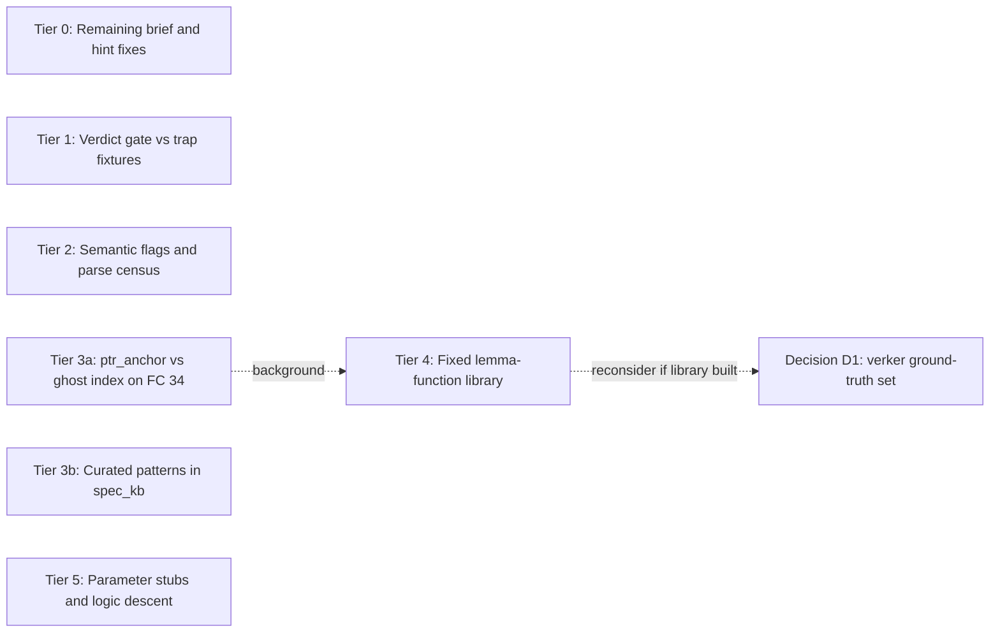

# External Frama-C Projects: Assessment & Ranked Improvement Plan

This document assesses ten public projects built on or around Frama-C for what they can improve in the pipeline ([`../guides/architecture.md`](../guides/architecture.md), [`../guides/agentic-swarm.md`](../guides/agentic-swarm.md)), and sets out an improvement plan **ordered by expected value**. It follows the format of [`./papers-generalization-plan.md`](./papers-generalization-plan.md) and [`./harness-and-spec-papers-generalization-plan.md`](./harness-and-spec-papers-generalization-plan.md): Tiers 1, 3b and 4 start with a Step 0 measurement and a stop rule, and nothing of theirs is built before Step 0 says go. Tier 0, the Tier 3a idiom probe, the report-only flag table of Tier 2 and the parameter-stub mutant of Tier 5 are small enough to go without a full corpus census.

**Result in one paragraph.** None of the ten is worth running as a tool inside the pipeline. Three are worth mining: `sysprog21/frama-c-mcp` for its list of ways a green WP run is not a proof, `evdenis/acsl-skills` for a small set of specification patterns not yet in the briefs, and `evdenis/verker` as a worked design for a maintainer-curated lemma library (narrowing Tier 7 of [`./formal-discovery-plan.md`](./formal-discovery-plan.md)). The other seven rate low or none. Comparing them with the code, plus an independent challenger review on 2026-11-20 against `main` (`d62c791`) and the current working tree, surfaced six brief/hint defects (three fixed uncommitted on 2026-11-20, three still open in Tier 0), three code-visible WP verdict-gate gaps (tracked in Tier 1), and the Phase 0 semantic-flag gap (Tier 2); all open items are recorded in [`../troubleshooting/`](../troubleshooting/README.md).

Limits on the reading and on the checks:

- **Read:** one subagent per project read the README, the file tree and the source behind the main mechanism through the GitHub API. Nothing was cloned, built or run, so every statement about compatibility with Frama-C 34 is unverified.
- **When:** nine projects were read on 2026-11-14 and verker on 2026-11-20 at `8d27577`. `frama-c-mcp` and `acsl-skills` have had commits since (heads `4b935a0` of 2026-11-18 and `4f913e2` of 2026-11-19 on 2026-11-20); those commits were not read in full, except that the parent spot-checked `frama-c-mcp`'s fixture file list and three fixtures (`decorative-contract.c`, `recursive-logic-unsound.c`, `generated-callee-spec.c`) at `4b935a0`. Tier 1 Step 0 opens the remaining fixtures at `4b935a0` before running them.
- **Spot-checked by the parent:** the claims behind the three medium verdicts. For `frama-c-mcp`: its dropped-flag table (`src/mcp/project.rs`), its plugin's version bounds, the absence of the same flags in this repository, and the three fixtures named above (each self-contained with a named target function). For `acsl-skills`: its licence, its file list, its limitation rows C-2 and C-11, the 335-to-311 figure of Tier 5, and that `frama-c-mcp`'s `docs/writing-acsl.md` cites it. For verker: that `src/strlen.h` defines `strlen` and `valid_str` without an axiom and proves the inductive facts as ghost functions with `decreases`, that the Makefile derives the proved set from the README table, and the two commits that removed false lemmas (`1c6ef2e`, `8dad88a`).
- **Overlap with the pipeline and independent challenge (2026-11-20):** nine reports were first compared against the tree of 2026-11-14, checked by `git grep` on 2026-11-20, and then challenged line-by-line on 2026-11-20 against [`../../scripts/run_wp_function.py`](../../scripts/run_wp_function.py), [`../../scripts/framac_common.py`](../../scripts/framac_common.py), [`../../scripts/acsl_ast.py`](../../scripts/acsl_ast.py), [`../../scripts/spec_kb.py`](../../scripts/spec_kb.py), [`../../scripts/frame_skeleton.py`](../../scripts/frame_skeleton.py), [`../../scripts/mutation_check.py`](../../scripts/mutation_check.py), [`../../scripts/build_capture.py`](../../scripts/build_capture.py), [`../../scripts/phase0_model.py`](../../scripts/phase0_model.py), [`../../scripts/kernel_ast_dump.ml`](../../scripts/kernel_ast_dump.ml), [`../../scripts/ledger.py`](../../scripts/ledger.py), [`../../scripts/proof_carry.py`](../../scripts/proof_carry.py), [`../../scripts/fuzz_build.py`](../../scripts/fuzz_build.py), [`../../scripts/eacsl_toolchain.py`](../../scripts/eacsl_toolchain.py), [`../../scripts/benchmark.py`](../../scripts/benchmark.py), [`../../benchmark/manifest.json`](../../benchmark/manifest.json), [`../../skills/framac-wp/prover_brief.md`](../../skills/framac-wp/prover_brief.md), [`../../skills/framac-wp/header_architect_brief.md`](../../skills/framac-wp/header_architect_brief.md), and [`../../templates/fc_stubs/fc_compat_types.h`](../../templates/fc_stubs/fc_compat_types.h). Key verified facts from that check:
  - `+nat` and `+real` WP models are already refused (`wp_model_problem` in [`../../scripts/framac_common.py`](../../scripts/framac_common.py)), and frame-only postconditions are already probed (`contract_refinement.py frame-only`).
  - `acsl_ast.verify_acsl_only` and `acsl_ast.splice_prover_changes` already accept an in-body ghost call (`/*@ ghost lemma_strlen_step(s, n); */`) with zero errors and no added top-level declarations (verified directly in Python on 2026-11-20).
  - `acsl_ast.check_frame_preserved` rejects `assigns \result \from x;` whenever `frame_skeleton.py` projects `assigns \nothing;` (verified directly in Python on 2026-11-20).
  - The only recursive `logic` definition anywhere in [`../../templates/`](../../templates/) is `strlen` in [`../../templates/fc_stubs/fc_compat_types.h`](../../templates/fc_stubs/fc_compat_types.h), guarded by `#if defined(__FRAMAC_EACSL__)` and never seen by WP.
  - All seven baseline files under `benchmark/baselines/` cover Phases 0–2 only (no `phase3` or `all_proven` data), and `libmnl` is not in [`../../benchmark/manifest.json`](../../benchmark/manifest.json).
  - The independent-challenger objections and how every tier changed are recorded in Section 3.8.
- **Not done:** verker's two worked examples were paraphrased by the subagent, not quoted. None of the external projects' code has been executed in `framac-analysis:latest` yet.
- **Measured:** two numbers so far: (1) for Tier 2, six `build_capture.json` files in the local run store outside this checkout (c-ares run-2, nginx 1.31.9 run-1 to run-5) contain none of the semantic compiler flags; (2) for Tier 5, [`../../templates/`](../../templates/) contains one recursive `logic` definition (`fc_compat_types.h` `strlen`, E-ACSL-only).

---

## 1. What each project is

| Project | Licence | Supports | What it really is | Verdict |
| :--- | :--- | :--- | :--- | :---: |
| [sysprog21/frama-c-mcp](https://github.com/sysprog21/frama-c-mcp) | MIT | Frama-C 32.1+, tested on 33.0 | A Rust MCP server and an OCaml plugin driving one live Frama-C. Its core is a `check` verdict that is `proved` only when a list of about 50 `incomplete[]` codes is empty; each code names one way a green run is not a proof. About 80 single-trap C fixtures test the codes | Medium |
| [evdenis/acsl-skills](https://github.com/evdenis/acsl-skills) | MIT | Measured on 33.0 | Five agent skills and 18 reference files of WP experience, each statement tagged as reproduced, read in the WP source, or from the manual. Its sources are ACSL by Example, verker and the ANSSI x509-parser | Medium |
| [evdenis/verker](https://github.com/evdenis/verker) | GPL-3.0 | 33.0 | 44 Linux `lib/string.c`-style functions with contracts; 35 proved on stock WP after AstraVer was removed in September 2026. Logic functions are defined, not axiomatised, and inductive facts are ghost C functions that WP proves and the body calls | Medium |
| [rse-verification/auto-deduct](https://github.com/rse-verification/auto-deduct) | GPL-2.0+ | 33.0 | A Python driver running saida, then ISP, then one whole-file WP run, on one translation unit with a hand-written entry contract | Low |
| [rse-verification/saida](https://github.com/rse-verification/saida) | GPL-2.0+ | 33 (`< 34`) | A wrapper around the TriCera Horn-clause model checker that pastes inferred helper contracts back by line number. No pointer arithmetic, no reinterpreting casts, one file | Low |
| [rse-verification/interface-specification-propagator](https://github.com/rse-verification/interface-specification-propagator) | GPL-2.0+ | 33 (`< 34`) | Runs Eva from one entry point and writes its intervals as `requires` and `ensures` on the helpers. Skips loops and pointer arithmetic | Low |
| [stanleyngugi/formally-verified-code-rl](https://github.com/stanleyngugi/formally-verified-code-rl) | Apache-2.0 | 33.0 | 64 loop-free textbook functions with a fixed contract; the model writes the body | Low |
| [ThalesGroup/frama-c-lsp](https://github.com/ThalesGroup/frama-c-lsp) | LGPL-3.0 (headers say GPL-3) | 32.1 | Each editor request spawns a cold Frama-C run. No hover, definition or completion on `main` | None |
| [rse-verification/VerNFR](https://github.com/rse-verification/VerNFR) | GPL-2.0+ | 33 (`< 34`) | A coding-guideline checker for automotive modules (call allowlist, static globals, no function pointers). No timing, stack or resource property | None |
| [rse-verification/SpecSmith](https://github.com/rse-verification/SpecSmith) | none | unpinned | A 2025 fork of VeCoGen that asks a model for ACSL on one toy function. No problem set, no results | None |

**One lineage, not three votes.** `frama-c-mcp`'s documentation cites `acsl-skills` for its triage ladder and loop advice, and `acsl-skills` names verker as a source. Lemma functions and the negative result on casts therefore come from one line of experience, measured again by a second author on Frama-C 33.

**Licences.** This repository has no licence file. MIT text and fixtures can be copied with their notice. GPL text (verker, the rse-verification plugins) is not copied: the plan ports ideas in the pipeline's own words and cites the source.

---

## 2. Mapping onto the pipeline

| Open problem in the pipeline | What the projects give |
| :--- | :--- |
| Shared lemma and predicate library (Tier 7) | verker: a working design on stock WP (defined logic functions, intro / elim / shift lemmas, ghost lemma functions). `acsl-skills`: the naming scheme for lemma families and the lemma-function recipe. Nothing can be dropped in: verker is GPL, its recursive `strlen` conflicts with S8 ("One String Vocabulary" over Frama-C libc's `__fc_string_axiomatic.h`), and the prover brief forbids the construct |
| Trivial contracts detected by text only | Already narrowed by `contract_refinement.py frame-only` and the stub mutant of [`../../scripts/mutation_check.py`](../../scripts/mutation_check.py). New and small: capped `return <parameter>` stub mutants (`frama-c-mcp`), and a well-founded descent check for recursive `logic` definitions in architect headers (`frama-c-mcp`, `acsl-skills`) |
| WP cast blocker (libmnl) | **Nothing.** `acsl-skills` (row C-2) and `frama-c-mcp` both report byte reinterpretation timing out under `Typed`, `Typed+cast`, `Typed+nocast` and `Bytes` alike. Their only routes are a verified core with an unverified shell, or Eva discharging the goal. This agrees with the pipeline's own result |
| A source of relational loop invariants | No generator. `acsl-skills` has hand patterns (Tier 3b). TriCera's `-inv` prints integer loop invariants and could feed [`../../scripts/loop_seeds.py`](../../scripts/loop_seeds.py); kept as a watch item |
| Callee contracts without a model | saida, ISP and auto-deduct do this for scalar, global-state code only, and their contracts are fitted to one call context. ISP's ranges are the harness-bound Eva intervals that the Tier 1b trial of [`./papers-generalization-plan.md`](./papers-generalization-plan.md) already rejected |
| The analysed program is the compiled one | `frama-c-mcp`: a table of compiler flags that change meaning and that Frama-C does not read, and a count of what the parser dropped (Tier 2) |
| Content for the spec KB and the briefs | `acsl-skills` (Tier 3a and 3b; four of the initial eight candidates were already present or conflicted with existing gates and were dropped) |
| Benchmark with ground truth | verker is the only candidate, with caveats (Decision D1) |
| Properties beyond Layers 1 to 6 | Nothing. VerNFR has no resource property |

### 2.1 Verified gaps

1. **Semantic compiler flags are not seen.** Every analysis runs under the fixed `-machdep gcc_x86_64`. The capture's architecture guard in [`../../scripts/build_capture.py`](../../scripts/build_capture.py) covers `-m32`, `-mx32`, `-m16` and `--target=`; no script handles `-fwrapv`, `-fno-strict-overflow`, `-funsigned-char`, `-fshort-enums`, `-fpack-struct` (`-fpack-struct=<n>`), `-fshort-wchar` or `-funsigned-bitfields` (with last-flag-wins across negating pairs). Under `-fwrapv` / `-fno-strict-overflow`, Phase 1 Clang sanitizer builds (`-fsanitize=address,undefined` in [`../../scripts/fuzz_build.py`](../../scripts/fuzz_build.py)) and E-ACSL Clang backend codegen ([`../../scripts/eacsl_toolchain.py`](../../scripts/eacsl_toolchain.py)) would also disagree with the target build. Recorded as an open gap in [`../troubleshooting/phase0-build-and-model.md`](../troubleshooting/phase0-build-and-model.md).
2. **What the parser drops is not counted.** No gate counts Frama-C's `kernel:asm:clobber` or semantically impactful `kernel:attrs:unknown` warnings per link unit. Because [`../../scripts/phase0_model.py`](../../scripts/phase0_model.py) passes `-no-annot`, its logs reflect C parse losses only (not annotation warnings), and any census must separate benign GCC attributes (`cold`, `hot`, `format`, `warn_unused_result`, `nonnull`, `visibility`, `deprecated`) from layout- or semantics-changing ones (`packed`, `aligned`, `transparent_union`, `cleanup`, `constructor`/`destructor`, `weak`, `alias`, `section`).
3. **The composite WP verdict gate has never been run against someone else's traps, and three code-level gaps are already visible.** The soundness scan of [`../../scripts/run_wp_function.py`](../../scripts/run_wp_function.py) was written from the pipeline's own runs and audits. Reading the code on 2026-11-20 already shows three concrete cracks to test against `frama-c-mcp`'s fixtures: (a) the CSV loop in `run_wp_function.py` has no branch for `STATUS_ASSUMED` (`Considered valid`), `STATUS_INCONSISTENT` (`Inconsistent`) or `STATUS_OTHER`, silently dropping those rows; (b) `framac_common.py` maps `"partially_proven"` to `STATUS_VALID` instead of `STATUS_VALID_UNDER_HYP`; (c) `framac_common.wp_limits_problem` accepts `vacuity == "inconclusive"` and `apply_verdict_limits` only turns `contradictory` into `unsound_proof`, even though `classify_vacuity_log` now returns `"inconclusive"` for unrecognized `(Doomed)` smoke goals. Recorded in [`../troubleshooting/wp-and-guardrail.md`](../troubleshooting/wp-and-guardrail.md).
4. **The prover brief and diagnostic hints contradict themselves on pointer-walk anchoring.** Row C-11 of `acsl-skills` (`skills/frama-c-wp/references/limitations.md`) says WP does not derive `p == q + (p - q)` and that asserting the equality leaves the assertion unproved (Frama-C 33). [`../../skills/framac-wp/prover_brief.md`](../../skills/framac-wp/prover_brief.md) already recommends a ghost index in Step B item 1 (`/*@ ghost size_t idx = 0; */`) while simultaneously recommending `loop invariant ptr_anchor: p == \at(p, Pre) + (p - \at(p, Pre));`, `end_anchor` and `res_anchor` in Step C, and [`../../scripts/run_wp_function.py`](../../scripts/run_wp_function.py) (`_PTR_DIFF_EQ_RE`) emits the same `ptr_anchor` / `end_anchor` hint. Neither claim has been tested on Frama-C 34 here.
5. **Provers cannot contribute or call a lemma**, which is Tier 7 as already recorded in [`./backlog.md`](./backlog.md).
6. **Three remaining brief/hint contradictions (Tier 0 follow-ups).** Beyond the three Tier 0 wording fixes already applied uncommitted on 2026-11-20, three more defects remain open in the working tree: (a) `derive_wp_diagnostic_hints` checks `soundness.get("checked_memory_model_functions")` inside `if not soundness.get("ok", True) or status in ("wp_aborted", "unsound_proof"):`, making that hint unreachable under default `-wp-check-memory-model` where unmet hypotheses leave `soundness.ok == True` and `status == "unproven_goals_remain"`; (b) `prover_brief.md` ("Worked contract patterns") tells provers to copy `euclid.c (axiomatic gcd + ...)`, which `acsl_ast._UNSOUND_ACSL_RE` and the merge scope check mechanically reject; (c) `run_wp_function.py` (`_BOOL_PRED_ERR_RE`) recommends `<==>` in syntax-error hints, contradicting `prover_brief.md` Strict Rule 4. All three are recorded in [`../troubleshooting/wp-and-guardrail.md`](../troubleshooting/wp-and-guardrail.md).

Not gaps (already present): generated callee contracts, skipped annotations, WP's unsound-encoding warnings, memory-model hypotheses checked as goals, smoke tests, unproved lemmas, unresolved indirect calls, the zero-goal gate, the ban on `axiom` and `admit`, WP models that weaken C semantics (`+cast`, `+nat`, `+real`, `Hoare`, `Region`), `in_place_loop` / "Say What Stays Unchanged" guidance, and per-goal solver cost hints (`goal_cost_hints`).

---

## 3. Ranked plan (by expected value)



| Rank | Upgrade | Origin | Value, evidence and transfer | Cost and risk |
| :---: | :--- | :--- | :--- | :--- |
| 0 | Three remaining brief/hint fixes (after the three fixed uncommitted 2026-11-20) | Found while comparing & challenging | **Value:** High per hit (unreachable separation hint, `axiomatic` copy advice rejected at merge, `<==>` hint contradicting Strict Rule 4). **Evidence:** `measured on our toolchain` (verified in source). **Transfer:** `same toolchain` | **Cost:** `brief or report only` (plus 1 hint branch in `run_wp_function.py`; hours). **Risk:** Low |
| 1 | Run `frama-c-mcp`'s trap fixtures through the composite WP verdict gate on Frama-C 34 | `frama-c-mcp` `tests/fixtures/` + 3 code-visible gaps | **Value:** High (any false `all_proven` credited by the gate is a soundness bug; 3 concrete gate cracks already visible in code). **Evidence:** `measured elsewhere` (33.0) + code inspection on 34. **Transfer:** `same toolchain` | **Cost:** `script and flag` (Step 0 is hours; each gap is a targeted check in `run_wp_function.py` / `framac_common.py`). **Risk:** Low–Medium (tightening `partially_proven` or `inconclusive` vacuity must not break valid proofs) |
| 3a | Test `ptr_anchor` / `end_anchor` vs. ghost index on Frama-C 34 | `acsl-skills` row C-11 | **Value:** Medium (resolves an active contradiction between Step B and Step C of `prover_brief.md` and `run_wp_function.py`). **Evidence:** `measured elsewhere` (33.0). **Transfer:** `same toolchain` | **Cost:** `brief or report only` (1-hour Docker probe + coordinated brief/hint edit if C-11 holds). **Risk:** Low |
| 2 | Semantic compiler flags (last-flag-wins) and attribute-filtered parse-loss census in Phase 0 | `frama-c-mcp` `src/mcp/project.rs`, `checkgaps.rs` | **Value:** Medium latent (zero hits in six captures on disk, but silent wrong-program analysis when hit). **Evidence:** `measured elsewhere` (33.0). **Transfer:** `same toolchain` | **Cost:** `script and flag` (1–2 days report-only; later overflow mitigation touches RTE/Eva/WP + Clang sanitizers + E-ACSL backend). **Risk:** Low for report-only; Medium for later overflow mitigation |
| 3b | Four pruned specification patterns in a dedicated `spec_kb.py` slot and `header_architect_brief.md` | `acsl-skills` `skills/acsl-spec/references/`, `skills/frama-c-wp/references/` | **Value:** Medium until measured on spec-limited stalls (parser/string/search units). **Evidence:** `measured elsewhere` (33.0, Alt-Ergo 2.6.3; not ablated). **Transfer:** `same toolchain` (different solver version & rules) | **Cost:** `script and flag` (1–2 days + Phase 3 LLM A/B on `FRAMAC_SPEC_KB_CURATED`). **Risk:** Medium (`prover_brief.md` is already ~60 KB — 61.8 KB on working tree — so nothing goes in its body; E-ACSL guardrail must accept every pattern) |
| 4 | Maintainer-curated ghost lemma library as the mechanism for Tier 7 | verker `src/*.h`, `acsl-skills` `auto-active.md` | **Value:** Medium–High if `inductive_lemma_required` recurs across units on shared facts (narrows Tier 7 from prover-authored to fixed library). **Evidence:** `measured elsewhere` (33.0 on recursive definitions). **Transfer:** `same kind of tool` (must bridge to `__fc_string_axiomatic.h` without breaking S8) | **Cost:** `script and flag` (weeks if built: brief rule, library header with E-ACSL no-ops, parent re-check, `ledger.py` `cmd_audit_hypotheses`, `proof_carry.py`, `wp-sweep`). **Risk:** High (soundness if caller credits an unproved lemma; S8 vocabulary split) |
| 5 | Capped `return <parameter>` stub mutants (`mutation_check.py`) and architect-header recursive `logic` well-founded descent check | `frama-c-mcp` `wpcli.rs`, `ast_utils_ast.ml`; `acsl-skills` `logic-defs.md` | **Value:** Low (each closes a narrow spec-quality or architect-header hole; `templates/` has zero WP-visible recursive logic defs). **Evidence:** `measured elsewhere` (33.0). **Transfer:** `same toolchain` | **Cost:** `script and flag` (hours each). **Risk:** Low (parameter stubs must be capped so WP cost and `precision` do not regress) |
| D1 | verker as a ground-truth set for Phase 3 | verker | **Value:** Depends on whether functional reference contracts are wanted beyond seeded-defect recall. **Evidence:** `argued` for this pipeline. **Transfer:** `different setting` (tiny leaf functions, unsigned/downcast alarms off, different string vocabulary) | **Cost:** `script and flag` (new scoring). **Risk:** Medium (training-data contamination; `contract_refinement.py compare` needs shared vocabulary and often returns `undecided`) |

Tiers 0, 1, 2, 3a, 3b and 5 are independent. Tier 3a is a 1-hour hygiene probe and does not wait on Tier 3b's stall census. Tier 4 uses Tier 3a's result only as background; Decision D1 is reconsidered only if Tier 4 builds a lemma library.

### Common requirements

The requirements of [`./formal-discovery-plan.md`](./formal-discovery-plan.md) ("Common requirements for every tier") apply: an A/B environment flag for behavior changes (added to both wrappers, `docker-compose.yml`, [`../guides/resources-and-caching.md`](../guides/resources-and-caching.md) and [`../../tests/test_remediation_p2_container.py`](../../tests/test_remediation_p2_container.py)), guides and briefs updated in the same change (then `python tools/sync_skill_mirrors.py`), and tests run with `-n auto`. Any pipeline bug found on the way goes into [`../troubleshooting/`](../troubleshooting/README.md) in the same session. Per the standing rule for multi-step work, each step runs the unit suite only; one real-target validation comes at the end of a tier.

**Acceptance tooling boundary (Phase 0–2 vs. Phase 3).** [`../../scripts/benchmark.py`](../../scripts/benchmark.py) (`benchmark.py run` / `benchmark_compare.py`) runs Phases 0–2 and reproducer replay only — no LLM, no Phase 3 WP, and no `mutation.json`. None of the seven baselines in `benchmark/baselines/` carries `phase3` or `all_proven` data, and `libmnl` is not in [`../../benchmark/manifest.json`](../../benchmark/manifest.json) (whose ten targets are `minmea`, `qcbor-dev`, `qcbor-master`, `cryptolib`, `x509-parser`, `oscs-jsmn`, `oscs-semver`, `oscs-stmr`, `oscs-qlz`, and `oscs-tweetnacl`). Accordingly:

- **Phase 0–2 changes (Tier 2)** validate with `benchmark.py run` and `benchmark_compare.py` against the current baseline.
- **Phase 3 gate, mutation and brief/KB changes (Tiers 1, 3b, 4, 5)** validate by replaying [`../../scripts/run_wp_function.py`](../../scripts/run_wp_function.py), [`../../scripts/mutation_check.py`](../../scripts/mutation_check.py) or [`../../scripts/benchmark_briefs.py`](../../scripts/benchmark_briefs.py) over proven Phase 3 fixtures / archived finished run directories, and — where LLM synthesis behavior is tested (Tier 3b, Tier 4) — by Phase 3 A/B runs on manifest targets (such as `minmea`, `qcbor-dev`, `x509-parser`).

---

### 3.1 Tier 0: brief and hint corrections — **DONE (2026-11-20, `a0e591f`)**

**Part 1 (fixed 2026-11-20, `a0e591f`):** the original three items recorded in [`../troubleshooting/wp-and-guardrail.md`](../troubleshooting/wp-and-guardrail.md) — `unproven lemma` hint naming unproven lemmas from `unproven_goals` and pointing to the `inductive lemma required` stop rule ([`../../scripts/run_wp_function.py`](../../scripts/run_wp_function.py)), removing `if (consumed == 0) return -1;` from `_loop_goal_strategies` and [`../../skills/framac-wp/prover_brief.md`](../../skills/framac-wp/prover_brief.md) Step B item 2, and updating Rule 5 of `prover_brief.md` to reflect `-wp-check-memory-model` being on by default.

**Part 2 (fixed 2026-11-20, `a0e591f`; verified by unit tests, `ruff`, `mypy`, `check_generated_text`, `sync_skill_mirrors --check`):**

| Where | Before | Fix |
| :--- | :--- | :--- |
| `derive_wp_diagnostic_hints` in [`../../scripts/run_wp_function.py`](../../scripts/run_wp_function.py) (`checked_memory_model_functions` branch) | Trapped inside `if not soundness.get("ok", True) or status in ("wp_aborted", "unsound_proof"):`, unreachable under default `-wp-check-memory-model` when `status == "unproven_goals_remain"` | Extracted `mm_sep_hint` / `has_mm_hyp` so the `\separated` hint fires on `status == "unproven_goals_remain"` as well (deduplicated, never on `all_proven`) |
| "Worked contract patterns" in [`../../skills/framac-wp/prover_brief.md`](../../skills/framac-wp/prover_brief.md) | Told provers to copy `euclid.c (axiomatic gcd + ...)` | Kept only `loop variant \abs(b)` / `\at(..., Pre)` shape with an explicit ban on copying `axiomatic` or top-level declarations; mirrors synced |
| `_BOOL_PRED_ERR_RE` syntax-error hint in [`../../scripts/run_wp_function.py`](../../scripts/run_wp_function.py) | Recommended `use '==>' or '<==>' instead of '? :'` | Updated to `use '==>' or '(p1 ==> p2) && (p2 ==> p1)' instead of '? :'`, matching Strict Rule 4 |

- **Tests:** `test_wp_hints_checked_memory_model_functions_emitted_on_unproven_goals_remain` and `test_wp_hints_bool_pred_syntax_hint_recommends_implications_not_iff` in [`../../tests/test_diagnostic_hints.py`](../../tests/test_diagnostic_hints.py); `test_prover_brief_worked_patterns_never_recommends_axiomatic` in [`../../tests/test_prover_stub_brief_gaps.py`](../../tests/test_prover_stub_brief_gaps.py).

---

### 3.2 Tier 1: the composite verdict gate against `frama-c-mcp`'s trap fixtures — **DONE (Step 0 + 6 fixes, 2026-11-20)**

**Step 0 results (2026-11-20, `framac-analysis:latest`, Frama-C 34.0~beta, Alt-Ergo 2.4.3 / Z3 4.13.3 / CVC5 1.1.2).** Ran all 21 `sysprog21/frama-c-mcp` fixtures at `4b935a0` (32 `(fixture, function)` targets + 4 confirmation probes) through the composite gate (`acsl_ast.find_unsound_acsl_keywords` + `run_wp_function.py` default and `--wp-model Typed --no-retry-bytes --no-retry-bitwise` + `framac_common.wp_limits_problem`, plus `frame_only_ensures` and `mutation_check.py` on `decorative-contract.c`).

- **Controls:** 0 failures (`memory-model-no-hypothesis.c :: one`, `indirect-call-annotated.c :: run` & `seta`, `abs-int-fixed.c :: abs_int` & `main`, `smoke-vacuous.c :: fine` all credited; `seta` exposed a 0-smoke-goal `"inconclusive"` misclassification fixed below).
- **Spec-quality trap (`decorative-contract.c`):** **STOP.** `frame_only_ensures` returned `False` on `weak`, but `mutation_check.py` caught `weak` (`trivial_body_rejected=False`, `precision=0.0`) and passed `strong` (`trivial_body_rejected=True`, `precision=1.0`).
- **Soundness / verdict-gate findings (GO, 6 confirmed defects — all fixed 2026-11-20):**
  1. **`lemma-unproved.c` (confirmed false-positive proof in Probe 1a):** under `-wp-fct`, Frama-C 34 never schedules global `lemma`s and emits 0 lemma rows in `-report-csv` (even whole-file `-wp` emitted 0 lemma rows in CSV), yet Alt-Ergo assumes every global `lemma` as an axiom. Dropping `requires \true;` returned `all_proven`, `soundness.ok=True`, `credited=True` on false `\result == 42`. **Fixed:** `acsl_ast.find_top_level_lemmas` + `run_wp_function.scan_target_sources_soundness` (over `c_file`, `extra_sources`, and local quoted headers, excluding `share/libc`, `/usr/`, `templates/fc_stubs/`) fails any global `lemma` in scope under `-wp-fct` as `unsound_proof` (`soundness["unproven_global_lemmas"]`, named in `derive_wp_diagnostic_hints`).
  2. **`axiom-licensed.c :: main` & `uncalled` (WP-layer gap behind `acsl_ast`):** `-report-csv` emits 0 rows for global axioms (`Axiom 'bogus'` appears only in `-report` stdout beside ~35 Frama-C libc axioms), so `run_wp_function.py` alone credited `main` (`wp_only_cred=True`). **Fixed:** `acsl_ast.find_target_unsound_axioms_or_admits` wired into `scan_target_sources_soundness` rejects target `axiom`/`axiomatic`/`admit` inside `run_wp_function.py` itself.
  3. **`recursive-logic-unsound.c :: f` (credited false-positive proof):** `logic integer bad(integer n) = bad(n) + 1;` proved `ensures bad(x) >= 0 ==> \result == 998;` in 4 ms (`credited=True`). **Fixed:** `acsl_ast.find_unsound_recursive_logic` (Tarjan SCC + base-case guard + strict descent/advance on a guarded parameter, skipping `#if defined(__FRAMAC_EACSL__)` / `#if 0` blocks) wired into `find_unsound_acsl_keywords`, `verify_acsl_only`, and `scan_target_sources_soundness` (also completes the recursive-logic check of Tier 5).
  4. **CSV fail-closed + `Partially proven` visibility + `memory-model-hypothesis.c :: two`:** hardened `run_wp_function.py`'s CSV loop for `STATUS_INCONSISTENT` / `STATUS_ASSUMED` (`soundness.ok=False`, `tier_b_unsound`) and `else` (`STATUS_OTHER` -> unproven); kept `normalize_status("Partially proven") == STATUS_VALID` (`Consolidation.Pending`) and recorded `partially_proven_count` (`assumption-unproved.c :: assumption_carrier` reports `partially_proven_count == 1`); extracted `checked_memory_model_hypotheses` into `limits["memory_model_hypotheses"]`, fixed `ledger.py` to read `checked_memory_model_functions` alongside legacy `memory_model_hypotheses`, and added `kind="memory_model_hypothesis"` assumptions in `ledger.py` and [`../../schemas/coverage-ledger.schema.json`](../../schemas/coverage-ledger.schema.json) (without falsely failing clean controls like `indirect-call-annotated.c :: run`).
  5. **Vacuity gate (`seta` vs. unrecognized `(Doomed)` / `unexplained_fails`):** `classify_vacuity_log` now classifies clean `rc == 0` 0-smoke-goal leaf functions (`Proved goals:` present, no `Smoke Tests`, no `(Doomed)`/`Failed`) as `consistent` (`smoke_goals: 0`), while recording `unknown_doomed` and `unexplained_fails` on failed smoke passes and rejecting them in both `apply_verdict_limits` (`unsound_proof`) and `framac_common.wp_limits_problem`.
  6. **Why3 anomaly & `[wp] [Failure]` (`pointer-cast-anomaly.c :: nextblk`):** recognized `[wp] [Failure]` and `[Why3 Error] anomaly:` (`Invalid_argument("missing free variable")` / `of_term`) in `run_wp_function.py`, preserving `Bytes` retry on default flags (`6/6` Valid with `wp_model_assumption`) while classifying unresolved runs (no-retry `Typed`, `Typed+nocast`) as `wp_aborted` with a dedicated Why3 backend anomaly diagnostic hint instead of a misleading `requires \valid(p)` hint.

- **Verification:** 40 new unit tests across [`../../tests/test_acsl_ast.py`](../../tests/test_acsl_ast.py), [`../../tests/test_run_wp_function.py`](../../tests/test_run_wp_function.py), [`../../tests/test_verdict_limits.py`](../../tests/test_verdict_limits.py), [`../../tests/test_diagnostic_hints.py`](../../tests/test_diagnostic_hints.py), and [`../../tests/test_ledger.py`](../../tests/test_ledger.py); post-fix Docker re-run of the trap fixtures + Probe 1a + all controls in `framac-analysis:latest` confirmed all soundness traps rejected, all controls credited (with `seta` `consistent`), and full suite `7842 passed, 329 skipped`, `ruff` and `mypy` green.

**Not transferred.** The server, its sandboxes, its proof receipts and its `verify_program_step`: the scratch overlays, the caches and the scheduler already do those jobs. Its `run_e_acsl` runs the instrumented program with a timeout only, without rlimits or a cleared environment, and must never see a target.

---

### 3.3 Tier 2: semantic compiler flags and a parse-loss census

**Problem.** Gaps 1 and 2. Under `-fwrapv` or `-fno-strict-overflow` every `signed_overflow` alarm, E-ACSL stop and UBSan abort is on behavior the build defines, so candidates are false positives. Under the layout and signedness flags (`-funsigned-char`, `-fshort-enums`, `-fpack-struct`, `-fshort-wchar`, `-funsigned-bitfields`) the analysed value ranges and struct layouts are not the compiled ones, so alarms and proofs may be about another program.

**Step 0 (no pipeline change).**

- **Flags.** Done for six captures in the local run store outside this checkout (c-ares run-2, nginx 1.31.9 run-1 to run-5): zero hits for any of the seven flags. Still to do: because [`../../benchmark/manifest.json`](../../benchmark/manifest.json) recipes mostly invoke `make`/`cmake` and do not list per-file compiler flags directly, inspect the benchmark targets' build files (`Makefile`, `CMakeLists.txt`, `configure.ac`) or captured `build_capture.json` files from benchmark runs for the same flags.
- **Parse losses.** Count `[kernel:...]` warning categories per link unit in the Frama-C parse logs of finished runs on disk, and list those no script reads today. Because `phase0_model.py` runs with `-no-annot`, its logs reflect C parse drops only. Under `kernel:attrs:unknown`, separate benign GCC attributes (`cold`, `hot`, `format`, `warn_unused_result`, `nonnull`, `visibility`, `deprecated` — which fire on almost every C project) from semantically impactful attributes (`packed`, `aligned`, `transparent_union`, `cleanup`, `constructor`/`destructor`, `weak`, `alias`, `section`).

**Stop or go.**

- **Flags: go as a report-only table whatever the count.** The check parses compile commands [`../../scripts/build_capture.py`](../../scripts/build_capture.py) already reads, and silent wrong-program analysis is the costliest failure mode. A count of zero only says no behavior mitigation needs deciding yet.
- **Parse losses: stop** if the logs show no unread category other than benign GCC attributes under `kernel:attrs:unknown`. **Go** if `kernel:asm:clobber`, a semantically impactful `kernel:attrs:unknown` attribute, or an unclassified `[kernel:...]` category appears in a unit whose functions reach Phase 2 or 3.

**Changes.**

- [`../../scripts/build_capture.py`](../../scripts/build_capture.py) and [`../../schemas/build_capture.schema.json`](../../schemas/build_capture.schema.json): a semantic-flag parser implementing **last-flag-wins** across negating pairs (`-fwrapv`/`-fno-wrapv`, `-fno-strict-overflow`/`-fstrict-overflow`, `-funsigned-char`/`-fsigned-char`, `-fshort-enums`/`-fno-short-enums`, `-funsigned-bitfields`/`-fno-unsigned-bitfields`), prefix matching for value-bearing `-fpack-struct=<n>`, and `-fshort-wchar`. `build_capture.json` gains `semantic_flags` per unit, and the report names affected units. No analysis behavior changes at this step.
- **Later, and only when a target shows a flag** (own A/B flag): for layout and signedness flags, stop with instructions as the architecture guard does; for `-fwrapv` / `-fno-strict-overflow`, a recorded per-unit decision must cover **every** tool consistently:
  - Frama-C RTE, Eva and WP: `-no-warn-signed-overflow` (switches Eva/WP signed arithmetic to two's-complement modulo per the Eva and WP manuals); note that in GCC 8+, `-fno-strict-overflow` also implies `-fwrapv-pointer`, which interacts with `-warn-invalid-pointer`.
  - Phase 1 Clang sanitizer builds ([`../../scripts/fuzz_build.py`](../../scripts/fuzz_build.py)): pass `-fwrapv` or `-fno-sanitize=signed-integer-overflow` alongside `-fsanitize=address,undefined` so UBSan does not emit false positives.
  - E-ACSL Clang backend codegen ([`../../scripts/eacsl_toolchain.py`](../../scripts/eacsl_toolchain.py), `EACSL_CODEGEN_FLAGS`): pass `-fwrapv` so the compiled E-ACSL binary matches target wrapping semantics.
- **Parse losses, if Step 0 says go:** a per-unit census in [`../../scripts/phase0_model.py`](../../scripts/phase0_model.py) separating semantically impactful attributes from benign ones and listing unclassified categories in the report.

- **Flag:** none for the report-only table (later mitigation gets its own `FRAMAC_*` flag).
- **Tests:** [`../../tests/test_build_capture.py`](../../tests/test_build_capture.py) (every flag, negating-pair last-flag-wins ordering, `-fpack-struct=<n>` prefix matching, schema validation).
- **Acceptance:** unit tests pass; `benchmark.py run` / `benchmark_compare.py` on one benchmark target shows capture and Phase 0–2 outputs unchanged apart from the new empty `semantic_flags` field; the open entry in [`../troubleshooting/phase0-build-and-model.md`](../troubleshooting/phase0-build-and-model.md) is updated.

---

### 3.4 Tier 3: pointer-anchor check (3a) and specification patterns in the spec KB (3b)

#### Tier 3a: pointer-difference anchor vs. ghost index on Frama-C 34 — **DONE (Step 0(a) Go + fixed 2026-11-20)**

**Step 0(a) results (2026-11-20, `framac-analysis:latest`, Frama-C 34.0~beta).** Verdict: **GO.**
- **`my_strlen` (`valid_read_string(s)`):** Idiom A (`ptr_anchor`) **failed** under both `Typed+ref` and `Typed` (`11/12`, `res_len` Unknown/Timeout on Alt-Ergo, Z3, CVC5; 66.2 s), because Qed collapses `p == base + (p - base)` to `p.base == base.base` without substituting `p := shift_sint8(base, offset)`, breaking E-matching against `__fc_string_axiomatic.h`'s `strlen_zero`. Idiom B (ghost `idx`) **proved** `13/13` in <= 25 ms under Alt-Ergo alone.
- **`find_delim` and `skip_spaces_caller`:** `-wp-print` confirmed Qed drops `end_anchor` completely (sending `p_end_0 = p` to Alt-Ergo, identical to a no-anchor control), whereas `ptr_idx: p == base + idx` lets Qed discharge `p == p_end` in **0 ms**. The old claim that `Typed` lacks `b1 == b2 ==> (ofs1 - ofs2 == 0 ==> p1 == p2)` was false on Frama-C 34 (`c11_diff_zero_direct` proved directly via Alt-Ergo in 3.9 ms).
- **Stride > 1 (`struct *` under `Typed`/`Typed+ref`) and `int *` under `Bytes`:** `acsl-skills` row C-11 **genuinely still fails** (Timeout/Unknown across all 3 provers); on `struct item *` loops, Idiom A fell back to CVC5/Z3 while ghost `idx` stayed in Qed + Alt-Ergo.
- **E-ACSL compatibility:** ghost `idx` + `/*@ ghost const T *base = p; */` compiles and actively checks `ptr_idx` and `idx_bound` at runtime (whereas `\at(p, LoopEntry)` loop invariants are skipped by E-ACSL), and `O(1)` `res_base` + `res_bound` postconditions avoid the `O(n)` GMP loop emitted for `\exists` postconditions.

**Implemented (2026-11-20):** replaced `ptr_anchor` / `end_anchor` / `res_anchor` in [`../../skills/framac-wp/prover_brief.md`](../../skills/framac-wp/prover_brief.md) (Step B cross-ref, Step C pointer-walk bullet, kept-asserts list; mirrors synced via `python tools/sync_skill_mirrors.py`) and [`../../scripts/run_wp_function.py`](../../scripts/run_wp_function.py) (`_PTR_DIFF_EQ_RE` hint) with the verified ghost-index (`ptr_idx: p == base + idx`) + `O(1)` `res_base`/`res_bound` + `/*@ ghost idx = (size_t)(p - buf); */` idiom. Added `test_wp_hints_pointer_walk_recommends_ghost_index_not_ptr_anchor` ([`../../tests/test_diagnostic_hints.py`](../../tests/test_diagnostic_hints.py)) and `test_prover_brief_pointer_walk_uses_ghost_index_not_ptr_anchor` ([`../../tests/test_prover_stub_brief_gaps.py`](../../tests/test_prover_stub_brief_gaps.py)), and updated wording assertions in [`../../tests/test_function_facts.py`](../../tests/test_function_facts.py), [`../../tests/test_prover_context.py`](../../tests/test_prover_context.py), and [`../../tests/test_workspace_overlay.py`](../../tests/test_workspace_overlay.py). Full unit suite green (`7802 passed` after Tier 3a; `7842 passed` after Tier 1).

#### Tier 3b: specification patterns in `spec_kb.py` and `header_architect_brief.md`

**Problem.** After pruning candidates that already exist in the pipeline or conflict with its merge gates, four `acsl-skills` patterns remain genuinely missing or only partly present:

| Kept candidate pattern | File (under `skills/` in `acsl-skills`) | For |
| :--- | :--- | :--- |
| `progress` clause bounding the consumed count on both sides; errors without behaviors; export offsets, not pointers (partly present in `prover_brief.md`, missing from `header_architect_brief.md`) | `acsl-spec/references/parsers.md` | Parser entry points returning a count |
| Restating a quantified invariant over the entry pointer so the solver's term matches | `acsl-spec/references/loops.md`, `frama-c-wp/references/auto-active.md` | Preservation goals that time out |
| Signed index with a lower bound of `-1` for backward scans; existential witness invariant | `acsl-spec/references/loops.md` | Search loops |
| Unproved `pointer_value` goal from pointer formation before NULL / empty-window check (classification/symptom row only); plus `annot:missing-spec` on a header only if verified distinct from `missing_spec_messages` | `verifiable-c/references/style.md`, `frama-c-wp/references/triage.md` | Symptom rows for `derive_wp_diagnostic_hints` |

**Dropped from the initial eight-row list (2026-11-20 challenge):**
- *Pointwise `untouched` / `copied` invariants* (`patterns.md`): already covered in `prover_brief.md` (`in_place_loop` and "Say What Stays Unchanged").
- *Fast `Unknown` = missing hypothesis, `Timeout` = goal too big* (`triage.md`): already implemented in `run_wp_function.py` (`goal_cost_hints`) and `prover_brief.md`, and the `Timeout` heuristic is unreliable under a multi-prover portfolio.
- *`wp:pedantic-assigns` -> `assigns \result \from`* (`triage.md`): `run_wp_function.py` already parses `wp:pedantic-assigns`, and `acsl_ast.check_frame_preserved` mechanically rejects `assigns \result \from x;` whenever `frame_skeleton.py` projects `assigns \nothing;` (verified empirically). Removed from both KB candidates and the `header_architect_brief.md` change.
- *`-wp-no-init-const` for large constant tables* (`limitations.md`): `run_wp_function.py` has no CLI flag for it, `workspace_overlay.infer_prover_wp_flags` would not replay it, and disabling `const` initializers can weaken proofs relying on lookup-table values. Moved to Watch / [`./frama-c-34-option-review.md`](./frama-c-34-option-review.md).

The four kept rows are as summarized from the 2026-11-14 reading; Step 0(b)'s codebook must be written from the pinned `acsl-skills` files themselves before reading any gaps.

**Step 0(b) (no pipeline change).** [`./harness-and-spec-papers-generalization-plan.md`](./harness-and-spec-papers-generalization-plan.md) Section 7 already examined the 70 stalled provers of libmodbus run-1 (53) and QCBOR run-6 (17) and found them dominated by structural blockers (backend function-pointer calls, missing callee contracts, Typed casts/shifts). Therefore:
- Restrict the denominator to **spec-limited stalls** (excluding indirect-call, uncontracted-callee, dynamic-allocation, and Typed-cast blockers).
- Include at least one string/text-parser run (e.g. `minmea` or `c-ares`) alongside `libmodbus` / `QCBOR` so the parser and search-loop patterns are evaluated on code where they apply.
- Fix the codebook from the pinned `acsl-skills` files before reading the gaps, then code each spec-limited `proof_gap` by hand against the four kept patterns.

**Stop or go.** **Stop** if fewer than one **spec-limited** stalled prover in ten has a gap one of the kept patterns addresses. **Narrow** to the patterns with at least two hits each. **Go** otherwise.

**Changes (if Step 0(b) says go).**

- [`../../scripts/spec_kb.py`](../../scripts/spec_kb.py): today `load_kb` merges 544 verbose `INDEX.md` manual slices and `evolved.json` into one pool, `query_kb` caps total output at `TOP_G = 3`, and `_STOPWORDS` strips `invariant`, `variant`, `assigns`, `requires`, `ensures`, `predicate`, `ghost`, `integer`, and `behavior`. Placing short curated patterns into that same raw keyword pool would starve them or evict manual/evolved items. Instead, add a curated pattern store matched directly on `record["features"]` tags (`pointer_walk`, `strings`, `pointer_len_params`, etc.) and rendered in its own bounded slot (up to 2 items beside `TOP_G`), written in the pipeline's own words with the MIT notice kept.
- [`../../scripts/run_wp_function.py`](../../scripts/run_wp_function.py): add the `pointer_value`-before-NULL symptom row (and `annot:missing-spec` only if distinct from `missing_spec_messages`).
- [`../../skills/framac-wp/header_architect_brief.md`](../../skills/framac-wp/header_architect_brief.md): add the `progress` clause guidance for parser entry points (never `assigns \result \from`). [`../../skills/framac-wp/prover_brief.md`](../../skills/framac-wp/prover_brief.md) (~60 KB) gains nothing in its body.

**Conflicts to keep out.** `acsl-skills` restructures C (`verifiable-c`); the pipeline never changes C, so that skill is used for classification only. It writes `buf == \null || \valid_read(...)` for empty buffers; keep the pipeline's guarded form, which E-ACSL can execute. It says `terminates` and `decreases` must precede `assigns`, which Frama-C 34 relaxed. Its timings and step budgets are on Alt-Ergo 2.6.3; the analysis image has 2.4.3.

- **Flag:** `FRAMAC_SPEC_KB_CURATED` (default `off` until A/B passes; wired through wrappers, `docker-compose.yml`, `resources-and-caching.md`, `tests/test_remediation_p2_container.py`). Do **not** toggle `FRAMAC_SPEC_KB` for this A/B, because `FRAMAC_SPEC_KB=off` also disables `obstructions.json` ("Known Dead Ends").
- **Tests:** `tests/test_spec_kb.py` (curated slot retrieval independent of `_STOPWORDS` and `TOP_G`, flag toggle leaving obstructions active), [`../../tests/test_diagnostic_hints.py`](../../tests/test_diagnostic_hints.py), [`../../tests/test_remediation_p2_container.py`](../../tests/test_remediation_p2_container.py).
- **Acceptance:** Phase 3 LLM A/B on `FRAMAC_SPEC_KB_CURATED=on` vs `off` (with `FRAMAC_SPEC_KB=on` in both arms) over parser/string units of manifest targets (such as `minmea`, `qcbor-dev`, `x509-parser`, plus `libmnl` if run as an external target): prover iterations, spec-limited stalls, and `rejected_overconstrained` count. Keep the items only if stalls or iterations drop and rejections do not rise.

---

### 3.5 Tier 4: fixed ghost lemma library as the mechanism for Tier 7

**Problem.** Gap 5. Since Tier 3 of [`./formal-discovery-plan.md`](./formal-discovery-plan.md), a prover needing an inductive fact stops with `inductive lemma required`. verker shows the same facts proved on stock WP with SMT solvers only: the logic function is defined recursively, base and step facts are lemmas, and inductive facts are ghost C functions with a contract and `decreases`, called from ghost code in the body. Verker's port also caught three false lemmas that the earlier toolchain had assumed — reinforcing the rule that every lemma must be proved and none assumed.

**Scope shift from formal-discovery Tier 7.** Adopting verker's mechanism narrows Tier 7 from "provers contribute new shared lemmas" to a **fixed, maintainer-curated lemma library** shipped beside [`../../templates/acsl/acsl_vocabulary.h`](../../templates/acsl/acsl_vocabulary.h) and proved once by the parent. Provers may call listed library ghost lemmas inside their assigned function and still may not author new ones. This can cover recurring domain facts (string length, bounded scans, byte sums/counts) but cannot solve target-specific inductive data structures.

**Step 0 (no pipeline change).**

- **Count.** Units with `details.gap_kind: "inductive_lemma_required"` in the ledgers of finished runs, grouped by the fact needed (string length, bounded string length, comparison, count, sum). This is the count [`./backlog.md`](./backlog.md) already requires before Tier 7.
- **Three-point feasibility probe** in `framac-analysis:latest` on one fact written in the pipeline's own words (not copied from verker; note that point (iv) from the initial draft — `acsl_ast.verify_acsl_only` and `splice_prover_changes` on an in-body ghost call — was already verified passing in Python on 2026-11-20):
  1. **(i) Lemma proof:** WP proves the ghost lemma function's own contract (`decreases`, `assigns \nothing;`).
  2. **(ii) Canonical-vocabulary discharge (S8 compatibility):** a caller whose body calls the ghost lemma proves a goal that failed without it, **stated over Frama-C libc's axiomatic `__fc_string_axiomatic.h` (`strlen` / `valid_read_string`)** rather than a parallel recursive definition. Verker's induction relies on unfolding recursive `logic` definitions; if WP cannot prove or apply a ghost lemma over `__fc_string_axiomatic.h`, adopting it would break S8 ("One String Vocabulary").
  3. **(iii) E-ACSL guardrail with `#if defined(__FRAMAC_EACSL__)` no-op stubs:** the E-ACSL guardrail builds and runs the caller cleanly when the library header provides empty-body no-op definitions of its ghost lemmas under `#if defined(__FRAMAC_EACSL__)`. Do **not** rely on a global ghost-stripping flag (such as `-remove-ghost`), which would break existing in-body ghost loop counters from `prover_brief.md` Step B item 1; empty-body stubs also prevent `O(n^2)` recursive ghost-lemma runtime blowup during corpus replay.

**Stop or go.**

- **Stop** if fewer than five units across finished runs need an inductive fact, or if the facts needed do not repeat across units (nothing to share).
- **Stop** if (i) fails, if (ii) cannot discharge a goal stated in `__fc_string_axiomatic.h`'s vocabulary without breaking S8, or if (iii) fails even with `#if defined(__FRAMAC_EACSL__)` no-op definitions in the library header.
- **Go** otherwise, to a design note for Tier 7 specifying the fixed library header, its parent proof stage, and its hypothesis-audit integration.

**What changes if it goes ahead.**
- [`../../skills/framac-wp/prover_brief.md`](../../skills/framac-wp/prover_brief.md) Step B item 3 (permit calling listed library ghost lemmas inside the assigned function while still forbidding new file-scope ghost functions or global `lemma`s).
- A sibling header of [`../../templates/acsl/acsl_vocabulary.h`](../../templates/acsl/acsl_vocabulary.h) with WP-proved ghost lemmas and `#if defined(__FRAMAC_EACSL__)` no-op bodies for guardrail builds.
- Parent proof & re-check ([`../../scripts/workspace_overlay.py`](../../scripts/workspace_overlay.py), `wp-sweep`): prove every library ghost lemma once per run and verify its proof status before crediting any caller.
- [`../../scripts/ledger.py`](../../scripts/ledger.py) (`cmd_audit_hypotheses`): recognize proven library ghost lemmas so a leaf function calling one is not permanently stranded in `open_ids` with `valid_under_hyp`, and a caller is never credited unless the library lemma itself is proved.
- [`../../scripts/proof_carry.py`](../../scripts/proof_carry.py): include the library header's digest in proof-carry cache keys so lemma edits invalidate carried proofs.
- **Flag:** `FRAMAC_LEMMA_LIBRARY` (default `off` until A/B passes).
- **Tests:** unit tests for `ledger.py` hypothesis resolution, `proof_carry.py` cache invalidation, `acsl_ast.py` in-body call allowlist, plus a Docker test proving a library lemma and running both WP and the E-ACSL guardrail on a caller.
- **Acceptance:** Phase 3 A/B on units previously stopped with `inductive_lemma_required`, verifying zero unproved-lemma credit and clean E-ACSL guardrail execution.

**Risks.** Breaking S8 ("One String Vocabulary") if recursive definitions cannot coexist with `__fc_string_axiomatic.h`; Frama-C 33-to-34 drift; any path where a caller proves under `-wp-fct` assuming a ghost lemma whose own contract was never proved (which would reopen the Tier 3 soundness defect).

---

### 3.6 Tier 5: two small checks

- **Capped `return <parameter>` stub mutants ([`../../scripts/mutation_check.py`](../../scripts/mutation_check.py)).** Today `trivial_stub_mutant` inspects only the return type, emits at most one stub (`trivial-noop-body` or `trivial-zero-body`, outside `max_mutants`), and records a single `trivial_body_rejected` boolean. A contract that only bounds `\result` by an input parameter survives `return 0;`.
  - **Design:** parse the parameter list in the declarator and emit `{ return <param>; }` for parameters whose normalized type matches the return type (typedef mismatches that fail to compile fall through to `not_applicable`, as today). Cap parameter stubs at **2 per function** so multi-parameter functions do not multiply WP cost or dilute `precision`. Define `trivial_body_rejected` as `True` only when **every** applicable trivial stub (`zero`/`noop` plus parameter stubs) is rejected (`False` if any survives, `None` if none is applicable).
  - **Step 0:** none needed.
  - **Flag:** existing `FRAMAC_MUTATION_STUB` (default `on`).
  - **Tests & acceptance:** unit tests in [`../../tests/test_mutation_check.py`](../../tests/test_mutation_check.py) (matching types, typedef `not_applicable` fallback, 2-stub cap, `trivial_body_rejected` aggregation); replay `mutation_check.py` over a finished Phase 3 run directory and verify existing mutant verdicts are unchanged apart from the new parameter-stub rows.

- **Well-founded descent of recursive `logic` definitions — DONE (2026-11-20, implemented as part of Tier 1).** Confirmed as a credited false-positive proof on `recursive-logic-unsound.c :: f` during Tier 1 Step 0 (`4/4` Valid in 4 ms). Implemented `find_unsound_recursive_logic` in [`../../scripts/acsl_ast.py`](../../scripts/acsl_ast.py) (Tarjan SCC + terminating base-case guard + strict descent/advance on a guarded parameter, skipping `#if defined(__FRAMAC_EACSL__)` and `#if 0` blocks; never placed in [`../../scripts/kernel_ast_dump.ml`](../../scripts/kernel_ast_dump.ml)) and wired into `find_unsound_acsl_keywords`, `verify_acsl_only`, and `run_wp_function.scan_target_sources_soundness`. Verified by 25 unit test cases in [`../../tests/test_acsl_ast.py`](../../tests/test_acsl_ast.py) (including [`../../templates/fc_stubs/fc_compat_types.h`](../../templates/fc_stubs/fc_compat_types.h) `strlen`) and post-fix Docker verification on `recursive-logic-unsound.c :: f` (`unsound_proof`, `credited=False`).

---

### 3.7 Decision D1: verker as a ground-truth set

**Question.** Whether Phase 3 should be measured against reference contracts, besides the seeded-defect recall of [`../../scripts/benchmark.py`](../../scripts/benchmark.py). This is the same question as Decision D1 of [`./harness-and-spec-papers-generalization-plan.md`](./harness-and-spec-papers-generalization-plan.md), with one concrete candidate.

**For.** 35 functions with proved contracts on stock WP and a status table the Makefile enforces. [`../../scripts/contract_refinement.py`](../../scripts/contract_refinement.py) (`compare`) can score contract implication semantically, **with two major caveats**: it requires both contracts to share a predicate/logic vocabulary (which `verker` and `__fc_string_axiomatic.h` do not without translation), and it frequently returns `undecided` on quantified pointer contracts (as noted in [`./caller-sufficient-contracts-plan.md`](./caller-sufficient-contracts-plan.md)).

**Against.** Tiny leaf functions, unlike the pipeline's targets. The references are functional contracts, while Phase 3 aims at absence of runtime errors and Layers 1 to 6. The older specifications are likely in a model's training data. verker's proofs run with the unsigned overflow and downcast alarms off; the pipeline has them on. The code carries `CODE_CHANGE` edits in four functions.

**Recommendation.** Not now. Reconsider after Tier 4's Step 0: if a lemma library is built, verker's string functions are its natural acceptance set, fetched at a pinned revision as an external target and never copied into the repository.

---

### 3.8 Challenger review (2026-11-20) and what changed

An independent source-grounded review checked every claim in the initial 2026-11-20 draft against the codebase, manuals, schemas, and baselines. All accepted objections are folded into Sections 2–3.7 above:

| Objection | Disposition & change |
| :--- | :--- |
| Common requirements, Tier 1, Tier 3 and Tier 5 used `benchmark.py run` / `benchmark_compare.py` for `all_proven` / mutation acceptance and named `libmnl` as a manifest target, but `benchmark.py` runs Phases 0–2 only, no baseline has Phase 3 data, and `libmnl` is not in `benchmark/manifest.json` | **Accepted.** Split acceptance in Common Requirements and each tier into Phase 0–2 (`benchmark.py`) vs. Phase 3 replay (`run_wp_function.py`, `mutation_check.py`, `benchmark_briefs.py`, and Phase 3 LLM A/B on manifest targets). |
| Tier 0 missed three adjacent defects still open in the working tree: `checked_memory_model_functions` hint is unreachable dead code under default `-wp-check-memory-model`; `prover_brief.md` tells provers to copy `euclid.c (axiomatic gcd)`; `_BOOL_PRED_ERR_RE` recommends `<==>` contradicting Strict Rule 4 | **Accepted.** Recorded the three original Tier 0 fixes as done (uncommitted) and updated Tier 0 and [`../troubleshooting/wp-and-guardrail.md`](../troubleshooting/wp-and-guardrail.md) with the three remaining defects. |
| Tier 1 tested `run_wp_function.py` in isolation, left `decorative-contract.c` (`weak`) inside the `all_proven` stop rule, misclassified Why3 `of_term` as a false-proof hole, and missed three verdict-gate cracks already visible in `run_wp_function.py` / `framac_common.py` (`STATUS_ASSUMED`/`INCONSISTENT`/`OTHER` dropped; `partially_proven` -> `STATUS_VALID`; `vacuity == "inconclusive"` accepted) | **Accepted.** Scoped Step 0 to the composite gate (`acsl_ast` + `run_wp_function.py` with both default and `--wp-model Typed --no-retry-bytes --no-retry-bitwise` + `wp_limits_problem`), separated `decorative-contract.c`, reclassified Why3 `of_term` as diagnostic, listed the three code-level cracks, and recorded them in [`../troubleshooting/wp-and-guardrail.md`](../troubleshooting/wp-and-guardrail.md). |
| Tier 2 needed last-flag-wins across negating pairs and `-fpack-struct=<n>`, missed Phase 1 Clang sanitizer and E-ACSL backend codegen under `-fwrapv`, pointed Step 0 at `manifest.json` recipes instead of build files/captures, and did not filter benign GCC attributes out of `kernel:attrs:unknown` | **Accepted.** Updated Tier 2 and [`../troubleshooting/phase0-build-and-model.md`](../troubleshooting/phase0-build-and-model.md) with all four requirements plus `-no-annot` and `-fwrapv-pointer` notes. |
| Tier 3's candidate table included four items already implemented or conflicting (`untouched`/`copied`, `Unknown`/`Timeout`, `assigns \result \from` rejected by `check_frame_preserved` on `assigns \nothing;`, `-wp-no-init-const` unwired), missed that `prover_brief.md` Step B already has ghost index and `run_wp_function.py` (`_PTR_DIFF_EQ_RE`) also recommends `ptr_anchor`, used the full 70-stall denominator already shown structurally blocked in `harness-and-spec-papers-generalization-plan.md` Section 7, understated `prover_brief.md` size as 42 KB (~60 KB), ignored `spec_kb.py`'s `TOP_G = 3` and `_STOPWORDS`, and reused `FRAMAC_SPEC_KB` (which also kills dead-end obstructions) | **Accepted.** Split out Tier 3a (`ptr_anchor` across brief and `run_wp_function.py`), pruned Tier 3b to four candidates, restricted Step 0(b) to spec-limited stalls plus a parser/string target, designed a feature-keyed curated slot behind `FRAMAC_SPEC_KB_CURATED`, and corrected the brief size. |
| Tier 4 understated its narrowing of Tier 7 to a fixed library, asked Step 0 to test `acsl_ast` in-body ghost calls (already passes), did not test S8 compatibility with `__fc_string_axiomatic.h`, proposed global ghost-stripping that would break ghost loop counters, and omitted `ledger.py` (`cmd_audit_hypotheses`), `proof_carry.py`, and `wp-sweep` | **Accepted.** Stated the fixed-library scope, dropped already-verified point (iv), anchored point (ii) to `__fc_string_axiomatic.h`, replaced ghost-stripping with `#if defined(__FRAMAC_EACSL__)` no-op stubs, and added the missing script touchpoints. |
| Tier 5 routed recursive `logic` checks to `kernel_ast_dump.ml` (which runs `-no-annot` on C only), checked only strict descent without a well-founded lower bound, and left `return <parameter>` stubs uncapped with undefined `trivial_body_rejected` semantics | **Accepted.** Dropped `kernel_ast_dump.ml`, recorded the `templates/` measurement (`fc_compat_types.h` `strlen` only), specified annotation-enabled well-founded descent checking, and defined the 2-stub cap, type-matching fallback, and `trivial_body_rejected` aggregation. |
| Opening limits had a commit-reading contradiction (`4b935a0`) and a hardcoded local Windows path, and Decision D1 overstated `contract_refinement.py compare` | **Accepted.** Reconciled the `4b935a0` note, generalized the local run-store reference, and qualified `contract_refinement.py compare`. |

---

### Not pursued

| Item | Why |
| :--- | :--- |
| Running `frama-c-mcp` as a server for provers | One stateful project per server, its own defaults, and it duplicates overlays, caches and the scheduler. Its plugin is untested on Frama-C 34 |
| `frama-c-lsp` | No live session: a cold Frama-C run per request, and nothing the WP runner does not already return |
| saida, ISP, auto-deduct as a pre-pass before the provers | Pinned below Frama-C 34; no pointer arithmetic, casts or loops; contracts fitted to one call context. On the pipeline's targets nearly every function is outside the subset |
| ISP's one transferable idea, `requires \valid_read(p)` for formals dereferenced on every path | Provers write it unprompted; no measured need |
| VerNFR | No resource, timing or information-flow property. An allowlist of external calls per unit, if ever wanted, is a query on the Phase 0 model's call edges |
| SpecSmith, formally-verified-code-rl | The first does at toy scale what Phase 3 does; the second's checks are a subset of the pipeline's and its tasks are loop-free |
| `acsl-skills`' Coq skill | Needs an interactive prover in the image and a gate against `Admitted`. It targets inductive lemmas, which provers may not write before Tier 7, and it does nothing for the cast-limited units. The author's own order puts it last, after lemma functions. See also the Rocq trial of [`./proof-papers-generalization-plan.md`](./proof-papers-generalization-plan.md) |
| `frama-c-mcp`'s textual lints on `assigns` targets no postcondition mentions and on results not tied to inputs | The implementation mutants of `mutation_check.py` and the `frame-only` probe measure the same weakness by meaning |
| A technique for the WP cast blocker | None found in any of the ten |

### Watch

- **Ports to Frama-C 34:** saida, ISP and VerNFR declare `frama-c < 34`; `frama-c-mcp`'s CI accepts 33.0 only. Nothing here depends on them.
- **TriCera `-inv`** as a source of integer loop invariants for `loop_seeds.py`, run directly, without saida. A two-hour trial on one integer loop if the loop-seed acceptance run is ever done.
- **`-wp-no-init-const`** (dropped from Tier 3b): if large constant lookup tables ever appear as a measured WP bottleneck, evaluate it through [`./frama-c-34-option-review.md`](./frama-c-34-option-review.md) with explicit opt-in CLI/replay support rather than a KB hint.
- **Seen in passing, not assessed:** `rse-verification/acsldiff` (compares two contracts; `contract_refinement.py` already does this), the CASP corpus behind formally-verified-code-rl, and the LOGOS contract skill used by auto-deduct.

---

## 4. Verification commands

```powershell
$env:PYTHONIOENCODING="utf-8"
python tools/check_generated_text.py
python -m pytest tests/test_docs_structure.py tests/test_extract_references.py -n auto
python tools/sync_skill_mirrors.py --check
python -m pytest -n auto
ruff check
mypy
```

Tier 1's Step 0 runs in the analysis image through the wrapper, one function at a time, with the runner's own per-goal timeout; no fuzz or Eva step is involved.
