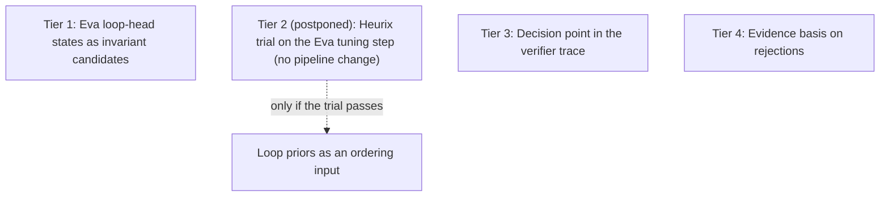

# Papers Generalization Analysis & Ranked Implementation Plan

This document reads the seven items under `docs/papers/`, maps what each one offers onto the Frama-C agentic verification pipeline ([`../guides/v2-design.md`](../guides/v2-design.md), [`../guides/agentic-swarm.md`](../guides/agentic-swarm.md)), and sets out an implementation plan **ordered by expected value**. It follows the format of [`./formal-discovery-plan.md`](./formal-discovery-plan.md). Every claim about the pipeline below was checked against the scripts on 2026-11-10; every claim about a paper carries the section it comes from.

Two limits on the reading:

- **Heurix:** the folder holds only the artifact's `docs/papers/README.md`, not the paper. What the tool does and how it is run is known; its measured results are not. Tier 2 starts by reading the paper.
- **Not read:** the proof appendices of the union-find paper, the last worked example of the responsibility paper's Appendix B, and the pages after 20 of the agentic-interpretation and resource-bounds papers (remaining related work, conclusions, appendices).

Four of the seven items yield work, one tier each: two build items and two brief-and-schema edits. **Tier 2 (Heurix) is postponed** (decided 2026-11-10); Tiers 1, 3 and 4 are the active ones. Section 3 also records what is deliberately not pursued and why.

---

## 1. What each paper does

### 1.1 Loop Invariants from Counterexamples (Greitschus, Dietsch, Podelski, SAS 2017; `978-3-319-66706-5_7.pdf`)

- **Setting:** a refinement-based software model checker (trace abstraction, Ultimate Automizer). The checker picks a candidate error trace and must prove it infeasible in a way that also rules out its loop unwindings (Section 1).
- **Method:** build the *path program* of the trace, the sub-graph of the control flow that contains only the trace's statements (Section 2). Run abstract interpretation on it with octagons, intervals and congruences. If the fixpoint proves the path program safe, its loop-head states are loop invariants and the whole path program is removed at once. Otherwise fall back to SMT interpolation on the single trace (Section 3, Fig. 6).
- **`weaken` (Section 3.2):** a backward pass over the proof that drops every conjunct whose variables are neither read by the next statement nor needed later. It exists because relational domains produce state assertions that grow quadratically with the number of variables.
- **Results (Section 4, Table 3):** 176 of 359 benchmarks solved with abstract interpretation tried first (Taipan), 145 with it tried last (LazyTaipan), 124 without it (Automizer). Benchmarks are SV-COMP Loops and ECA; the engine supports no arrays, bitvectors or floats; the timeout is 90 s.

### 1.2 Heurix (Mattar, Alberti, Perrelle, Sadou, SAS 2026; artifact README only)

- **Setting:** precision options of an abstract interpreter (loop unrolling, delayed joins, abstract domains) are costly, so they must be enabled selectively.
- **Method:** a pipeline of automatic labelling, feature extraction (code property graphs), graph-neural-network training and inference. It learns statement-level heuristics (which loops to unroll, where to delay joins) and program-level ones (which domains to enable). A Frama-C plugin, `uroll`, extracts features and applies predictions inside an Eva run (`-uroll-predict-model`, `-uroll-predict-target unroll`, `-uroll-predict-domain-model`).
- **Labelling:** slicing, incremental and decremental strategies, each in source, reverse or random order (README, Table 1).
- **Baselines:** Eva's `-eva-auto-loop-unroll` (`alu`) and PARF (README, Tables 3 and 5); zero-, one- and few-shot code LLMs for classification (Table 2).
- **Requirements:** 64 GiB RAM, 60 GB of storage, a GPU recommended (CPU possible), shipped as a Docker image with pretrained checkpoints.

### 1.3 Responsibility Analysis by Abstract Interpretation (Deng, Cousot, 2019; `1907.08251v1.pdf`)

- **Definition (Section 2.2, Definition 1):** an entity is responsible for a behaviour in an execution if it is free to choose its value and that choice is the *first* one that guarantees the behaviour. Free choices are inputs, system settings, return values of external functions and the like (Section 2.1, P2).
- **Why it is stricter than existing notions (Section 2.1):** dependency, taint and slicing include every variable that influences the outcome; counterfactual and structural-equation causality ignore the order of events.
- **Observer (Section 3.3):** responsibility is relative to what an observer can distinguish. The omniscient observer is the usual case.
- **Status:** no implementation ("an implementation of responsibility analyzer is not provided here", Section 1). Appendix B sketches an abstract analysis that needs forward and backward invariance analyses and, for precision, an eventuality analyzer.

### 1.4 Agentic Interpretation (Mitchell, Wang, 2026; `2605.12694v1.pdf`)

- **Setting:** analyses where no verifier can check the LLM's answer because the evidence is outside the source: opaque third-party components, advisories, informal contracts (Section 1, Fig. 1). The paper sets generate-and-check systems aside as already covered by their checker.
- **Method (Section 3):** split the goal into claims attached to nodes of an *evaluation graph* (the program graph plus auxiliary nodes, context edges and feedback edges). An LLM grades each claim; the grade lives in a finite-height join-semilattice; a worklist re-processes a node's successors when its grade changes.
- **Lattices (Sections 2.2 and 4.1):** supporting and refuting evidence are graded separately (absent, weak, strong). A refinement tracks how trustworthy the evidence is, per polarity: `model` (LLM only), `located` (a concrete evidence record), `applicable`, `corroborated`, `checked` (source inspection, deterministic tool, verifier or human audit).
- **Guarantee (Proposition 1):** termination only. The paper states that no least fixed point is claimed, because LLM calls are neither deterministic nor monotone, and that worklist order can change the result (Section 4.5).
- **Status:** work in progress; "a practical implementation and experimental evaluation of the system are left to future work" (Section 1).

### 1.5 A Lattice of Union-Finds (Lesbre, Lemerre, SAS 2026; `2026-sas-union-find-lattice-with-appendices.pdf`)

- **Contribution:** join, meet and inclusion on persistent union-find, in time almost linear in the size of the difference between the two versions (Sections 3 to 5), on Patricia trees and on persistent arrays (Section 6), and for labelled union-find, which represents `x = y + k` (Section 7).
- **Delivery:** the OCaml library `union-find-lattice`, and an experimental domain in the Codex analyzer, not in Eva (Section 8.3).
- **Measured in Codex (Section 8.3):** 5 to 10% more runtime with Patricia trees; precision differences in 19 of 638 files; 34 more alarms proved, most of them overflow checks.

### 1.6 Abstract Interpretation for Generalized Heuristic Search in Model-Based Planning (Tan, Tenenbaum, Mansinghka, 2022; `2208.02938v1.pdf`)

A four-page extended abstract. It recasts planning heuristics (`h_max`, `h_add`, counterexample-guided Cartesian abstraction) as abstract interpretation of symbolic world models, to extend them to numeric and set-valued variables. No tool and no evaluation.

### 1.7 Inferring Empirical Sound Resource Bounds (Frontull, Meitinger, Moser, SAS 2026; `2608.11833v1.pdf`)

- **Method:** a custom symbolic executor for a functional core language enumerates every path for inputs up to a size bound and records the worst cost per input shape (Section 3). A mixed-integer linear program then fits an upper bound from basis functions (Section 4).
- **Scope:** pure OCaml programs; the paper chooses functional programs to avoid "the complications of side-effects or pointers" (Section 1).
- **Guarantee:** "empirically sound" means the bound holds on the explored input sizes (Corollary 1). Of 46 benchmarks, one inferred bound is wrong beyond them (Duplicates, Section 6) and one has the wrong asymptotic class (MergeSort2).

---

## 2. Mapping onto the pipeline

| Paper mechanism | Pipeline counterpart | Where |
| :--- | :--- | :--- |
| Abstract interpretation before SMT (1.1) | Phase 2 Eva before Phase 3 WP; Unknown obligations reach the prover brief through `{unknown_obligations_json}` | [`../../scripts/run_eva_slice.py`](../../scripts/run_eva_slice.py), [`../../skills/framac-wp/prover_brief.md`](../../skills/framac-wp/prover_brief.md) |
| Loop-head fixpoint states as loop invariants (1.1) | **none**: provers get loop structure and Eva read and write sets, not Eva values (Tier 1) | [`../../scripts/function_facts.py`](../../scripts/function_facts.py) |
| `weaken`: drop conjuncts over irrelevant variables (1.1) | **none** for hints; `var_classes` already classifies loop variables as unchanged, non-inductive or inductive | [`../../scripts/function_facts.py`](../../scripts/function_facts.py) |
| Cache of path programs the domain could not prove (1.1, Section 4) | Dead-end ledger (formal-discovery Tier 1) | [`../../scripts/spec_kb.py`](../../scripts/spec_kb.py) |
| Learned choice of loops to unroll (1.2) | Fixed ladder, then per-loop differential trials capped at `MAX_LOOP_TRIALS = 8`, ordered by Unknown count per function | [`../../scripts/eva_tuning.py`](../../scripts/eva_tuning.py), [`../../scripts/eva_loops.py`](../../scripts/eva_loops.py) |
| Learned domain selection (1.2) | Base domains fixed (`cvalue`, `equality`, `symbolic-locations`, `octagon`, `gauges`); only `multidim` and `taint` can be added | [`../../scripts/run_eva_slice.py`](../../scripts/run_eva_slice.py), [`../../scripts/eva_options.py`](../../scripts/eva_options.py) |
| Responsible entity: first free choice that guarantees the behaviour (1.3) | `root_cause` free text; `trace` of `entrypoint`, `propagation`, `sink` steps; `reachability` (`untrusted_surface`, `internal_api`); "Audit Harness Legitimacy" in the verifier brief | [`../../schemas/findings.schema.json`](../../schemas/findings.schema.json), [`../../skills/framac-wp/crash_verifier_brief.md`](../../skills/framac-wp/crash_verifier_brief.md) |
| Dependency and taint, which 1.3 shows are weaker | Optional Eva `taint` domain (`--eva-taint`), CodeQL trust marking | [`../../scripts/pipeline_make.py`](../../scripts/pipeline_make.py), [`../../scripts/codeql_trust.py`](../../scripts/codeql_trust.py) |
| Claims graded on a lattice, never trusted until checked (1.4) | `candidate`, `needs_validation`, `confirmed`, `rejected` verdicts; the Crash Verifier gate | [`../../scripts/ledger.py`](../../scripts/ledger.py) |
| Confidence basis of evidence (1.4, Section 4.1) | `verifier.method` (`reproduced`, `source_review`, `reproduced_and_source_review`) is recorded but nothing reads it (Tier 4) | [`../../schemas/findings.schema.json`](../../schemas/findings.schema.json) |
| Feedback edges: a downstream finding re-targets upstream work (1.4) | Strengthening requests and `negotiate` tasks; a breaker crash reopens the gates of the slices it affects | [`../../scripts/contract_negotiator.py`](../../scripts/contract_negotiator.py), [`../../scripts/wp_scheduler.py`](../../scripts/wp_scheduler.py) |
| Flow-sensitive equalities and `x = y + k` (1.5) | Eva's `equality`, `octagon` and `gauges` domains, used as a black box | [`../../scripts/run_eva_slice.py`](../../scripts/run_eva_slice.py) |
| Planning heuristics (1.6) | none | |
| Cost bounds from bounded exploration (1.7) | LibFuzzer per-input `-timeout` (`timeout_found`, `slow_unit`) and `loop variant` proofs; no cost model | [`../../scripts/run_eacsl_fuzz.py`](../../scripts/run_eacsl_fuzz.py) |

### 2.1 Verified gaps

1. **Eva's values never reach a prover.** After a successful run, `collect_flows` loads `framac.sav` in a separate process with `-deps -inout -input -out-external -cg` and keeps read sets, write sets and call targets. `function_facts._eva_record` passes exactly those on. `_loop_record` is built from the kernel AST alone (guard, scalars, memory writes, pointer walkers, exits). Step B of the prover brief then asks the prover to write index bounds and pointer-offset invariants by hand (`loop invariant range: 0 <= i <= len;`, `loop invariant ptr_idx: p == start + idx;`). No script calls `Frama_C_show_each`, `Frama_C_dump_each` or an Eva results API.
2. **Loop trials are few and ordered by one signal.** `plan_loop_candidates` takes the loop nests of the functions that have Unknowns, most Unknowns first, and returns the first eight. Each trial is a whole Eva run. Measured rung costs are 0.84 to 1.2 times the base run for the cheapest rungs and 3 to 10 times for the others (`eva_options.py`); QCBOR run-5 queued about 15 hours of rungs that could not finish.
3. **The root cause has no structure.** A confirmed record requires `root_cause` as free text and a `trace` whose steps are `entrypoint`, `propagation` or `sink`. Nothing names the point where the failure became inevitable or who controlled it. The verifier brief's harness audit asks "whether the failure occurred because the harness violated a non-attacker precondition" without a test for it. Fingerprints are keyed on file, function, kind and predicate of the failing property (`fingerprint.make_fingerprint`), that is, on the sink.
4. **A rejection by reading is treated like a rejection by tool.** On a `rejected` verdict whose class is not `harness_induced`, `ledger.py` sets each affected unit to `covered` when it has discharging evidence and to `blocked` otherwise, whatever the verifier's method was. `disproved_by_source` and `dead_code` can rest on an LLM's source review alone, and the record does not say so in a field anything reads.

---

## 3. Ranked plan (by expected value)



| Rank | Upgrade | Paper origin | Value | Risk |
| :---: | :--- | :--- | :--- | :--- |
| 1 | Eva loop-head states as invariant candidates | 1.1 (Sections 1.1, 3.1, 3.2, Table 3) | High: every loop in every proved function is written by hand today | Medium: harness-shaped hints can pull contracts toward the harness |
| 2 | Heurix trial on the Eva tuning step (**postponed**) | 1.2 (README) | Medium-high if it transfers: the tuning step is the longest deterministic step | Low for the trial; medium for integration (plugin build, PyTorch) |
| 3 | Decision point in the verifier trace | 1.3 (Definition 1, Section 2.1) | Medium: sharper harness audit, fix placement and duplicate detection | Low: brief and optional schema field |
| 4 | Evidence basis on rejections | 1.4 (Section 4.1) | Medium: makes unverified rejections visible | Low: record and report first |

The four tiers are independent of each other, so postponing Tier 2 blocks nothing. Tier 2 is a measurement with no code in the pipeline; its integration step exists only if the measurement passes. The ranks are kept as assessed: the working order is Tier 1, Tier 3, Tier 4.

### Common requirements

The requirements of [`./formal-discovery-plan.md`](./formal-discovery-plan.md) ("Common requirements for every tier") apply unchanged: an A/B environment flag for behaviour changes (added to both wrappers, `docker-compose.yml` and `tests/test_remediation_p2_container.py`), acceptance on a `benchmark.py` run compared with `benchmark_compare.py`, docs updated in the same change, tests run with `-n auto`. Any pipeline bug found on the way goes into [`../troubleshooting/`](../troubleshooting/README.md) in the same session ([`../../AGENTS.md`](../../AGENTS.md)).

---

### Tier 1: Eva loop-head states as invariant candidates

> **Status: Step 0 run on 2026-11-10; it did not pass on the target that matters, so nothing below Step 0 was built.** Route A works mechanically, but Eva does not hold the index-against-length relation at a widened loop head, and that relation is the reason for the tier. See "Step 0 result" below. No pipeline code was changed for this tier.

**Step 0 result (2026-11-10, `framac-analysis:latest`, Frama-C 35.0~dev).** Measured on toy functions only (an index loop `for (i = 0; i < len; i++)`, a constant-bounded loop, a pointer walk `while (p < end)`), called from a harness with a nondeterministic length over a 16-byte and a 4096-byte buffer, with the pipeline's base domains (`cvalue,equality,symbolic-locations,octagon,gauges`). libmnl and QCBOR were not run: the toy cases are the easiest form of the pattern and already fail.

- **Route A is mechanically sound.** A module compiled like `kernel_ast_dump.ml` with the extra package `frama-c-eva.core` reads a saved session through `Eva.Results` (`before`/`after stmt`, `eval_exp`, `as_ival`, `as_cvalue`) with no further Eva run. Details that cost time: the loop-head state is the state before the first statement of the loop body (`before` on the `Loop` statement gives only the entry state); `Cil.mkBinOp` returns a `result`; a pointer difference needs `MinusPP`; `as_ival` fails on pointers; `equality_class` answers "The computed state is Top".
- **Index against length: not recovered.** At the loop head `i ∈ [0..2147483647]` (widened) and `i - len ∈ [-4096..2147483647]`, so `i <= len` cannot be read off. Same result with slevel 0, slevel 100, slevel 200 with `-eva-auto-loop-unroll 128`, signed or unsigned operands, and differences widened to `long long`. Unsigned differences wrap to the full range.
- **Evaluating at the loop's predecessors does not help either.** The entry state gives `i - len ∈ [-4096..0]`, but the back edge gives `[-4095..100]` at slevel 100: the octagon does not keep `i - len <= 0` across `i++`, so the join is not provable from the two.
- **Pointer walk: recovered in one calling context only.** `p - end ∈ [-4096..0]` at the head with the 4096-byte buffer in one run, `[-4096..4096]` or `[-16..16]` in others.
- **Constant-bounded loop: recovered** (`k ∈ [0..16]`), but the prover reads that bound from the guard already.
- **Route B was not tried:** `Frama_C_show_each` prints the same cvalue intervals, and `Frama_C_domain_show_each` answers "not implemented" for the octagon and gauges domains.

**Consequence.** What Eva can supply here is `0 <= i` and bounds by a harness constant. The first is what a prover writes unprompted; the second is exactly what the constant rule below exists to suppress. The tier stays open only if a different source for the relation is found (for example the gauges domain's internal state, which `Eva.Results` does not expose, or a relational analyser outside Eva).

**Problem.** Gap 1. The paper's core move is to take the abstract interpreter's loop-head state as the invariant instead of asking a solver to find one (Section 1.1). Its ordering result says to do so up front: 176 solved with abstract interpretation first against 145 with it last (Table 3).

**Step 0: measure the extraction before building anything.** (Original design, kept for reference; the result is above.) Two routes exist, and neither was verified on the Frama-C 35 image when this was written:

- **Route A, a script on the saved session (preferred).** An OCaml module loaded next to `framac.sav`, compiled and loaded the way `kernel_ast.py` handles `kernel_ast_dump.ml` (`ocamlfind`, `-load-module`). For each loop it evaluates a fixed list of expressions at the loop-head statement. This adds no Eva run. To verify: which Eva results interface Frama-C 35 exposes to a loaded module, and whether evaluating a difference such as `len - i` there benefits from the octagon and equality domains.
- **Route B, display directives on a scratch mirror.** Insert `Frama_C_show_each_<id>(i, len - i, p - buf)` on the mirror `eva_loops.py` already builds for `loop unroll`. The Eva manual documents this (Section 9.3.1) and shows a difference expression as an argument. It costs one more Eva run per module, and a call placed in the loop body reports the state after the guard, not at the loop head, so every bound taken from it must be relaxed (`i < n` becomes `i <= n`). The manual also says that what the additional domains print through `Frama_C_domain_show_each` "is currently very limited" (Section 9.3.3), so relations must be asked for as explicit difference expressions.

Step 0 passes when, on one libmnl module and one QCBOR module, extraction finishes within the flows time limit and yields at least interval bounds for the loop scalars. Record the time and the output size.

**Which expressions to ask for.** Per loop, from the facts already computed: each inductive scalar, each `bound - scalar` for the operands of the guard, and each `walker - root` for a pointer walker and the formal it derives from. Differences are what make a candidate relational without reading domain internals.

**Changes.**
- [`../../scripts/run_eva_slice.py`](../../scripts/run_eva_slice.py): `collect_loop_states` next to `collect_flows`, same contract. It decides nothing, and a failure or timeout only loses hints (`loop_states.status`). The report carries `loop_states` by kernel function name and loop line.
- [`../../scripts/function_facts.py`](../../scripts/function_facts.py):
  - `_loop_record` gains `eva_candidates`: predicates over the function's own formals and locals.
  - **Relational first.** A candidate is `scalar <= bound`, `0 <= scalar` or `walker - root == scalar`, derived from the sign or the singleton value of a difference. A bound against a bare constant is kept only when that constant appears literally in the function's source (`_source_context` already collects literal uses). This rule is the main safeguard of the tier: Eva reports `i ∈ [0..16]` because the harness buffer has 16 bytes, and a prover given `i <= 16` may add `requires len <= 16` to make it hold. The guardrail cannot catch that, because its corpus comes from the same harness.
  - **`weaken` filter.** Keep a candidate only if each of its variables appears in the loop's guard, `scalars`, `pointer_walkers`, read or written lvalues, or in an Unknown RTE obligation located in the loop. Cap the candidates per loop.
  - `render_section` prints them under the loop as named clauses, headed as observations under this harness, not facts.
  - The facts cache key already covers "the Eva flows it was built from"; add the loop-state digest.
- [`../../skills/framac-wp/prover_brief.md`](../../skills/framac-wp/prover_brief.md), Step B: candidates are hints; paste, then run both oracles; never add or strengthen a `requires` to make a candidate hold; drop a candidate that WP cannot establish or preserve.
- Flag `FRAMAC_EVA_SEEDS`. The existing `FRAMAC_PROVER_CONTEXT=off` already removes the whole facts section and must remove these too.
- Tests: `tests/test_function_facts.py` (difference to predicate, constant suppression, `weaken`, cap, rendering, absence with the flag off); parsing of the extraction output beside the existing `collect_flows` tests.

**Acceptance.** A benchmark A/B on the flag: fewer prover iterations to `all_proven` on functions with loops, and no rise in `rejected_overconstrained` guardrail verdicts. Also read the merged contracts of the seeded run for `requires` clauses that bound a size by a harness constant: the guardrail cannot see those, and one of them means the constant rule is too loose.

**What does not transfer.** Path programs and the refinement loop: the pipeline has no CEGAR loop and Frama-C has no path-program mode. The 40% figure: it comes from integer-only code with no arrays, and the targets here are pointer-walking parsers.

### Tier 2: Heurix trial on the Eva tuning step (postponed)

> **Status: postponed on 2026-11-10.** Nothing below has been started. When it is picked up again, it still begins with step 1 of the trial: the paper itself is not in `docs/papers/`, only the artifact README.

**Problem.** Gap 2. Heurix predicts what `eva_tuning.py` finds by search. A wrong prediction costs precision or time, never correctness: unrolling "never affects correctness" (Eva manual 6.4.1, cited in `eva_loops.py`), and every trial still passes the guards and `loop_trial_helps`.

**Trial (no change to the pipeline).**
1. Get the paper and read its results. Only the README was available for this plan; Tables 1, 3, 4 and 5 are the ones that matter.
2. Check the artifact's licence and the Frama-C version `uroll` builds against. The pipeline runs Frama-C 35, and MetAcsl already needed a source build for it (`Dockerfile`).
3. In the artifact's own Docker image, run the pretrained Eva model on the sources of two modules the pipeline has already tuned (libmnl, QCBOR), with their harnesses.
4. Compare with the recorded decisions (the `tuning` block of the Eva report and `workspace/build/params.json`):
   - of the loop nests the pipeline kept, how many Heurix predicts;
   - of the loops Heurix predicts, how many lie outside the first eight candidates of `plan_loop_candidates`;
   - inside the artifact's Frama-C only, alarms and time for its base run against its prediction. Alarm counts are not comparable across Frama-C versions or harness options.
5. Run inference on CPU and record its time and memory. The pipeline runs on machines of unknown size, and the README's 64 GiB and GPU figures are for reproducing the paper, not necessarily for inference.

**Decision rule.** Integrate only if the prediction finds helpful loops beyond the cap, or reaches the pipeline's Unknown count in clearly fewer Eva runs.

**Integration, if the trial passes.** The prediction becomes an *ordering* input: an optional `workspace/build/loop_priors.json` that `plan_loop_candidates` uses to rank loop nests before the cap. Guards, `loop_trial_helps` and the per-obligation combination stay as they are. Decisions are recorded in `params.json` as today, so another machine replays them without the model. Loading `uroll` into the Eva run that decides results is not proposed: it would put a PyTorch dependency and a third-party plugin into the hardened analysis image.

**Not taken from Heurix.** Domain selection. The base domains are fixed and only `multidim` can be added, by choice (`eva_options.py`), so a domain predictor has almost nothing to decide here.

### Tier 3: Decision point in the verifier trace

> **Status: implemented on 2026-11-10** (schema, verifier scaffold, brief, reports; tests in `tests/test_verifier_decision_basis.py`). No A/B flag: the field is optional and no status depends on it. Not yet exercised on a benchmark run.

**Problem.** Gap 3. The responsibility paper gives the definition the verifier brief lacks: the responsible choice is the first free one after which the failure is guaranteed (Definition 1), and intermediaries such as the sink are not responsible because they are not free (Section 2.1, P2).

**Changes.**
- [`../../skills/framac-wp/crash_verifier_brief.md`](../../skills/framac-wp/crash_verifier_brief.md), Case A step 3 and Case B step 1: after the trace, name the **decision point**, the earliest step at which a value chosen outside the target makes the failure inevitable, and who controls it:
  - `attacker_input`: bytes of the fuzz input;
  - `harness_choice`: an argument or state the harness sets;
  - `environment`: the return value of an external function, or configuration.

  Two rules follow. A `harness_choice` that no legitimate caller could make is `harness_induced`; this gives the existing harness audit a test. A fix patch belongs at or just after the decision point (the missing validation), not at the sink.
- [`../../schemas/findings.schema.json`](../../schemas/findings.schema.json): an optional `decision_point` object (`file`, `line`, `function`, `controlled_by`, `description`) on `confirmed` and `needs_validation` records. Optional, so existing records still validate.
- [`../../scripts/ledger.py`](../../scripts/ledger.py): `scaffold-verifier` emits the field; `ingest-verifier` accepts records with or without it.
- [`../../scripts/generate_report.py`](../../scripts/generate_report.py): print it under the root cause, and list confirmed findings that share a decision point as possibly one defect. Report only: fingerprints and merging are unchanged.
- Optional check for Case A: mutate the decision bytes of the minimized reproducer and replay. If the failure stays, the decision point is wrong. This uses the existing `replay` and `minimize` steps.
- Tests: `tests/test_ledger.py` and `tests/test_promote_and_verifier.py` (scaffold and ingest, with and without the field, both shapes validating against the schema), and the report rendering. No test file references `findings.schema.json` by name today, so the validation cases go where the ingest tests are.

**Limits.** The paper's definition quantifies over all executions. The verifier judges from one reproducer and the source, so the field is a reviewed claim, not an analysis result. The static analysis of Appendix B is not attempted: Eva has no backward analysis, and the `taint` domain gives dependency, which Section 2.1 shows is weaker.

### Tier 4: Evidence basis on rejections

> **Status: step 1 implemented on 2026-11-10** (record and report only). A `dead_code` basis raised to `checked` from the Eva or coverage report means "not reached under this module's harness or corpus"; the attempt entry keeps `refutation_basis_source` so those can be counted apart. The "at least `located`" rule is in the brief only; ingest does not refuse a weaker basis.

**Problem.** Gap 4. The agentic-interpretation paper separates how strong evidence is from how far it can be trusted, and shows why the two must not be merged: strong LLM-only support joined with weak checked refutation would otherwise read as "checked" (Section 4.1).

**Changes.**
- [`../../schemas/findings.schema.json`](../../schemas/findings.schema.json): `rejected` records gain `refutation_basis`, three of the paper's five levels:
  - `checked`: a tool output cited in `evidence` refutes the candidate (a rung or WP proves the property, Eva reports the statement Dead, a repaired harness no longer fails);
  - `located`: the record cites the file and line of the check or dead branch, with no tool output;
  - `model`: reasoning only.
- [`../../skills/framac-wp/crash_verifier_brief.md`](../../skills/framac-wp/crash_verifier_brief.md): state the basis; `disproved_by_source` and `dead_code` need at least `located`.
- [`../../scripts/ledger.py`](../../scripts/ledger.py), `ingest-verifier`: record the basis in the unit's attempt entry. For `dead_code`, check the claim against data already on disk (Eva's Dead status for the statement, Phase 1 per-function coverage) and raise the basis to `checked` when it agrees.
- [`../../scripts/generate_report.py`](../../scripts/generate_report.py): count rejections by class and basis in `REPORT.md`.
- **Step 1 is record and report only.** Unit statuses do not change. After one benchmark run, decide from the counts whether a rejection below `checked` should stop returning a unit to `covered`.
- Tests: `tests/test_ledger.py` and `tests/test_promote_and_verifier.py` (basis recorded, `dead_code` raised to `checked` only when Eva or coverage agrees, records without the field still ingest).

**Not taken from the paper.** The worklist over an evaluation graph as an architecture. The pipeline's main loop is generate-and-check, the paper has no implementation or evaluation, and it guarantees termination only.

---

### Follow-ups built on the tiers (2026-11-10)

Three additions, implemented on branch `papers-generalization`. None has been run on a real target or through the wrapper; each was run on toy inputs in `framac-analysis:latest` or with mocked tools, as stated.

**Loop invariant seeds (replaces Tier 1's Eva source).** [`../../scripts/loop_seeds.py`](../../scripts/loop_seeds.py), flag `FRAMAC_LOOP_SEEDS` (default off).
- Candidates come from the loop facts, not from Eva: `0 <= i`, `i <= bound`, the guarded `0 <= len ==> i <= len` for a signed bound, pointer-walker anchors on `\at(p, Pre)`, `p <= end`. A constant bound is kept only if the literal is in the function's code.
- **Houdini with WP:** the candidates go into a private copy as `loop invariant seed_<n>`, WP is restricted to those goals (`-wp-prop`), and what it cannot establish or preserve is dropped until nothing drops. Measured on toy loops: about 1 s per round when everything proves, about 6 s with a failing goal at a 5 s goal timeout, 1 to 3 rounds. On eleven toy functions (bare contract plus `loop assigns`), pasting the proven seeds took the unproven memory-safety goals from 12 to 4 and helped five functions; the tool took 483 s in total with the no-harm check, 45 s without it.
- **Corpus filter:** only on what WP dropped. The candidates are compiled with E-ACSL and the corpus is replayed with the guardrail machinery; a falsified candidate is dropped with the input, a survivor is printed as "held on every replayed corpus input, NOT proven". The replay stops at the first failure, so it falsifies one candidate per round.
- **No-harm check:** proven seeds can still make a solver miss another goal (seen on a nested loop with a nonlinear index). The tool compares the function's unproven goals without and with the seeds and withholds the seeds that cost a goal. This adds two full WP runs per function.
- The prover runs it at the start of Step B ([`../../skills/framac-wp/prover_brief.md`](../../skills/framac-wp/prover_brief.md)); the scheduler copies the report to `workspace/reports/loop_seeds/`. It never adds a `requires` and changes no unit status.
- **Acceptance (open):** the A/B of Tier 1, on `FRAMAC_LOOP_SEEDS`: fewer prover iterations on functions with loops, no rise in `rejected_overconstrained`. The goal timeout and the caps come from toy measurements.

**A weak rejection does not silence later tool evidence.** [`../../scripts/ledger.py`](../../scripts/ledger.py), flag `FRAMAC_REJECTION_REOPEN` (default on).
- Nothing carries rejections between runs, whatever the schema description says. Within a run, a verified candidate was never reopened by a later signal at the same sink.
- Now a new reproduced failure (breaker crash, guardrail `code_fault` with an input, a reproducible fuzz artifact) reopens a rejection whose basis is `located`, `model`, unstated, or `checked` only because ingest raised it. A verifier-stated `checked` is not reopened; the evidence is recorded as contradicting it. A fault hypothesis reopens nothing.
- The old rejection stays in the new record's `prior_verdicts`. Reopenings per candidate are bounded by the harness repair budget (`max_repair_attempts`, 2 without a sidecar), and a `harness_induced` rejection is not reopened by the same unrepaired harness.
- The scheduler dispatches a second verifier for a reopened candidate.

**Decision point checked by patch and replay.** [`../../scripts/decision_point_check.py`](../../scripts/decision_point_check.py), no flag (a tool the verifier runs).
- The verifier writes a small patch that neutralises the decision point. The tool builds the E-ACSL replay binary with and without it in the agent's scratch and replays the reproducers. `checked` means: the unpatched build fails with the candidate's failure and the patched build fails on no reproducer. Nothing more.
- `decision_point.basis` (`checked`, `located`, `model`) is raised to `checked` by ingest only from an agreeing report on disk; a stated `checked` without one is lowered to `located`. No status or severity depends on it.
- Run once in the container on a toy target: a bound-check patch gave `checked`, a patch that does not bound the index gave `not_removed`.
- **Known limit:** a verifier could hand-write the report. The digest check catches a mismatching patch, not a forged report; re-running the check in the parent would.

### Not pursued

| Item | Reason |
| :--- | :--- |
| Union-find lattice (1.5) | It is for authors of abstract domains. The pipeline uses Eva as a black box, and the paper's integration is in Codex. Watch item only: when mining upstream Frama-C ([`./backlog.md`](./backlog.md), Section 1a), note any Eva domain built on labelled union-find, since `x = y + k` is the shape of the pointer-offset invariants provers write by hand. |
| Planning heuristics (1.6) | About PDDL planners; nothing maps to the pipeline. |
| Resource bounds (1.7) | Functional programs only, a custom symbolic executor, and bounds valid only on the explored sizes. The pipeline has no cost model to feed. |
| Static responsibility analysis (1.3, Appendix B) | No implementation exists and Eva has no backward analysis. |
| Path programs and refinement (1.1) | No refinement loop in the pipeline; Frama-C has no path-program mode. |

---

## 4. Verification commands

```powershell
$env:PYTHONIOENCODING="utf-8"
python -m pytest tests/test_function_facts.py tests/test_eva_tuning.py tests/test_ledger.py tests/test_promote_and_verifier.py tests/test_workspace_overlay.py -n auto
```

Then the full suite and static checks ([`../../skills/python-patterns/SKILL.md`](../../skills/python-patterns/SKILL.md)):

```powershell
$env:PYTHONIOENCODING="utf-8"
python -m pytest tests -n auto
python -m ruff check scripts tests
python -m mypy scripts tests
```

And, for Tiers 1 and 4, a benchmark run compared against the previous baseline:

```powershell
python scripts/benchmark_compare.py <baseline.json> <candidate.json>
```
