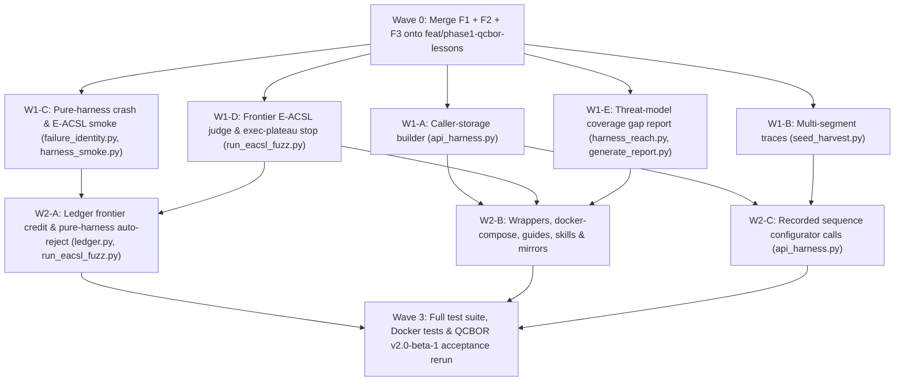

# Phase 1 Improvements From QCBOR Run-1: Parallelizable Implementation Plan

- **Status:** Wave 0 (`F1`/`F2`/`F3`), Wave 1 (`W1-A`..`W1-E`), and Wave 2 (`W2-A`, `W2-B`, `W2-C`) implemented on `feat/phase1-qcbor-lessons` (2026-11-23); Wave 3 verification and QCBOR `v2.0-beta-1` acceptance rerun remain. Wave 0 merged the held supervision branches (`F1`, `F2`, `F3`) recorded in `docs/runs/2026-11-22-qcbor-run1-supervision.md` (see [`../runs/README.md`](../runs/README.md)).
- **Evidence base:** read-only inspection of `QCBOR/run-1` (`v2.0-beta-1`, commit `47df2bc4240d`, `standard` profile, `main` at `069ab4b`, threat model SHA-256 `6b073f84...`) and pipeline source code on 2026-11-22.
- **Related plans:** [`./fuzz-budget-design.md`](./fuzz-budget-design.md), [`./schema-driven-api-harness-plan.md`](./schema-driven-api-harness-plan.md), [`./api-sequence-fuzzing-papers-generalization-plan.md`](./api-sequence-fuzzing-papers-generalization-plan.md).

---

## 1. Evidence Summary & Diagnosis

Phase 1 on `QCBOR/run-1` (`libqcbor_a`, 126 dispatch cases, 42 `api_auto_exempt`, 21,600 CPU-s budget, 7 sanitizer workers, 51 min wall time) exercised the decoder core thoroughly (`141.4M` executions, `0` crashes, `0` OOMs, `0` skipped/blinded cases), yet left high-priority threat-model surfaces untested and wasted both exploration compute and E-ACSL judging coverage:

1. **Known real bug missed due to caller-storage exemption (`QCBOR-01`):** `QCBORDecode_ProcessBigNumber` (`src/qcbor_number_decode.c:1964, 2008`, tracked in [`../bugs-found/qcbor/README.md`](../bugs-found/qcbor/README.md)) is still unfixed in `v2.0-beta-1` (`47df2bc`). Phase 1 missed it because `FRAMAC_API_TRUST_SCHEMA=on` auto-exempts trusted by-value buffer structs (`UsefulBuf`: `BigNumberBuf`, `MantissaBuffer`, `BufferForMantissa`, `Buffer`, `Dest`) when no schema instance or builder exists. `src/qcbor_number_decode.c` ended at `21.4%` region coverage (`176/821` regions; `416` of the `631` zero-execution `.c` regions across the library).
2. **Monolithic test-runner trace truncation (`MAX_TRACE_CALLS = 256`):** [`../../scripts/seed_harvest.py`](../../scripts/seed_harvest.py) previously stopped recording `traces.jsonl` after the first `256` calls of each process (`_collect`). `./qcbortest` runs 90 tests in one process (`SortMapTest`, `MemPoolTest`, `CursorTests`, `BignumDecodeTest`, etc.), so late subsystems never appeared in `traces.jsonl` even though `calls.jsonl` saw them. This starved both `sequence_case` and `F2`'s `recorded` stateful prefixes, and left optional `no-attacker-data` context configurators (`QCBORDecode_SetMemPool`, `MemPool_Function` `0/28`, indefinite-length string assembly `QCBORDecode_Private_GetNextFullString` `24/52`) unreached.
3. **E-ACSL judge corpus-selection and ledger-credit mismatch:**
   - `workspace/corpus/libqcbor_a` accumulated `42,288` files (`7,239` unmerged `floor_*` files plus `35,049` append-only intermediate mutations from 7 workers), while libFuzzer's live minimized corpus (`max_corp`) was only `2,591` files.
   - `select_judge_inputs` in [`../../scripts/run_eacsl_fuzz.py`](../../scripts/run_eacsl_fuzz.py) previously sampled `2,048` files uniformly (case-stratified SHA-256) out of the `42,288` unmerged files, giving the 33 complex decoder cases only `24-25` random mostly-intermediate inputs each instead of the `2,591`-input coverage frontier.
   - Judging all `3,225` selected inputs (`1,177` mandatory seeds + `2,048` grown) took only `27.0 s` (`119.5 inputs/s`, `0.8%` of Phase 1's wall time).
   - Because `not_judged_breakdown.cap = 40240 > 0`, `_ingest_judge_report_into_state` in [`../../scripts/ledger.py`](../../scripts/ledger.py) withheld E-ACSL `fuzz_clean` credit from the **entire** `libqcbor_a` module, even for the `76/126` cases where `100%` of grown inputs were judged.
4. **Diminishing-returns tail with late breakthroughs:** In `telemetry.series` of `workspace/reports/fuzz/libqcbor_a.json`, the 54-second P6a floor pass plus seeds reached `2,566` edges at shared-pass `INITED`. During the shared pass, `cov` jumped `+37` edges between `4M` and `8M` executions/worker (`2832 -> 2869`, `ft` `4902 -> 5106`), then flattened to `+7` edges (`2869 -> 2876`) from `8M` to `14M` executions/worker. A wall-time stop violates [`./fuzz-budget-design.md`](./fuzz-budget-design.md) P3 (hardware-independent limits), and an edge-only early stop at `1.5M` would cut off the `4M-8M` breakthrough; an execution-counted stop watching both `cov` and `ft` preserves both properties while saving `~40-50%` of CPU time.
5. **Pure-harness crash attribution and missing E-ACSL zero-rest smoke probe:** The sole Phase 1 candidate (`seed-17a8a928db558c9c`, Case 116) aborted in `LLVMFuzzerTestOneInput -> __e_acsl_builtin_memcpy` with **zero target frames** on the stack (`F3`: unguarded `memcpy` when `rest_n == 0` at one-past-the-end of an exact-size input). Because `_caller_of_eacsl_runtime` in [`../../scripts/failure_identity.py`](../../scripts/failure_identity.py) skipped `is_harness_fuzz_function("LLVMFuzzerTestOneInput")`, it fell through to libFuzzer's `main`, emitted `unknown#main::mem_access::8674205c9c`, and queued a Crash Verifier subagent. [`../../scripts/harness_smoke.py`](../../scripts/harness_smoke.py) missed it because per-case smoke ran only on `.san` with `0`-byte and `64`-byte payloads, not exact-slot-length (`rest_n == 0`) probes on `.e-acsl`.
6. **Silent auto-exempt blind spots:** `harness_reach_dynamic.json` reported `passed: true` despite `40/158` unexecuted `input_sources` and `21.4%` region coverage on `src/qcbor_number_decode.c`, because all `40` were `api_auto_exempt`.

---

## 2. Parallel Worktree Topology

Workstreams in the same wave own **disjoint production files** so subagents can run concurrently in isolated git worktrees without merge conflicts.



---

## 3. Wave 0 — Prerequisites (Sequential; Done)

Integration branch `feat/phase1-qcbor-lessons` merged Wave 0 sequentially:

1. Merged `sup/QCBOR-trusted-cstring-instance` (**F1**, commits `4b92d56` and `8520a72`).
2. Merged `sup/QCBOR-stateful-sequence-cases` (**F2**, commit `5743663`).
3. Landed **F3** (`sup/QCBOR-string-rest-zero-copy`): guarded string-rest `memcpy` with `if (rest_n > 0)` in [`../../scripts/api_harness.py`](../../scripts/api_harness.py), with unit and E-ACSL regression tests.

**Why sequential:** `F1`, `F2`, and `F3` all edit [`../../scripts/api_harness.py`](../../scripts/api_harness.py). Landing them first gave `W1-A` a conflict-free base.

---

## 4. Wave 1 — Five Parallel Workstreams (Done)

All five workstreams branched from Wave 0, ran in parallel, and merged onto `feat/phase1-qcbor-lessons`.

### W1-A: Caller-Owned Writable Scratch/Output Buffer Builder

- **Owned files:**
  - [`../../scripts/api_harness.py`](../../scripts/api_harness.py)
  - `tests/test_api_harness_caller_storage.py` (new)
- **Design:**
  - Generalize S2 ([`./schema-driven-api-harness-plan.md`](./schema-driven-api-harness-plan.md)) in `_param_roles`, `_single_cases_for_entry`, and `_bind_call` to recognize two trusted caller-storage shapes:
    1. A trusted **by-value writable buffer struct** whose fields are a single writable byte/void pointer (`void *`, `unsigned char *`, `uint8_t *`, `char *`, non-`const` pointee) and a single size/length integer field (e.g., `UsefulBuf { void *ptr; size_t len; }`), with no function-pointer or other pointer fields.
    2. A trusted **writable `(void */byte *, size_t)` scratch pair** whose pointer is non-`const`.
  - Back each recognized parameter with a fixed `_Alignas(16) unsigned char <var>_buf[<spare>];` array owned by the harness and initialize its pointer/length to `(<var>_buf, sizeof(<var>_buf))` (or a fuzzed length clamped to `0..sizeof(<var>_buf)` only when the parameter is explicitly marked attacker-sized, never allowing out-of-bounds lengths or forged pointers).
  - Keep read-only or state structs (`pSavedState`, `pInfo`, structs with `const` pointers, multiple pointers, or function pointers) auto-exempt with `"trusted parameter <name> has no instance"`.
  - Record a clear case note (`trusted caller-storage buffer: backed by fixed harness array`) and gate behavior under `FRAMAC_API_TRUST_SCHEMA` (`=off` restores rollback).
- **Acceptance:**
  - Unit tests cover by-value `{ptr, len}` struct (both `{ptr, len}` and `{len, ptr}` field orders), writable `(ptr, len)` pair, and negative tests confirming `const`-pointer structs (`UsefulBufC`), multi-pointer structs, and opaque/state structs stay exempt.
  - Scratch regeneration against `QCBOR/run-1`'s `phase0_model.json`: `QCBORDecode_ProcessBigNumber`, `GetTBigNumber*`, `GetT*BigMantissa*`, `QCBOREncode_EncodeHead`, `UsefulBuf_CopyOffset`, and `UsefulOutBuf_CopyOut` gain compiling cases (`clang -fsyntax-only` passes).

### W1-B: Multi-Segment Trace Harvesting

- **Owned files:**
  - [`../../scripts/seed_harvest.py`](../../scripts/seed_harvest.py)
  - `tests/test_seed_harvest_segments.py` (new)
- **Design:**
  - In `_collect` ([`../../scripts/seed_harvest.py`](../../scripts/seed_harvest.py)), remove the global `if len(trace) < MAX_TRACE_CALLS:` cutoff that drops everything after call 256 of a monolithic test process.
  - Stream the full `calls-<pid>.txt` file and split it into per-context segments (`iter_trace_segments`) keyed by the first pointer argument address (`addrs["0"]`), starting a new segment whenever an initializer-like function (`_INIT_NAME_RE`) or first non-destructor call after a destructor (`_DTOR_NAME_RE`) reuses an address, plus a bounded sliding window (`NON_CONTEXT_WINDOW_CALLS = 64`) for non-context/unlinked calls.
  - Deduplicate segments by their ordered function-name tuple (keeping the richest / first complete segment per distinct signature) up to `MAX_TRACES = 512`, with each individual segment capped at `MAX_TRACE_CALLS = 256`.
  - Keep the existing `traces.jsonl` JSONL schema (`{"pid": ..., "calls": [...]}`) unchanged so [`../../scripts/api_harness.py`](../../scripts/api_harness.py) and [`../../scripts/validate_artifacts.py`](../../scripts/validate_artifacts.py) work without modification.
- **Acceptance:**
  - Unit test with a synthetic 1,000-call single-PID recording where encoder, map-sort, and mempool sequences appear after call 400: all late distinct segments appear in `traces.jsonl`, duplicate early tests do not crowd them out, and total output remains bounded.

### W1-C: Pure-Harness Crash Detection & Exact-Slot E-ACSL Smoke Probe

- **Owned files:**
  - [`../../scripts/failure_identity.py`](../../scripts/failure_identity.py)
  - [`../../scripts/harness_smoke.py`](../../scripts/harness_smoke.py)
  - [`../../schemas/harness_smoke.schema.json`](../../schemas/harness_smoke.schema.json)
  - `tests/test_harness_self_bug_triage.py` (new)
  - [`../../tests/test_harness_smoke.py`](../../tests/test_harness_smoke.py)
- **Design:**
  1. **Fix `_caller_of_eacsl_runtime` in [`../../scripts/failure_identity.py`](../../scripts/failure_identity.py):** Scan frames after the innermost E-ACSL runtime frame (`last_rt`). If the first non-runtime frame is `LLVMFuzzerTestOneInput` (i.e., there is no target function frame between E-ACSL runtime and the harness entry point), return `("LLVMFuzzerTestOneInput", where)` instead of skipping `is_harness_fuzz_function` and falling through to libFuzzer's `main`.
  2. **Add `is_pure_harness_crash(failure, frames)` in [`../../scripts/failure_identity.py`](../../scripts/failure_identity.py):** Returns `True` when `failure["function"] == "LLVMFuzzerTestOneInput"` (or `is_harness_fuzz_function`) and the parsed stack frames between the sanitizer/E-ACSL runtime and `LLVMFuzzerTestOneInput` contain zero target functions. Mark `_parse_libc_failure` results with `harness_self_fault: True` when triggered directly from `LLVMFuzzerTestOneInput`.
  3. **Extend [`../../scripts/harness_smoke.py`](../../scripts/harness_smoke.py) and [`../../schemas/harness_smoke.schema.json`](../../schemas/harness_smoke.schema.json):**
     - For each dispatch case in the sidecar `api_cases` that has a `rest` field, compute its exact slot byte length `S` (selector width + sum of fixed slot sizes) via `exact_slot_lengths()` and generate an `exact_slots` (`rest_n == 0`) zeroed probe of length `S`.
     - Run the batched per-case smoke pass on `.e-acsl` as well as `.san` when `.e-acsl` is built (`case_engines_checked`, fast single-batch replay, typically `< 1 s`), quarantining unambiguous `harness_setup_fault` / `is_pure_harness_crash` failures before Phase 1 explore/judge.
- **Acceptance:**
  - Replay-parser unit test using QCBOR run-1 Case 116's exact E-ACSL stack trace verifies `function == "LLVMFuzzerTestOneInput"`, `harness_self_fault is True`, and `is_pure_harness_crash(...) is True`.
  - Smoke unit/integration test confirms an unguarded zero-length `memcpy(dst, buf + n, 0)` on exact-slot length fails in `harness_smoke.py` under `.e-acsl`.

### W1-D: Coverage-Frontier E-ACSL Judge & Execution-Count Plateau Stop

- **Owned files:**
  - [`../../scripts/run_eacsl_fuzz.py`](../../scripts/run_eacsl_fuzz.py)
  - [`../../schemas/judge_report.schema.json`](../../schemas/judge_report.schema.json)
  - [`../../schemas/fuzz_report.schema.json`](../../schemas/fuzz_report.schema.json)
  - `tests/test_judge_frontier_selection.py` (new)
  - `tests/test_fuzz_plateau_stop.py` (new)
- **Design:**
  1. **Two-tier E-ACSL judge selection (`FRAMAC_JUDGE_FRONTIER`, default `on`, `=off` rollback):**
     - Keep all grown corpus files on disk (preserving value diversity as required by [`./fuzz-budget-design.md`](./fuzz-budget-design.md) P2).
     - Before selecting grown inputs in `run_judge`, run a fast read-only `libFuzzer -merge=1` pass using the `.san` binary into a temporary scratch directory (`JUDGE_MERGE_TIMEOUT_S = 30 s`) to obtain the set of filenames forming the minimized coverage frontier (`frontier_names`).
     - In `select_judge_inputs`:
       - **Tier 1 (frontier):** Select all frontier files up to `JUDGE_FRONTIER_CAP_BY_PROFILE` (`2,048` in `quick`, `8,192` in `standard`, `16,384` in `deep`) ahead of unmerged intermediate mutations.
       - **Tier 2 (value-diverse overflow):** Fill remaining capacity with case-stratified SHA-256 samples from non-frontier grown files. After the first batch measures `inputs_per_s`, allow the Tier 2 cap to expand toward target replay budgets (`JUDGE_TARGET_REPLAY_S_BY_PROFILE`: `30 s` `quick`, `120 s` `standard`, `300 s` `deep`, hard-capped at `JUDGE_TIER2_HARD_CAP = 16,384` inputs) so fast modules like QCBOR (`119.5 inputs/s`) do not stop after `27 s`.
     - Record `frontier_total`, `frontier_judged`, and `not_judged_by_case` in [`../../schemas/judge_report.schema.json`](../../schemas/judge_report.schema.json) (all optional/additive for backward compatibility).
  2. **Execution-count plateau stop (`FRAMAC_FUZZ_PLATEAU_STOP`, default `on`, `=off` rollback):**
     - Preserve [`./fuzz-budget-design.md`](./fuzz-budget-design.md) P3's hardware-independence rule by measuring stagnation strictly in **executions**, never wall seconds.
     - During multi-worker shared-pass fuzzing in `_run_fuzz_campaign_once`, `ExecutionPlateauDetector` polls worker logs periodically (`PLATEAU_POLL_INTERVAL_S = 15 s`) and tracks per-worker `(unit, cov, ft)`:
       - Require every active worker to reach its floor (`min_execs_per_worker`: `1_000_000` `quick`, `3_000_000` `standard`, `10_000_000` `deep`).
       - Stop gracefully (`SIGTERM`, `PLATEAU_SIGTERM_GRACE_S = 15 s`, letting libFuzzer flush final stats and corpus) only when **every** active worker has added `0` new `cov` edges **and** `< 0.5%` relative `ft` growth (`PLATEAU_MAX_FT_REL_GROWTH = 0.005`) over the last `W` executions (`1_500_000` `quick`, `4_000_000` `standard`, `8_000_000` `deep`).
     - Record `stopped_reason` (`"budget" | "plateau" | "crash"`) and `cpu_saved_s` in [`../../schemas/fuzz_report.schema.json`](../../schemas/fuzz_report.schema.json).
- **Acceptance:**
  - `test_judge_frontier_selection.py` verifies 100% frontier selection when 40,000 unmerged files exist alongside a 2,500-file frontier, per-case `not_judged_by_case` accounting, and `FRAMAC_JUDGE_FRONTIER=off` rollback.
  - `test_fuzz_plateau_stop.py` replays QCBOR run-1's recorded `telemetry.series` through the plateau detector and asserts: (a) it does **not** fire at `1.5M` execs/worker (preserving the `4M-8M` `+37`-edge breakthrough), and (b) it **does** fire cleanly in the flat tail after `~8M-10M` execs/worker.

### W1-E: Threat-Model Coverage Gap Summary

- **Owned files:**
  - [`../../scripts/harness_reach.py`](../../scripts/harness_reach.py)
  - [`../../scripts/generate_report.py`](../../scripts/generate_report.py)
  - [`../../schemas/harness_reach_dynamic.schema.json`](../../schemas/harness_reach_dynamic.schema.json)
  - `tests/test_threat_model_reach_report.py` (new)
- **Design:**
  - In `check_dynamic` ([`../../scripts/harness_reach.py`](../../scripts/harness_reach.py)), join `phase0_model.json` trust entries, harness sidecar `api_auto_exempt`, and `coverage/<mod>.json` to compute a `threat_model_coverage` object:
    - `input_sources_total`, `executed`, `unexecuted_total`, and `auto_exempt_by_reason` (`reason -> {count, functions}` sample functions).
    - `untrusted_files`: per-`.c`-file region coverage (`file`, `covered`, `total`, `pct`, `zero_exec_functions`, `below_threshold` for `< 50%`) sorted ascending by `pct`.
  - In [`../../scripts/generate_report.py`](../../scripts/generate_report.py) (`fuzz_reach_lines` / `REPORT.md`), render a concise "Threat-Model Coverage Gaps" table whenever `auto_exempt_by_reason` is non-empty or any untrusted `.c` file has `< 50%` region coverage.
- **Acceptance:**
  - Unit test using QCBOR run-1's dynamic reach + coverage fixture verifies `src/qcbor_number_decode.c` (`21.4%`) and the grouped auto-exempt reasons appear in both `harness_reach_dynamic.json` and rendered Markdown, and schemas validate cleanly.

---

## 5. Wave 2 — Cross-Module Integration, Configurators & Docs (3 Parallel Workstreams; Implemented on `feat/phase1-qcbor-lessons`)

Branched from Wave 0 + merged Wave 1 (`W1-A`..`W1-E`) with disjoint file ownership:

### W2-A: Ledger Frontier E-ACSL Credit & Pure-Harness Auto-Rejection

- **Depends on:** `W1-C`, `W1-D`.
- **Owned files:**
  - [`../../scripts/ledger.py`](../../scripts/ledger.py)
  - [`../../scripts/run_eacsl_fuzz.py`](../../scripts/run_eacsl_fuzz.py) (wire `is_pure_harness_crash` onto emitted explore/judge artifacts)
  - `tests/test_ledger_judge_frontier.py` (new)
- **Design:**
  1. **Granular E-ACSL credit in `_ingest_judge_report_into_state` ([`../../scripts/ledger.py`](../../scripts/ledger.py)):**
     - Keep module-wide denial of E-ACSL `fuzz_clean` on `timeout > 0`, `error > 0`, `blinded`, or `judged == 0`.
     - When `nj_cap > 0` is the only gap, do **not** blanket-deny the entire module if either:
       - `frontier_total > 0` and `frontier_judged == frontier_total` (100% of the minimized coverage frontier was judged under E-ACSL), **or**
       - for a specific unit, every reaching case `k` satisfies `not_judged_by_case.get(str(k), 0) == 0`.
     - Record `judge_frontier_complete: true` and `overflow_not_judged: nj_cap` in the evidence metadata so the report remains completely transparent about what was judged.
  2. **Zero-verifier pre-triage for pure-harness faults:**
     - Tag artifacts with `harness_self_fault: True` when `is_pure_harness_crash(failure, frames)` holds in `run_eacsl_fuzz.py`.
     - In `_ingest_fuzz_artifacts` ([`../../scripts/ledger.py`](../../scripts/ledger.py)), classify `harness_self_fault` candidates directly as `rejected` (`rejection_class: "harness_induced"`, `evidence_basis: "pure_harness_stack_frame"`) and emit a repair hint without queuing an LLM Crash Verifier subagent.
- **Acceptance:**
  - Unit tests cover: (a) module with `cap=40240` and `frontier_judged == frontier_total == 2591` grants E-ACSL credit on clean executed units; (b) module with `frontier_judged < frontier_total` still denies E-ACSL credit on capped reaching cases while granting it on fully-judged cases; (c) `timeout`/`error`/`blinded` still withhold credit; (d) Case-116-shaped artifact creates `0` pending verifier tasks.

### W2-B: Env-Flag Wiring, Guides, Skills & Mirror Sync

- **Depends on:** `W1-A`, `W1-D`, `W1-E` (settled knob names and schema fields).
- **Owned files:**
  - [`../../wrappers/framac-docker.sh`](../../wrappers/framac-docker.sh)
  - [`../../wrappers/framac-docker.ps1`](../../wrappers/framac-docker.ps1)
  - [`../../docker-compose.yml`](../../docker-compose.yml)
  - [`../guides/resources-and-caching.md`](../guides/resources-and-caching.md)
  - [`../guides/slicing-and-onboarding.md`](../guides/slicing-and-onboarding.md)
  - [`./phase1-qcbor-lessons-plan.md`](./phase1-qcbor-lessons-plan.md) and [`./README.md`](./README.md)
  - [`../../skills/framac-slice/SKILL.md`](../../skills/framac-slice/SKILL.md)
  - [`../../skills/framac-fuzz/SKILL.md`](../../skills/framac-fuzz/SKILL.md)
  - Synced mirrors under `.agents/skills/` and `.claude/skills/` (via `python tools/sync_skill_mirrors.py`)
  - [`../../tests/test_remediation_p2_container.py`](../../tests/test_remediation_p2_container.py)
- **Design:**
  - Forward `FRAMAC_JUDGE_FRONTIER` and `FRAMAC_FUZZ_PLATEAU_STOP` in both wrappers and `docker-compose.yml`, and add both to `AB_SWITCHES` in `tests/test_remediation_p2_container.py`.
  - Document both knobs in [`../guides/resources-and-caching.md`](../guides/resources-and-caching.md) (verified by `test_remediation_p2_container.py`), update [`../guides/slicing-and-onboarding.md`](../guides/slicing-and-onboarding.md) for the caller-storage builder, multi-segment trace harvesting, recorded sequence configurators, exact-slot `.e-acsl` smoke probes & pure-harness fault auto-rejection, and threat-model coverage gaps, and update `/framac-slice` and `/framac-fuzz` skills.
  - Run `python tools/sync_skill_mirrors.py`.
- **Acceptance:**
  - `python -m pytest tests/test_remediation_p2_container.py tests/test_docs_structure.py -n auto` passes.
  - `python tools/sync_skill_mirrors.py --check` and `python tools/check_generated_text.py` exit `0`.

### W2-C: Recorded Sequence Context Configurators

- **Depends on:** `W1-A`, `W1-B`.
- **Owned files:**
  - [`../../scripts/api_harness.py`](../../scripts/api_harness.py)
  - `tests/test_api_harness_sequence_configurators.py` (new)
- **Design:**
  - Because `QCBORDecode_SetMemPool` (and similar module-local setup calls such as `QCBOREncode_Init`, `UsefulOutBuf_Init`, `QCBORDecode_CompatibilityV1`) is `no-attacker-data` and therefore absent from `records` in [`../../scripts/api_harness.py`](../../scripts/api_harness.py), update recorded `sequence_case` (and `recorded` stateful prefix) construction to retain module-local, non-static, non-variadic, header-visible configurator calls present in `api.records` whenever they share a context address with at least one real entry point in `records`.
  - Under `FRAMAC_API_TRUST_SCHEMA=on`, bind their non-shared parameters as trusted (using `W1-A`'s fixed `_Alignas(16)` caller-storage array for writable buffer structs like `UsefulBuf Pool`, `F1` trusted C-strings, and recorded scalars or zero for trusted scalars).
  - Never emit configurator-only chains or single cases for `no-attacker-data` configurators; preserve `FRAMAC_API_TRUST_SCHEMA=off` rollback.
- **Acceptance:**
  - Unit tests cover a traced `QCBORDecode_Init -> QCBORDecode_SetMemPool -> QCBORDecode_GetNext` chain, configurator-only trace rejection, external/unknown call filtering, unsupported trusted parameter fallback, and compiling C against `QCBOR/run-1`'s `phase0_model.json`.

---

## 6. Wave 3 — Verification & Acceptance Gates (Sequential; Pending)

1. **Host test and lint suite:**
   ```powershell
   $env:PYTHONIOENCODING="utf-8"
   python -m pytest tests -n auto
   ruff check scripts tests
   mypy scripts tests
   python tools/check_generated_text.py
   python tools/sync_skill_mirrors.py --check
   ```
2. **Containerized integration suite:**
   ```powershell
   $env:PYTHONIOENCODING="utf-8"
   $env:FRAMAC_DOCKER_TESTS="1"
   python -m pytest tests -n 4 -m integration
   ```
3. **Real-target acceptance rerun on QCBOR `v2.0-beta-1` (`47df2bc`, `standard` profile, ThreatModel SHA-256 `6b073f84...`):**
   - **Recall:** `QCBOR-01` (`QCBORDecode_ProcessBigNumber` `INT64_MIN` signed overflow) is detected in Phase 1.
   - **Threat-model coverage:** `src/qcbor_number_decode.c` region coverage rises from `21.4%` to `>= 60%`; `QCBOREncode_Private_ConsumeNext` rises off `0/51`; `QCBORDecode_SeekToLabelSZ` executes; `MemPool_Function` executes (via `W1-B` + `W2-C`).
   - **E-ACSL judge & ledger:** `frontier_judged == frontier_total`, and [`../../scripts/ledger.py`](../../scripts/ledger.py) grants E-ACSL `fuzz_clean` on clean judged units instead of module-wide `fuzz_not_judged`.
   - **Noise & compute:** `0` Crash Verifier dispatches for pure-harness faults; plateau stop saves `>= 35%` of the `21,600` CPU-s budget without cutting off the `4M-8M` coverage breakthrough.
4. **Cross-target benchmark A/B:** `benchmark.py` and `benchmark_compare.py` confirm `7/7` seeded recall and no increase in `harness_induced` rejections on `mpack`, `nanopb`, and `libmodbus`.
