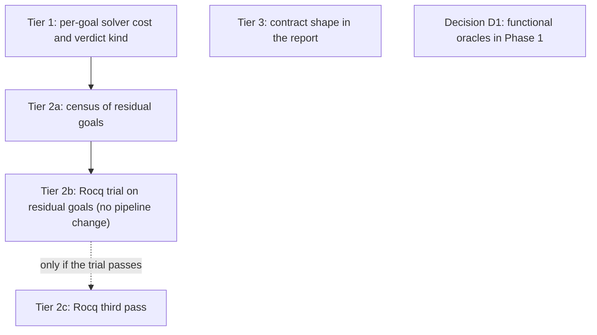

# Proof-Workflow Papers: Generalization Analysis & Ranked Implementation Plan

This document reads five papers on LLM-assisted proof and verified code generation, maps what each one offers onto the Frama-C agentic verification pipeline ([`../guides/v2-design.md`](../guides/v2-design.md), [`../guides/agentic-swarm.md`](../guides/agentic-swarm.md)), and sets out an implementation plan **ordered by expected value**. It follows the format of [`./archive/papers-generalization-plan.md`](./archive/papers-generalization-plan.md) and [`./archive/formal-discovery-plan.md`](./archive/formal-discovery-plan.md), and does not repeat work those two plans already cover. Claims about the pipeline were checked against the scripts on 2026-11-16; every claim about a paper carries the section it comes from.

Limits on the reading and on the checks:

- **Read:** the body of all five papers and the appendices of 1.4. Not read: the reference lists.
- **Not checked in the analysis image:** whether Frama-C 34's WP has a structured per-goal output that carries prover and time (Tier 1 starts with this), and how it hands a goal to an interactive prover through Why3 (Tier 2b starts with this). The image installs `why3.1.8.2` and no Rocq ([`../../Dockerfile`](../../Dockerfile)).
- **Not measured:** what the goals left Unknown by a finished run are made of. Tier 2a is that measurement, and Tier 2b depends on it.

One premise decides most of the mapping. Four of the five papers may change the program or add global lemmas to make a proof go through. The pipeline may do neither: Rule 1 of [`../../skills/framac-wp/prover_brief.md`](../../skills/framac-wp/prover_brief.md) forbids any C token change, and a global `lemma` or a file-scope ghost function is refused at merge. Only mechanisms that survive both rules are planned here.

Three tiers yield work and one item is a decision for the user. Section 3 records what is deliberately not pursued and why.

---

## 1. What each paper does

### 1.1 ProofCoder (Afonso, Lynce, Morisio, Ferreira; `arXiv:2611.14106v1`)

- **Setting:** an agent proves, in Rocq, verification conditions that Frama-C/WP generated from ACSL-annotated C (SV-COMP programs and the Verker Linux-kernel set, both from the AutoRocq benchmark; Section 4.2). This is the pipeline's own toolchain, one step further down.
- **Method (Section 3):** the proof script is an editable artifact. Four tools: read a proof state at any index, run `Search` / `Print` / `Locate`, read the source file, and one edit tool that keeps the first `n` tactic lines and replaces the rest. The agent writes a short diagnosis before each call ("continuous reasoning"). `admit` and changes to the theorem statement are blocked by the harness (Section 3.1).
- **Results (Tables 1 and 2):** on the 200 SV-COMP lemmas with the highest term count, 120 proved (60.0%) against 94 (47.0%) for AutoRocq, at 0.084 USD and 229 s per lemma on average. By obligation type: 34 of 49 assert reachability, 25 of 30 signed overflow, 61 of 121 loop invariant. On 80 Verker lemmas, 48 against 38.
- **Ablations (Table 3):** restarting the proof after every failure instead of repairing its suffix drops SV-COMP from 120 to 81. Replacing the running diagnosis with a plan tool drops it from 119 to 115 and more than doubles the cost.
- **Stated limit (Sections 4.2 and 7):** the benchmark has no ground-truth proofs, so some goals may be unprovable; 88 of the 200 were known solvable beforehand. Budget per lemma: 200k non-cached tokens, 30 minutes.

### 1.2 VeriGen-C (Wang, Li, Sun, Cai; `arXiv:2610.30725v1`)

- **Setting:** from a natural-language requirement, generate a C function and its ACSL contract together and prove them with Frama-C/WP (Section II-B).
- **Method (Section III):** generate code that exposes "proof anchors" (named counters, flags, witnesses); on a WP failure, diagnose and route to specification-only repair first, and to joint code-and-specification repair only after two specification attempts and evidence that the code shape blocks the proof (Algorithm 1). A final check rejects proved contracts that hold only safety, frame, nullability or range clauses ("shell-only") or that contradict the requirement (Section III-C).
- **Results (Tables IV to VI):** proved-and-aligned success of 44.5%, 80.0% and 58.7% on three benchmarks, against 5.5%, 44.3% and 6.5% one-shot. Without the generation guidance, 19.0% to 37.8% of WP-passing artifacts are shell-only. Without diagnosis (every failure goes to joint repair), 45.0% to 79.3% are.
- **Verifier configuration (Section IV-A):** `Typed+real`, Alt-Ergo and Z3, 8 s per goal, single functions over scalars, arrays and small structs.

### 1.3 LLM-Assisted Verification in Dafny (Wesselink, Huizing, van de Wetering; `arXiv:2611.16886v1`)

- **Setting:** from published pseudocode to a verified Dafny implementation, with a human approving the contract and steering when the agent stalls (Section 4).
- **Method:** ten steps. The ones that matter here: candidate invariants are tested on executions before any proof (truth test, counterexample-to-induction test, drop test; Section 5); verifier runs are measured per obligation to find the expensive ones (Section 5, "Solver diagnostics"); proofs are restructured with small lemmas, opaque predicates and per-assertion isolation (Section 6).
- **Results (Table 2):** 37 algorithms, 74,539 lines, 2,371 lemmas. Opaque predicates with proofs moved into lemmas were the most effective technique: 11 of 11 documented uses ended in a verified method (Section 6). In seven failures re-examined after every performance technique had been tried, the statement was false (Section 6).
- **Evidence (Sections 9.3 and 9.4):** three algorithms stalled for weeks and resumed after the solver measurements were added. The paper states that it has no controlled comparison and does not isolate the contribution of any component.

### 1.4 Agentic Verified Optimization (Ye, Ghai, Qin, Song, Kong; `arXiv:2610.30188v1`)

- **Setting:** in Lean 4, an agent writes a faster implementation and a proof that it equals the existing one. Since few real applications are written in Lean, a second system (Aqueduct) ports C, C++, Go and Rust programs to Lean and checks each port by differential testing (Sections 3 and 4.2).
- **Results:** 156 of 189 standalone functions improved; on 17 ported applications, 92 proved rewrites and 47 of 51 scenarios faster (Section 5).
- **Ablation of the porting workflow (Appendix C, Fig. 6):** 87.68% of the original behaviour recovered by the full workflow, 72.96% with one porting strategy instead of three, 77.88% and 77.63% without coverage or mutation feedback, 68.17% for a single agent, 53.32% for the same tools run as a fixed sequence of phases.

### 1.5 From Formal Methods to Fuzzing and Back (Donaldson; `arXiv:2611.12338v1`)

An invited-talk perspective with no new experiment. Its claims that bear on the pipeline:

- Fuzzing scales where proof does not, and the oracle is where the two fields meet: metamorphic and differential oracles find functional bugs that crash oracles cannot (Section 4).
- A proof checker cannot catch a wrong specification, so specifications must be reviewed and tested, "including via fuzzing" (Section 7, "Proof scale").
- SMT-based verification is unstable under irrelevant changes, and repairing proofs after such a change is work an agent can do (Sections 2 and 7).
- Formal tools are software and have bugs that fuzzing finds; Csmith found fifty in Frama-C (Section 6).

---

## 2. Mapping onto the pipeline

| Paper mechanism | Pipeline counterpart | Where |
| :--- | :--- | :--- |
| Rocq agent on goals SMT cannot discharge (1.1) | **none**: provers are Alt-Ergo, Z3 and CVC5 only; `-wp-auto` tactics were evaluated once and are an open second pass | [`../../scripts/run_wp_function.py`](../../scripts/run_wp_function.py), [`./frama-c-34-option-review.md`](./frama-c-34-option-review.md) |
| Repair the failing suffix, keep the working prefix (1.1, Table 3) | Fixed Step A, B, C order; best-candidate tracker with `restore-best`; only an invariant failing both establishment and preservation is regenerated | [`../../skills/framac-wp/prover_brief.md`](../../skills/framac-wp/prover_brief.md), [`../../scripts/prover_candidates.py`](../../scripts/prover_candidates.py) |
| No `admit`, statement frozen (1.1, 1.3 guardrails, 1.4 Appendix A) | `verify_acsl_only`, `splice_prover_changes`, `check_frame_preserved`, trusted `wp-sweep` | [`../../scripts/acsl_ast.py`](../../scripts/acsl_ast.py), [`../../scripts/workspace_overlay.py`](../../scripts/workspace_overlay.py) |
| Proof anchors and joint code repair (1.2) | **excluded by Rule 1**; in-body ghost variables are the only anchor a prover may add | [`../../skills/framac-wp/prover_brief.md`](../../skills/framac-wp/prover_brief.md) |
| Failure diagnosis routed to a repair kind (1.2, Algorithm 1) | Goal buckets by kind (`step_a_assigns` ... `step_c_contract_postcondition`), established or preserved hints, `next_synthesis_focus` | [`../../scripts/run_wp_function.py`](../../scripts/run_wp_function.py) |
| Shell-only rejection of proved contracts (1.2, Section III-C) | Syntactic `is_trivial_predicate`, doomed-`requires` smoke pass, opt-in mutation check; **nothing reports a proved contract that has no functional clause** (Tier 3) | [`../../scripts/acsl_ast.py`](../../scripts/acsl_ast.py), [`../../scripts/mutation_check.py`](../../scripts/mutation_check.py) |
| Alignment with a natural-language requirement (1.2) | none: the only stated intent is the MetAcsl Layer 3 to 6 properties | [`../guides/v2-design.md`](../guides/v2-design.md) |
| Truth test of candidate invariants on executions (1.3) | Dual-Oracle Guardrail on the Phase 1 corpus at every prover iteration | [`../../scripts/run_eacsl_fuzz.py`](../../scripts/run_eacsl_fuzz.py) |
| Counterexample-to-induction and drop tests (1.3) | Loop seeds: Houdini with WP, then corpus replay of what WP dropped (`FRAMAC_LOOP_SEEDS`, default on) | [`../../scripts/loop_seeds.py`](../../scripts/loop_seeds.py) |
| Per-obligation solver cost to find bottlenecks (1.3) | **none**: goals carry status, kind and property; only a timeout count is kept, and only to trigger the tail retry (Tier 1) | [`../../scripts/run_wp_function.py`](../../scripts/run_wp_function.py) |
| Lemma decomposition, opaque predicates (1.3) | **excluded today**; formal-discovery Tier 7 (deferred) | [`./archive/formal-discovery-plan.md`](./archive/formal-discovery-plan.md) |
| Technique catalogue and lessons reused across proofs (1.3, Section 7) | Specification KB, dead-end ledger, proof carry-forward | [`../../scripts/spec_kb.py`](../../scripts/spec_kb.py), [`../../scripts/proof_carry.py`](../../scripts/proof_carry.py) |
| Deterministic controller decides, agents judge; no agent grades its own work (1.4) | Make and the scheduler decide; independent Crash Verifiers; parent re-verification at merge | [`../../scripts/wp_scheduler.py`](../../scripts/wp_scheduler.py) |
| Portfolio of candidates from different strategies (1.4, Appendix C) | One prover per function, K iterations, candidates ranked within that one agent | [`../../scripts/prover_candidates.py`](../../scripts/prover_candidates.py) |
| Coverage and mutation feedback on the test corpus (1.4) | Per-function coverage reopens the reach gate; mutation check is evaluative only | [`../../scripts/run_eacsl_fuzz.py`](../../scripts/run_eacsl_fuzz.py), [`../../scripts/mutation_check.py`](../../scripts/mutation_check.py) |
| Metamorphic and differential oracles (1.5) | **none**: Phase 1 detects RTE and contract violations (E-ACSL), sanitizer reports and LibFuzzer crashes; the target's tests are used as seeds and their expected outputs are dropped (Section 3, decision D1) | [`../../skills/framac-fuzz/SKILL.md`](../../skills/framac-fuzz/SKILL.md) |
| Fuzzing the formal tools (1.5) | By use: the dual `eacsl+sanitizers` engine and the drafts under [`../upstream/frama-c/`](../upstream/frama-c/README.md) | [`../../scripts/run_eacsl_fuzz.py`](../../scripts/run_eacsl_fuzz.py) |

### 2.1 Verified gaps

1. **A timed-out goal and a quickly refused goal look the same to the prover.** `run_wp_function.py` builds each goal record from the report CSV (`file`, `function`, `line`, `kind`, `status`, `annotation`). The WP log does carry the prover and the time per goal (the script's own comment quotes `[wp] [Unknown] <goal> (Qed 2ms) (CVC5) (Cached) (Model)`), and `_FAILED_GOAL_RE` already reads the goal names, but the tags are used only to find counter-example models. The aggregate `wp_vc_stats.timeouts` triggers the focused tail retry and nothing else. Paper 1.3 reports that this distinction is what separated false statements, missing facts and oversized contexts.
2. **No prover beyond the SMT portfolio.** No script or brief mentions Rocq, Why3 interactive provers or WP proof scripts. A goal the three solvers leave Unknown goes to an LLM prover, which can only change annotations. The `-wp-auto` trial closed 11 of 92 Unknown libseccomp goals, all integer RTE goals, at 2.3 times the run time; 81 stayed Unknown ([`./frama-c-34-option-review.md`](./frama-c-34-option-review.md)).
3. **No census of residual goals.** No report says how many Unknown goals of a finished run are integer RTE, pointer validity, loop invariant or postcondition goals, nor how many timed out. Without it, the value of gap 2 cannot be estimated.
4. **A proved contract with no functional clause is not visible.** The ledger credits `all_proven` per obligation class, which is correct for absence of runtime errors. The report lists trivial Layer 4 to 6 clauses and, when the opt-in mutation check ran, completeness and precision. It does not say which proved functions have a contract made only of `requires`, `assigns` and validity or range `ensures`. Paper 1.2 measured that share at 9.5% to 79.3% depending on how repair is constrained.
5. **Phase 1 has no functional oracle.** See decision D1.

Recorded, not planned: [`../guides/agentic-swarm.md`](../guides/agentic-swarm.md) says WP runs only after a contract holds on every dynamic execution, while the prover brief allows WP first, the guardrail first, or both in parallel. One of the two should be corrected when either file is next edited.

---

## 3. Ranked plan (by expected value)



| Rank | Upgrade | Paper origin | Value | Risk |
| :---: | :--- | :--- | :--- | :--- |
| 1 | Per-goal solver cost and verdict kind | 1.3 (Sections 5, 9.2, 9.3) | Medium-high: a sharper hint on every failed iteration; prerequisite of Tier 2 and of the `-wp-auto` second pass | Low: new report fields and hints |
| 2 | Census of residual goals, then a Rocq trial | 1.1 (Tables 1 to 3) | High if the residual goals are true and SMT-hard; unknown until measured | Low for the census and the trial; medium-high for integration (image, proof storage, sweep) |
| 3 | Contract shape in the report | 1.2 (Section III-C, Table VI) | Low-medium: makes safety-only proofs visible | Low: report only |
| D1 | Functional oracles in Phase 1 | 1.5 (Sections 4 and 6) | Depends on scope: finds bugs no current oracle can | Medium: widens what a finding is |

Tiers 1 and 3 are independent. Tier 2a needs Tier 1's fields. Tier 2b should run on the goals the `-wp-auto` second pass leaves, so that the two are not credited for the same goals.

### Common requirements

The requirements of [`./archive/formal-discovery-plan.md`](./archive/formal-discovery-plan.md) ("Common requirements for every tier") apply unchanged: an A/B environment flag for behaviour changes (added to both wrappers, `docker-compose.yml` and `tests/test_remediation_p2_container.py`), acceptance on a `benchmark.py` run compared with `benchmark_compare.py`, guides and briefs updated in the same change, tests run with `-n auto`. Any pipeline bug found on the way goes into [`../troubleshooting/`](../troubleshooting/README.md) in the same session.

---

### Tier 1: Per-goal solver cost and verdict kind

**Problem.** Gap 1.

**Step 0 (source of the data).** In `framac-analysis:latest`, run WP on one function with a timed-out goal and one with a fast Unknown, and compare what the log tags, the report CSV and any JSON output of WP 34 give per goal (the "JSON outputs" candidate of [`./frama-c-34-option-review.md`](./frama-c-34-option-review.md)). Prefer a structured output if it names the goal, the prover and the time; otherwise parse the log tags that `_FAILED_GOAL_RE` and `_PAREN_TAG_RE` already read. [`./regex-hardening-plan.md`](./regex-hardening-plan.md) applies: a log parser must fail closed, leaving the fields absent when a line does not match.

**Changes.**
- [`../../scripts/run_wp_function.py`](../../scripts/run_wp_function.py):
  - For each goal WP reports as not proved, record `verdict_kind` (`timeout`, `stepout`, `unknown`, `failed`), the provers that answered, `time_ms` and `cached`. The CSV has no goal name, so these attach to a new `unproven_goal_costs` list keyed by WP goal name, with the property name beside it when the name encodes one.
  - Record `slowest_proved_goals`: the five proved goals with the highest time, so a contract that proves at 14 s of a 15 s timeout is visible before it flips.
  - `derive_wp_diagnostic_hints` gains two hints. All provers answered Unknown well under the timeout: the goal is probably false or missing a fact, so read the sequent (`--prop <clause> --dump-goal`) and check the claim with the guardrail before strengthening anything. Every prover timed out: the goal may be true and too large, so isolate it and reduce what it depends on. The thresholds are a fraction of the configured timeout, not constants.
  - A time read from a cached result is marked `cached` and never used for a hint.
- [`../../skills/framac-wp/prover_brief.md`](../../skills/framac-wp/prover_brief.md): two lines in Step C naming the fields and what each kind suggests. Run `python tools/sync_skill_mirrors.py`.
- [`../guides/agentic-swarm.md`](../guides/agentic-swarm.md): the new fields.
- Flag: `FRAMAC_WP_GOAL_COSTS` (default on); off removes the hints and keeps the fields.
- Tests: `tests/test_run_wp_function.py` with log fixtures for each tag form (`Timeout`, `Unknown` with `Qed` time, `Cached`, `Model`, `Degenerated`), an unmatched line, and the cached exclusion.

**Acceptance.** Benchmark A/B on the flag: no fewer functions proved, and fewer prover iterations per proved function. The fields alone are accepted on the tests.

**Not included.** Changing the tail retry, or any per-goal timeout policy. Those wait for the census.

### Tier 2: Residual goals and a Rocq fallback

**Problem.** Gaps 2 and 3. Paper 1.1 is the only one of the five whose evidence is on WP-generated goals, and a per-goal Rocq script needs neither a C change nor a global lemma. What is not known is whether the pipeline's residual goals resemble the benchmark's.

**Tier 2a: census (measurement, one small script).**
- `scripts/wp_residual_census.py`: over a finished run's promoted WP reports, count unproved goals by obligation class, diagnostic bucket and `verdict_kind`, per function and in total, and list the functions that would become `all_proven` if their timed-out goals alone were closed. Output is JSON and a table for the run log.
- Run it on the last libseccomp and libmnl runs once they have been re-run with Tier 1, and record the result under [`../runs/`](../runs/README.md).
- The census also sizes the `-wp-auto` second pass, which needs the same goal list.

**Tier 2b: trial (no pipeline change).**
- Step 0: establish how WP 34 passes a goal to Rocq through Why3 and where the proof script is stored (WP manual under [`../references/`](../references/README.md)). If WP 34 cannot do it with `why3.1.8.2`, stop and record that here.
- Build a trial image from the analysis image with Rocq added and the Why3 configuration regenerated. The production image is not changed.
- Sample at most 30 residual goals from the census: only goals in functions whose other goals are proved, spread over the obligation classes, after the `-wp-auto` strategies have been tried on them.
- One agent per goal with the interface of paper 1.1 (inspect a proof state, query, edit from an index) and its budget (30 minutes, 200k non-cached tokens). The goal statement is frozen; `admit`, `Admitted` and new axioms are rejected by a check on the script, and the proof is replayed by WP from a clean session before it counts.
- Record per goal: closed or not, time, tokens, obligation class, and for the failures whether the agent judged the goal false. A goal judged false is handed to the existing Breaker path by hand, since that is a contract or code question, not a proof question.

**Go or no-go.** Go if at least a third of the sampled goals are closed and at least three functions become `all_proven` that were not. Otherwise record the result and stop; the agents' "false goal" judgements are still useful input for the prover brief.

**Tier 2c: integration (only after a go; a milestone, not a patch).**
- A third pass in `run_wp_function.py` after the SMT run and the `-wp-auto` pass, restricted to named goals, under its own wall budget sized from the trial's measured times.
- Proof scripts are stored in the run directory per function, keyed by the goal's digest. They never enter the target tree or the C file.
- Evidence records which goals were closed by a script. The trusted `wp-sweep` replays the scripts and re-proves; a script that no longer replays makes the goal unproved again.
- `proof_carry.py` adds the scripts to the published value and the Rocq version to the toolchain identity.
- The allowlist of memory models is unchanged: a script proves a goal generated under `Typed` or `Bytes`, nothing else.
- Rocq goes into the production image only at this point.

### Tier 3: Contract shape in the report

**Problem.** Gap 4.

**Changes.**
- [`../../scripts/acsl_ast.py`](../../scripts/acsl_ast.py): `contract_shape(function_contract) -> "functional" | "safety_only" | "not_applicable"`.
  - `functional`: at least one non-trivial `ensures` (by `is_trivial_predicate`) relates an output to an input: it mentions `\result`, `\old(...)`, or the content of a location named in `assigns`, and is not only a validity, initialization, separation or constant-range predicate on it.
  - `not_applicable`: a `void` function with `assigns \nothing`.
  - `safety_only`: everything else.
  - The test is syntactic and says so, like the trivial-clause detection.
- [`../../scripts/run_wp_function.py`](../../scripts/run_wp_function.py): record `limits.contract_shape` on an `all_proven` result.
- [`../../scripts/generate_report.py`](../../scripts/generate_report.py): under the verdict limits, the count of proved functions per shape and the list of `safety_only` ones, with one sentence stating that absence of runtime errors is fully credited for them and that their callers learn nothing about their results.
- No flag: it changes no status, rank or gate.
- Tests: `tests/test_acsl_ast.py` (each shape, a range-only `ensures \result >= 0`, a behavior-scoped functional clause), and a report test beside the existing `generate_report` cases in `tests/test_mutation_check.py` (there is no `tests/test_generate_report.py`).

**Later, only with data.** If the report shows that `safety_only` callees are a frequent source of strengthening requests, feed the shape to the candidate rank or to the Header Architect brief. Not before.

*Measured on 2026-11-18 (Tier 2, Step 0 of [`./archive/harness-and-spec-papers-generalization-plan.md`](./archive/harness-and-spec-papers-generalization-plan.md), counts in its Section 6): the data cannot answer yet, so this stays "not before".*

- Six finished runs hold 305 strengthening requests: 273 filed by the scheduler (`caller needs a contract`) and 32 by provers, of which 5 are structural rejections. That leaves 27.
- None of the 27 has a callee contract shape from before the request. 26 come from QCBOR runs that predate `limits.contract_shape`, and the one from libmodbus run-1 names a callee with no WP report.
- Only libmodbus run-1 has the field: 41 proved functions, 24 `functional` and 17 `safety_only`; of the 18 that have a caller, 12 and 6.
- By content, 24 of the 27 ask for a first contract on a callee that has none, and none asks to strengthen a proved contract.
- This is not evidence that `safety_only` callees cost nothing: in libmodbus run-1, 53 provers ended `stalled_after_k_retries` and one filed a request.

*Second measurement on 2026-11-18 (Section 7 of the same plan): the 53 stalled provers of libmodbus run-1 were read. Still "not before".*

- None was held up by a postcondition missing from a proved contract. 29 call no function of the target, so they had no callee to ask. At most 14 had a callee with a proved contract at dispatch, at most 35 pairs in all (23 `functional`, 12 `safety_only`).
- All but 2 of those pairs are calls through the backend function-pointer table, where WP never applies the callee's contract, so this run could hardly have shown the effect. A target whose stalled callers call proved callees directly is still needed.
- The 17 stalled provers of QCBOR run-6 were read with the same rule: none either. Two had a proved callee at dispatch, and their gaps are casts and shifts under the Typed model.
- Over both runs, 8 of 129 dispatched provers had a directly called callee with a proved contract, and 38 of the 44 provers that merged are leaves. This is partly by design: a caller is released as soon as its callee has a contract, proved or not (`_compute_deps`), so the contract a caller meets is usually the initial one. A shape recorded on `all_proven` reports therefore rarely describes what a caller saw.
- One observation on the shape itself: `_modbus_tcp_build_request_basis` is `safety_only` by this tier's definition, and its contract states the constant result length that its callers need. The label is a coarse proxy for what a caller lacks.

### Decision D1: functional oracles in Phase 1

**The gap.** Phase 1 reports an input only when it triggers a runtime error, a contract violation, a sanitizer report or a crash. A decoder that returns a wrong value without undefined behaviour is invisible. Paper 1.5 argues that metamorphic and differential oracles are what let fuzzing find such bugs. The manual differential test in [`../bugs-found/minmea/README.md`](../bugs-found/minmea/README.md) is the only precedent in the repository.

**Why it is a decision and not a tier.** The pipeline's findings are memory-safety and contract defects with a reproducible witness. A round-trip mismatch is a functional defect: it needs a statement of intended behaviour that no layer derives today, its severity is not comparable, and the Crash Verifier's rules were not written for it.

**Options.**
- **A. Leave Phase 1 as it is.** No cost. Functional bugs stay out of scope.
- **B. Harness-level properties, tried by hand on one target first.** For one codec target (minmea or QCBOR), write a round-trip or known-answer `//@ assert` in a copy of the generated harness, run it with the existing E-ACSL engine, and see what it reports and how much of it is real. No pipeline change. If it finds something a maintainer would fix, plan a `functional` candidate class that goes to `needs_validation` and is never auto-confirmed.
- **C. Differential builds** (the same input through an `-O0` and an `-O2` build, outputs compared). Finds undefined behaviour that the E-ACSL build already detects more directly; low expected yield.

**Recommendation.** B, as a one-target trial recorded under [`../runs/`](../runs/README.md), after Tiers 1 and 3.

### Not pursued

| Item | Reason |
| :--- | :--- |
| Proof anchors and joint code-and-specification repair (1.2) | They change the C code. Rule 1 stands. |
| The pass rates of 1.2 as an estimate for the pipeline | Obtained under `Typed+real`, which the pipeline classes as `unsound_proof`, with an 8 s timeout on single small functions. |
| Requirement alignment against natural language (1.2) | The pipeline has no natural-language requirement per function. Tier 3 keeps the deterministic part of the check. |
| Lemma decomposition and opaque predicates (1.3) | Formal-discovery Tier 7, deferred there until the count of `inductive lemma required` gaps justifies it. Paper 1.3 supports its value for functional proofs of algorithms and gives no ablation. |
| Counterexample-to-induction test by state perturbation (1.3) | It needs an executable model whose state can be set freely. WP's preservation goal with counter-examples and the loop-seed corpus replay cover the same question on C. |
| A "reason before each edit" rule in the prover brief (1.1) | The ablation removed reasoning from a constrained harness. The pipeline's provers are general agents; nothing shows they skip it. |
| A portfolio of provers per function (1.4, Appendix C) | The evidence is for porting programs, where candidates differ structurally. Here it would multiply prover cost by the portfolio size. Revisit only if Tier 2a shows many functions stalled on invariant choice. |
| Relaxing the fixed Step A, B, C order (1.1, 1.4) | The order encodes a dependency (frame before invariants before contracts), and phases already feed back through breakers, the reach gate and negotiation. |
| Verified optimization and migration to Lean (1.4) | A different task: the pipeline neither rewrites nor ports the target. |
| Proof-instability testing by repeated runs (1.5) | The `wp-sweep` re-proof and `carried_forward_reproven` already detect a proof that stops holding. Tier 1's `slowest_proved_goals` shows which ones are close to the timeout. |

---

## 4. Verification commands

```powershell
$env:PYTHONIOENCODING="utf-8"
python -m pytest tests/test_run_wp_function.py tests/test_acsl_ast.py tests/test_mutation_check.py tests/test_docs_structure.py -n auto
```

Then the full suite and static checks ([`../../skills/python-patterns/SKILL.md`](../../skills/python-patterns/SKILL.md)):

```powershell
$env:PYTHONIOENCODING="utf-8"
python -m pytest tests -n auto
python -m ruff check scripts tests
python -m mypy scripts tests
python tools/check_generated_text.py
```

And, for Tier 1, a benchmark run compared against the previous baseline:

```powershell
python scripts/benchmark_compare.py <baseline.json> <candidate.json>
```
