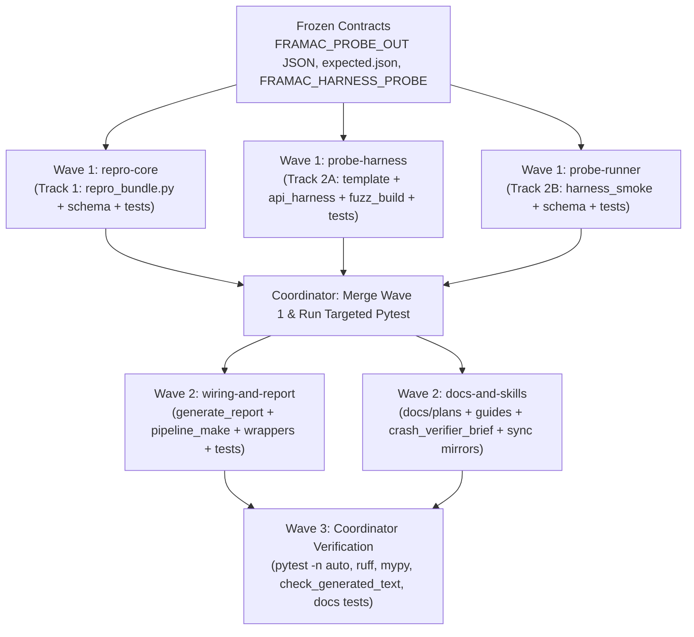

# STITCH++ Reuse Plan: Standalone C Reproducer Oracle & Per-Case Probe Telemetry

- **Status:** Active (Wave 1 merged into `main` in `00120d43`; Wave 2 wiring/reporting and docs/skills merged; Track 2 Step 0 validation passed on real QCBOR `libqcbor_a` — 244 cases, 225 `healthy`, 19 `constant_return`, 0 quarantined — and `FRAMAC_HARNESS_PROBE` flipped to default `on`).
- **Source:** Mechanisms adapted from STITCH++ (`stitch-fuzz` v0.2.0) without adopting its C++17 stub runtime or Docker lifecycle.
- **Related plans:** [`./backlog.md`](./backlog.md#1h-api-sequence-fuzzing-paper-archiveapi-sequence-fuzzing-papers-generalization-planmd), [`./archive/api-sequence-fuzzing-papers-generalization-plan.md`](./archive/api-sequence-fuzzing-papers-generalization-plan.md), [`./fuzz-budget-design.md`](./fuzz-budget-design.md).

---

## 1. Goal & Scope

This plan brings two mechanisms from STITCH++ into the Frama-C verification pipeline:

1. **Track 1 — Standalone C Reproducer + `try` Oracle + Frozen Disclosure Bundle ([`../../scripts/repro_bundle.py`](../../scripts/repro_bundle.py)):**
   - Adapts STITCH++'s `write` -> `try` -> `report` workflow for `confirmed` findings in `findings.json` (or candidates with `--allow-candidate`).
   - Generates a standalone plain-C `main(void)` reproducer from a dispatch crash artifact, provides a deterministic `try` oracle (`SAME_CRASH`, `DIFFERENT_CRASH`, `NO_CRASH`, `COMPILE_ERROR`) against [`../../scripts/failure_identity.py`](../../scripts/failure_identity.py) fingerprints so an agent can iteratively shrink the reproducer to plain library calls, and packages a verified, frozen maintainer bundle (`repro.c`, `Dockerfile`, `run.sh`, `ISSUE.md`).
2. **Track 2 — Per-Case Probe Telemetry ([`../../templates/harness_dual.c.template`](../../templates/harness_dual.c.template), [`../../scripts/api_harness.py`](../../scripts/api_harness.py), [`../../scripts/fuzz_build.py`](../../scripts/fuzz_build.py), [`../../scripts/harness_smoke.py`](../../scripts/harness_smoke.py)):**
   - Adapts STITCH++'s `stitch probe` diagnostics to address the open *"Entry points reached only on their refusal path"* gap in [`./backlog.md`](./backlog.md#1h-api-sequence-fuzzing-paper-archiveapi-sequence-fuzzing-papers-generalization-planmd).
   - Adds a fuzz-only, zero-control-flow-change telemetry macro that records per-case execution counts, initializer failures, and return-value diversity (`unique_vals`), enabling [`../../scripts/harness_smoke.py`](../../scripts/harness_smoke.py) to classify active dispatch cases as `never_reached`, `init_always_fails`, `constant_return`, `low_samples`, or `healthy` without altering Eva, E-ACSL, or call-after-error fuzzing paths.

### Design Constraints

- **A/B flag defaults:** Track 2 is controlled by `FRAMAC_HARNESS_PROBE` (default **`on`**; `=off` for A/B rollback) after Step 0 validation on real QCBOR `libqcbor_a` (244 cases: 225 `healthy`, 19 `constant_return`, 0 quarantined) confirmed refusal-path cases land in `constant_return` without false positives on healthy cases. Track 1 ([`../../scripts/repro_bundle.py`](../../scripts/repro_bundle.py)) is an explicit CLI tool invoked on demand and changes nothing in Phases 0-3.
- **No third fuzz binary for Track 2:** Rather than compiling a separate probe binary, [`../../scripts/fuzz_build.py`](../../scripts/fuzz_build.py) passes `-DFRAMAC_FUZZ_PROBE_TELEMETRY` to the existing `.san` sanitizer build when `FRAMAC_HARNESS_PROBE=on`. At runtime, recording macros are a single branch unless `FRAMAC_PROBE_OUT=<path>` is set, and they are compiled out under `__FRAMAC__` (Eva and E-ACSL).
- **Report-only telemetry:** Track 2 probe classifications (`never_reached`, `init_always_fails`, `constant_return`) are **advisory diagnostics** surfaced in `workspace/reports/smoke/<module>.json` and `REPORT.md`. They never quarantine cases or block Phase 1/2/3.

---

## 2. Swarm Execution Topology & File Ownership

Work is structured into three waves with disjoint file ownership so parallel workers execute without merge conflicts.



| Wave | Worker | Exclusive File Ownership |
| :---: | :--- | :--- |
| **1** | `repro-core` | [`../../scripts/repro_bundle.py`](../../scripts/repro_bundle.py), [`../../schemas/repro_expected.schema.json`](../../schemas/repro_expected.schema.json), [`../../tests/test_repro_bundle.py`](../../tests/test_repro_bundle.py) |
| **1** | `probe-harness` | [`../../templates/harness_dual.c.template`](../../templates/harness_dual.c.template), [`../../scripts/api_harness.py`](../../scripts/api_harness.py), [`../../scripts/fuzz_build.py`](../../scripts/fuzz_build.py), [`../../tests/test_probe_harness_emit.py`](../../tests/test_probe_harness_emit.py) |
| **1** | `probe-runner` | [`../../scripts/harness_smoke.py`](../../scripts/harness_smoke.py), [`../../schemas/smoke_probe.schema.json`](../../schemas/smoke_probe.schema.json), [`../../tests/test_harness_probe.py`](../../tests/test_harness_probe.py) |
| **2** | `wiring-and-report` | [`../../scripts/generate_report.py`](../../scripts/generate_report.py), [`../../scripts/pipeline_make.py`](../../scripts/pipeline_make.py), [`../../wrappers/framac-docker.sh`](../../wrappers/framac-docker.sh), [`../../wrappers/framac-docker.ps1`](../../wrappers/framac-docker.ps1), [`../../tests/test_remediation_p2_container.py`](../../tests/test_remediation_p2_container.py), [`../../tests/test_report.py`](../../tests/test_report.py) |
| **2** | `docs-and-skills` | `./stitch-plusplus-reuse-plan.md`, [`./README.md`](./README.md), [`./backlog.md`](./backlog.md), [`../guides/resources-and-caching.md`](../guides/resources-and-caching.md), [`../guides/v2-design.md`](../guides/v2-design.md), [`../../skills/framac-wp/crash_verifier_brief.md`](../../skills/framac-wp/crash_verifier_brief.md) (+ synced mirrors via [`../../tools/sync_skill_mirrors.py`](../../tools/sync_skill_mirrors.py)) |

---

## 3. Frozen Inter-Worker Contracts

### Contract 1: `FRAMAC_PROBE_OUT` Telemetry File Format

When the `.san` binary is built with `-DFRAMAC_FUZZ_PROBE_TELEMETRY` and run with `FRAMAC_PROBE_OUT=/path/to/probe.json`, an `atexit` handler writes one JSON object (validated by [`../../schemas/smoke_probe.schema.json`](../../schemas/smoke_probe.schema.json), including only cases with `runs > 0`):

```json
{
  "schema_version": 1,
  "cases": {
    "0": {
      "runs": 64,
      "init_fail": 0,
      "ret_kind": "i64",
      "unique_overflow": false,
      "unique_vals": [0, 14]
    },
    "7": {
      "runs": 64,
      "init_fail": 0,
      "ret_kind": "i64",
      "unique_overflow": false,
      "unique_vals": [27]
    },
    "12": {
      "runs": 64,
      "init_fail": 64,
      "ret_kind": "void",
      "unique_overflow": false,
      "unique_vals": []
    }
  }
}
```

- `ret_kind`: `"void"` | `"i64"` | `"ptr"` (for pointers, `0` = `NULL`, `1` = non-`NULL`).
- `unique_vals`: up to `8` distinct `int64_t` values observed; if a 9th distinct value appears, `unique_overflow` becomes `true`.
- When `FRAMAC_PROBE_OUT` is unset or empty, the `atexit` handler is never registered and recording macros return immediately.

### Contract 2: `FRAMAC_HARNESS_PROBE` Environment Variable

- Canonical helper `harness_probe_enabled() -> bool` in [`../../scripts/harness_smoke.py`](../../scripts/harness_smoke.py) (and mirrored in [`../../scripts/api_harness.py`](../../scripts/api_harness.py), [`../../scripts/fuzz_build.py`](../../scripts/fuzz_build.py), and [`../../scripts/pipeline_make.py`](../../scripts/pipeline_make.py) via `_OFF_VALUES = frozenset({"off", "0", "false", "no"})`):
  - **Default:** `on` (disabled only when `FRAMAC_HARNESS_PROBE` is one of `off`, `0`, `false`, `no`, case-insensitive).
  - Forwarded in [`../../wrappers/framac-docker.sh`](../../wrappers/framac-docker.sh) and [`../../wrappers/framac-docker.ps1`](../../wrappers/framac-docker.ps1).

### Contract 3: `expected.json` Schema (Track 1)

Validated by [`../../schemas/repro_expected.schema.json`](../../schemas/repro_expected.schema.json):

```json
{
  "schema_version": 1,
  "fingerprint": "src/foo.c#parse::mem_access::a1b2c3d4e5",
  "module": "libfoo",
  "engine": "sanitizers",
  "kind": "heap-buffer-overflow",
  "file": "src/foo.c",
  "line": 142,
  "function": "parse",
  "predicate": "heap-buffer-overflow READ of size 4",
  "frames_top": ["parse", "decode_entry"],
  "case_selector": 3,
  "artifact_sha256": "..."
}
```

---

## 4. Component Design

### Component 1 (Wave 1, `repro-core` — Done): Standalone C Reproducer & `try` Oracle

- **[`../../scripts/repro_bundle.py`](../../scripts/repro_bundle.py):** stdlib-only Python 3.10+ CLI with three subcommands:
  - `scaffold`: takes `--run-dir`, `--fingerprint`, `--out`, optional `--artifact`, `--engine auto|sanitizers|eacsl`, `--allow-candidate`. Locates the verdict in `findings.json` (or `candidates.json` with `--allow-candidate`), resolves `workspace/harnesses/harness_<module>.json` and `workspace/reports/build_capture.json`, reads the minimized crash artifact (`.min` if present, else the recorded reproducer), decodes the dispatch selector via [`../../scripts/generate_harness.py`](../../scripts/generate_harness.py) (`dispatch_case_of_bytes`) and extracts the matching `case <k>:` body from `harness_<module>.c` (with clean fallback to a raw `fuzz_buf` array + `LLVMFuzzerTestOneInput` wrapper for non-dispatch harnesses), and writes `expected.json`, `build_spec.json`, and standalone plain-C `repro.c` (`main(void)` with exact-sized `malloc`+`memcpy` buffer to preserve ASan/E-ACSL bounds semantics).
  - `try`: takes `--file`, `--expected`, `--build-spec`, optional `--engine auto|sanitizers|eacsl`, `--timeout`, `--show`, `--json`. Compiles `<file>` without libFuzzer against captured non-harness sources and `ldflags` via [`../../scripts/fuzz_build.py`](../../scripts/fuzz_build.py), executes under [`../../scripts/sandbox_exec.py`](../../scripts/sandbox_exec.py) (`Limits(cpu_seconds=timeout*2, ignore_sigpipe=True)`, `RLIMIT_CORE=0`, `SANITIZER_RUNTIME_ENV`), parses output with [`../../scripts/failure_identity.py`](../../scripts/failure_identity.py), and classifies against `expected.json`:
    - `SAME_CRASH` (exit `0`): exact fingerprint match or same normalized `(kind, function, basename(file))`.
    - `DIFFERENT_CRASH` (exit `1`): any other crash, abort, or timeout.
    - `NO_CRASH` (exit `1`): exit code `0` without failure.
    - `COMPILE_ERROR` (exit `2`): compilation failure.
  - `package`: takes `--file`, `--expected`, `--build-spec`, `--out`, optional `--finding-json`, `--engine`, `--timeout`, `--skip-verify`. Runs `try` first unless `--skip-verify` and refuses to package if status != `SAME_CRASH`. Emits LF-terminated `repro.c`, `Dockerfile`, `run.sh`, and `ISSUE.md`.
- **Schema & tests:** [`../../schemas/repro_expected.schema.json`](../../schemas/repro_expected.schema.json), [`../../tests/test_repro_bundle.py`](../../tests/test_repro_bundle.py).

### Component 2 (Wave 1, `probe-harness` — Done): Fuzz-Only Probe Telemetry in Harness & Build

- **[`../../templates/harness_dual.c.template`](../../templates/harness_dual.c.template):** guarded `#if !defined(__FRAMAC__) && defined(FRAMAC_FUZZ_PROBE_TELEMETRY)` block defining `FRAMAC_PROBE_CASE_START(c)`, `FRAMAC_PROBE_INIT_FAIL(c)`, `FRAMAC_PROBE_RET_I64(c, v)`, and `FRAMAC_PROBE_RET_PTR(c, p)` plus the `atexit` JSON flusher. Compiled to `((void)0)` under `__FRAMAC__` or without `-DFRAMAC_FUZZ_PROBE_TELEMETRY`.
- **[`../../scripts/api_harness.py`](../../scripts/api_harness.py):** emits probe macros while preserving the one-line-per-case C invariant (recording case start, init-guard failures, and pointer/integer/enum return values; leaving `void`/struct/float returns as `ret_kind = "void"`).
- **[`../../scripts/fuzz_build.py`](../../scripts/fuzz_build.py):** adds `-DFRAMAC_FUZZ_PROBE_TELEMETRY` to `.san` fuzzer builds only when `FRAMAC_HARNESS_PROBE` is enabled (automatically folding into the build cache key) and never to E-ACSL or Eva builds.
- **Tests:** [`../../tests/test_probe_harness_emit.py`](../../tests/test_probe_harness_emit.py).

### Component 3 (Wave 1, `probe-runner` — Done): Probe Pass & Classification in `harness_smoke.py`

- **[`../../scripts/harness_smoke.py`](../../scripts/harness_smoke.py):** adds `harness_probe_enabled()` (default `on`; `=off` disables), `--probe-secs <int>` (default `5` when enabled, `0` otherwise), and `_run_health_probe(...)` after a clean or degraded dispatch smoke pass. Runs `.san` under [`../../scripts/sandbox_exec.py`](../../scripts/sandbox_exec.py) with `FRAMAC_PROBE_OUT`, `FRAMAC_FUZZ_SKIP_CASES`, `-ignore_crashes=1`, and per-case selector seeds, then classifies every active (non-quarantined) dispatch case:
  - `never_reached`: `runs == 0`.
  - `init_always_fails`: `runs > 0` and `init_fail == runs`.
  - `constant_return`: `runs >= 20`, `ret_kind != "void"`, `not unique_overflow`, and `len(unique_vals) == 1` (records `constant_value`).
  - `low_samples`: `0 < runs < 20` and `len(unique_vals) <= 1`.
  - `healthy`: otherwise.
  Attaches an optional `"probe"` block to `workspace/reports/smoke/<module>.json` without altering the smoke exit code or quarantining cases.
- **Schema & tests:** [`../../schemas/smoke_probe.schema.json`](../../schemas/smoke_probe.schema.json), [`../../tests/test_harness_probe.py`](../../tests/test_harness_probe.py).

### Component 4 (Wave 2, `wiring-and-report`): Report Rendering, Make Wiring & Wrappers

- **[`../../scripts/generate_report.py`](../../scripts/generate_report.py):** appends an advisory **"Harness Probe Health (Advisory)"** subsection to `harness_smoke_lines()` when any smoke report contains flagged probe cases.
- **[`../../scripts/pipeline_make.py`](../../scripts/pipeline_make.py):** forwards `FRAMAC_HARNESS_PROBE` into the Make smoke recipe (`--probe-secs 5` when enabled).
- **[`../../wrappers/framac-docker.sh`](../../wrappers/framac-docker.sh) & [`../../wrappers/framac-docker.ps1`](../../wrappers/framac-docker.ps1):** add `FRAMAC_HARNESS_PROBE` to the forwarded knob allowlist beside `FRAMAC_HARNESS_SMOKE`.
- **Tests:** [`../../tests/test_remediation_p2_container.py`](../../tests/test_remediation_p2_container.py), [`../../tests/test_report.py`](../../tests/test_report.py).

### Component 5 (Wave 2, `docs-and-skills`): Documentation & Brief Updates

- Record this plan in `./stitch-plusplus-reuse-plan.md`, register it in [`./README.md`](./README.md), and link it from Section 1h of [`./backlog.md`](./backlog.md).
- Document `FRAMAC_HARNESS_PROBE` (default `on`; `=off` disables) and [`../../scripts/repro_bundle.py`](../../scripts/repro_bundle.py) in [`../guides/resources-and-caching.md`](../guides/resources-and-caching.md) and [`../guides/v2-design.md`](../guides/v2-design.md).
- Add a concise note in [`../../skills/framac-wp/crash_verifier_brief.md`](../../skills/framac-wp/crash_verifier_brief.md) pointing to `repro_bundle.py` (`scaffold` / `try` / `package`) for standalone plain-C upstream reproducers, and sync mirrors with [`../../tools/sync_skill_mirrors.py`](../../tools/sync_skill_mirrors.py).

---

## 5. Verification Plan & Step 0 Acceptance

### Automated Gate (Wave 3)

```powershell
$env:PYTHONIOENCODING="utf-8"
python -m pytest tests/test_repro_bundle.py tests/test_probe_harness_emit.py tests/test_harness_probe.py tests/test_report.py tests/test_remediation_p2_container.py tests/test_docs_structure.py tests/test_sync_skill_mirrors.py -n auto
python -m pytest tests -n auto
python -m ruff check scripts tests
python -m ruff format --check scripts tests
python -m mypy scripts tests
python tools/check_generated_text.py
python tools/sync_skill_mirrors.py --check
```

### Step 0 Manual Validation (Post-Merge, Docker)

1. **Track 1 (`repro_bundle.py`) end-to-end check in `framac-analysis:latest`:** run `repro_bundle.py scaffold` + `try` + `package` on a confirmed finding (or seeded benchmark target) and confirm `try` prints `SAME_CRASH` (exit `0`), a fixed `min.c` prints `NO_CRASH` (exit `1`), and `package` emits a runnable `Dockerfile` + `run.sh`.
2. **Track 2 (`FRAMAC_HARNESS_PROBE`) Step 0 measurement — Passed:** validated on real QCBOR `libqcbor_a` (244 cases: 225 `healthy`, 19 `constant_return`, 0 quarantined); refusal-path cases landed in `constant_return` with zero quarantines, so `FRAMAC_HARNESS_PROBE` was flipped from default `off` to default `on` (`=off` retains A/B rollback).
